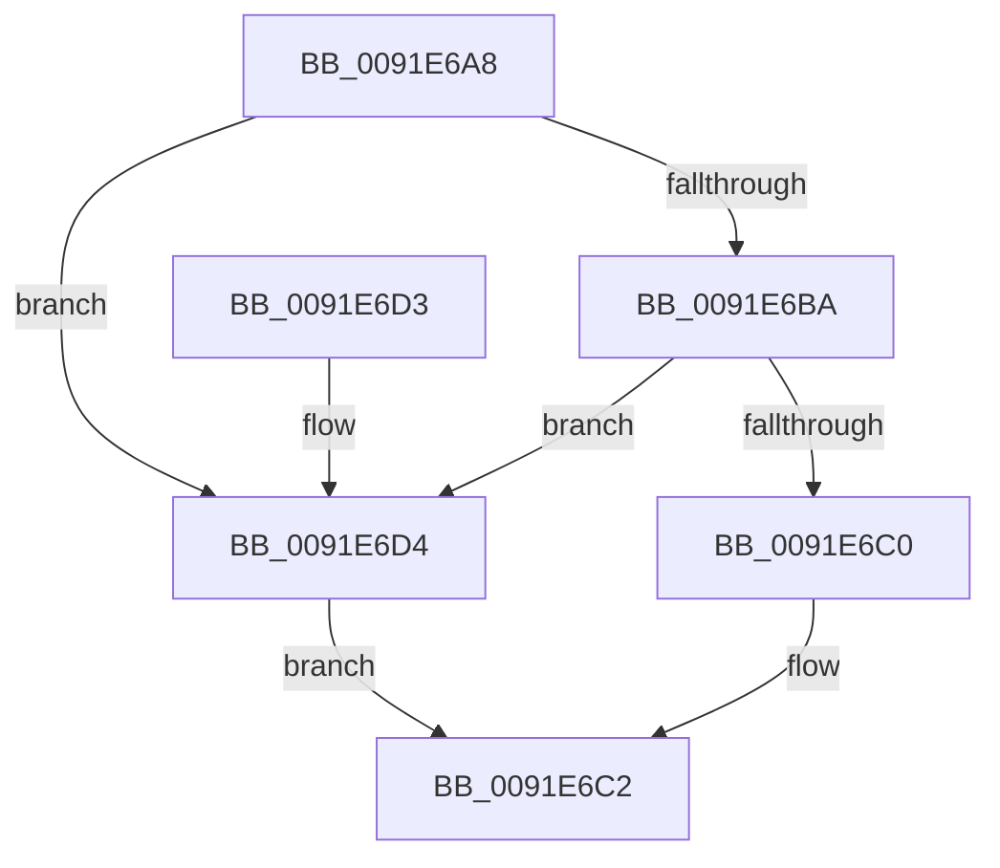

# ObNormalizeHandleValue

- RVA: `0x0091E6A8`–`0x0091E6D8` (길이 `48` bytes)
- VA: `0x000000014091E6A8`
- 실행 섹션: `PAGE`
- PDB 이름 있음: `예`; PDB Function 태그: `아니요`
- unwind 정보 RVA: `0x000DB714`
- 디코드: `17`개 명령, `48/48` bytes 표시
- 미해석 바이트: `0` (있으면 어셈블리에 `.byte`로 보존)

> 이 문서는 커널 이미지의 기계어와 PDB 기호를 분석해 생성했습니다. 4번과 5번은 함수 원형과 자료형을 바이너리 사용 방식에서 추정한 C 해석이며 원본 소스 복구 결과는 아닙니다.

## 1. Dependencies

- 직접 호출 지점: **0**; 고유 호출 대상: **0**
- 직접 호출자로 확인된 함수: **9**
- RIP 상대 이미지 참조: **0**

### Outgoing calls
- 직접 디코드된 call 명령이 없습니다.

### Direct callers
- [SeAdtRegistryValueChangedAuditAlarm](../79/SeAdtRegistryValueChangedAuditAlarm_function_0079DDD4.md) at `0x0079E1ED`
- [SepAdtCloseObjectAuditAlarm](../86/SepAdtCloseObjectAuditAlarm_function_0086B4E8.md) at `0x0086B699`
- [SepAdtPrivilegeObjectAuditAlarm](../86/SepAdtPrivilegeObjectAuditAlarm_function_0086E3F0.md) at `0x0086E671`
- [SepAdtSecurityDescriptorChangedAuditAlarm](SepAdtSecurityDescriptorChangedAuditAlarm_function_0091E3E8.md) at `0x0091E567`
- [SepAdtDeleteObjectAuditAlarm](SepAdtDeleteObjectAuditAlarm_function_0091E824.md) at `0x0091E9BA`
- [SeOperationAuditAlarm](SeOperationAuditAlarm_function_0091EA78.md) at `0x0091ECF4`
- [SepAdtOpenObjectAuditAlarm](SepAdtOpenObjectAuditAlarm_function_0091F23C.md) at `0x0091F4C3`
- [SeAuditHandleDuplication](../AC/SeAuditHandleDuplication_function_00AC1458.md) at `0x00AC1565`
- [SeAuditHandleDuplication](../AC/SeAuditHandleDuplication_function_00AC1458.md) at `0x00AC158C`
- [sub_00B21E9E](../B2/Unknown_function_00B21E9E.md) at `0x00B22008`

### Static image references
- 디코드된 RIP-relative 메모리 참조가 없습니다.

## 2. Other-region calls and transfers

- 다른 실행 섹션으로 향하는 call: **0**
- 별도 외부 분기/꼬리 이동을 확인하지 못했습니다.

## 3. Assembly (complete function range)

```asm
0091E6A8  49 C7 C0 00 00 00 80            mov r8, 0xffffffff80000000
0091E6AF  48 8B C1                        mov rax, rcx
0091E6B2  49 23 C0                        and rax, r8
0091E6B5  49 3B C0                        cmp rax, r8
0091E6B8  75 1A                           jne 0x14091e6d4
0091E6BA  48 83 F9 FD                     cmp rcx, -3
0091E6BE  77 14                           ja 0x14091e6d4
0091E6C0  B2 01                           mov dl, 1
0091E6C2  48 8B C1                        mov rax, rcx
0091E6C5  49 33 C0                        xor rax, r8
0091E6C8  84 D2                           test dl, dl
0091E6CA  48 0F 44 C1                     cmove rax, rcx
0091E6CE  48 83 E0 FC                     and rax, 0xfffffffffffffffc
0091E6D2  C3                              ret
0091E6D3  CC                              int3
0091E6D4  32 D2                           xor dl, dl
0091E6D6  EB EA                           jmp 0x14091e6c2
```

## 4. C-style interpretation (structured pseudocode)

```c
__int64 __fastcall ObNormalizeHandleValue(__int64 a1)
{
    __int64 result;

    result = (a1) & (0xFFFFFFFF80000000ULL);
    if (result != 0xFFFFFFFF80000000ULL) goto loc_0091E6D4;
    if (a1 > -3) goto loc_0091E6D4;
loc_0091E6C2:
    result = (a1) ^ (0xFFFFFFFF80000000ULL);
    if (1 == 0) { result = a1; }
    result = (result) & (-4);
    return result;
loc_0091E6D4:
    a2 = 0;
    goto loc_0091E6C2;
}
```

## 5. (Beta) C Style

```c
int64_t ObNormalizeHandleValue(int64_t Arg1)
{
    int64_t result;

    result = (Arg1) & (0xFFFFFFFF80000000ULL);
    if (result != 0xFFFFFFFF80000000ULL) goto loc_0091E6D4;
    if (Arg1 > -3) goto loc_0091E6D4;
loc_0091E6C2:
    result = (Arg1) ^ (0xFFFFFFFF80000000ULL);
    if (1 == 0) { result = Arg1; }
    result = (result) & (-4);
    return result;
loc_0091E6D4:
    a2 = 0;
    goto loc_0091E6C2;
}
```

## 6. Execution-region graph

[열기: 2D/3D 그래프와 함수 탐색 컨트롤 패널](../../../control-panel.html?section=page&rva=0x0091E6A8&view=graph)

- 2D 그래프는 위에서 아래로 흐르고, 3D 그래프는 빈 공간을 드래그해 회전합니다. Shift+드래그는 이동, 휠은 확대·축소, 함수 노드 선택은 대상 보고서 이동입니다.

### Static fallback


