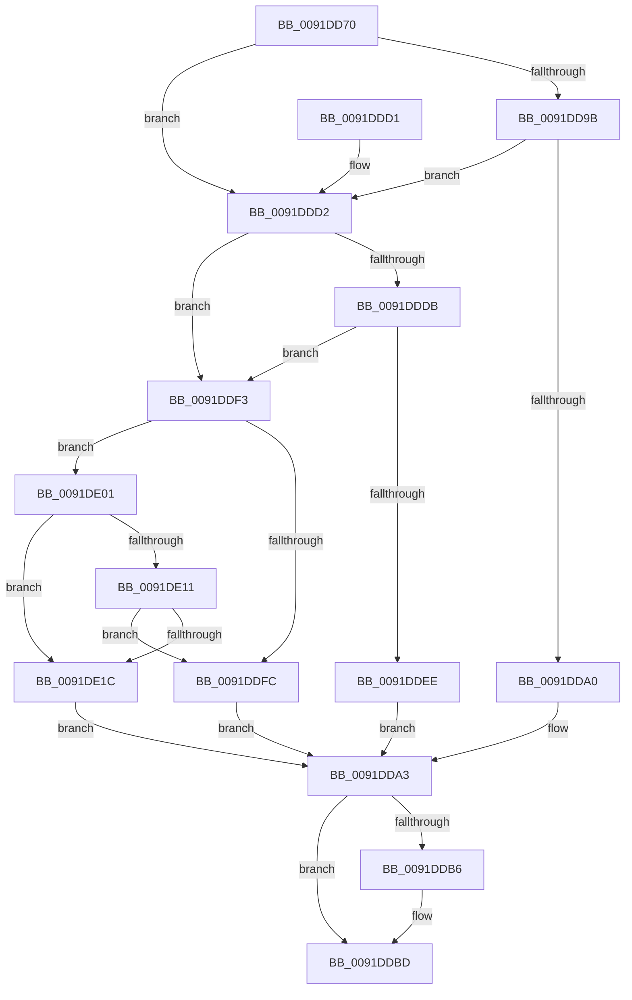

# ObpEnumFindHandleProcedure

- RVA: `0x0091DD70`–`0x0091DE21` (길이 `177` bytes)
- VA: `0x000000014091DD70`
- 실행 섹션: `PAGE`
- PDB 이름 있음: `예`; PDB Function 태그: `아니요`
- unwind 정보 RVA: `0x0008B3A0`
- 디코드: `56`개 명령, `177/177` bytes 표시
- 미해석 바이트: `0` (있으면 어셈블리에 `.byte`로 보존)

> 이 문서는 커널 이미지의 기계어와 PDB 기호를 분석해 생성했습니다. 4번과 5번은 함수 원형과 자료형을 바이너리 사용 방식에서 추정한 C 해석이며 원본 소스 복구 결과는 아닙니다.

## 1. Dependencies

- 직접 호출 지점: **2**; 고유 호출 대상: **2**
- 직접 호출자로 확인된 함수: **1**
- RIP 상대 이미지 참조: **1**

### Outgoing calls
- `0x0091DD8B` → [ExGetHandlePointer](../../text/43/ExGetHandlePointer_function_00430C90.md) (function, `0x00430C90`)
- `0x0091DDB8` → [ExfUnblockPushLock](../../text/2A/ExfUnblockPushLock_function_002A3FE0.md) (function, `0x002A3FE0`)

### Direct callers
- [ExEnumHandleTable](ExEnumHandleTable_function_0091DB20.md) at `0x0091DBFA`

### Static image references
- `0x0091DDE3` → RVA `0x00FC6E4C` (`ALMOSTRO`; read)

## 2. Other-region calls and transfers

- 다른 실행 섹션으로 향하는 call: **2**
  - `0x0091DD8B` → [ExGetHandlePointer](../../text/43/ExGetHandlePointer_function_00430C90.md) (`PAGE` → `.text`)
  - `0x0091DDB8` → [ExfUnblockPushLock](../../text/2A/ExfUnblockPushLock_function_002A3FE0.md) (`PAGE` → `.text`)
- 별도 외부 분기/꼬리 이동을 확인하지 못했습니다.

## 3. Assembly (complete function range)

```asm
0091DD70  48 89 5C 24 08                  mov qword ptr [rsp + 8], rbx
0091DD75  48 89 74 24 10                  mov qword ptr [rsp + 0x10], rsi
0091DD7A  57                              push rdi
0091DD7B  48 83 EC 20                     sub rsp, 0x20
0091DD7F  48 8B F1                        mov rsi, rcx
0091DD82  49 8B F9                        mov rdi, r9
0091DD85  48 8B CA                        mov rcx, rdx
0091DD88  48 8B DA                        mov rbx, rdx
0091DD8B  E8 00 2F B1 FF                  call 0x140430c90
0091DD90  48 8B 17                        mov rdx, qword ptr [rdi]
0091DD93  4C 8B C0                        mov r8, rax
0091DD96  48 85 D2                        test rdx, rdx
0091DD99  74 37                           je 0x14091ddd2
0091DD9B  48 3B D0                        cmp rdx, rax
0091DD9E  74 32                           je 0x14091ddd2
0091DDA0  40 32 FF                        xor dil, dil
0091DDA3  F0 48 FF 03                     lock inc qword ptr [rbx]
0091DDA7  48 8D 4E 30                     lea rcx, [rsi + 0x30]
0091DDAB  F0 83 0C 24 00                  lock or dword ptr [rsp], 0
0091DDB0  48 83 39 00                     cmp qword ptr [rcx], 0
0091DDB4  74 07                           je 0x14091ddbd
0091DDB6  33 D2                           xor edx, edx
0091DDB8  E8 23 62 98 FF                  call 0x1402a3fe0
0091DDBD  48 8B 5C 24 30                  mov rbx, qword ptr [rsp + 0x30]
0091DDC2  40 0F B6 C7                     movzx eax, dil
0091DDC6  48 8B 74 24 38                  mov rsi, qword ptr [rsp + 0x38]
0091DDCB  48 83 C4 20                     add rsp, 0x20
0091DDCF  5F                              pop rdi
0091DDD0  C3                              ret
0091DDD1  CC                              int3
0091DDD2  48 8B 4F 08                     mov rcx, qword ptr [rdi + 8]
0091DDD6  48 85 C9                        test rcx, rcx
0091DDD9  74 18                           je 0x14091ddf3
0091DDDB  48 C1 E8 08                     shr rax, 8
0091DDDF  41 32 40 18                     xor al, byte ptr [r8 + 0x18]
0091DDE3  32 05 63 90 6A 00               xor al, byte ptr [rip + 0x6a9063]
0091DDE9  3A 41 28                        cmp al, byte ptr [rcx + 0x28]
0091DDEC  74 05                           je 0x14091ddf3
0091DDEE  40 32 FF                        xor dil, dil
0091DDF1  EB B0                           jmp 0x14091dda3
0091DDF3  48 8B 4F 10                     mov rcx, qword ptr [rdi + 0x10]
0091DDF7  48 85 C9                        test rcx, rcx
0091DDFA  75 05                           jne 0x14091de01
0091DDFC  40 B7 01                        mov dil, 1
0091DDFF  EB A2                           jmp 0x14091dda3
0091DE01  8B 03                           mov eax, dword ptr [rbx]
0091DE03  8B 53 08                        mov edx, dword ptr [rbx + 8]
0091DE06  48 C1 F8 11                     sar rax, 0x11
0091DE0A  83 E0 07                        and eax, 7
0091DE0D  39 01                           cmp dword ptr [rcx], eax
0091DE0F  75 0B                           jne 0x14091de1c
0091DE11  81 E2 FF FF FF 01               and edx, 0x1ffffff
0091DE17  39 51 04                        cmp dword ptr [rcx + 4], edx
0091DE1A  74 E0                           je 0x14091ddfc
0091DE1C  40 32 FF                        xor dil, dil
0091DE1F  EB 82                           jmp 0x14091dda3
```

## 4. C-style interpretation (structured pseudocode)

```c
__int64 __fastcall ObpEnumFindHandleProcedure(__int64 a1, __int64 a2, __int64 a3, __int64 a4)
{
    __int64 result;
    __int64 v_rdi;
    __int64 v_rsp;
    unsigned int v_stack_m28;
    unsigned __int64 v_stack_p10;
    unsigned __int64 v_stack_p8;

    v_stack_p8 = v_rbx;
    v_stack_p10 = v_rsi;
    v_rsp = (v_rsp) - (32);
    result = ExGetHandlePointer(a2, a2, a3, a4);
    if (*(unsigned __int64 *)(a4) == 0) goto loc_0091DDD2;
    if ((*(unsigned __int64 *)(a4)) == result) goto loc_0091DDD2;
    v_rdi = 0;
loc_0091DDA3:
    if ((*(unsigned __int64 *)(a1 + 48)) != 0) {
        a2 = 0;
        result = ExfUnblockPushLock(a1 + 48, a2, result, a4);
    }
    v_rsp = (v_rsp) + (32);
    return 0;
loc_0091DDD2:
    if (*(unsigned __int64 *)(v_rdi + 8) == 0) goto loc_0091DDF3;
    result = (0) >> (8);
    result = (unsigned __int8)((result) ^ (*(unsigned __int8 *)(result + 24)));
    result = (unsigned __int8)((result) ^ (*(unsigned __int8 *)(v_rip + 6983779)));
    if (((unsigned __int8)(result)) == (*(unsigned __int8 *)(*(unsigned __int64 *)(v_rdi + 8) + 40))) goto loc_0091DDF3;
    v_rdi = 0;
    goto loc_0091DDA3;
loc_0091DDF3:
    if (*(unsigned __int64 *)(v_rdi + 16) != 0) goto loc_0091DE01;
loc_0091DDFC:
    goto loc_0091DDA3;
loc_0091DE01:
    result = ((unsigned int)(*(unsigned int *)(v_stack_p8))) >> (17);
    result = (unsigned int)((result) & (7));
    if ((*(unsigned int *)(*(unsigned __int64 *)(v_rdi + 16))) != ((unsigned int)(result))) goto loc_0091DE1C;
    a2 = (unsigned int)(((unsigned int)(*(unsigned int *)(v_stack_p8 + 8))) & (0x1FFFFFFULL));
    if ((*(unsigned int *)(*(unsigned __int64 *)(v_rdi + 16) + 4)) == ((unsigned int)(a2))) goto loc_0091DDFC;
loc_0091DE1C:
    v_rdi = 0;
    goto loc_0091DDA3;
}
```

## 5. (Beta) C Style

```c
int64_t ObpEnumFindHandleProcedure(void *Arg1, void *Arg2, int64_t Arg3, void *Arg4)
{
    uint8_t *arg1 = (uint8_t *)Arg1;
    uint8_t *arg2 = (uint8_t *)Arg2;
    uint8_t *arg4 = (uint8_t *)Arg4;

    int64_t result;
    int64_t local_rdi;
    int64_t local_rsp;
    uint32_t v_stack_m28;
    uint64_t v_stack_p10;
    uint64_t v_stack_p8;

    v_stack_p8 = local_rbx;
    v_stack_p10 = local_rsi;
    local_rsp = (local_rsp) - (32);
    result = ExGetHandlePointer(Arg2, Arg2, Arg3, Arg4);
    if (*(uint64_t *)(arg4) == 0) goto loc_0091DDD2;
    if ((*(uint64_t *)(arg4)) == result) goto loc_0091DDD2;
    local_rdi = 0;
loc_0091DDA3:
    if ((*(uint64_t *)(arg1 + 0x30)) != 0) {
        Arg2 = 0;
        result = ExfUnblockPushLock(Arg1 + 48, Arg2, result, Arg4);
    }
    local_rsp = (local_rsp) + (32);
    return 0;
loc_0091DDD2:
    if (*(uint64_t *)(local_rdi + 0x8) == 0) goto loc_0091DDF3;
    result = (0) >> (8);
    result = (uint8_t)((result) ^ (*(uint8_t *)(result + 0x18)));
    result = (uint8_t)((result) ^ (*(uint8_t *)(v_rip + 0x6A9063)));
    if (((uint8_t)(result)) == (*(uint8_t *)(*(uint64_t *)(local_rdi + 0x8) + 0x28))) goto loc_0091DDF3;
    local_rdi = 0;
    goto loc_0091DDA3;
loc_0091DDF3:
    if (*(uint64_t *)(local_rdi + 0x10) != 0) goto loc_0091DE01;
loc_0091DDFC:
    goto loc_0091DDA3;
loc_0091DE01:
    result = ((uint32_t)(*(uint32_t *)(v_stack_p8))) >> (17);
    result = (uint32_t)((result) & (7));
    if ((*(uint32_t *)(*(uint64_t *)(local_rdi + 0x10))) != ((uint32_t)(result))) goto loc_0091DE1C;
    Arg2 = (uint32_t)(((uint32_t)(*(uint32_t *)(v_stack_p8 + 0x8))) & (0x1FFFFFFULL));
    if ((*(uint32_t *)(*(uint64_t *)(local_rdi + 0x10) + 0x4)) == ((uint32_t)(Arg2))) goto loc_0091DDFC;
loc_0091DE1C:
    local_rdi = 0;
    goto loc_0091DDA3;
}
```

### 관측된 메모리 오프셋

구조체 형식이 확인되지 않은 접근은 인자 기준의 오프셋으로만 기록했습니다.

| 기준 인자 | 오프셋 표현 | 폭 (bit) | 접근 |
|---|---:|---:|---|
| `Arg1` | `+ 0x0` | `64` | `R` |
| `Arg1` | `+ 0x30` | `64` | `R` |
| `Arg2` | `+ 0x0` | `32` | `R` |
| `Arg2` | `+ 0x0` | `64` | `R/W` |
| `Arg2` | `+ 0x8` | `32` | `R` |
| `Arg4` | `+ 0x0` | `64` | `R` |
| `Arg4` | `+ 0x8` | `64` | `R` |
| `Arg4` | `+ 0x10` | `64` | `R` |

## 6. Execution-region graph

[열기: 2D/3D 그래프와 함수 탐색 컨트롤 패널](../../../control-panel.html?section=page&rva=0x0091DD70&view=graph)

- 2D 그래프는 위에서 아래로 흐르고, 3D 그래프는 빈 공간을 드래그해 회전합니다. Shift+드래그는 이동, 휠은 확대·축소, 함수 노드 선택은 대상 보고서 이동입니다.

### Static fallback


