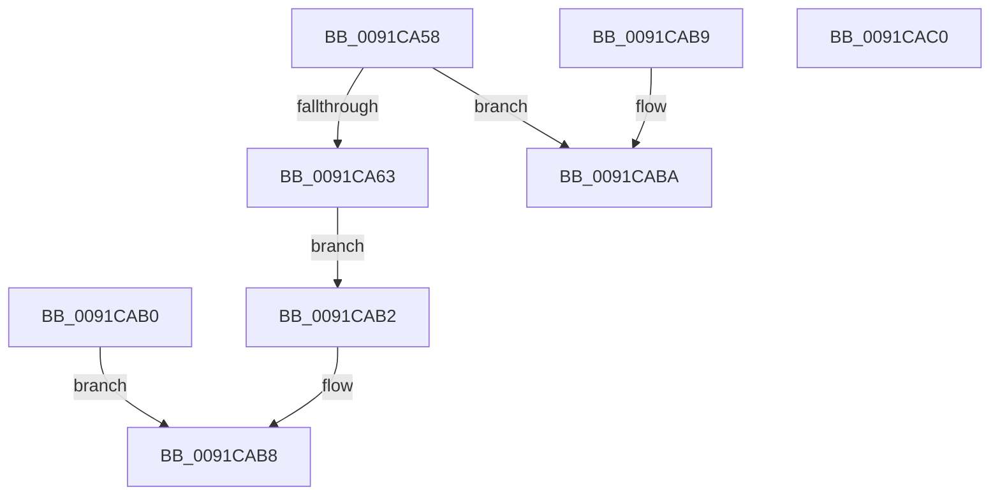

# PfpPrivSourceAdd

- RVA: `0x0091CA58`–`0x0091CAC1` (길이 `105` bytes)
- VA: `0x000000014091CA58`
- 실행 섹션: `PAGE`
- PDB 이름 있음: `예`; PDB Function 태그: `아니요`
- unwind 정보 RVA: `0x0008B154`
- 디코드: `32`개 명령, `105/105` bytes 표시
- 미해석 바이트: `0` (있으면 어셈블리에 `.byte`로 보존)

> 이 문서는 커널 이미지의 기계어와 PDB 기호를 분석해 생성했습니다. 4번과 5번은 함수 원형과 자료형을 바이너리 사용 방식에서 추정한 C 해석이며 원본 소스 복구 결과는 아닙니다.

## 1. Dependencies

- 직접 호출 지점: **0**; 고유 호출 대상: **0**
- 직접 호출자로 확인된 함수: **1**
- RIP 상대 이미지 참조: **0**

### Outgoing calls
- 직접 디코드된 call 명령이 없습니다.

### Direct callers
- [PfpPrivSourceEnum](PfpPrivSourceEnum_function_0091BF00.md) at `0x0091C1A8`
- [PfpPrivSourceEnum](PfpPrivSourceEnum_function_0091BF00.md) at `0x0091C434`

### Static image references
- 디코드된 RIP-relative 메모리 참조가 없습니다.

## 2. Other-region calls and transfers

- 다른 실행 섹션으로 향하는 call: **0**
- 별도 외부 분기/꼬리 이동을 확인하지 못했습니다.

## 3. Assembly (complete function range)

```asm
0091CA58  4C 8B C1                        mov r8, rcx
0091CA5B  8B 41 10                        mov eax, dword ptr [rcx + 0x10]
0091CA5E  3B 41 14                        cmp eax, dword ptr [rcx + 0x14]
0091CA61  73 57                           jae 0x14091caba
0091CA63  48 8D 0C 40                     lea rcx, [rax + rax*2]
0091CA67  48 C1 E1 05                     shl rcx, 5
0091CA6B  49 8B 00                        mov rax, qword ptr [r8]
0091CA6E  0F 28 02                        movaps xmm0, xmmword ptr [rdx]
0091CA71  0F 11 44 01 10                  movups xmmword ptr [rcx + rax + 0x10], xmm0
0091CA76  0F 28 4A 10                     movaps xmm1, xmmword ptr [rdx + 0x10]
0091CA7A  0F 11 4C 01 20                  movups xmmword ptr [rcx + rax + 0x20], xmm1
0091CA7F  0F 28 42 20                     movaps xmm0, xmmword ptr [rdx + 0x20]
0091CA83  0F 11 44 01 30                  movups xmmword ptr [rcx + rax + 0x30], xmm0
0091CA88  0F 28 4A 30                     movaps xmm1, xmmword ptr [rdx + 0x30]
0091CA8C  0F 11 4C 01 40                  movups xmmword ptr [rcx + rax + 0x40], xmm1
0091CA91  0F 28 42 40                     movaps xmm0, xmmword ptr [rdx + 0x40]
0091CA95  0F 11 44 01 50                  movups xmmword ptr [rcx + rax + 0x50], xmm0
0091CA9A  0F 28 4A 50                     movaps xmm1, xmmword ptr [rdx + 0x50]
0091CA9E  0F 11 4C 01 60                  movups xmmword ptr [rcx + rax + 0x60], xmm1
0091CAA3  49 8B 08                        mov rcx, qword ptr [r8]
0091CAA6  8B 41 08                        mov eax, dword ptr [rcx + 8]
0091CAA9  FF C0                           inc eax
0091CAAB  89 41 08                        mov dword ptr [rcx + 8], eax
0091CAAE  EB 02                           jmp 0x14091cab2
0091CAB0  EB 06                           jmp 0x14091cab8
0091CAB2  41 FF 40 10                     inc dword ptr [r8 + 0x10]
0091CAB6  33 C0                           xor eax, eax
0091CAB8  C3                              ret
0091CAB9  CC                              int3
0091CABA  B8 23 00 00 C0                  mov eax, 0xc0000023
0091CABF  C3                              ret
0091CAC0  CC                              int3
```

## 4. C-style interpretation (structured pseudocode)

```c
__int64 __fastcall PfpPrivSourceAdd(__int64 a1, __int64 a2)
{
    __int64 result;

    if (((unsigned int)((unsigned int)(*(unsigned int *)(a1 + 16)))) >= (*(unsigned int *)(a1 + 20))) goto loc_0091CABA;
    a1 = ((unsigned int)(*(unsigned int *)(a1 + 16)) + (unsigned int)(*(unsigned int *)(a1 + 16)) * 2) << (5);
    *(unsigned __int64 *)(a1 + *(unsigned __int64 *)(a1) * 1 + 16) = v_xmm0;
    *(unsigned __int64 *)(a1 + *(unsigned __int64 *)(a1) * 1 + 32) = v_xmm1;
    *(unsigned __int64 *)(a1 + *(unsigned __int64 *)(a1) * 1 + 48) = v_xmm0;
    *(unsigned __int64 *)(a1 + *(unsigned __int64 *)(a1) * 1 + 64) = v_xmm1;
    *(unsigned __int64 *)(a1 + *(unsigned __int64 *)(a1) * 1 + 80) = v_xmm0;
    *(unsigned __int64 *)(a1 + *(unsigned __int64 *)(a1) * 1 + 96) = v_xmm1;
    result = (unsigned int)(((unsigned int)(*(unsigned int *)(*(unsigned __int64 *)(a1) + 8))) + 1);
    *(unsigned int *)(*(unsigned __int64 *)(a1) + 8) = (unsigned int)(result);
    goto loc_0091CAB2;
loc_0091CAB2:
    result = 0;
loc_0091CAB8:
    return result;
loc_0091CABA:
    return (unsigned int)(0xC0000023ULL);
}
```

## 5. (Beta) C Style

```c
int64_t PfpPrivSourceAdd(void *Arg1, void *Arg2)
{
    uint8_t *arg1 = (uint8_t *)Arg1;
    uint8_t *arg2 = (uint8_t *)Arg2;

    int64_t result;

    if (((uint32_t)((uint32_t)(*(uint32_t *)(arg1 + 0x10)))) >= (*(uint32_t *)(arg1 + 0x14))) goto loc_0091CABA;
    Arg1 = ((uint32_t)(*(uint32_t *)(arg1 + 0x10)) + (uint32_t)(*(uint32_t *)(arg1 + 0x10)) * 2) << (5);
    *(uint64_t *)(arg1 + *(uint64_t *)(arg1) * 1 + 0x10) = v_xmm0;
    *(uint64_t *)(arg1 + *(uint64_t *)(arg1) * 1 + 0x20) = v_xmm1;
    *(uint64_t *)(arg1 + *(uint64_t *)(arg1) * 1 + 0x30) = v_xmm0;
    *(uint64_t *)(arg1 + *(uint64_t *)(arg1) * 1 + 0x40) = v_xmm1;
    *(uint64_t *)(arg1 + *(uint64_t *)(arg1) * 1 + 0x50) = v_xmm0;
    *(uint64_t *)(arg1 + *(uint64_t *)(arg1) * 1 + 0x60) = v_xmm1;
    result = (uint32_t)(((uint32_t)(*(uint32_t *)(*(uint64_t *)(arg1) + 0x8))) + 1);
    *(uint32_t *)(*(uint64_t *)(arg1) + 0x8) = (uint32_t)(result);
    goto loc_0091CAB2;
loc_0091CAB2:
    result = 0;
loc_0091CAB8:
    return result;
loc_0091CABA:
    return (uint32_t)(0xC0000023ULL);
}
```

### 관측된 메모리 오프셋

구조체 형식이 확인되지 않은 접근은 인자 기준의 오프셋으로만 기록했습니다.

| 기준 인자 | 오프셋 표현 | 폭 (bit) | 접근 |
|---|---:|---:|---|
| `Arg1` | `+ 0x0` | `64` | `R` |
| `Arg1` | `+ 0x10` | `32` | `R` |
| `Arg1` | `+ 0x10` | `32` | `R/W` |
| `Arg1` | `+ 0x14` | `32` | `R` |
| `Arg2` | `+ 0x0` | `128` | `R` |
| `Arg2` | `+ 0x10` | `128` | `R` |
| `Arg2` | `+ 0x20` | `128` | `R` |
| `Arg2` | `+ 0x30` | `128` | `R` |
| `Arg2` | `+ 0x40` | `128` | `R` |
| `Arg2` | `+ 0x50` | `128` | `R` |

## 6. Execution-region graph

[열기: 2D/3D 그래프와 함수 탐색 컨트롤 패널](../../../control-panel.html?section=page&rva=0x0091CA58&view=graph)

- 2D 그래프는 위에서 아래로 흐르고, 3D 그래프는 빈 공간을 드래그해 회전합니다. Shift+드래그는 이동, 휠은 확대·축소, 함수 노드 선택은 대상 보고서 이동입니다.

### Static fallback


