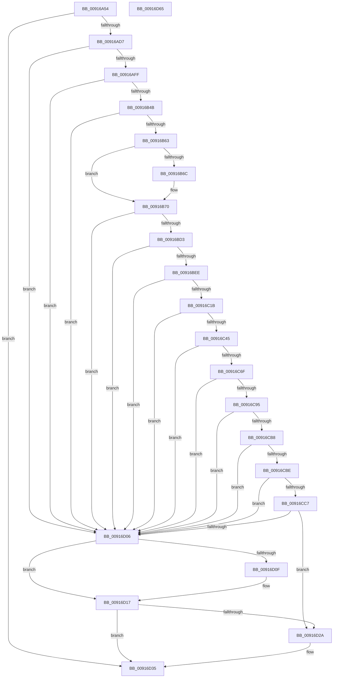

# PiUEventInitClientRegistrationContext

- RVA: `0x00916A54`–`0x00916D66` (길이 `786` bytes)
- VA: `0x0000000140916A54`
- 실행 섹션: `PAGE`
- PDB 이름 있음: `예`; PDB Function 태그: `아니요`
- unwind 정보 RVA: `0x0008A8D4`
- 디코드: `204`개 명령, `786/786` bytes 표시
- 미해석 바이트: `0` (있으면 어셈블리에 `.byte`로 보존)

> 이 문서는 커널 이미지의 기계어와 PDB 기호를 분석해 생성했습니다. 4번과 5번은 함수 원형과 자료형을 바이너리 사용 방식에서 추정한 C 해석이며 원본 소스 복구 결과는 아닙니다.

## 1. Dependencies

- 직접 호출 지점: **22**; 고유 호출 대상: **10**
- 직접 호출자로 확인된 함수: **1**
- RIP 상대 이미지 참조: **6**

### Outgoing calls
- `0x00916AC6` → [ExAllocatePool2](../../poolcode/B8/ExAllocatePool2_function_00B820F0.md) (function, `0x00B820F0`)
- `0x00916ADF` → [memset](../../text/6C/memset_function_006C6C40.md) (function, `0x006C6C40`)
- `0x00916AED` → [ExAllocatePool2](../../poolcode/B8/ExAllocatePool2_function_00B820F0.md) (function, `0x00B820F0`)
- `0x00916B02` → [KeInitializeGuardedMutex](../../text/46/KeInitializeGuardedMutex_function_00466E90.md) (function, `0x00466E90`)
- `0x00916B3E` → [RtlDeriveCapabilitySidsFromName](../../text/47/RtlDeriveCapabilitySidsFromName_function_00474DC0.md) (function, `0x00474DC0`)
- `0x00916B7F` → [RtlLengthSid](../../text/45/RtlLengthSid_function_0045D270.md) (function, `0x0045D270`)
- `0x00916B8D` → [RtlLengthSid](../../text/45/RtlLengthSid_function_0045D270.md) (function, `0x0045D270`)
- `0x00916B9B` → [RtlLengthSid](../../text/45/RtlLengthSid_function_0045D270.md) (function, `0x0045D270`)
- `0x00916BA5` → [RtlLengthSid](../../text/45/RtlLengthSid_function_0045D270.md) (function, `0x0045D270`)
- `0x00916BB0` → [RtlLengthSid](../../text/45/RtlLengthSid_function_0045D270.md) (function, `0x0045D270`)
- `0x00916BC2` → [ExAllocatePool2](../../poolcode/B8/ExAllocatePool2_function_00B820F0.md) (function, `0x00B820F0`)
- `0x00916BE1` → [RtlCreateAcl](RtlCreateAcl_function_00916F00.md) (function, `0x00916F00`)
- `0x00916C0E` → [RtlpAddKnownAce](../92/RtlpAddKnownAce_function_00929A20.md) (function, `0x00929A20`)
- `0x00916C38` → [RtlpAddKnownAce](../92/RtlpAddKnownAce_function_00929A20.md) (function, `0x00929A20`)
- `0x00916C62` → [RtlpAddKnownAce](../92/RtlpAddKnownAce_function_00929A20.md) (function, `0x00929A20`)
- `0x00916C8C` → [RtlpAddKnownAce](../92/RtlpAddKnownAce_function_00929A20.md) (function, `0x00929A20`)
- `0x00916CAF` → [RtlpAddKnownAce](../92/RtlpAddKnownAce_function_00929A20.md) (function, `0x00929A20`)
- `0x00916CFD` → [ZwCreateWnfStateName](../../text/6A/ZwCreateWnfStateName_function_006AEB50.md) (function, `0x006AEB50`)
- `0x00916D12` → [ExFreePoolWithTag](../../poolcode/B8/ExFreePoolWithTag_function_00B82870.md) (function, `0x00B82870`)
- `0x00916D1D` → [ExFreePoolWithTag](../../poolcode/B8/ExFreePoolWithTag_function_00B82870.md) (function, `0x00B82870`)
- `0x00916D30` → [ExFreePoolWithTag](../../poolcode/B8/ExFreePoolWithTag_function_00B82870.md) (function, `0x00B82870`)
- `0x00916D3F` → [_security_check_cookie](../../text/6A/_security_check_cookie_function_006AC640.md) (function, `0x006AC640`)

### Direct callers
- [PiUEventHandleRegistration](../9C/PiUEventHandleRegistration_function_009C3304.md) at `0x009C334E`

### Static image references
- `0x00916A77` → RVA `0x00E0A740` (`.data`; read)
- `0x00916A9B` → RVA `0x00AFE000` (` ?? ::NNGAKEGL::`string'`; read)
- `0x00916B4F` → RVA `0x00E67D58` (`.data`; read)
- `0x00916B70` → RVA `0x00F05878` (`.data`; read)
- `0x00916B84` → RVA `0x00E67D60` (`.data`; read)
- `0x00916B92` → RVA `0x00E67D48` (`.data`; read)

## 2. Other-region calls and transfers

- 다른 실행 섹션으로 향하는 call: **16**
  - `0x00916AC6` → [ExAllocatePool2](../../poolcode/B8/ExAllocatePool2_function_00B820F0.md) (`PAGE` → `POOLCODE`)
  - `0x00916ADF` → [memset](../../text/6C/memset_function_006C6C40.md) (`PAGE` → `.text`)
  - `0x00916AED` → [ExAllocatePool2](../../poolcode/B8/ExAllocatePool2_function_00B820F0.md) (`PAGE` → `POOLCODE`)
  - `0x00916B02` → [KeInitializeGuardedMutex](../../text/46/KeInitializeGuardedMutex_function_00466E90.md) (`PAGE` → `.text`)
  - `0x00916B3E` → [RtlDeriveCapabilitySidsFromName](../../text/47/RtlDeriveCapabilitySidsFromName_function_00474DC0.md) (`PAGE` → `.text`)
  - `0x00916B7F` → [RtlLengthSid](../../text/45/RtlLengthSid_function_0045D270.md) (`PAGE` → `.text`)
  - `0x00916B8D` → [RtlLengthSid](../../text/45/RtlLengthSid_function_0045D270.md) (`PAGE` → `.text`)
  - `0x00916B9B` → [RtlLengthSid](../../text/45/RtlLengthSid_function_0045D270.md) (`PAGE` → `.text`)
  - `0x00916BA5` → [RtlLengthSid](../../text/45/RtlLengthSid_function_0045D270.md) (`PAGE` → `.text`)
  - `0x00916BB0` → [RtlLengthSid](../../text/45/RtlLengthSid_function_0045D270.md) (`PAGE` → `.text`)
  - `0x00916BC2` → [ExAllocatePool2](../../poolcode/B8/ExAllocatePool2_function_00B820F0.md) (`PAGE` → `POOLCODE`)
  - `0x00916CFD` → [ZwCreateWnfStateName](../../text/6A/ZwCreateWnfStateName_function_006AEB50.md) (`PAGE` → `.text`)
  - `0x00916D12` → [ExFreePoolWithTag](../../poolcode/B8/ExFreePoolWithTag_function_00B82870.md) (`PAGE` → `POOLCODE`)
  - `0x00916D1D` → [ExFreePoolWithTag](../../poolcode/B8/ExFreePoolWithTag_function_00B82870.md) (`PAGE` → `POOLCODE`)
  - `0x00916D30` → [ExFreePoolWithTag](../../poolcode/B8/ExFreePoolWithTag_function_00B82870.md) (`PAGE` → `POOLCODE`)
  - `0x00916D3F` → [_security_check_cookie](../../text/6A/_security_check_cookie_function_006AC640.md) (`PAGE` → `.text`)
- 별도 외부 분기/꼬리 이동을 확인하지 못했습니다.

## 3. Assembly (complete function range)

```asm
00916A54  48 8B C4                        mov rax, rsp
00916A57  48 89 58 08                     mov qword ptr [rax + 8], rbx
00916A5B  48 89 70 10                     mov qword ptr [rax + 0x10], rsi
00916A5F  48 89 78 18                     mov qword ptr [rax + 0x18], rdi
00916A63  55                              push rbp
00916A64  41 54                           push r12
00916A66  41 55                           push r13
00916A68  41 56                           push r14
00916A6A  41 57                           push r15
00916A6C  48 8D 68 A1                     lea rbp, [rax - 0x5f]
00916A70  48 81 EC E0 00 00 00            sub rsp, 0xe0
00916A77  48 8B 05 C2 3C 4F 00            mov rax, qword ptr [rip + 0x4f3cc2]
00916A7E  48 33 C4                        xor rax, rsp
00916A81  48 89 45 2F                     mov qword ptr [rbp + 0x2f], rax
00916A85  33 C0                           xor eax, eax
00916A87  48 C7 45 97 28 00 2A 00         mov qword ptr [rbp - 0x69], 0x2a0028
00916A8F  0F 57 C0                        xorps xmm0, xmm0
00916A92  48 89 45 C7                     mov qword ptr [rbp - 0x39], rax
00916A96  BE 90 00 00 00                  mov esi, 0x90
00916A9B  48 8D 05 5E 75 1E 00            lea rax, [rip + 0x1e755e]
00916AA2  41 BD 50 6E 70 59               mov r13d, 0x59706e50
00916AA8  48 89 45 9F                     mov qword ptr [rbp - 0x61], rax
00916AAC  45 33 F6                        xor r14d, r14d
00916AAF  45 8B C5                        mov r8d, r13d
00916AB2  8B D6                           mov edx, esi
00916AB4  41 8B DE                        mov ebx, r14d
00916AB7  44 8D 7E 70                     lea r15d, [rsi + 0x70]
00916ABB  41 8B CF                        mov ecx, r15d
00916ABE  0F 11 45 A7                     movups xmmword ptr [rbp - 0x59], xmm0
00916AC2  0F 11 45 B7                     movups xmmword ptr [rbp - 0x49], xmm0
00916AC6  E8 25 B6 26 00                  call 0x140b820f0
00916ACB  48 8B F8                        mov rdi, rax
00916ACE  48 85 C0                        test rax, rax
00916AD1  0F 84 5E 02 00 00               je 0x140916d35
00916AD7  44 8B C6                        mov r8d, esi
00916ADA  33 D2                           xor edx, edx
00916ADC  48 8B C8                        mov rcx, rax
00916ADF  E8 5C 01 DB FF                  call 0x1406c6c40
00916AE4  45 8B C5                        mov r8d, r13d
00916AE7  8D 56 A8                        lea edx, [rsi - 0x58]
00916AEA  8D 4E B0                        lea ecx, [rsi - 0x50]
00916AED  E8 FE B5 26 00                  call 0x140b820f0
00916AF2  48 89 47 10                     mov qword ptr [rdi + 0x10], rax
00916AF6  48 85 C0                        test rax, rax
00916AF9  0F 84 07 02 00 00               je 0x140916d06
00916AFF  48 8B C8                        mov rcx, rax
00916B02  E8 89 03 B5 FF                  call 0x140466e90
00916B07  48 8D 47 70                     lea rax, [rdi + 0x70]
00916B0B  48 89 40 08                     mov qword ptr [rax + 8], rax
00916B0F  45 8D 66 01                     lea r12d, [r14 + 1]
00916B13  48 89 00                        mov qword ptr [rax], rax
00916B16  4C 8D 45 CF                     lea r8, [rbp - 0x31]
00916B1A  48 8D 47 60                     lea rax, [rdi + 0x60]
00916B1E  48 89 40 08                     mov qword ptr [rax + 8], rax
00916B22  48 8D 55 FF                     lea rdx, [rbp - 1]
00916B26  48 89 00                        mov qword ptr [rax], rax
00916B29  48 8D 4D 97                     lea rcx, [rbp - 0x69]
00916B2D  C7 87 84 00 00 00 04 00 00 00   mov dword ptr [rdi + 0x84], 4
00916B37  44 88 A7 8C 00 00 00            mov byte ptr [rdi + 0x8c], r12b
00916B3E  E8 7D E2 B5 FF                  call 0x140474dc0
00916B43  85 C0                           test eax, eax
00916B45  0F 88 BB 01 00 00               js 0x140916d06
00916B4B  0F B7 45 A9                     movzx eax, word ptr [rbp - 0x57]
00916B4F  48 8B 35 02 12 55 00            mov rsi, qword ptr [rip + 0x551202]
00916B56  44 88 65 A7                     mov byte ptr [rbp - 0x59], r12b
00916B5A  66 85 C0                        test ax, ax
00916B5D  0F 88 A3 01 00 00               js 0x140916d06
00916B63  4C 89 75 AF                     mov qword ptr [rbp - 0x51], r14
00916B67  48 85 F6                        test rsi, rsi
00916B6A  74 04                           je 0x140916b70
00916B6C  48 89 75 AF                     mov qword ptr [rbp - 0x51], rsi
00916B70  48 8B 0D 01 ED 5E 00            mov rcx, qword ptr [rip + 0x5eed01]
00916B77  66 41 0B C4                     or ax, r12w
00916B7B  66 89 45 A9                     mov word ptr [rbp - 0x57], ax
00916B7F  E8 EC 66 B4 FF                  call 0x14045d270
00916B84  48 8B 0D D5 11 55 00            mov rcx, qword ptr [rip + 0x5511d5]
00916B8B  8B D8                           mov ebx, eax
00916B8D  E8 DE 66 B4 FF                  call 0x14045d270
00916B92  48 8B 0D AF 11 55 00            mov rcx, qword ptr [rip + 0x5511af]
00916B99  03 D8                           add ebx, eax
00916B9B  E8 D0 66 B4 FF                  call 0x14045d270
00916BA0  48 8B CE                        mov rcx, rsi
00916BA3  03 D8                           add ebx, eax
00916BA5  E8 C6 66 B4 FF                  call 0x14045d270
00916BAA  48 8D 4D CF                     lea rcx, [rbp - 0x31]
00916BAE  03 D8                           add ebx, eax
00916BB0  E8 BB 66 B4 FF                  call 0x14045d270
00916BB5  45 8B C5                        mov r8d, r13d
00916BB8  49 8B CF                        mov rcx, r15
00916BBB  8D 70 30                        lea esi, [rax + 0x30]
00916BBE  03 F3                           add esi, ebx
00916BC0  8B D6                           mov edx, esi
00916BC2  E8 29 B5 26 00                  call 0x140b820f0
00916BC7  48 8B D8                        mov rbx, rax
00916BCA  48 85 C0                        test rax, rax
00916BCD  0F 84 33 01 00 00               je 0x140916d06
00916BD3  41 BF 02 00 00 00               mov r15d, 2
00916BD9  8B D6                           mov edx, esi
00916BDB  45 8B C7                        mov r8d, r15d
00916BDE  48 8B C8                        mov rcx, rax
00916BE1  E8 1A 03 00 00                  call 0x140916f00
00916BE6  85 C0                           test eax, eax
00916BE8  0F 88 18 01 00 00               js 0x140916d06
00916BEE  48 8B 0D 63 11 55 00            mov rcx, qword ptr [rip + 0x551163]
00916BF5  41 B9 00 00 00 10               mov r9d, 0x10000000
00916BFB  44 88 74 24 28                  mov byte ptr [rsp + 0x28], r14b
00916C00  45 8B C7                        mov r8d, r15d
00916C03  48 89 4C 24 20                  mov qword ptr [rsp + 0x20], rcx
00916C08  41 8B D7                        mov edx, r15d
00916C0B  48 8B CB                        mov rcx, rbx
00916C0E  E8 0D 2E 01 00                  call 0x140929a20
00916C13  85 C0                           test eax, eax
00916C15  0F 88 EB 00 00 00               js 0x140916d06
00916C1B  48 8B 05 26 11 55 00            mov rax, qword ptr [rip + 0x551126]
00916C22  45 8B CC                        mov r9d, r12d
00916C25  44 88 74 24 28                  mov byte ptr [rsp + 0x28], r14b
00916C2A  45 8B C7                        mov r8d, r15d
00916C2D  41 8B D7                        mov edx, r15d
00916C30  48 89 44 24 20                  mov qword ptr [rsp + 0x20], rax
00916C35  48 8B CB                        mov rcx, rbx
00916C38  E8 E3 2D 01 00                  call 0x140929a20
00916C3D  85 C0                           test eax, eax
00916C3F  0F 88 C1 00 00 00               js 0x140916d06
00916C45  48 8B 05 14 11 55 00            mov rax, qword ptr [rip + 0x551114]
00916C4C  45 8B CC                        mov r9d, r12d
00916C4F  44 88 74 24 28                  mov byte ptr [rsp + 0x28], r14b
00916C54  45 8B C7                        mov r8d, r15d
00916C57  41 8B D7                        mov edx, r15d
00916C5A  48 89 44 24 20                  mov qword ptr [rsp + 0x20], rax
00916C5F  48 8B CB                        mov rcx, rbx
00916C62  E8 B9 2D 01 00                  call 0x140929a20
00916C67  85 C0                           test eax, eax
00916C69  0F 88 97 00 00 00               js 0x140916d06
00916C6F  48 8B 05 02 EC 5E 00            mov rax, qword ptr [rip + 0x5eec02]
00916C76  45 8B CC                        mov r9d, r12d
00916C79  44 88 74 24 28                  mov byte ptr [rsp + 0x28], r14b
00916C7E  45 8B C7                        mov r8d, r15d
00916C81  41 8B D7                        mov edx, r15d
00916C84  48 89 44 24 20                  mov qword ptr [rsp + 0x20], rax
00916C89  48 8B CB                        mov rcx, rbx
00916C8C  E8 8F 2D 01 00                  call 0x140929a20
00916C91  85 C0                           test eax, eax
00916C93  78 71                           js 0x140916d06
00916C95  48 8D 45 CF                     lea rax, [rbp - 0x31]
00916C99  44 88 74 24 28                  mov byte ptr [rsp + 0x28], r14b
00916C9E  45 8B CC                        mov r9d, r12d
00916CA1  48 89 44 24 20                  mov qword ptr [rsp + 0x20], rax
00916CA6  45 8B C7                        mov r8d, r15d
00916CA9  41 8B D7                        mov edx, r15d
00916CAC  48 8B CB                        mov rcx, rbx
00916CAF  E8 6C 2D 01 00                  call 0x140929a20
00916CB4  85 C0                           test eax, eax
00916CB6  78 4E                           js 0x140916d06
00916CB8  44 38 65 A7                     cmp byte ptr [rbp - 0x59], r12b
00916CBC  75 48                           jne 0x140916d06
00916CBE  0F B7 45 A9                     movzx eax, word ptr [rbp - 0x57]
00916CC2  66 85 C0                        test ax, ax
00916CC5  78 3F                           js 0x140916d06
00916CC7  45 8D 47 02                     lea r8d, [r15 + 2]
00916CCB  48 89 5D C7                     mov qword ptr [rbp - 0x39], rbx
00916CCF  B9 F7 FF 00 00                  mov ecx, 0xfff7
00916CD4  41 8D 57 01                     lea edx, [r15 + 1]
00916CD8  66 23 C1                        and ax, cx
00916CDB  45 33 C9                        xor r9d, r9d
00916CDE  66 41 0B C0                     or ax, r8w
00916CE2  48 8D 4F 58                     lea rcx, [rdi + 0x58]
00916CE6  66 89 45 A9                     mov word ptr [rbp - 0x57], ax
00916CEA  48 8D 45 A7                     lea rax, [rbp - 0x59]
00916CEE  48 89 44 24 30                  mov qword ptr [rsp + 0x30], rax
00916CF3  44 89 44 24 28                  mov dword ptr [rsp + 0x28], r8d
00916CF8  4C 89 74 24 20                  mov qword ptr [rsp + 0x20], r14
00916CFD  E8 4E 7E D9 FF                  call 0x1406aeb50
00916D02  85 C0                           test eax, eax
00916D04  79 24                           jns 0x140916d2a
00916D06  48 8B 4F 10                     mov rcx, qword ptr [rdi + 0x10]
00916D0A  48 85 C9                        test rcx, rcx
00916D0D  74 08                           je 0x140916d17
00916D0F  41 8B D5                        mov edx, r13d
00916D12  E8 59 BB 26 00                  call 0x140b82870
00916D17  41 8B D5                        mov edx, r13d
00916D1A  48 8B CF                        mov rcx, rdi
00916D1D  E8 4E BB 26 00                  call 0x140b82870
00916D22  49 8B FE                        mov rdi, r14
00916D25  48 85 DB                        test rbx, rbx
00916D28  74 0B                           je 0x140916d35
00916D2A  41 8B D5                        mov edx, r13d
00916D2D  48 8B CB                        mov rcx, rbx
00916D30  E8 3B BB 26 00                  call 0x140b82870
00916D35  48 8B C7                        mov rax, rdi
00916D38  48 8B 4D 2F                     mov rcx, qword ptr [rbp + 0x2f]
00916D3C  48 33 CC                        xor rcx, rsp
00916D3F  E8 FC 58 D9 FF                  call 0x1406ac640
00916D44  4C 8D 9C 24 E0 00 00 00         lea r11, [rsp + 0xe0]
00916D4C  49 8B 5B 30                     mov rbx, qword ptr [r11 + 0x30]
00916D50  49 8B 73 38                     mov rsi, qword ptr [r11 + 0x38]
00916D54  49 8B 7B 40                     mov rdi, qword ptr [r11 + 0x40]
00916D58  49 8B E3                        mov rsp, r11
00916D5B  41 5F                           pop r15
00916D5D  41 5E                           pop r14
00916D5F  41 5D                           pop r13
00916D61  41 5C                           pop r12
00916D63  5D                              pop rbp
00916D64  C3                              ret
00916D65  CC                              int3
```

## 4. C-style interpretation (structured pseudocode)

```c
__int64 __fastcall PiUEventInitClientRegistrationContext(void)
{
    __int64 result;
    __int64 v_r14;
    __int64 v_rbx;
    __int64 v_rsi;
    __int64 v_rsp;
    unsigned __int64 v_stack_m28;
    unsigned __int64 v_stack_mD8;
    unsigned __int8 v_stack_mE0;
    unsigned __int64 v_stack_mE8;

    *(unsigned __int64 *)(v_rsp + 8) = v_rbx;
    *(unsigned __int64 *)(v_rsp + 16) = v_rsi;
    *(unsigned __int64 *)(v_rsp + 24) = v_rdi;
    v_rsp = (v_rsp) - (224);
    result = (*(unsigned __int64 *)(v_rip + 5192898)) ^ (v_rsp);
    *(unsigned __int64 *)(v_rsp - 95 + 47) = result;
    result = 0;
    *(unsigned __int64 *)(v_rsp - 95 - 105) = 0x2A0028ULL;
    *(unsigned __int64 *)(v_rsp - 95 - 57) = 0;
    *(unsigned __int64 *)(v_rsp - 95 - 97) = v_rip + 1996126;
    v_r14 = 0;
    *(unsigned __int64 *)(v_rsp - 95 - 89) = v_xmm0;
    *(unsigned __int64 *)(v_rsp - 95 - 73) = v_xmm0;
    result = ExAllocatePool2((unsigned int)((unsigned int)(144 + 112)), 144, (unsigned int)((unsigned int)((unsigned int)(0x59706E50ULL))), a4);
    if (result == 0) goto loc_00916D35;
    a2 = 0;
    result = memset(result, a2, 144, a4);
    result = ExAllocatePool2(144 - 80, 144 - 88, (unsigned int)((unsigned int)((unsigned int)(0x59706E50ULL))), a4);
    *(unsigned __int64 *)(result + 16) = result;
    if (result == 0) goto loc_00916D06;
    result = KeInitializeGuardedMutex(result, 144 - 88, (unsigned int)((unsigned int)((unsigned int)(0x59706E50ULL))), a4);
    *(unsigned __int64 *)(result + 112 + 8) = result + 112;
    *(unsigned __int64 *)(result + 112) = result + 112;
    *(unsigned __int64 *)(result + 96 + 8) = result + 96;
    *(unsigned __int64 *)(result + 96) = result + 96;
    *(unsigned int *)(result + 132) = 4;
    *(unsigned __int8 *)(result + 140) = (unsigned __int8)(v_r14 + 1);
    result = RtlDeriveCapabilitySidsFromName(v_rsp - 95 - 105, v_rsp - 95 - 1, v_rsp - 95 - 49, a4);
    if (sign_flag) goto loc_00916D06;
    *(unsigned __int8 *)(v_rsp - 95 - 89) = (unsigned __int8)(v_r14 + 1);
    if (sign_flag) goto loc_00916D06;
    *(unsigned __int64 *)(v_rsp - 95 - 81) = 0;
    if (*(unsigned __int64 *)(v_rip + 5575170) != 0) {
        *(unsigned __int64 *)(v_rsp - 95 - 81) = *(unsigned __int64 *)(v_rip + 5575170);
    }
    result = (unsigned __int16)((*(unsigned __int16 *)(v_rsp - 95 - 87)) | ((unsigned __int16)(v_r14 + 1)));
    *(unsigned __int16 *)(v_rsp - 95 - 87) = (unsigned __int16)(result);
    result = RtlLengthSid(*(unsigned __int64 *)(v_rip + 6221057), v_rsp - 95 - 1, v_rsp - 95 - 49, a4);
    result = RtlLengthSid(*(unsigned __int64 *)(v_rip + 5575125), v_rsp - 95 - 1, v_rsp - 95 - 49, a4);
    v_rbx = (unsigned int)(((unsigned int)((unsigned int)(result))) + ((unsigned int)(result)));
    result = RtlLengthSid(*(unsigned __int64 *)(v_rip + 5575087), v_rsp - 95 - 1, v_rsp - 95 - 49, a4);
    v_rbx = (unsigned int)((v_rbx) + ((unsigned int)(result)));
    result = RtlLengthSid(*(unsigned __int64 *)(v_rip + 5575170), v_rsp - 95 - 1, v_rsp - 95 - 49, a4);
    v_rbx = (unsigned int)((v_rbx) + ((unsigned int)(result)));
    result = RtlLengthSid(v_rsp - 95 - 49, v_rsp - 95 - 1, v_rsp - 95 - 49, a4);
    v_rsi = (unsigned int)((result + 48) + ((unsigned int)(v_rbx)));
    result = ExAllocatePool2(144 + 112, (unsigned int)((unsigned int)(v_rsi)), (unsigned int)((unsigned int)((unsigned int)(0x59706E50ULL))), a4);
    if (result == 0) goto loc_00916D06;
    result = RtlCreateAcl(result, (unsigned int)((unsigned int)(v_rsi)), 2, a4);
    if (sign_flag) goto loc_00916D06;
    v_stack_mE0 = 0;
    v_stack_mE8 = *(unsigned __int64 *)(v_rip + 5575011);
    result = RtlpAddKnownAce(result, 2, 2, (unsigned int)(0x10000000ULL));
    if (sign_flag) goto loc_00916D06;
    v_stack_mE0 = 0;
    v_stack_mE8 = *(unsigned __int64 *)(v_rip + 5574950);
    result = RtlpAddKnownAce(result, 2, 2, (unsigned int)((unsigned int)(v_r14 + 1)));
    if (sign_flag) goto loc_00916D06;
    v_stack_mE0 = 0;
    v_stack_mE8 = *(unsigned __int64 *)(v_rip + 5574932);
    result = RtlpAddKnownAce(result, 2, 2, (unsigned int)((unsigned int)(v_r14 + 1)));
    if (sign_flag) goto loc_00916D06;
    v_stack_mE0 = 0;
    v_stack_mE8 = *(unsigned __int64 *)(v_rip + 6220802);
    result = RtlpAddKnownAce(result, 2, 2, (unsigned int)((unsigned int)(v_r14 + 1)));
    if (sign_flag) goto loc_00916D06;
    v_stack_mE0 = 0;
    v_stack_mE8 = v_rsp - 95 - 49;
    result = RtlpAddKnownAce(result, 2, 2, (unsigned int)((unsigned int)(v_r14 + 1)));
    if (sign_flag) goto loc_00916D06;
    if ((*(unsigned __int8 *)(v_rsp - 95 - 89)) != ((unsigned __int8)(v_r14 + 1))) goto loc_00916D06;
    if (sign_flag) goto loc_00916D06;
    *(unsigned __int64 *)(v_rsp - 95 - 57) = result;
    result = (unsigned __int16)((*(unsigned __int16 *)(v_rsp - 95 - 87)) & ((unsigned __int16)((unsigned int)(0xFFF7ULL))));
    a4 = 0;
    result = (unsigned __int16)((result) | ((unsigned __int16)(2 + 2)));
    *(unsigned __int16 *)(v_rsp - 95 - 87) = (unsigned __int16)(result);
    v_stack_mD8 = v_rsp - 95 - 89;
    v_stack_mE0 = (unsigned int)(2 + 2);
    v_stack_mE8 = 0;
    result = ZwCreateWnfStateName(result + 88, 2 + 1, 2 + 2, a4);
    if (!sign_flag) goto loc_00916D2A;
loc_00916D06:
    if (*(unsigned __int64 *)(result + 16) != 0) {
        a2 = (unsigned int)((unsigned int)(0x59706E50ULL));
        result = ExFreePoolWithTag(*(unsigned __int64 *)(result + 16), a2, 2 + 2, a4);
    }
    result = ExFreePoolWithTag(result, (unsigned int)((unsigned int)((unsigned int)(0x59706E50ULL))), 2 + 2, a4);
    if (result != 0) {
        a2 = (unsigned int)((unsigned int)(0x59706E50ULL));
        a1 = result;
        result = ExFreePoolWithTag(a1, a2, 2 + 2, a4);
    }
    a1 = (*(unsigned __int64 *)(v_rsp - 95 + 47)) ^ (v_rsp);
    result = _security_check_cookie(a1, a2, 2 + 2, a4);
    return result;
}
```

## 5. (Beta) C Style

```c
void PiUEventInitClientRegistrationContext(void)
{
    int64_t result;
    int64_t local_r14;
    int64_t local_rbx;
    int64_t local_rsi;
    int64_t local_rsp;
    uint64_t v_stack_m28;
    uint64_t v_stack_mD8;
    uint8_t v_stack_mE0;
    uint64_t v_stack_mE8;

    *(uint64_t *)(local_rsp + 0x8) = local_rbx;
    *(uint64_t *)(local_rsp + 0x10) = local_rsi;
    *(uint64_t *)(local_rsp + 0x18) = local_rdi;
    local_rsp = (local_rsp) - (224);
    result = (*(uint64_t *)(v_rip + 0x4F3CC2)) ^ (local_rsp);
    *(uint64_t *)(local_rsp - 0x5F + 0x2F) = result;
    result = 0;
    *(uint64_t *)(local_rsp - 0x5F - 0x69) = 0x2A0028ULL;
    *(uint64_t *)(local_rsp - 0x5F - 0x39) = 0;
    *(uint64_t *)(local_rsp - 0x5F - 0x61) = v_rip + 1996126;
    local_r14 = 0;
    *(uint64_t *)(local_rsp - 0x5F - 0x59) = v_xmm0;
    *(uint64_t *)(local_rsp - 0x5F - 0x49) = v_xmm0;
    result = ExAllocatePool2((uint32_t)((uint32_t)(144 + 112)), 144, (uint32_t)((uint32_t)((uint32_t)(0x59706E50ULL))), a4);
    if (result == 0) goto loc_00916D35;
    a2 = 0;
    result = memset(result, a2, 144, a4);
    result = ExAllocatePool2(144 - 80, 144 - 88, (uint32_t)((uint32_t)((uint32_t)(0x59706E50ULL))), a4);
    *(uint64_t *)(result + 0x10) = result;
    if (result == 0) goto loc_00916D06;
    result = KeInitializeGuardedMutex(result, 144 - 88, (uint32_t)((uint32_t)((uint32_t)(0x59706E50ULL))), a4);
    *(uint64_t *)(result + 0x70 + 0x8) = result + 112;
    *(uint64_t *)(result + 0x70) = result + 112;
    *(uint64_t *)(result + 0x60 + 0x8) = result + 96;
    *(uint64_t *)(result + 0x60) = result + 96;
    *(uint32_t *)(result + 0x84) = 4;
    *(uint8_t *)(result + 0x8C) = (uint8_t)(local_r14 + 1);
    result = RtlDeriveCapabilitySidsFromName(local_rsp - 95 - 105, local_rsp - 95 - 1, local_rsp - 95 - 49, a4);
    if (sign_flag) goto loc_00916D06;
    *(uint8_t *)(local_rsp - 0x5F - 0x59) = (uint8_t)(local_r14 + 1);
    if (sign_flag) goto loc_00916D06;
    *(uint64_t *)(local_rsp - 0x5F - 0x51) = 0;
    if (*(uint64_t *)(v_rip + 0x551202) != 0) {
        *(uint64_t *)(local_rsp - 0x5F - 0x51) = *(uint64_t *)(v_rip + 0x551202);
    }
    result = (uint16_t)((*(uint16_t *)(local_rsp - 0x5F - 0x57)) | ((uint16_t)(local_r14 + 1)));
    *(uint16_t *)(local_rsp - 0x5F - 0x57) = (uint16_t)(result);
    result = RtlLengthSid(*(uint64_t *)(v_rip + 0x5EED01), local_rsp - 95 - 1, local_rsp - 95 - 49, a4);
    result = RtlLengthSid(*(uint64_t *)(v_rip + 0x5511D5), local_rsp - 95 - 1, local_rsp - 95 - 49, a4);
    local_rbx = (uint32_t)(((uint32_t)((uint32_t)(result))) + ((uint32_t)(result)));
    result = RtlLengthSid(*(uint64_t *)(v_rip + 0x5511AF), local_rsp - 95 - 1, local_rsp - 95 - 49, a4);
    local_rbx = (uint32_t)((local_rbx) + ((uint32_t)(result)));
    result = RtlLengthSid(*(uint64_t *)(v_rip + 0x551202), local_rsp - 95 - 1, local_rsp - 95 - 49, a4);
    local_rbx = (uint32_t)((local_rbx) + ((uint32_t)(result)));
    result = RtlLengthSid(local_rsp - 95 - 49, local_rsp - 95 - 1, local_rsp - 95 - 49, a4);
    local_rsi = (uint32_t)((result + 48) + ((uint32_t)(local_rbx)));
    result = ExAllocatePool2(144 + 112, (uint32_t)((uint32_t)(local_rsi)), (uint32_t)((uint32_t)((uint32_t)(0x59706E50ULL))), a4);
    if (result == 0) goto loc_00916D06;
    result = RtlCreateAcl(result, (uint32_t)((uint32_t)(local_rsi)), 2, a4);
    if (sign_flag) goto loc_00916D06;
    v_stack_mE0 = 0;
    v_stack_mE8 = *(uint64_t *)(v_rip + 0x551163);
    result = RtlpAddKnownAce(result, 2, 2, (uint32_t)(0x10000000ULL));
    if (sign_flag) goto loc_00916D06;
    v_stack_mE0 = 0;
    v_stack_mE8 = *(uint64_t *)(v_rip + 0x551126);
    result = RtlpAddKnownAce(result, 2, 2, (uint32_t)((uint32_t)(local_r14 + 1)));
    if (sign_flag) goto loc_00916D06;
    v_stack_mE0 = 0;
    v_stack_mE8 = *(uint64_t *)(v_rip + 0x551114);
    result = RtlpAddKnownAce(result, 2, 2, (uint32_t)((uint32_t)(local_r14 + 1)));
    if (sign_flag) goto loc_00916D06;
    v_stack_mE0 = 0;
    v_stack_mE8 = *(uint64_t *)(v_rip + 0x5EEC02);
    result = RtlpAddKnownAce(result, 2, 2, (uint32_t)((uint32_t)(local_r14 + 1)));
    if (sign_flag) goto loc_00916D06;
    v_stack_mE0 = 0;
    v_stack_mE8 = local_rsp - 95 - 49;
    result = RtlpAddKnownAce(result, 2, 2, (uint32_t)((uint32_t)(local_r14 + 1)));
    if (sign_flag) goto loc_00916D06;
    if ((*(uint8_t *)(local_rsp - 0x5F - 0x59)) != ((uint8_t)(local_r14 + 1))) goto loc_00916D06;
    if (sign_flag) goto loc_00916D06;
    *(uint64_t *)(local_rsp - 0x5F - 0x39) = result;
    result = (uint16_t)((*(uint16_t *)(local_rsp - 0x5F - 0x57)) & ((uint16_t)((uint32_t)(0xFFF7ULL))));
    a4 = 0;
    result = (uint16_t)((result) | ((uint16_t)(2 + 2)));
    *(uint16_t *)(local_rsp - 0x5F - 0x57) = (uint16_t)(result);
    v_stack_mD8 = local_rsp - 95 - 89;
    v_stack_mE0 = (uint32_t)(2 + 2);
    v_stack_mE8 = 0;
    result = ZwCreateWnfStateName(result + 88, 2 + 1, 2 + 2, a4);
    if (!sign_flag) goto loc_00916D2A;
loc_00916D06:
    if (*(uint64_t *)(result + 0x10) != 0) {
        a2 = (uint32_t)((uint32_t)(0x59706E50ULL));
        result = ExFreePoolWithTag(*(uint64_t *)(result + 0x10), a2, 2 + 2, a4);
    }
    result = ExFreePoolWithTag(result, (uint32_t)((uint32_t)((uint32_t)(0x59706E50ULL))), 2 + 2, a4);
    if (result != 0) {
        a2 = (uint32_t)((uint32_t)(0x59706E50ULL));
        a1 = result;
        result = ExFreePoolWithTag(a1, a2, 2 + 2, a4);
    }
    a1 = (*(uint64_t *)(local_rsp - 0x5F + 0x2F)) ^ (local_rsp);
    result = _security_check_cookie(a1, a2, 2 + 2, a4);
    return result;
}
```

## 6. Execution-region graph

[열기: 2D/3D 그래프와 함수 탐색 컨트롤 패널](../../../control-panel.html?section=page&rva=0x00916A54&view=graph)

- 2D 그래프는 위에서 아래로 흐르고, 3D 그래프는 빈 공간을 드래그해 회전합니다. Shift+드래그는 이동, 휠은 확대·축소, 함수 노드 선택은 대상 보고서 이동입니다.

### Static fallback


