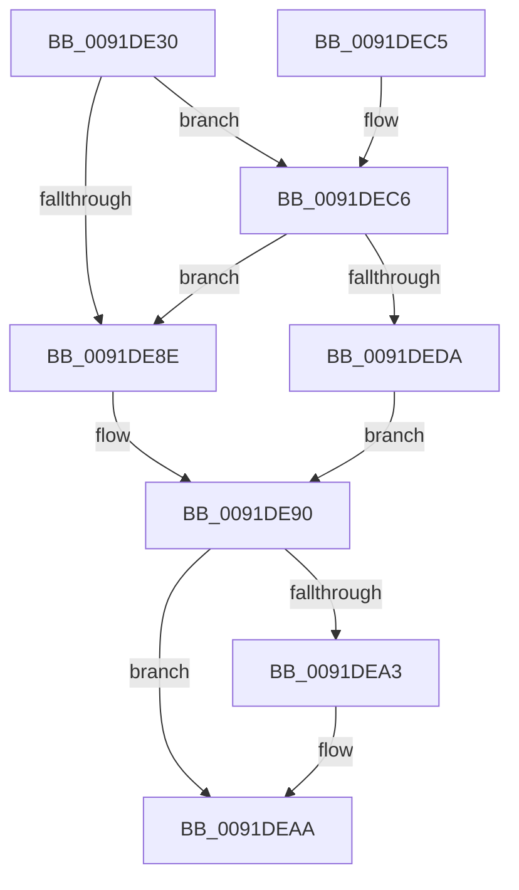

# PnpHandleProcessWalkWorker

- RVA: `0x0091DE30`–`0x0091DEFD` (길이 `205` bytes)
- VA: `0x000000014091DE30`
- 실행 섹션: `PAGE`
- PDB 이름 있음: `예`; PDB Function 태그: `아니요`
- unwind 정보 RVA: `0x0008B3B4`
- 디코드: `58`개 명령, `205/205` bytes 표시
- 미해석 바이트: `0` (있으면 어셈블리에 `.byte`로 보존)

> 이 문서는 커널 이미지의 기계어와 PDB 기호를 분석해 생성했습니다. 4번과 5번은 함수 원형과 자료형을 바이너리 사용 방식에서 추정한 C 해석이며 원본 소스 복구 결과는 아닙니다.

## 1. Dependencies

- 직접 호출 지점: **4**; 고유 호출 대상: **4**
- 직접 호출자로 확인된 함수: **1**
- RIP 상대 이미지 참조: **3**

### Outgoing calls
- `0x0091DE57` → [ExGetHandlePointer](../../text/43/ExGetHandlePointer_function_00430C90.md) (function, `0x00430C90`)
- `0x0091DEA5` → [ExfUnblockPushLock](../../text/2A/ExfUnblockPushLock_function_002A3FE0.md) (function, `0x002A3FE0`)
- `0x0091DED0` → [IoGetBaseFileSystemDeviceObject](../../text/29/IoGetBaseFileSystemDeviceObject_function_0029A2A0.md) (function, `0x0029A2A0`)
- `0x0091DEF4` → [guard_dispatch_icall](../../text/6B/guard_dispatch_icall_function_006BAAD0.md) (function, `0x006BAAD0`)

### Direct callers
- [ExEnumHandleTable](ExEnumHandleTable_function_0091DB20.md) at `0x0091DC0D`

### Static image references
- `0x0091DE5C` → RVA `0x00FC6AE0` (`ALMOSTRO`; read)
- `0x0091DE63` → RVA `0x00FC7800` (`ALMOSTRO`; read)
- `0x0091DE7D` → RVA `0x00FC6E4C` (`ALMOSTRO`; read)

## 2. Other-region calls and transfers

- 다른 실행 섹션으로 향하는 call: **4**
  - `0x0091DE57` → [ExGetHandlePointer](../../text/43/ExGetHandlePointer_function_00430C90.md) (`PAGE` → `.text`)
  - `0x0091DEA5` → [ExfUnblockPushLock](../../text/2A/ExfUnblockPushLock_function_002A3FE0.md) (`PAGE` → `.text`)
  - `0x0091DED0` → [IoGetBaseFileSystemDeviceObject](../../text/29/IoGetBaseFileSystemDeviceObject_function_0029A2A0.md) (`PAGE` → `.text`)
  - `0x0091DEF4` → [guard_dispatch_icall](../../text/6B/guard_dispatch_icall_function_006BAAD0.md) (`PAGE` → `.text`)
- 별도 외부 분기/꼬리 이동을 확인하지 못했습니다.

## 3. Assembly (complete function range)

```asm
0091DE30  48 89 5C 24 08                  mov qword ptr [rsp + 8], rbx
0091DE35  48 89 6C 24 10                  mov qword ptr [rsp + 0x10], rbp
0091DE3A  48 89 74 24 18                  mov qword ptr [rsp + 0x18], rsi
0091DE3F  57                              push rdi
0091DE40  41 56                           push r14
0091DE42  41 57                           push r15
0091DE44  48 83 EC 30                     sub rsp, 0x30
0091DE48  4C 8B F1                        mov r14, rcx
0091DE4B  49 8B D9                        mov rbx, r9
0091DE4E  48 8B CA                        mov rcx, rdx
0091DE51  4D 8B F8                        mov r15, r8
0091DE54  48 8B FA                        mov rdi, rdx
0091DE57  E8 34 2E B1 FF                  call 0x140430c90
0091DE5C  48 8B 0D 7D 8C 6A 00            mov rcx, qword ptr [rip + 0x6a8c7d]
0091DE63  48 8D 15 96 99 6A 00            lea rdx, [rip + 0x6a9996]
0091DE6A  4C 8B D0                        mov r10, rax
0091DE6D  49 C1 EA 08                     shr r10, 8
0091DE71  45 0F B6 DA                     movzx r11d, r10b
0091DE75  44 0F B6 50 18                  movzx r10d, byte ptr [rax + 0x18]
0091DE7A  4D 33 DA                        xor r11, r10
0091DE7D  44 0F B6 15 C7 8F 6A 00         movzx r10d, byte ptr [rip + 0x6a8fc7]
0091DE85  4D 33 DA                        xor r11, r10
0091DE88  4A 39 0C DA                     cmp qword ptr [rdx + r11*8], rcx
0091DE8C  74 38                           je 0x14091dec6
0091DE8E  32 DB                           xor bl, bl
0091DE90  F0 48 FF 07                     lock inc qword ptr [rdi]
0091DE94  49 8D 4E 30                     lea rcx, [r14 + 0x30]
0091DE98  F0 83 0C 24 00                  lock or dword ptr [rsp], 0
0091DE9D  48 83 39 00                     cmp qword ptr [rcx], 0
0091DEA1  74 07                           je 0x14091deaa
0091DEA3  33 D2                           xor edx, edx
0091DEA5  E8 36 61 98 FF                  call 0x1402a3fe0
0091DEAA  48 8B 6C 24 58                  mov rbp, qword ptr [rsp + 0x58]
0091DEAF  8A C3                           mov al, bl
0091DEB1  48 8B 5C 24 50                  mov rbx, qword ptr [rsp + 0x50]
0091DEB6  48 8B 74 24 60                  mov rsi, qword ptr [rsp + 0x60]
0091DEBB  48 83 C4 30                     add rsp, 0x30
0091DEBF  41 5F                           pop r15
0091DEC1  41 5E                           pop r14
0091DEC3  5F                              pop rdi
0091DEC4  C3                              ret
0091DEC5  CC                              int3
0091DEC6  48 8B 2B                        mov rbp, qword ptr [rbx]
0091DEC9  48 8D 70 30                     lea rsi, [rax + 0x30]
0091DECD  48 8B CE                        mov rcx, rsi
0091DED0  E8 CB C3 97 FF                  call 0x14029a2a0
0091DED5  48 3B C5                        cmp rax, rbp
0091DED8  75 B4                           jne 0x14091de8e
0091DEDA  48 8B 53 18                     mov rdx, qword ptr [rbx + 0x18]
0091DEDE  4D 8B CF                        mov r9, r15
0091DEE1  48 8B 43 10                     mov rax, qword ptr [rbx + 0x10]
0091DEE5  4C 8B C6                        mov r8, rsi
0091DEE8  48 89 54 24 20                  mov qword ptr [rsp + 0x20], rdx
0091DEED  48 8B CD                        mov rcx, rbp
0091DEF0  48 8B 53 08                     mov rdx, qword ptr [rbx + 8]
0091DEF4  E8 D7 CB D9 FF                  call 0x1406baad0
0091DEF9  8B D8                           mov ebx, eax
0091DEFB  EB 93                           jmp 0x14091de90
```

## 4. C-style interpretation (structured pseudocode)

```c
__int64 __fastcall PnpHandleProcessWalkWorker(__int64 a1, __int64 a2, __int64 a3, __int64 a4)
{
    __int64 result;
    __int64 v_r10;
    __int64 v_r11;
    __int64 v_rbx;
    __int64 v_rsp;
    unsigned int v_stack_m48;
    unsigned __int64 v_stack_p10;
    unsigned __int64 v_stack_p18;
    unsigned __int64 v_stack_p20;
    unsigned __int64 v_stack_p8;

    v_stack_p8 = v_rbx;
    v_stack_p10 = v_rbp;
    v_stack_p18 = v_rsi;
    v_rsp = (v_rsp) - (48);
    result = ExGetHandlePointer(a2, a2, a3, a4);
    v_r10 = (result) >> (8);
    v_r11 = ((unsigned __int8)(v_r10)) ^ (*(unsigned __int8 *)(result + 24));
    v_r11 = (v_r11) ^ (*(unsigned __int8 *)(v_rip + 6983623));
    if ((*(unsigned __int64 *)(v_rip + 6986134 + v_r11 * 8)) == (*(unsigned __int64 *)(v_rip + 6982781))) goto loc_0091DEC6;
loc_0091DE8E:
    v_rbx = 0;
loc_0091DE90:
    if ((*(unsigned __int64 *)(a1 + 48)) != 0) {
        a2 = 0;
        result = ExfUnblockPushLock(a1 + 48, a2, a3, a4);
    }
    v_rsp = (v_rsp) + (48);
    return 0;
loc_0091DEC6:
    result = IoGetBaseFileSystemDeviceObject(0 + 48, a2, a3, a4);
    if (result != (*(unsigned __int64 *)(v_stack_p8))) goto loc_0091DE8E;
    v_stack_p20 = *(unsigned __int64 *)(v_stack_p8 + 24);
    result = guard_dispatch_icall(*(unsigned __int64 *)(v_stack_p8), *(unsigned __int64 *)(v_stack_p8 + 8), 0 + 48, a3);
    goto loc_0091DE90;
}
```

## 5. (Beta) C Style

```c
int64_t PnpHandleProcessWalkWorker(void *Arg1, void *Arg2, int64_t Arg3, void *Arg4)
{
    uint8_t *arg1 = (uint8_t *)Arg1;
    uint8_t *arg2 = (uint8_t *)Arg2;
    uint8_t *arg4 = (uint8_t *)Arg4;

    int64_t result;
    int64_t local_r10;
    int64_t local_r11;
    int64_t local_rbx;
    int64_t local_rsp;
    uint32_t v_stack_m48;
    uint64_t v_stack_p10;
    uint64_t v_stack_p18;
    uint64_t v_stack_p20;
    uint64_t v_stack_p8;

    v_stack_p8 = local_rbx;
    v_stack_p10 = local_rbp;
    v_stack_p18 = local_rsi;
    local_rsp = (local_rsp) - (48);
    result = ExGetHandlePointer(Arg2, Arg2, Arg3, Arg4);
    local_r10 = (result) >> (8);
    local_r11 = ((uint8_t)(local_r10)) ^ (*(uint8_t *)(result + 0x18));
    local_r11 = (local_r11) ^ (*(uint8_t *)(v_rip + 0x6A8FC7));
    if ((*(uint64_t *)(v_rip + 0x6A9996 + local_r11 * 8)) == (*(uint64_t *)(v_rip + 0x6A8C7D))) goto loc_0091DEC6;
loc_0091DE8E:
    local_rbx = 0;
loc_0091DE90:
    if ((*(uint64_t *)(arg1 + 0x30)) != 0) {
        Arg2 = 0;
        result = ExfUnblockPushLock(Arg1 + 48, Arg2, Arg3, Arg4);
    }
    local_rsp = (local_rsp) + (48);
    return 0;
loc_0091DEC6:
    result = IoGetBaseFileSystemDeviceObject(0 + 48, Arg2, Arg3, Arg4);
    if (result != (*(uint64_t *)(v_stack_p8))) goto loc_0091DE8E;
    v_stack_p20 = *(uint64_t *)(v_stack_p8 + 0x18);
    result = guard_dispatch_icall(*(uint64_t *)(v_stack_p8), *(uint64_t *)(v_stack_p8 + 0x8), 0 + 48, Arg3);
    goto loc_0091DE90;
}
```

### 관측된 메모리 오프셋

구조체 형식이 확인되지 않은 접근은 인자 기준의 오프셋으로만 기록했습니다.

| 기준 인자 | 오프셋 표현 | 폭 (bit) | 접근 |
|---|---:|---:|---|
| `Arg1` | `+ 0x0` | `64` | `R` |
| `Arg1` | `+ 0x30` | `64` | `R` |
| `Arg2` | `+ 0x0` | `64` | `R/W` |
| `Arg4` | `+ 0x0` | `64` | `R` |
| `Arg4` | `+ 0x8` | `64` | `R` |
| `Arg4` | `+ 0x10` | `64` | `R` |
| `Arg4` | `+ 0x18` | `64` | `R` |

## 6. Execution-region graph

[열기: 2D/3D 그래프와 함수 탐색 컨트롤 패널](../../../control-panel.html?section=page&rva=0x0091DE30&view=graph)

- 2D 그래프는 위에서 아래로 흐르고, 3D 그래프는 빈 공간을 드래그해 회전합니다. Shift+드래그는 이동, 휠은 확대·축소, 함수 노드 선택은 대상 보고서 이동입니다.

### Static fallback


