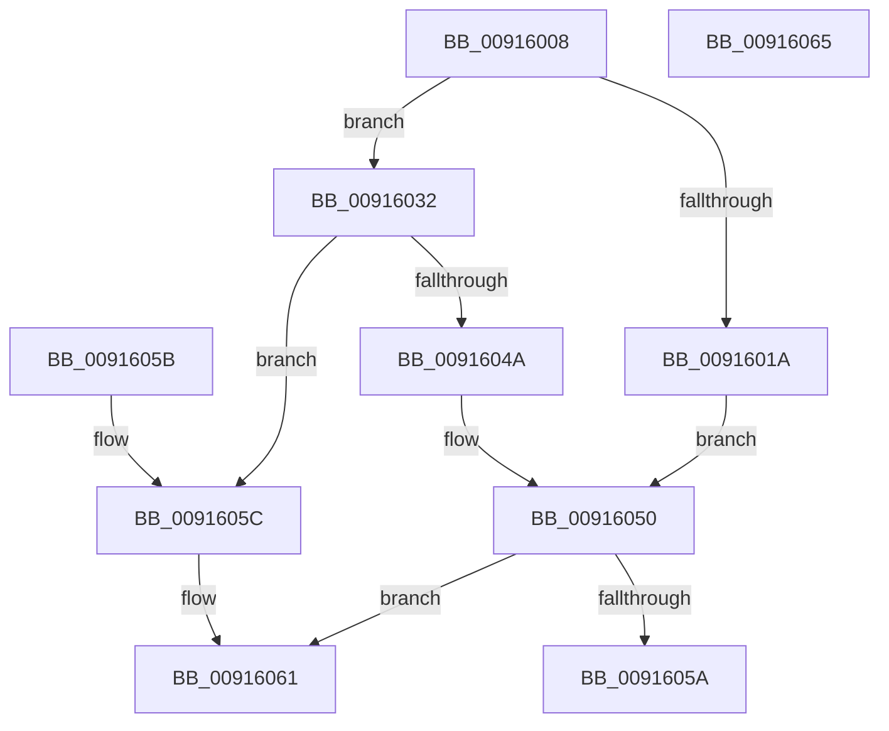

# PopAdaptiveCalculateInputRelativeTimeout

- RVA: `0x00916008`–`0x00916066` (길이 `94` bytes)
- VA: `0x0000000140916008`
- 실행 섹션: `PAGE`
- PDB 이름 있음: `예`; PDB Function 태그: `아니요`
- unwind 정보 RVA: `0x000DB714`
- 디코드: `31`개 명령, `94/94` bytes 표시
- 미해석 바이트: `0` (있으면 어셈블리에 `.byte`로 보존)

> 이 문서는 커널 이미지의 기계어와 PDB 기호를 분석해 생성했습니다. 4번과 5번은 함수 원형과 자료형을 바이너리 사용 방식에서 추정한 C 해석이며 원본 소스 복구 결과는 아닙니다.

## 1. Dependencies

- 직접 호출 지점: **0**; 고유 호출 대상: **0**
- 직접 호출자로 확인된 함수: **1**
- RIP 상대 이미지 참조: **0**

### Outgoing calls
- 직접 디코드된 call 명령이 없습니다.

### Direct callers
- [PopAdaptiveGetConsoleSessionState](PopAdaptiveGetConsoleSessionState_function_00913FB4.md) at `0x009141D5`
- [PopAdaptiveGetConsoleSessionState](PopAdaptiveGetConsoleSessionState_function_00913FB4.md) at `0x00914326`

### Static image references
- 디코드된 RIP-relative 메모리 참조가 없습니다.

## 2. Other-region calls and transfers

- 다른 실행 섹션으로 향하는 call: **0**
- 별도 외부 분기/꼬리 이동을 확인하지 못했습니다.

## 3. Assembly (complete function range)

```asm
00916008  44 8B CA                        mov r9d, edx
0091600B  48 B8 77 BE 9F 1A 2F DD 24 06   movabs rax, 0x624dd2f1a9fbe77
00916015  4C 3B C1                        cmp r8, rcx
00916018  77 18                           ja 0x140916032
0091601A  49 2B C8                        sub rcx, r8
0091601D  48 F7 E1                        mul rcx
00916020  48 2B CA                        sub rcx, rdx
00916023  48 D1 E9                        shr rcx, 1
00916026  48 03 CA                        add rcx, rdx
00916029  48 C1 E9 09                     shr rcx, 9
0091602D  49 03 C9                        add rcx, r9
00916030  EB 1E                           jmp 0x140916050
00916032  4C 2B C1                        sub r8, rcx
00916035  49 F7 E0                        mul r8
00916038  4C 2B C2                        sub r8, rdx
0091603B  49 D1 E8                        shr r8, 1
0091603E  4C 03 C2                        add r8, rdx
00916041  49 C1 E8 09                     shr r8, 9
00916045  4D 3B C1                        cmp r8, r9
00916048  73 12                           jae 0x14091605c
0091604A  49 8B C9                        mov rcx, r9
0091604D  49 2B C8                        sub rcx, r8
00916050  B8 FF FF FF FF                  mov eax, 0xffffffff
00916055  48 3B C8                        cmp rcx, rax
00916058  72 07                           jb 0x140916061
0091605A  C3                              ret
0091605B  CC                              int3
0091605C  B9 01 00 00 00                  mov ecx, 1
00916061  48 8B C1                        mov rax, rcx
00916064  C3                              ret
00916065  CC                              int3
```

## 4. C-style interpretation (structured pseudocode)

```c
__int64 __fastcall PopAdaptiveCalculateInputRelativeTimeout(__int64 a1, __int64 a2, __int64 a3)
{
    if (a3 > a1) goto loc_00916032;
    a1 = (a1) - (a3);
    a1 = (a1) - (a2);
    a1 = (a1) >> (1);
    a1 = (a1) + (a2);
    a1 = (a1) >> (9);
    a1 = (a1) + ((unsigned int)((unsigned int)(a2)));
    goto loc_00916050;
loc_00916032:
    a3 = (a3) - (a1);
    a3 = (a3) - (a2);
    a3 = (a3) >> (1);
    a3 = (a3) + (a2);
    a3 = (a3) >> (9);
    if (a3 >= ((unsigned int)((unsigned int)(a2)))) goto loc_0091605C;
    a1 = ((unsigned int)((unsigned int)(a2))) - (a3);
loc_00916050:
    if (a1 < ((unsigned int)(0xFFFFFFFFULL))) goto loc_00916061;
    return (unsigned int)(0xFFFFFFFFULL);
loc_0091605C:
loc_00916061:
    return 1;
}
```

## 5. (Beta) C Style

```c
int64_t PopAdaptiveCalculateInputRelativeTimeout(int64_t Arg1, int64_t Arg2, int64_t Arg3)
{
    if (Arg3 > Arg1) goto loc_00916032;
    Arg1 = (Arg1) - (Arg3);
    Arg1 = (Arg1) - (Arg2);
    Arg1 = (Arg1) >> (1);
    Arg1 = (Arg1) + (Arg2);
    Arg1 = (Arg1) >> (9);
    Arg1 = (Arg1) + ((uint32_t)((uint32_t)(Arg2)));
    goto loc_00916050;
loc_00916032:
    Arg3 = (Arg3) - (Arg1);
    Arg3 = (Arg3) - (Arg2);
    Arg3 = (Arg3) >> (1);
    Arg3 = (Arg3) + (Arg2);
    Arg3 = (Arg3) >> (9);
    if (Arg3 >= ((uint32_t)((uint32_t)(Arg2)))) goto loc_0091605C;
    Arg1 = ((uint32_t)((uint32_t)(Arg2))) - (Arg3);
loc_00916050:
    if (Arg1 < ((uint32_t)(0xFFFFFFFFULL))) goto loc_00916061;
    return (uint32_t)(0xFFFFFFFFULL);
loc_0091605C:
loc_00916061:
    return 1;
}
```

## 6. Execution-region graph

[열기: 2D/3D 그래프와 함수 탐색 컨트롤 패널](../../../control-panel.html?section=page&rva=0x00916008&view=graph)

- 2D 그래프는 위에서 아래로 흐르고, 3D 그래프는 빈 공간을 드래그해 회전합니다. Shift+드래그는 이동, 휠은 확대·축소, 함수 노드 선택은 대상 보고서 이동입니다.

### Static fallback


