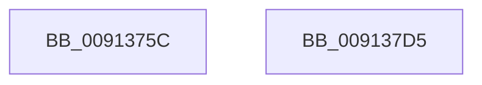

# PopAdaptiveGetBootIsSystemInitiated

- RVA: `0x0091375C`–`0x009137D6` (길이 `122` bytes)
- VA: `0x000000014091375C`
- 실행 섹션: `PAGE`
- PDB 이름 있음: `예`; PDB Function 태그: `아니요`
- unwind 정보 RVA: `0x0008A2AC`
- 디코드: `29`개 명령, `122/122` bytes 표시
- 미해석 바이트: `0` (있으면 어셈블리에 `.byte`로 보존)

> 이 문서는 커널 이미지의 기계어와 PDB 기호를 분석해 생성했습니다. 4번과 5번은 함수 원형과 자료형을 바이너리 사용 방식에서 추정한 C 해석이며 원본 소스 복구 결과는 아닙니다.

## 1. Dependencies

- 직접 호출 지점: **2**; 고유 호출 대상: **2**
- 직접 호출자로 확인된 함수: **1**
- RIP 상대 이미지 참조: **4**

### Outgoing calls
- `0x0091379A` → [ExAcquireResourceExclusiveLite](../../text/21/ExAcquireResourceExclusiveLite_function_00214E20.md) (function, `0x00214E20`)
- `0x009137C3` → [PopReleaseAdaptiveLock](PopReleaseAdaptiveLock_function_009137DC.md) (function, `0x009137DC`)

### Direct callers
- [NtSetThreadExecutionState](../AC/NtSetThreadExecutionState_function_00AC0A40.md) at `0x00AC0BE1`
- [NtSetThreadExecutionState](../AC/NtSetThreadExecutionState_function_00AC0A40.md) at `0x00AC0CDF`

### Static image references
- `0x00913769` → RVA `0x00F08140` (`.data`; read)
- `0x009137A8` → RVA `0x00FD82A0` (`PAGEDATA`; write)
- `0x009137B1` → RVA `0x00FD81F0` (`PAGEDATA`; read)
- `0x009137BD` → RVA `0x00F08220` (`.data`; write)

## 2. Other-region calls and transfers

- 다른 실행 섹션으로 향하는 call: **1**
  - `0x0091379A` → [ExAcquireResourceExclusiveLite](../../text/21/ExAcquireResourceExclusiveLite_function_00214E20.md) (`PAGE` → `.text`)
- 별도 외부 분기/꼬리 이동을 확인하지 못했습니다.

## 3. Assembly (complete function range)

```asm
0091375C  48 89 5C 24 08                  mov qword ptr [rsp + 8], rbx
00913761  57                              push rdi
00913762  48 83 EC 50                     sub rsp, 0x50
00913766  0F 57 C0                        xorps xmm0, xmm0
00913769  48 8D 0D D0 49 5F 00            lea rcx, [rip + 0x5f49d0]
00913770  0F 11 44 24 20                  movups xmmword ptr [rsp + 0x20], xmm0
00913775  33 C0                           xor eax, eax
00913777  BF 01 00 00 00                  mov edi, 1
0091377C  0F 11 44 24 30                  movups xmmword ptr [rsp + 0x30], xmm0
00913781  48 89 44 24 40                  mov qword ptr [rsp + 0x40], rax
00913786  40 8A D7                        mov dl, dil
00913789  65 48 8B 04 25 88 01 00 00      mov rax, qword ptr gs:[0x188]
00913792  66 FF 88 E4 01 00 00            dec word ptr [rax + 0x1e4]
00913799  90                              nop
0091379A  E8 81 16 90 FF                  call 0x140214e20
0091379F  65 48 8B 04 25 88 01 00 00      mov rax, qword ptr gs:[0x188]
009137A8  48 89 05 F1 4A 6C 00            mov qword ptr [rip + 0x6c4af1], rax
009137AF  32 C0                           xor al, al
009137B1  38 05 39 4A 6C 00               cmp byte ptr [rip + 0x6c4a39], al
009137B7  0F B6 D8                        movzx ebx, al
009137BA  0F 45 DF                        cmovne ebx, edi
009137BD  88 05 5D 4A 5F 00               mov byte ptr [rip + 0x5f4a5d], al
009137C3  E8 14 00 00 00                  call 0x1409137dc
009137C8  8A C3                           mov al, bl
009137CA  48 8B 5C 24 60                  mov rbx, qword ptr [rsp + 0x60]
009137CF  48 83 C4 50                     add rsp, 0x50
009137D3  5F                              pop rdi
009137D4  C3                              ret
009137D5  CC                              int3
```

## 4. C-style interpretation (structured pseudocode)

```c
__int64 __fastcall PopAdaptiveGetBootIsSystemInitiated(void)
{
    __int64 result;
    __int64 v_rbx;
    __int64 v_rsp;
    unsigned __int64 v_stack_m18;
    unsigned __int64 v_stack_m28;
    unsigned __int64 v_stack_m38;
    unsigned __int64 v_stack_p8;

    v_stack_p8 = v_rbx;
    v_rsp = (v_rsp) - (80);
    v_stack_m38 = v_xmm0;
    result = 0;
    v_stack_m28 = v_xmm0;
    v_stack_m18 = 0;
    result = ExAcquireResourceExclusiveLite(v_rip + 6244816, 1, a3, a4);
    *(unsigned __int64 *)(v_rip + 7097073) = *(unsigned __int64 *)(gs_base + (0 + 392));
    result = 0;
    v_rbx = 0;
    if ((*(unsigned __int8 *)(v_rip + 7096889)) != 0) { v_rbx = 1; }
    *(unsigned __int8 *)(v_rip + 6244957) = 0;
    result = PopReleaseAdaptiveLock(v_rip + 6244816, 1, a3, a4);
    v_rsp = (v_rsp) + (80);
    return (unsigned __int8)(v_rbx);
}
```

## 5. (Beta) C Style

```c
void PopAdaptiveGetBootIsSystemInitiated(void)
{
    int64_t result;
    int64_t local_rbx;
    int64_t local_rsp;
    uint64_t v_stack_m18;
    uint64_t v_stack_m28;
    uint64_t v_stack_m38;
    uint64_t v_stack_p8;

    v_stack_p8 = local_rbx;
    local_rsp = (local_rsp) - (80);
    v_stack_m38 = v_xmm0;
    result = 0;
    v_stack_m28 = v_xmm0;
    v_stack_m18 = 0;
    result = ExAcquireResourceExclusiveLite(v_rip + 6244816, 1, a3, a4);
    *(uint64_t *)(v_rip + 0x6C4AF1) = *(uint64_t *)(gs_base + (0 + 0x188));
    result = 0;
    local_rbx = 0;
    if ((*(uint8_t *)(v_rip + 0x6C4A39)) != 0) { local_rbx = 1; }
    *(uint8_t *)(v_rip + 0x5F4A5D) = 0;
    result = PopReleaseAdaptiveLock(v_rip + 6244816, 1, a3, a4);
    local_rsp = (local_rsp) + (80);
    return (uint8_t)(local_rbx);
}
```

## 6. Execution-region graph

[열기: 2D/3D 그래프와 함수 탐색 컨트롤 패널](../../../control-panel.html?section=page&rva=0x0091375C&view=graph)

- 2D 그래프는 위에서 아래로 흐르고, 3D 그래프는 빈 공간을 드래그해 회전합니다. Shift+드래그는 이동, 휠은 확대·축소, 함수 노드 선택은 대상 보고서 이동입니다.

### Static fallback


