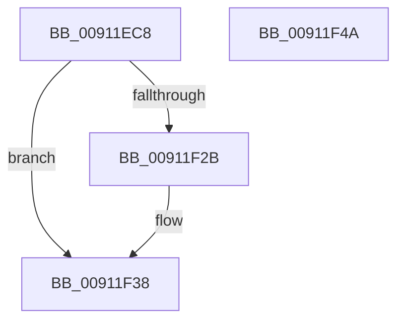

# PopAdaptiveGetBootIsUnattended

- RVA: `0x00911EC8`–`0x00911F4B` (길이 `131` bytes)
- VA: `0x0000000140911EC8`
- 실행 섹션: `PAGE`
- PDB 이름 있음: `예`; PDB Function 태그: `아니요`
- unwind 정보 RVA: `0x0008A2AC`
- 디코드: `31`개 명령, `131/131` bytes 표시
- 미해석 바이트: `0` (있으면 어셈블리에 `.byte`로 보존)

> 이 문서는 커널 이미지의 기계어와 PDB 기호를 분석해 생성했습니다. 4번과 5번은 함수 원형과 자료형을 바이너리 사용 방식에서 추정한 C 해석이며 원본 소스 복구 결과는 아닙니다.

## 1. Dependencies

- 직접 호출 지점: **2**; 고유 호출 대상: **2**
- 직접 호출자로 확인된 함수: **1**
- RIP 상대 이미지 참조: **5**

### Outgoing calls
- `0x00911F06` → [ExAcquireResourceExclusiveLite](../../text/21/ExAcquireResourceExclusiveLite_function_00214E20.md) (function, `0x00214E20`)
- `0x00911F38` → [PopReleaseAdaptiveLock](PopReleaseAdaptiveLock_function_009137DC.md) (function, `0x009137DC`)

### Direct callers
- [PopUpdateSystemIdleContext](PopUpdateSystemIdleContext_function_00911BB4.md) at `0x00911C06`

### Static image references
- `0x00911ED5` → RVA `0x00F08140` (`.data`; read)
- `0x00911F16` → RVA `0x00FD81F0` (`PAGEDATA`; read)
- `0x00911F1C` → RVA `0x00FD82A0` (`PAGEDATA`; write)
- `0x00911F23` → RVA `0x00F08220` (`.data`; write)
- `0x00911F2B` → RVA `0x00FD81F8` (`PAGEDATA`; read)

## 2. Other-region calls and transfers

- 다른 실행 섹션으로 향하는 call: **1**
  - `0x00911F06` → [ExAcquireResourceExclusiveLite](../../text/21/ExAcquireResourceExclusiveLite_function_00214E20.md) (`PAGE` → `.text`)
- 별도 외부 분기/꼬리 이동을 확인하지 못했습니다.

## 3. Assembly (complete function range)

```asm
00911EC8  48 89 5C 24 08                  mov qword ptr [rsp + 8], rbx
00911ECD  57                              push rdi
00911ECE  48 83 EC 50                     sub rsp, 0x50
00911ED2  0F 57 C0                        xorps xmm0, xmm0
00911ED5  48 8D 0D 64 62 5F 00            lea rcx, [rip + 0x5f6264]
00911EDC  0F 11 44 24 20                  movups xmmword ptr [rsp + 0x20], xmm0
00911EE1  33 C0                           xor eax, eax
00911EE3  BF 01 00 00 00                  mov edi, 1
00911EE8  0F 11 44 24 30                  movups xmmword ptr [rsp + 0x30], xmm0
00911EED  48 89 44 24 40                  mov qword ptr [rsp + 0x40], rax
00911EF2  40 8A D7                        mov dl, dil
00911EF5  65 48 8B 04 25 88 01 00 00      mov rax, qword ptr gs:[0x188]
00911EFE  66 FF 88 E4 01 00 00            dec word ptr [rax + 0x1e4]
00911F05  90                              nop
00911F06  E8 15 2F 90 FF                  call 0x140214e20
00911F0B  65 48 8B 04 25 88 01 00 00      mov rax, qword ptr gs:[0x188]
00911F14  32 DB                           xor bl, bl
00911F16  38 1D D4 62 6C 00               cmp byte ptr [rip + 0x6c62d4], bl
00911F1C  48 89 05 7D 63 6C 00            mov qword ptr [rip + 0x6c637d], rax
00911F23  88 1D F7 62 5F 00               mov byte ptr [rip + 0x5f62f7], bl
00911F29  74 0D                           je 0x140911f38
00911F2B  F6 05 C6 62 6C 00 08            test byte ptr [rip + 0x6c62c6], 8
00911F32  0F B6 DB                        movzx ebx, bl
00911F35  0F 45 DF                        cmovne ebx, edi
00911F38  E8 9F 18 00 00                  call 0x1409137dc
00911F3D  8A C3                           mov al, bl
00911F3F  48 8B 5C 24 60                  mov rbx, qword ptr [rsp + 0x60]
00911F44  48 83 C4 50                     add rsp, 0x50
00911F48  5F                              pop rdi
00911F49  C3                              ret
00911F4A  CC                              int3
```

## 4. C-style interpretation (structured pseudocode)

```c
__int64 __fastcall PopAdaptiveGetBootIsUnattended(void)
{
    __int64 result;
    __int64 v_rbx;
    __int64 v_rsp;
    unsigned __int64 v_stack_m18;
    unsigned __int64 v_stack_m28;
    unsigned __int64 v_stack_m38;
    unsigned __int64 v_stack_p8;

    v_stack_p8 = v_rbx;
    v_rsp = (v_rsp) - (80);
    v_stack_m38 = v_xmm0;
    result = 0;
    v_stack_m28 = v_xmm0;
    v_stack_m18 = 0;
    result = ExAcquireResourceExclusiveLite(v_rip + 6251108, 1, a3, a4);
    v_rbx = 0;
    *(unsigned __int64 *)(v_rip + 7103357) = *(unsigned __int64 *)(gs_base + (0 + 392));
    *(unsigned __int8 *)(v_rip + 6251255) = 0;
    if ((*(unsigned __int8 *)(v_rip + 7103188)) != 0) {
        v_rbx = 0;
        if (((*(unsigned __int8 *)(v_rip + 7103174)) & (8)) != 0) { v_rbx = 1; }
    }
    result = PopReleaseAdaptiveLock(v_rip + 6251108, 1, a3, a4);
    v_rsp = (v_rsp) + (80);
    return (unsigned __int8)(v_rbx);
}
```

## 5. (Beta) C Style

```c
void PopAdaptiveGetBootIsUnattended(void)
{
    int64_t result;
    int64_t local_rbx;
    int64_t local_rsp;
    uint64_t v_stack_m18;
    uint64_t v_stack_m28;
    uint64_t v_stack_m38;
    uint64_t v_stack_p8;

    v_stack_p8 = local_rbx;
    local_rsp = (local_rsp) - (80);
    v_stack_m38 = v_xmm0;
    result = 0;
    v_stack_m28 = v_xmm0;
    v_stack_m18 = 0;
    result = ExAcquireResourceExclusiveLite(v_rip + 6251108, 1, a3, a4);
    local_rbx = 0;
    *(uint64_t *)(v_rip + 0x6C637D) = *(uint64_t *)(gs_base + (0 + 0x188));
    *(uint8_t *)(v_rip + 0x5F62F7) = 0;
    if ((*(uint8_t *)(v_rip + 0x6C62D4)) != 0) {
        local_rbx = 0;
        if (((*(uint8_t *)(v_rip + 0x6C62C6)) & (8)) != 0) { local_rbx = 1; }
    }
    result = PopReleaseAdaptiveLock(v_rip + 6251108, 1, a3, a4);
    local_rsp = (local_rsp) + (80);
    return (uint8_t)(local_rbx);
}
```

## 6. Execution-region graph

[열기: 2D/3D 그래프와 함수 탐색 컨트롤 패널](../../../control-panel.html?section=page&rva=0x00911EC8&view=graph)

- 2D 그래프는 위에서 아래로 흐르고, 3D 그래프는 빈 공간을 드래그해 회전합니다. Shift+드래그는 이동, 휠은 확대·축소, 함수 노드 선택은 대상 보고서 이동입니다.

### Static fallback


