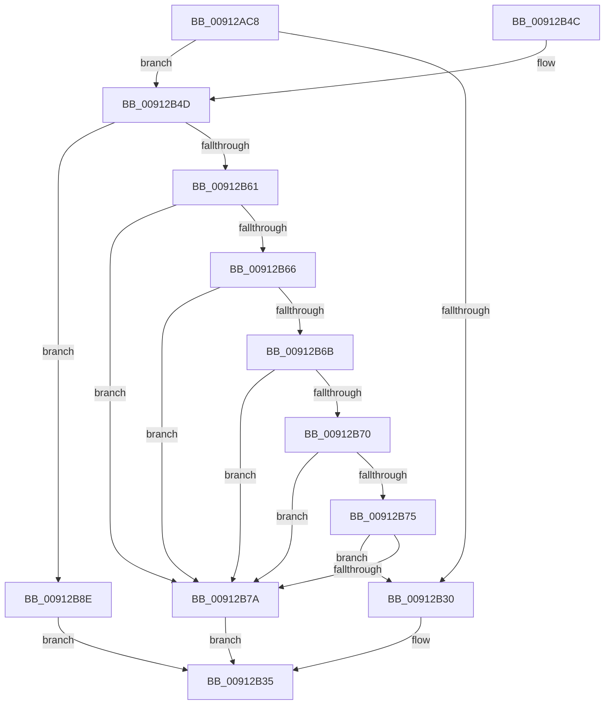

# PopAdaptiveGetBootTargetSystemState

- RVA: `0x00912AC8`–`0x00912B96` (길이 `206` bytes)
- VA: `0x0000000140912AC8`
- 실행 섹션: `PAGE`
- PDB 이름 있음: `예`; PDB Function 태그: `아니요`
- unwind 정보 RVA: `0x0008A380`
- 디코드: `56`개 명령, `206/206` bytes 표시
- 미해석 바이트: `0` (있으면 어셈블리에 `.byte`로 보존)

> 이 문서는 커널 이미지의 기계어와 PDB 기호를 분석해 생성했습니다. 4번과 5번은 함수 원형과 자료형을 바이너리 사용 방식에서 추정한 C 해석이며 원본 소스 복구 결과는 아닙니다.

## 1. Dependencies

- 직접 호출 지점: **2**; 고유 호출 대상: **2**
- 직접 호출자로 확인된 함수: **1**
- RIP 상대 이미지 참조: **6**

### Outgoing calls
- `0x00912B0B` → [ExAcquireResourceExclusiveLite](../../text/21/ExAcquireResourceExclusiveLite_function_00214E20.md) (function, `0x00214E20`)
- `0x00912B35` → [PopReleaseAdaptiveLock](PopReleaseAdaptiveLock_function_009137DC.md) (function, `0x009137DC`)

### Direct callers
- [PopSystemIdleEventHandler](PopSystemIdleEventHandler_function_00912A70.md) at `0x00912A8A`

### Static image references
- `0x00912AFC` → RVA `0x00F08140` (`.data`; read)
- `0x00912B1B` → RVA `0x00FD81F0` (`PAGEDATA`; read)
- `0x00912B21` → RVA `0x00FD82A0` (`PAGEDATA`; write)
- `0x00912B28` → RVA `0x00F08220` (`.data`; write)
- `0x00912B51` → RVA `0x00FD81F8` (`PAGEDATA`; read)
- `0x00912B7A` → RVA `0x00FD87D0` (`PAGEDATA`; read)

## 2. Other-region calls and transfers

- 다른 실행 섹션으로 향하는 call: **1**
  - `0x00912B0B` → [ExAcquireResourceExclusiveLite](../../text/21/ExAcquireResourceExclusiveLite_function_00214E20.md) (`PAGE` → `.text`)
- 별도 외부 분기/꼬리 이동을 확인하지 못했습니다.

## 3. Assembly (complete function range)

```asm
00912AC8  48 89 5C 24 08                  mov qword ptr [rsp + 8], rbx
00912ACD  48 89 74 24 10                  mov qword ptr [rsp + 0x10], rsi
00912AD2  57                              push rdi
00912AD3  48 83 EC 50                     sub rsp, 0x50
00912AD7  0F 57 C0                        xorps xmm0, xmm0
00912ADA  33 C0                           xor eax, eax
00912ADC  0F 11 44 24 20                  movups xmmword ptr [rsp + 0x20], xmm0
00912AE1  48 89 44 24 40                  mov qword ptr [rsp + 0x40], rax
00912AE6  48 8B F2                        mov rsi, rdx
00912AE9  0F 11 44 24 30                  movups xmmword ptr [rsp + 0x30], xmm0
00912AEE  65 48 8B 04 25 88 01 00 00      mov rax, qword ptr gs:[0x188]
00912AF7  48 8B F9                        mov rdi, rcx
00912AFA  B2 01                           mov dl, 1
00912AFC  48 8D 0D 3D 56 5F 00            lea rcx, [rip + 0x5f563d]
00912B03  66 FF 88 E4 01 00 00            dec word ptr [rax + 0x1e4]
00912B0A  90                              nop
00912B0B  E8 10 23 90 FF                  call 0x140214e20
00912B10  65 48 8B 04 25 88 01 00 00      mov rax, qword ptr gs:[0x188]
00912B19  33 DB                           xor ebx, ebx
00912B1B  38 1D CF 56 6C 00               cmp byte ptr [rip + 0x6c56cf], bl
00912B21  48 89 05 78 57 6C 00            mov qword ptr [rip + 0x6c5778], rax
00912B28  88 1D F2 56 5F 00               mov byte ptr [rip + 0x5f56f2], bl
00912B2E  75 1D                           jne 0x140912b4d
00912B30  BB 25 02 00 C0                  mov ebx, 0xc0000225
00912B35  E8 A2 0C 00 00                  call 0x1409137dc
00912B3A  48 8B 74 24 68                  mov rsi, qword ptr [rsp + 0x68]
00912B3F  8B C3                           mov eax, ebx
00912B41  48 8B 5C 24 60                  mov rbx, qword ptr [rsp + 0x60]
00912B46  48 83 C4 50                     add rsp, 0x50
00912B4A  5F                              pop rdi
00912B4B  C3                              ret
00912B4C  CC                              int3
00912B4D  33 C0                           xor eax, eax
00912B4F  89 06                           mov dword ptr [rsi], eax
00912B51  8B 15 A1 56 6C 00               mov edx, dword ptr [rip + 0x6c56a1]
00912B57  83 E2 07                        and edx, 7
00912B5A  8B CA                           mov ecx, edx
00912B5C  83 E9 01                        sub ecx, 1
00912B5F  74 2D                           je 0x140912b8e
00912B61  83 E9 01                        sub ecx, 1
00912B64  74 14                           je 0x140912b7a
00912B66  83 E9 01                        sub ecx, 1
00912B69  74 0F                           je 0x140912b7a
00912B6B  83 E9 01                        sub ecx, 1
00912B6E  74 0A                           je 0x140912b7a
00912B70  83 E9 01                        sub ecx, 1
00912B73  74 05                           je 0x140912b7a
00912B75  83 F9 01                        cmp ecx, 1
00912B78  75 B6                           jne 0x140912b30
00912B7A  48 8D 0D 4F 5C 6C 00            lea rcx, [rip + 0x6c5c4f]
00912B81  C7 07 0A 00 00 00               mov dword ptr [rdi], 0xa
00912B87  8B 04 91                        mov eax, dword ptr [rcx + rdx*4]
00912B8A  89 06                           mov dword ptr [rsi], eax
00912B8C  EB A7                           jmp 0x140912b35
00912B8E  C7 07 02 00 00 00               mov dword ptr [rdi], 2
00912B94  EB 9F                           jmp 0x140912b35
```

## 4. C-style interpretation (structured pseudocode)

```c
__int64 __fastcall PopAdaptiveGetBootTargetSystemState(__int64 a1, __int64 a2)
{
    __int64 result;
    __int64 v_rbx;
    __int64 v_rsp;
    unsigned __int64 v_stack_m18;
    unsigned __int64 v_stack_m28;
    unsigned __int64 v_stack_m38;
    unsigned __int64 v_stack_p10;
    unsigned __int64 v_stack_p8;

    v_stack_p8 = v_rbx;
    v_stack_p10 = v_rsi;
    v_rsp = (v_rsp) - (80);
    result = 0;
    v_stack_m38 = v_xmm0;
    v_stack_m18 = 0;
    v_stack_m28 = v_xmm0;
    result = ExAcquireResourceExclusiveLite(v_rip + 6247997, 1, a3, a4);
    v_rbx = 0;
    *(unsigned __int64 *)(v_rip + 7100280) = *(unsigned __int64 *)(gs_base + (0 + 392));
    *(unsigned __int8 *)(v_rip + 6248178) = 0;
    if ((*(unsigned __int8 *)(v_rip + 7100111)) != 0) goto loc_00912B4D;
loc_00912B30:
loc_00912B35:
    result = PopReleaseAdaptiveLock(v_rip + 6247997, 1, a3, a4);
    v_rsp = (v_rsp) + (80);
    return (unsigned int)((unsigned int)((unsigned int)(0xC0000225ULL)));
loc_00912B4D:
    result = 0;
    *(unsigned int *)(v_stack_p10) = 0;
    a2 = (unsigned int)(((unsigned int)(*(unsigned int *)(v_rip + 7100065))) & (7));
    a1 = (unsigned int)(((unsigned int)((unsigned int)(a2))) - (1));
    if (condition_is_equal) goto loc_00912B8E;
    a1 = (unsigned int)((a1) - (1));
    if (condition_is_equal) goto loc_00912B7A;
    a1 = (unsigned int)((a1) - (1));
    if (condition_is_equal) goto loc_00912B7A;
    a1 = (unsigned int)((a1) - (1));
    if (condition_is_equal) goto loc_00912B7A;
    a1 = (unsigned int)((a1) - (1));
    if (condition_is_equal) goto loc_00912B7A;
    if (((unsigned int)(a1)) != 1) goto loc_00912B30;
loc_00912B7A:
    *(unsigned int *)(a1) = 10;
    *(unsigned int *)(v_stack_p10) = (unsigned int)((unsigned int)(*(unsigned int *)(v_rip + 7101519 + a2 * 4)));
    goto loc_00912B35;
loc_00912B8E:
    *(unsigned int *)(a1) = 2;
    goto loc_00912B35;
}
```

## 5. (Beta) C Style

```c
int64_t PopAdaptiveGetBootTargetSystemState(void *Arg1, void *Arg2)
{
    uint8_t *arg1 = (uint8_t *)Arg1;
    uint8_t *arg2 = (uint8_t *)Arg2;

    int64_t result;
    int64_t local_rbx;
    int64_t local_rsp;
    uint64_t v_stack_m18;
    uint64_t v_stack_m28;
    uint64_t v_stack_m38;
    uint64_t v_stack_p10;
    uint64_t v_stack_p8;

    v_stack_p8 = local_rbx;
    v_stack_p10 = local_rsi;
    local_rsp = (local_rsp) - (80);
    result = 0;
    v_stack_m38 = v_xmm0;
    v_stack_m18 = 0;
    v_stack_m28 = v_xmm0;
    result = ExAcquireResourceExclusiveLite(v_rip + 6247997, 1, a3, a4);
    local_rbx = 0;
    *(uint64_t *)(v_rip + 0x6C5778) = *(uint64_t *)(gs_base + (0 + 0x188));
    *(uint8_t *)(v_rip + 0x5F56F2) = 0;
    if ((*(uint8_t *)(v_rip + 0x6C56CF)) != 0) goto loc_00912B4D;
loc_00912B30:
loc_00912B35:
    result = PopReleaseAdaptiveLock(v_rip + 6247997, 1, a3, a4);
    local_rsp = (local_rsp) + (80);
    return (uint32_t)((uint32_t)((uint32_t)(0xC0000225ULL)));
loc_00912B4D:
    result = 0;
    *(uint32_t *)(v_stack_p10) = 0;
    Arg2 = (uint32_t)(((uint32_t)(*(uint32_t *)(v_rip + 0x6C56A1))) & (7));
    Arg1 = (uint32_t)(((uint32_t)((uint32_t)(Arg2))) - (1));
    if (condition_is_equal) goto loc_00912B8E;
    Arg1 = (uint32_t)((Arg1) - (1));
    if (condition_is_equal) goto loc_00912B7A;
    Arg1 = (uint32_t)((Arg1) - (1));
    if (condition_is_equal) goto loc_00912B7A;
    Arg1 = (uint32_t)((Arg1) - (1));
    if (condition_is_equal) goto loc_00912B7A;
    Arg1 = (uint32_t)((Arg1) - (1));
    if (condition_is_equal) goto loc_00912B7A;
    if (((uint32_t)(Arg1)) != 1) goto loc_00912B30;
loc_00912B7A:
    *(uint32_t *)(arg1) = 10;
    *(uint32_t *)(v_stack_p10) = (uint32_t)((uint32_t)(*(uint32_t *)(v_rip + 0x6C5C4F + arg2 * 4)));
    goto loc_00912B35;
loc_00912B8E:
    *(uint32_t *)(arg1) = 2;
    goto loc_00912B35;
}
```

### 관측된 메모리 오프셋

구조체 형식이 확인되지 않은 접근은 인자 기준의 오프셋으로만 기록했습니다.

| 기준 인자 | 오프셋 표현 | 폭 (bit) | 접근 |
|---|---:|---:|---|
| `Arg1` | `+ 0x0` | `32` | `W` |
| `Arg2` | `+ 0x0` | `32` | `W` |

## 6. Execution-region graph

[열기: 2D/3D 그래프와 함수 탐색 컨트롤 패널](../../../control-panel.html?section=page&rva=0x00912AC8&view=graph)

- 2D 그래프는 위에서 아래로 흐르고, 3D 그래프는 빈 공간을 드래그해 회전합니다. Shift+드래그는 이동, 휠은 확대·축소, 함수 노드 선택은 대상 보고서 이동입니다.

### Static fallback


