# PopAdaptiveGetConsoleSessionState

- RVA: `0x00913FB4`–`0x00914378` (길이 `964` bytes)
- VA: `0x0000000140913FB4`
- 실행 섹션: `PAGE`
- PDB 이름 있음: `예`; PDB Function 태그: `예`
- unwind 정보 RVA: `0x0008A574`
- 디코드: `223`개 명령, `964/964` bytes 표시
- 미해석 바이트: `0` (있으면 어셈블리에 `.byte`로 보존)

> 이 문서는 커널 이미지의 기계어와 PDB 기호를 분석해 생성했습니다. 4번과 5번은 함수 원형과 자료형을 바이너리 사용 방식에서 추정한 C 해석이며 원본 소스 복구 결과는 아닙니다.

## 1. Dependencies

- 직접 호출 지점: **8**; 고유 호출 대상: **5**
- 직접 호출자로 확인된 함수: **1**
- RIP 상대 이미지 참조: **16**

### Outgoing calls
- `0x00913FF1` → [TtmIsEnabled](TtmIsEnabled_function_009143D8.md) (function, `0x009143D8`)
- `0x0091413E` → [PopSetSessionUserStatus](PopSetSessionUserStatus_function_00914BB8.md) (function, `0x00914BB8`)
- `0x00914164` → [PopSetPowerSettingValue](PopSetPowerSettingValue_function_00914E54.md) (function, `0x00914E54`)
- `0x00914183` → [PopSetPowerSettingValue](PopSetPowerSettingValue_function_00914E54.md) (function, `0x00914E54`)
- `0x009141D5` → [PopAdaptiveCalculateInputRelativeTimeout](PopAdaptiveCalculateInputRelativeTimeout_function_00916008.md) (function, `0x00916008`)
- `0x00914300` → [PopAdaptiveConsoleSessionOverrideClear](../76/PopAdaptiveConsoleSessionOverrideClear_function_0076B5EC.md) (function, `0x0076B5EC`)
- `0x00914312` → [PopAdaptiveConsoleSessionOverrideClear](../76/PopAdaptiveConsoleSessionOverrideClear_function_0076B5EC.md) (function, `0x0076B5EC`)
- `0x00914326` → [PopAdaptiveCalculateInputRelativeTimeout](PopAdaptiveCalculateInputRelativeTimeout_function_00916008.md) (function, `0x00916008`)

### Direct callers
- [PopAdaptiveGetSessionStateUnsafe](PopAdaptiveGetSessionStateUnsafe_function_00913A4C.md) at `0x00913A87`

### Static image references
- `0x00913FD1` → RVA `0x00F081AC` (`.data`; read)
- `0x0091400E` → RVA `0x00F08221` (`.data`; read)
- `0x0091401B` → RVA `0x00F081A8` (`.data`; read)
- `0x00914035` → RVA `0x00F08254` (`.data`; read)
- `0x00914067` → RVA `0x00F08230` (`.data`; read)
- `0x009140D3` → RVA `0x00F081C8` (`.data`; read)
- `0x009140DD` → RVA `0x00F081C4` (`.data`; read)
- `0x00914110` → RVA `0x00F08224` (`.data`; write)
- `0x0091411C` → RVA `0x00F08228` (`.data`; write)
- `0x00914158` → RVA `0x00011AB8` (`.rdata`; read)
- `0x0091425F` → RVA `0x00F08224` (`.data`; read)
- `0x0091428D` → RVA `0x00F08230` (`.data`; write)
- `0x00914294` → RVA `0x00F08240` (`.data`; read)
- `0x009142B4` → RVA `0x00F08222` (`.data`; read)
- `0x009142C1` → RVA `0x00F081C0` (`.data`; read)
- `0x009142DF` → RVA `0x00FC5340` (`ALMOSTRO`; read)

## 2. Other-region calls and transfers

- 다른 실행 섹션으로 향하는 call: **0**
- call이 아닌 외부 분기/꼬리 이동: **2**
  - `0x0091432D` → [sub_00B217AC](../B2/Unknown_function_00B217AC.md) (`tail-transfer`)
  - `0x0091433B` → [sub_00B217AC](../B2/Unknown_function_00B217AC.md) (`tail-transfer`)

## 3. Assembly (complete function range)

```asm
00913FB4  48 89 5C 24 20                  mov qword ptr [rsp + 0x20], rbx
00913FB9  4C 89 44 24 18                  mov qword ptr [rsp + 0x18], r8
00913FBE  89 4C 24 08                     mov dword ptr [rsp + 8], ecx
00913FC2  55                              push rbp
00913FC3  56                              push rsi
00913FC4  57                              push rdi
00913FC5  41 54                           push r12
00913FC7  41 55                           push r13
00913FC9  41 56                           push r14
00913FCB  41 57                           push r15
00913FCD  48 83 EC 40                     sub rsp, 0x40
00913FD1  8B 05 D5 41 5F 00               mov eax, dword ptr [rip + 0x5f41d5]
00913FD7  45 32 FF                        xor r15b, r15b
00913FDA  44 88 BC 24 88 00 00 00         mov byte ptr [rsp + 0x88], r15b
00913FE2  4D 8B E1                        mov r12, r9
00913FE5  4C 8B EA                        mov r13, rdx
00913FE8  89 44 24 34                     mov dword ptr [rsp + 0x34], eax
00913FEC  BF 03 00 00 00                  mov edi, 3
00913FF1  E8 E2 03 00 00                  call 0x1409143d8
00913FF6  45 8B 55 18                     mov r10d, dword ptr [r13 + 0x18]
00913FFA  45 33 DB                        xor r11d, r11d
00913FFD  84 C0                           test al, al
00913FFF  0F 85 0E 02 00 00               jne 0x140914213
00914005  45 85 D2                        test r10d, r10d
00914008  0F 84 46 02 00 00               je 0x140914254
0091400E  44 38 1D 0C 42 5F 00            cmp byte ptr [rip + 0x5f420c], r11b
00914015  0F 85 99 02 00 00               jne 0x1409142b4
0091401B  8B 1D 87 41 5F 00               mov ebx, dword ptr [rip + 0x5f4187]
00914021  89 5C 24 30                     mov dword ptr [rsp + 0x30], ebx
00914025  41 C7 04 24 00 01 00 00         mov dword ptr [r12], 0x100
0091402D  48 8B B4 24 A0 00 00 00         mov rsi, qword ptr [rsp + 0xa0]
00914035  4C 8D 35 18 42 5F 00            lea r14, [rip + 0x5f4218]
0091403C  41 8B EB                        mov ebp, r11d
0091403F  45 8B FB                        mov r15d, r11d
00914042  45 38 5E EC                     cmp byte ptr [r14 - 0x14], r11b
00914046  0F 85 55 01 00 00               jne 0x1409141a1
0091404C  41 FF C7                        inc r15d
0091404F  49 83 C6 18                     add r14, 0x18
00914053  41 83 FF 02                     cmp r15d, 2
00914057  72 E9                           jb 0x140914042
00914059  89 5C 24 30                     mov dword ptr [rsp + 0x30], ebx
0091405D  BE 00 01 00 00                  mov esi, 0x100
00914062  83 FF 03                        cmp edi, 3
00914065  75 6C                           jne 0x1409140d3
00914067  48 8B 05 C2 41 5F 00            mov rax, qword ptr [rip + 0x5f41c2]
0091406E  49 39 45 00                     cmp qword ptr [r13], rax
00914072  0F 86 E1 02 00 00               jbe 0x140914359
00914078  48 B8 04 00 00 00 80 F7 FF FF   movabs rax, 0xfffff78000000004
00914082  8B 08                           mov ecx, dword ptr [rax]
00914084  48 B8 20 03 00 00 80 F7 FF FF   movabs rax, 0xfffff78000000320
0091408E  48 C1 E1 20                     shl rcx, 0x20
00914092  48 8B 00                        mov rax, qword ptr [rax]
00914095  48 C1 E0 08                     shl rax, 8
00914099  48 F7 E1                        mul rcx
0091409C  48 B8 77 BE 9F 1A 2F DD 24 06   movabs rax, 0x624dd2f1a9fbe77
009140A6  48 8B CA                        mov rcx, rdx
009140A9  49 2B 4D 00                     sub rcx, qword ptr [r13]
009140AD  48 F7 E1                        mul rcx
009140B0  48 2B CA                        sub rcx, rdx
009140B3  48 D1 E9                        shr rcx, 1
009140B6  48 03 CA                        add rcx, rdx
009140B9  8B 15 ED 40 5F 00               mov edx, dword ptr [rip + 0x5f40ed]
009140BF  48 C1 E9 09                     shr rcx, 9
009140C3  48 3B CA                        cmp rcx, rdx
009140C6  0F 83 81 02 00 00               jae 0x14091434d
009140CC  8B 5C 24 30                     mov ebx, dword ptr [rsp + 0x30]
009140D0  41 8B FB                        mov edi, r11d
009140D3  8B 05 EF 40 5F 00               mov eax, dword ptr [rip + 0x5f40ef]
009140D9  85 C0                           test eax, eax
009140DB  74 21                           je 0x1409140fe
009140DD  44 39 1D E0 40 5F 00            cmp dword ptr [rip + 0x5f40e0], r11d
009140E4  0F 85 60 01 00 00               jne 0x14091424a
009140EA  83 FB 3C                        cmp ebx, 0x3c
009140ED  0F 87 18 01 00 00               ja 0x14091420b
009140F3  41 8B C3                        mov eax, r11d
009140F6  85 C0                           test eax, eax
009140F8  0F 85 F4 00 00 00               jne 0x1409141f2
009140FE  44 8A BC 24 88 00 00 00         mov r15b, byte ptr [rsp + 0x88]
00914106  48 8B 8C 24 90 00 00 00         mov rcx, qword ptr [rsp + 0x90]
0091410E  85 FF                           test edi, edi
00914110  89 1D 0E 41 5F 00               mov dword ptr [rip + 0x5f410e], ebx
00914116  8B D7                           mov edx, edi
00914118  49 8B 45 00                     mov rax, qword ptr [r13]
0091411C  48 89 05 05 41 5F 00            mov qword ptr [rip + 0x5f4105], rax
00914123  8B 44 24 34                     mov eax, dword ptr [rsp + 0x34]
00914127  89 19                           mov dword ptr [rcx], ebx
00914129  41 0F 45 C3                     cmovne eax, r11d
0091412D  89 69 04                        mov dword ptr [rcx + 4], ebp
00914130  44 88 79 0C                     mov byte ptr [rcx + 0xc], r15b
00914134  89 41 08                        mov dword ptr [rcx + 8], eax
00914137  8B 8C 24 80 00 00 00            mov ecx, dword ptr [rsp + 0x80]
0091413E  E8 75 0A 00 00                  call 0x140914bb8
00914143  48 8D 44 24 30                  lea rax, [rsp + 0x30]
00914148  BF 04 00 00 00                  mov edi, 4
0091414D  83 CB FF                        or ebx, 0xffffffff
00914150  48 89 44 24 20                  mov qword ptr [rsp + 0x20], rax
00914155  44 8B CF                        mov r9d, edi
00914158  48 8D 0D 59 D9 6F FF            lea rcx, [rip - 0x9026a7]
0091415F  8B D3                           mov edx, ebx
00914161  45 33 C0                        xor r8d, r8d
00914164  E8 EB 0C 00 00                  call 0x140914e54
00914169  48 8D 44 24 30                  lea rax, [rsp + 0x30]
0091416E  44 8B CF                        mov r9d, edi
00914171  44 8D 47 FD                     lea r8d, [rdi - 3]
00914175  48 89 44 24 20                  mov qword ptr [rsp + 0x20], rax
0091417A  8B D3                           mov edx, ebx
0091417C  48 8D 0D 35 D9 6F FF            lea rcx, [rip - 0x9026cb]
00914183  E8 CC 0C 00 00                  call 0x140914e54
00914188  48 8B 9C 24 98 00 00 00         mov rbx, qword ptr [rsp + 0x98]
00914190  48 83 C4 40                     add rsp, 0x40
00914194  41 5F                           pop r15
00914196  41 5E                           pop r14
00914198  41 5D                           pop r13
0091419A  41 5C                           pop r12
0091419C  5F                              pop rdi
0091419D  5E                              pop rsi
0091419E  5D                              pop rbp
0091419F  C3                              ret
009141A0  CC                              int3
009141A1  4D 8B 56 F4                     mov r10, qword ptr [r14 - 0xc]
009141A5  4D 3B 55 08                     cmp r10, qword ptr [r13 + 8]
009141A9  0F 82 5B 01 00 00               jb 0x14091430a
009141AF  41 8B 16                        mov edx, dword ptr [r14]
009141B2  C6 84 24 88 00 00 00 01         mov byte ptr [rsp + 0x88], 1
009141BA  85 D2                           test edx, edx
009141BC  0F 85 5D 01 00 00               jne 0x14091431f
009141C2  41 8B 56 FC                     mov edx, dword ptr [r14 - 4]
009141C6  85 D2                           test edx, edx
009141C8  0F 84 7E FE FF FF               je 0x14091404c
009141CE  4D 8B 45 00                     mov r8, qword ptr [r13]
009141D2  49 8B CA                        mov rcx, r10
009141D5  E8 2E 1E 00 00                  call 0x140916008
009141DA  85 DB                           test ebx, ebx
009141DC  0F 85 5E 01 00 00               jne 0x140914340
009141E2  8B D8                           mov ebx, eax
009141E4  45 89 3C 24                     mov dword ptr [r12], r15d
009141E8  BF 02 00 00 00                  mov edi, 2
009141ED  E9 5A FE FF FF                  jmp 0x14091404c
009141F2  85 ED                           test ebp, ebp
009141F4  0F 85 71 01 00 00               jne 0x14091436b
009141FA  8B E8                           mov ebp, eax
009141FC  48 8B 84 24 A0 00 00 00         mov rax, qword ptr [rsp + 0xa0]
00914204  89 30                           mov dword ptr [rax], esi
00914206  E9 F3 FE FF FF                  jmp 0x1409140fe
0091420B  8D 43 F1                        lea eax, [rbx - 0xf]
0091420E  E9 E3 FE FF FF                  jmp 0x1409140f6
00914213  48 8B 84 24 A0 00 00 00         mov rax, qword ptr [rsp + 0xa0]
0091421B  41 F7 DA                        neg r10d
0091421E  8B 1D 84 3F 5F 00               mov ebx, dword ptr [rip + 0x5f3f84]
00914224  41 8B EB                        mov ebp, r11d
00914227  1B FF                           sbb edi, edi
00914229  44 89 5C 24 34                  mov dword ptr [rsp + 0x34], r11d
0091422E  F7 D7                           not edi
00914230  89 5C 24 30                     mov dword ptr [rsp + 0x30], ebx
00914234  83 E7 02                        and edi, 2
00914237  41 C7 04 24 00 01 00 00         mov dword ptr [r12], 0x100
0091423F  C7 00 02 01 00 00               mov dword ptr [rax], 0x102
00914245  E9 BC FE FF FF                  jmp 0x140914106
0091424A  BE 02 01 00 00                  mov esi, 0x102
0091424F  E9 A2 FE FF FF                  jmp 0x1409140f6
00914254  48 8B 84 24 A0 00 00 00         mov rax, qword ptr [rsp + 0xa0]
0091425C  41 8B EB                        mov ebp, r11d
0091425F  8B 1D BF 3F 5F 00               mov ebx, dword ptr [rip + 0x5f3fbf]
00914265  BF 02 00 00 00                  mov edi, 2
0091426A  89 5C 24 30                     mov dword ptr [rsp + 0x30], ebx
0091426E  41 C7 04 24 00 01 00 00         mov dword ptr [r12], 0x100
00914276  C7 00 02 01 00 00               mov dword ptr [rax], 0x102
0091427C  49 8B 45 10                     mov rax, qword ptr [r13 + 0x10]
00914280  48 39 05 A9 3F 5F 00            cmp qword ptr [rip + 0x5f3fa9], rax
00914287  0F 84 79 FE FF FF               je 0x140914106
0091428D  48 89 05 9C 3F 5F 00            mov qword ptr [rip + 0x5f3f9c], rax
00914294  48 8D 35 A5 3F 5F 00            lea rsi, [rip + 0x5f3fa5]
0091429B  45 8B F3                        mov r14d, r11d
0091429E  44 38 1E                        cmp byte ptr [rsi], r11b
009142A1  75 4E                           jne 0x1409142f1
009142A3  41 FF C6                        inc r14d
009142A6  48 83 C6 18                     add rsi, 0x18
009142AA  44 3B F7                        cmp r14d, edi
009142AD  72 EF                           jb 0x14091429e
009142AF  E9 52 FE FF FF                  jmp 0x140914106
009142B4  44 38 1D 67 3F 5F 00            cmp byte ptr [rip + 0x5f3f67], r11b
009142BB  0F 85 5A FD FF FF               jne 0x14091401b
009142C1  8B 1D F9 3E 5F 00               mov ebx, dword ptr [rip + 0x5f3ef9]
009142C7  3B 1D DB 3E 5F 00               cmp ebx, dword ptr [rip + 0x5f3edb]
009142CD  89 5C 24 30                     mov dword ptr [rsp + 0x30], ebx
009142D1  41 C7 04 24 01 01 00 00         mov dword ptr [r12], 0x101
009142D9  0F 86 4E FD FF FF               jbe 0x14091402d
009142DF  44 39 1D 5A 10 6B 00            cmp dword ptr [rip + 0x6b105a], r11d
009142E6  0F 85 41 FD FF FF               jne 0x14091402d
009142EC  E9 2A FD FF FF                  jmp 0x14091401b
009142F1  49 8B 45 10                     mov rax, qword ptr [r13 + 0x10]
009142F5  48 39 46 08                     cmp qword ptr [rsi + 8], rax
009142F9  77 A8                           ja 0x1409142a3
009142FB  33 D2                           xor edx, edx
009142FD  41 8B CE                        mov ecx, r14d
00914300  E8 E7 72 E5 FF                  call 0x14076b5ec
00914305  45 33 DB                        xor r11d, r11d
00914308  EB 99                           jmp 0x1409142a3
0091430A  BA 01 00 00 00                  mov edx, 1
0091430F  41 8B CF                        mov ecx, r15d
00914312  E8 D5 72 E5 FF                  call 0x14076b5ec
00914317  45 33 DB                        xor r11d, r11d
0091431A  E9 2D FD FF FF                  jmp 0x14091404c
0091431F  4D 8B 45 00                     mov r8, qword ptr [r13]
00914323  49 8B CA                        mov rcx, r10
00914326  E8 DD 1C 00 00                  call 0x140916008
0091432B  85 ED                           test ebp, ebp
0091432D  0F 84 79 D4 20 00               je 0x140b217ac
00914333  3B C5                           cmp eax, ebp
00914335  0F 83 87 FE FF FF               jae 0x1409141c2
0091433B  E9 6C D4 20 00                  jmp 0x140b217ac
00914340  3B C3                           cmp eax, ebx
00914342  0F 83 A0 FE FF FF               jae 0x1409141e8
00914348  E9 95 FE FF FF                  jmp 0x1409141e2
0091434D  85 D2                           test edx, edx
0091434F  0F 84 77 FD FF FF               je 0x1409140cc
00914355  8B 5C 24 30                     mov ebx, dword ptr [rsp + 0x30]
00914359  BF 02 00 00 00                  mov edi, 2
0091435E  C6 84 24 88 00 00 00 01         mov byte ptr [rsp + 0x88], 1
00914366  E9 68 FD FF FF                  jmp 0x1409140d3
0091436B  3B C5                           cmp eax, ebp
0091436D  0F 83 8B FD FF FF               jae 0x1409140fe
00914373  E9 82 FE FF FF                  jmp 0x1409141fa
```

## 4. C-style interpretation (structured pseudocode)

```c
__int64 __fastcall PopAdaptiveGetConsoleSessionState(int a1, __int64 a2, __int64 a3, __int64 a4, __int64 a5)
{
    __int64 result;
    __int64 v_r10;
    __int64 v_r11;
    __int64 v_r14;
    __int64 v_r15;
    __int64 v_rbx;
    __int64 v_rdi;
    __int64 v_rsi;
    __int64 v_rsp;
    unsigned int v_stack_m44;
    unsigned int v_stack_m48;
    unsigned __int64 v_stack_m58;
    unsigned __int8 v_stack_p10;
    unsigned __int64 v_stack_p18;
    unsigned __int64 v_stack_p20;
    unsigned int v_stack_p30;
    unsigned int v_stack_p34;
    unsigned int v_stack_p8;
    unsigned __int8 v_stack_p88;

    v_stack_p20 = v_rbx;
    v_stack_p18 = a3;
    v_stack_p8 = a1;
    v_rsp = (v_rsp) - (64);
    v_r15 = 0;
    v_stack_p10 = 0;
    v_stack_m44 = (unsigned int)((unsigned int)(*(unsigned int *)(v_rip + 6242773)));
    result = TtmIsEnabled(a1, a2, a3, a4);
    v_r11 = 0;
    if ((unsigned __int8)(result) != 0) goto loc_00914213;
    if ((unsigned int)((unsigned int)(*(unsigned int *)(a2 + 24))) == 0) goto loc_00914254;
    if ((*(unsigned __int8 *)(v_rip + 6242828)) != 0) goto loc_009142B4;
loc_0091401B:
    v_stack_m48 = (unsigned int)((unsigned int)(*(unsigned int *)(v_rip + 6242695)));
    *(unsigned int *)(a4) = 256;
loc_0091402D:
loc_00914042:
    if ((*(unsigned __int8 *)(v_rip + 6242840 - 20)) != 0) goto loc_009141A1;
loc_0091404C:
    v_r15 = (unsigned int)((0) + 1);
    v_r14 = (v_rip + 6242840) + (24);
    if (((unsigned int)(v_r15)) < 2) goto loc_00914042;
    v_stack_m48 = (unsigned int)((unsigned int)(*(unsigned int *)(v_rip + 6242695)));
    if (3 != 3) goto loc_009140D3;
    if ((*(unsigned __int64 *)(a2)) <= (*(unsigned __int64 *)(v_rip + 6242754))) goto loc_00914359;
    a1 = ((unsigned int)(*(unsigned int *)(*(unsigned __int64 *)(v_rip + 6242754)))) << (32);
    result = (*(unsigned __int64 *)(*(unsigned __int64 *)(v_rip + 6242754))) << (8);
    a1 = (a2) - (*(unsigned __int64 *)(a2));
    a1 = (a1) - (a2);
    a1 = (a1) >> (1);
    a1 = (a1) + (a2);
    a1 = (a1) >> (9);
    if (a1 >= ((unsigned int)(*(unsigned int *)(v_rip + 6242541)))) goto loc_0091434D;
loc_009140CC:
loc_009140D3:
    if ((unsigned int)((unsigned int)(*(unsigned int *)(v_rip + 6242543))) == 0) goto loc_009140FE;
    if ((*(unsigned int *)(v_rip + 6242528)) != 0) goto loc_0091424A;
    if (((unsigned int)((unsigned int)(v_stack_m48))) > 60) goto loc_0091420B;
loc_009140F6:
    if (0 != 0) goto loc_009141F2;
loc_009140FE:
loc_00914106:
    *(unsigned int *)(v_rip + 6242574) = (unsigned int)((unsigned int)(v_stack_m48));
    *(unsigned __int64 *)(v_rip + 6242565) = *(unsigned __int64 *)(a2);
    *(unsigned int *)(v_stack_p18) = (unsigned int)((unsigned int)(v_stack_m48));
    result = (unsigned int)(v_stack_m44);
    if (0 != 0) { result = 0; }
    *(unsigned int *)(v_stack_p18 + 4) = 0;
    *(unsigned __int8 *)(v_stack_p18 + 12) = (unsigned __int8)(v_stack_p10);
    *(unsigned int *)(v_stack_p18 + 8) = (unsigned int)(result);
    result = PopSetSessionUserStatus((unsigned int)(v_stack_p8), 0, a3, a4);
    v_rbx = (unsigned int)(((unsigned int)(v_stack_m48)) | (0xFFFFFFFFULL));
    v_stack_m58 = v_stack_m48;
    a3 = 0;
    result = PopSetPowerSettingValue(v_rip - 9447079, (unsigned int)((unsigned int)(v_rbx)), a3, 4);
    v_stack_m58 = v_stack_m48;
    result = PopSetPowerSettingValue(v_rip - 9447115, (unsigned int)((unsigned int)(v_rbx)), 4 - 3, 4);
    v_rsp = (v_rsp) + (64);
    return result;
loc_009141A1:
    if ((*(unsigned __int64 *)(v_r14 - 12)) < (*(unsigned __int64 *)(a2 + 8))) goto loc_0091430A;
    v_stack_p88 = 1;
    if ((unsigned int)((unsigned int)(*(unsigned int *)(v_r14))) != 0) goto loc_0091431F;
loc_009141C2:
    if ((unsigned int)((unsigned int)(*(unsigned int *)(v_r14 - 4))) == 0) goto loc_0091404C;
    result = PopAdaptiveCalculateInputRelativeTimeout(*(unsigned __int64 *)(v_r14 - 12), (unsigned int)(*(unsigned int *)(v_r14 - 4)), *(unsigned __int64 *)(a2), 4);
    if ((unsigned int)(v_stack_p20) != 0) goto loc_00914340;
loc_009141E2:
    *(unsigned int *)(a4) = (unsigned int)(v_stack_p10);
loc_009141E8:
    goto loc_0091404C;
loc_009141F2:
    if (0 != 0) goto loc_0091436B;
loc_009141FA:
    *(unsigned int *)(a5) = 256;
    goto loc_009140FE;
loc_0091420B:
    goto loc_009140F6;
loc_00914213:
    v_r10 = (unsigned int)(-(*(unsigned __int64 *)(v_r14 - 12)));
    v_stack_p34 = 0;
    v_rdi = (unsigned int)(~(2));
    v_stack_p30 = (unsigned int)((unsigned int)(*(unsigned int *)(v_rip + 6242180)));
    v_rdi = (unsigned int)((v_rdi) & (2));
    *(unsigned int *)(a4) = 256;
    *(unsigned int *)(a5) = 258;
    goto loc_00914106;
loc_0091424A:
    goto loc_009140F6;
loc_00914254:
    v_stack_p30 = (unsigned int)((unsigned int)(*(unsigned int *)(v_rip + 6242239)));
    *(unsigned int *)(a4) = 256;
    *(unsigned int *)(a5) = 258;
    if ((*(unsigned __int64 *)(v_rip + 6242217)) == (*(unsigned __int64 *)(a2 + 16))) goto loc_00914106;
    *(unsigned __int64 *)(v_rip + 6242204) = *(unsigned __int64 *)(a2 + 16);
loc_0091429E:
    if ((*(unsigned __int8 *)(v_rip + 6242213)) != 0) goto loc_009142F1;
loc_009142A3:
    v_r14 = (unsigned int)((0) + 1);
    v_rsi = (v_rip + 6242213) + (24);
    if (((unsigned int)(v_r14)) < 2) goto loc_0091429E;
    goto loc_00914106;
loc_009142B4:
    if ((*(unsigned __int8 *)(v_rip + 6242151)) != 0) goto loc_0091401B;
    v_stack_p30 = (unsigned int)((unsigned int)(*(unsigned int *)(v_rip + 6242041)));
    *(unsigned int *)(a4) = 257;
    if (((unsigned int)((unsigned int)(*(unsigned int *)(v_rip + 6242041)))) <= (*(unsigned int *)(v_rip + 6242011))) goto loc_0091402D;
    if ((*(unsigned int *)(v_rip + 7016538)) != 0) goto loc_0091402D;
    goto loc_0091401B;
loc_009142F1:
    if ((*(unsigned __int64 *)(v_rsi + 8)) > (*(unsigned __int64 *)(a2 + 16))) goto loc_009142A3;
    a2 = 0;
    result = PopAdaptiveConsoleSessionOverrideClear((unsigned int)((unsigned int)(v_r14)), a2, *(unsigned __int64 *)(a2), 4);
    v_r11 = 0;
    goto loc_009142A3;
loc_0091430A:
    result = PopAdaptiveConsoleSessionOverrideClear((unsigned int)((unsigned int)(v_stack_p10)), 1, *(unsigned __int64 *)(a2), 4);
    v_r11 = 0;
    goto loc_0091404C;
loc_0091431F:
    result = PopAdaptiveCalculateInputRelativeTimeout(v_r10, 1, *(unsigned __int64 *)(a2), 4);
    if (((unsigned int)(result)) >= 0) goto loc_009141C2;
loc_00914340:
    if (((unsigned int)(result)) >= ((unsigned int)((unsigned int)(*(unsigned int *)(v_rip + 6242041))))) goto loc_009141E8;
    goto loc_009141E2;
loc_0091434D:
    if (1 == 0) goto loc_009140CC;
loc_00914359:
    v_stack_p88 = 1;
    goto loc_009140D3;
loc_0091436B:
    if (((unsigned int)(result)) >= 0) goto loc_009140FE;
    goto loc_009141FA;
}
```

## 5. (Beta) C Style

```c
int64_t PopAdaptiveGetConsoleSessionState(int32_t Arg1, void *Arg2, int64_t Arg3, void *Arg4, void *Arg5)
{
    uint8_t *arg2 = (uint8_t *)Arg2;
    uint8_t *arg4 = (uint8_t *)Arg4;
    uint8_t *arg5 = (uint8_t *)Arg5;

    int64_t result;
    int64_t local_r10;
    int64_t local_r11;
    int64_t local_r14;
    int64_t local_r15;
    int64_t local_rbx;
    int64_t local_rdi;
    int64_t local_rsi;
    int64_t local_rsp;
    uint32_t v_stack_m44;
    uint32_t v_stack_m48;
    uint64_t v_stack_m58;
    uint8_t v_stack_p10;
    uint64_t v_stack_p18;
    uint64_t v_stack_p20;
    uint32_t v_stack_p30;
    uint32_t v_stack_p34;
    uint32_t v_stack_p8;
    uint8_t v_stack_p88;

    v_stack_p20 = local_rbx;
    v_stack_p18 = Arg3;
    v_stack_p8 = Arg1;
    local_rsp = (local_rsp) - (64);
    local_r15 = 0;
    v_stack_p10 = 0;
    v_stack_m44 = (uint32_t)((uint32_t)(*(uint32_t *)(v_rip + 0x5F41D5)));
    result = TtmIsEnabled(Arg1, Arg2, Arg3, Arg4);
    local_r11 = 0;
    if ((uint8_t)(result) != 0) goto loc_00914213;
    if ((uint32_t)((uint32_t)(*(uint32_t *)(arg2 + 0x18))) == 0) goto loc_00914254;
    if ((*(uint8_t *)(v_rip + 0x5F420C)) != 0) goto loc_009142B4;
loc_0091401B:
    v_stack_m48 = (uint32_t)((uint32_t)(*(uint32_t *)(v_rip + 0x5F4187)));
    *(uint32_t *)(arg4) = 256;
loc_0091402D:
loc_00914042:
    if ((*(uint8_t *)(v_rip + 0x5F4218 - 0x14)) != 0) goto loc_009141A1;
loc_0091404C:
    local_r15 = (uint32_t)((0) + 1);
    local_r14 = (v_rip + 6242840) + (24);
    if (((uint32_t)(local_r15)) < 2) goto loc_00914042;
    v_stack_m48 = (uint32_t)((uint32_t)(*(uint32_t *)(v_rip + 0x5F4187)));
    if (3 != 3) goto loc_009140D3;
    if ((*(uint64_t *)(arg2)) <= (*(uint64_t *)(v_rip + 0x5F41C2))) goto loc_00914359;
    Arg1 = ((uint32_t)(*(uint32_t *)(*(uint64_t *)(v_rip + 0x5F41C2)))) << (32);
    result = (*(uint64_t *)(*(uint64_t *)(v_rip + 0x5F41C2))) << (8);
    Arg1 = (Arg2) - (*(uint64_t *)(arg2));
    Arg1 = (Arg1) - (Arg2);
    Arg1 = (Arg1) >> (1);
    Arg1 = (Arg1) + (Arg2);
    Arg1 = (Arg1) >> (9);
    if (Arg1 >= ((uint32_t)(*(uint32_t *)(v_rip + 0x5F40ED)))) goto loc_0091434D;
loc_009140CC:
loc_009140D3:
    if ((uint32_t)((uint32_t)(*(uint32_t *)(v_rip + 0x5F40EF))) == 0) goto loc_009140FE;
    if ((*(uint32_t *)(v_rip + 0x5F40E0)) != 0) goto loc_0091424A;
    if (((uint32_t)((uint32_t)(v_stack_m48))) > 60) goto loc_0091420B;
loc_009140F6:
    if (0 != 0) goto loc_009141F2;
loc_009140FE:
loc_00914106:
    *(uint32_t *)(v_rip + 0x5F410E) = (uint32_t)((uint32_t)(v_stack_m48));
    *(uint64_t *)(v_rip + 0x5F4105) = *(uint64_t *)(arg2);
    *(uint32_t *)(v_stack_p18) = (uint32_t)((uint32_t)(v_stack_m48));
    result = (uint32_t)(v_stack_m44);
    if (0 != 0) { result = 0; }
    *(uint32_t *)(v_stack_p18 + 0x4) = 0;
    *(uint8_t *)(v_stack_p18 + 0xC) = (uint8_t)(v_stack_p10);
    *(uint32_t *)(v_stack_p18 + 0x8) = (uint32_t)(result);
    result = PopSetSessionUserStatus((uint32_t)(v_stack_p8), 0, Arg3, Arg4);
    local_rbx = (uint32_t)(((uint32_t)(v_stack_m48)) | (0xFFFFFFFFULL));
    v_stack_m58 = v_stack_m48;
    Arg3 = 0;
    result = PopSetPowerSettingValue(v_rip - 9447079, (uint32_t)((uint32_t)(local_rbx)), Arg3, 4);
    v_stack_m58 = v_stack_m48;
    result = PopSetPowerSettingValue(v_rip - 9447115, (uint32_t)((uint32_t)(local_rbx)), 4 - 3, 4);
    local_rsp = (local_rsp) + (64);
    return result;
loc_009141A1:
    if ((*(uint64_t *)(local_r14 - 0xC)) < (*(uint64_t *)(arg2 + 0x8))) goto loc_0091430A;
    v_stack_p88 = 1;
    if ((uint32_t)((uint32_t)(*(uint32_t *)(local_r14))) != 0) goto loc_0091431F;
loc_009141C2:
    if ((uint32_t)((uint32_t)(*(uint32_t *)(local_r14 - 0x4))) == 0) goto loc_0091404C;
    result = PopAdaptiveCalculateInputRelativeTimeout(*(uint64_t *)(local_r14 - 0xC), (uint32_t)(*(uint32_t *)(local_r14 - 0x4)), *(uint64_t *)(arg2), 4);
    if ((uint32_t)(v_stack_p20) != 0) goto loc_00914340;
loc_009141E2:
    *(uint32_t *)(arg4) = (uint32_t)(v_stack_p10);
loc_009141E8:
    goto loc_0091404C;
loc_009141F2:
    if (0 != 0) goto loc_0091436B;
loc_009141FA:
    *(uint32_t *)(arg5) = 256;
    goto loc_009140FE;
loc_0091420B:
    goto loc_009140F6;
loc_00914213:
    local_r10 = (uint32_t)(-(*(uint64_t *)(local_r14 - 0xC)));
    v_stack_p34 = 0;
    local_rdi = (uint32_t)(~(2));
    v_stack_p30 = (uint32_t)((uint32_t)(*(uint32_t *)(v_rip + 0x5F3F84)));
    local_rdi = (uint32_t)((local_rdi) & (2));
    *(uint32_t *)(arg4) = 256;
    *(uint32_t *)(arg5) = 258;
    goto loc_00914106;
loc_0091424A:
    goto loc_009140F6;
loc_00914254:
    v_stack_p30 = (uint32_t)((uint32_t)(*(uint32_t *)(v_rip + 0x5F3FBF)));
    *(uint32_t *)(arg4) = 256;
    *(uint32_t *)(arg5) = 258;
    if ((*(uint64_t *)(v_rip + 0x5F3FA9)) == (*(uint64_t *)(arg2 + 0x10))) goto loc_00914106;
    *(uint64_t *)(v_rip + 0x5F3F9C) = *(uint64_t *)(arg2 + 0x10);
loc_0091429E:
    if ((*(uint8_t *)(v_rip + 0x5F3FA5)) != 0) goto loc_009142F1;
loc_009142A3:
    local_r14 = (uint32_t)((0) + 1);
    local_rsi = (v_rip + 6242213) + (24);
    if (((uint32_t)(local_r14)) < 2) goto loc_0091429E;
    goto loc_00914106;
loc_009142B4:
    if ((*(uint8_t *)(v_rip + 0x5F3F67)) != 0) goto loc_0091401B;
    v_stack_p30 = (uint32_t)((uint32_t)(*(uint32_t *)(v_rip + 0x5F3EF9)));
    *(uint32_t *)(arg4) = 257;
    if (((uint32_t)((uint32_t)(*(uint32_t *)(v_rip + 0x5F3EF9)))) <= (*(uint32_t *)(v_rip + 0x5F3EDB))) goto loc_0091402D;
    if ((*(uint32_t *)(v_rip + 0x6B105A)) != 0) goto loc_0091402D;
    goto loc_0091401B;
loc_009142F1:
    if ((*(uint64_t *)(local_rsi + 0x8)) > (*(uint64_t *)(arg2 + 0x10))) goto loc_009142A3;
    Arg2 = 0;
    result = PopAdaptiveConsoleSessionOverrideClear((uint32_t)((uint32_t)(local_r14)), Arg2, *(uint64_t *)(arg2), 4);
    local_r11 = 0;
    goto loc_009142A3;
loc_0091430A:
    result = PopAdaptiveConsoleSessionOverrideClear((uint32_t)((uint32_t)(v_stack_p10)), 1, *(uint64_t *)(arg2), 4);
    local_r11 = 0;
    goto loc_0091404C;
loc_0091431F:
    result = PopAdaptiveCalculateInputRelativeTimeout(local_r10, 1, *(uint64_t *)(arg2), 4);
    if (((uint32_t)(result)) >= 0) goto loc_009141C2;
loc_00914340:
    if (((uint32_t)(result)) >= ((uint32_t)((uint32_t)(*(uint32_t *)(v_rip + 0x5F3EF9))))) goto loc_009141E8;
    goto loc_009141E2;
loc_0091434D:
    if (1 == 0) goto loc_009140CC;
loc_00914359:
    v_stack_p88 = 1;
    goto loc_009140D3;
loc_0091436B:
    if (((uint32_t)(result)) >= 0) goto loc_009140FE;
    goto loc_009141FA;
}
```

### 관측된 메모리 오프셋

구조체 형식이 확인되지 않은 접근은 인자 기준의 오프셋으로만 기록했습니다.

| 기준 인자 | 오프셋 표현 | 폭 (bit) | 접근 |
|---|---:|---:|---|
| `Arg2` | `+ 0x0` | `64` | `R` |
| `Arg2` | `+ 0x8` | `64` | `R` |
| `Arg2` | `+ 0x10` | `64` | `R` |
| `Arg2` | `+ 0x18` | `32` | `R` |
| `Arg4` | `+ 0x0` | `32` | `W` |
| `Arg5` | `+ 0x0` | `32` | `W` |

## 6. Execution-region graph

[열기: 2D/3D 그래프와 함수 탐색 컨트롤 패널](../../../control-panel.html?section=page&rva=0x00913FB4&view=graph)

- 2D 그래프는 위에서 아래로 흐르고, 3D 그래프는 빈 공간을 드래그해 회전합니다. Shift+드래그는 이동, 휠은 확대·축소, 함수 노드 선택은 대상 보고서 이동입니다.

### Static fallback

```mermaid
flowchart TD
  bb_00913FB4[BB_00913FB4]
  bb_00914005[BB_00914005]
  bb_0091400E[BB_0091400E]
  bb_0091401B[BB_0091401B]
  bb_0091402D[BB_0091402D]
  bb_00914042[BB_00914042]
  bb_0091404C[BB_0091404C]
  bb_00914059[BB_00914059]
  bb_00914067[BB_00914067]
  bb_00914078[BB_00914078]
  bb_009140CC[BB_009140CC]
  bb_009140D3[BB_009140D3]
  bb_009140DD[BB_009140DD]
  bb_009140EA[BB_009140EA]
  bb_009140F3[BB_009140F3]
  bb_009140F6[BB_009140F6]
  bb_009140FE[BB_009140FE]
  bb_00914106[BB_00914106]
  bb_009141A0[BB_009141A0]
  bb_009141A1[BB_009141A1]
  bb_009141AF[BB_009141AF]
  bb_009141C2[BB_009141C2]
  bb_009141CE[BB_009141CE]
  bb_009141E2[BB_009141E2]
  bb_009141E8[BB_009141E8]
  bb_009141F2[BB_009141F2]
  bb_009141FA[BB_009141FA]
  bb_0091420B[BB_0091420B]
  bb_00914213[BB_00914213]
  bb_0091424A[BB_0091424A]
  bb_00914254[BB_00914254]
  bb_0091428D[BB_0091428D]
  bb_0091429E[BB_0091429E]
  bb_009142A3[BB_009142A3]
  bb_009142AF[BB_009142AF]
  bb_009142B4[BB_009142B4]
  bb_009142C1[BB_009142C1]
  bb_009142DF[BB_009142DF]
  bb_009142EC[BB_009142EC]
  bb_009142F1[BB_009142F1]
  bb_009142FB[BB_009142FB]
  bb_0091430A[BB_0091430A]
  bb_0091431F[BB_0091431F]
  bb_00914333[BB_00914333]
  bb_0091433B[BB_0091433B]
  bb_00914340[BB_00914340]
  bb_00914348[BB_00914348]
  bb_0091434D[BB_0091434D]
  bb_00914355[BB_00914355]
  bb_00914359[BB_00914359]
  bb_0091436B[BB_0091436B]
  bb_00914373[BB_00914373]
  bb_00913FB4 -->|branch| bb_00914213
  bb_00913FB4 -->|fallthrough| bb_00914005
  bb_00914005 -->|branch| bb_00914254
  bb_00914005 -->|fallthrough| bb_0091400E
  bb_0091400E -->|branch| bb_009142B4
  bb_0091400E -->|fallthrough| bb_0091401B
  bb_0091401B -->|flow| bb_0091402D
  bb_0091402D -->|flow| bb_00914042
  bb_00914042 -->|branch| bb_009141A1
  bb_00914042 -->|fallthrough| bb_0091404C
  bb_0091404C -->|branch| bb_00914042
  bb_0091404C -->|fallthrough| bb_00914059
  bb_00914059 -->|branch| bb_009140D3
  bb_00914059 -->|fallthrough| bb_00914067
  bb_00914067 -->|branch| bb_00914359
  bb_00914067 -->|fallthrough| bb_00914078
  bb_00914078 -->|branch| bb_0091434D
  bb_00914078 -->|fallthrough| bb_009140CC
  bb_009140CC -->|flow| bb_009140D3
  bb_009140D3 -->|branch| bb_009140FE
  bb_009140D3 -->|fallthrough| bb_009140DD
  bb_009140DD -->|branch| bb_0091424A
  bb_009140DD -->|fallthrough| bb_009140EA
  bb_009140EA -->|branch| bb_0091420B
  bb_009140EA -->|fallthrough| bb_009140F3
  bb_009140F3 -->|flow| bb_009140F6
  bb_009140F6 -->|branch| bb_009141F2
  bb_009140F6 -->|fallthrough| bb_009140FE
  bb_009140FE -->|flow| bb_00914106
  bb_009141A0 -->|flow| bb_009141A1
  bb_009141A1 -->|branch| bb_0091430A
  bb_009141A1 -->|fallthrough| bb_009141AF
  bb_009141AF -->|branch| bb_0091431F
  bb_009141AF -->|fallthrough| bb_009141C2
  bb_009141C2 -->|branch| bb_0091404C
  bb_009141C2 -->|fallthrough| bb_009141CE
  bb_009141CE -->|branch| bb_00914340
  bb_009141CE -->|fallthrough| bb_009141E2
  bb_009141E2 -->|flow| bb_009141E8
  bb_009141E8 -->|branch| bb_0091404C
  bb_009141F2 -->|branch| bb_0091436B
  bb_009141F2 -->|fallthrough| bb_009141FA
  bb_009141FA -->|branch| bb_009140FE
  bb_0091420B -->|branch| bb_009140F6
  bb_00914213 -->|branch| bb_00914106
  bb_0091424A -->|branch| bb_009140F6
  bb_00914254 -->|branch| bb_00914106
  bb_00914254 -->|fallthrough| bb_0091428D
  bb_0091428D -->|flow| bb_0091429E
  bb_0091429E -->|branch| bb_009142F1
  bb_0091429E -->|fallthrough| bb_009142A3
  bb_009142A3 -->|branch| bb_0091429E
  bb_009142A3 -->|fallthrough| bb_009142AF
  bb_009142AF -->|branch| bb_00914106
  bb_009142B4 -->|branch| bb_0091401B
  bb_009142B4 -->|fallthrough| bb_009142C1
  bb_009142C1 -->|branch| bb_0091402D
  bb_009142C1 -->|fallthrough| bb_009142DF
  bb_009142DF -->|branch| bb_0091402D
  bb_009142DF -->|fallthrough| bb_009142EC
  bb_009142EC -->|branch| bb_0091401B
  bb_009142F1 -->|branch| bb_009142A3
  bb_009142F1 -->|fallthrough| bb_009142FB
  bb_009142FB -->|branch| bb_009142A3
  bb_0091430A -->|branch| bb_0091404C
  bb_0091431F -->|fallthrough| bb_00914333
  bb_00914333 -->|branch| bb_009141C2
  bb_00914333 -->|fallthrough| bb_0091433B
  bb_00914340 -->|branch| bb_009141E8
  bb_00914340 -->|fallthrough| bb_00914348
  bb_00914348 -->|branch| bb_009141E2
  bb_0091434D -->|branch| bb_009140CC
  bb_0091434D -->|fallthrough| bb_00914355
  bb_00914355 -->|flow| bb_00914359
  bb_00914359 -->|branch| bb_009140D3
  bb_0091436B -->|branch| bb_009140FE
  bb_0091436B -->|fallthrough| bb_00914373
  bb_00914373 -->|branch| bb_009141FA
```


