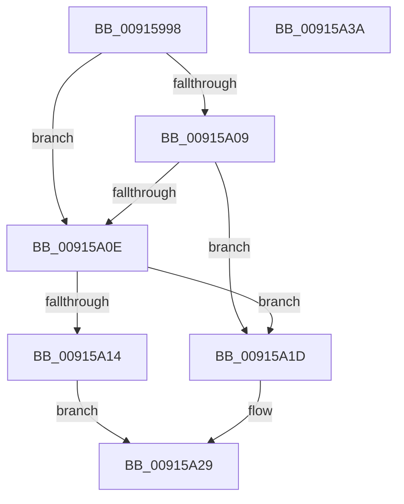

# PopAdaptiveGetRemoteSessionState

- RVA: `0x00915998`–`0x00915A3B` (길이 `163` bytes)
- VA: `0x0000000140915998`
- 실행 섹션: `PAGE`
- PDB 이름 있음: `예`; PDB Function 태그: `아니요`
- unwind 정보 RVA: `0x0005CF00`
- 디코드: `45`개 명령, `163/163` bytes 표시
- 미해석 바이트: `0` (있으면 어셈블리에 `.byte`로 보존)

> 이 문서는 커널 이미지의 기계어와 PDB 기호를 분석해 생성했습니다. 4번과 5번은 함수 원형과 자료형을 바이너리 사용 방식에서 추정한 C 해석이며 원본 소스 복구 결과는 아닙니다.

## 1. Dependencies

- 직접 호출 지점: **1**; 고유 호출 대상: **1**
- 직접 호출자로 확인된 함수: **1**
- RIP 상대 이미지 참조: **1**

### Outgoing calls
- `0x00915A2F` → [PopSetSessionUserStatus](PopSetSessionUserStatus_function_00914BB8.md) (function, `0x00914BB8`)

### Direct callers
- [PopAdaptiveGetSessionStateUnsafe](PopAdaptiveGetSessionStateUnsafe_function_00913A4C.md) at `0x00913AE9`

### Static image references
- `0x009159DD` → RVA `0x00F081AC` (`.data`; read)

## 2. Other-region calls and transfers

- 다른 실행 섹션으로 향하는 call: **0**
- 별도 외부 분기/꼬리 이동을 확인하지 못했습니다.

## 3. Assembly (complete function range)

```asm
00915998  40 53                           push rbx
0091599A  48 83 EC 20                     sub rsp, 0x20
0091599E  48 8B 44 24 50                  mov rax, qword ptr [rsp + 0x50]
009159A3  8B D9                           mov ebx, ecx
009159A5  B9 00 01 00 00                  mov ecx, 0x100
009159AA  4C 8B DA                        mov r11, rdx
009159AD  41 89 09                        mov dword ptr [r9], ecx
009159B0  45 33 D2                        xor r10d, r10d
009159B3  4D 89 10                        mov qword ptr [r8], r10
009159B6  89 08                           mov dword ptr [rax], ecx
009159B8  48 B8 04 00 00 00 80 F7 FF FF   movabs rax, 0xfffff78000000004
009159C2  44 8B 08                        mov r9d, dword ptr [rax]
009159C5  48 B8 20 03 00 00 80 F7 FF FF   movabs rax, 0xfffff78000000320
009159CF  49 C1 E1 20                     shl r9, 0x20
009159D3  48 8B 00                        mov rax, qword ptr [rax]
009159D6  48 C1 E0 08                     shl rax, 8
009159DA  49 F7 E1                        mul r9
009159DD  44 8B 0D C8 27 5F 00            mov r9d, dword ptr [rip + 0x5f27c8]
009159E4  48 B8 77 BE 9F 1A 2F DD 24 06   movabs rax, 0x624dd2f1a9fbe77
009159EE  48 8B CA                        mov rcx, rdx
009159F1  49 2B 0B                        sub rcx, qword ptr [r11]
009159F4  48 F7 E1                        mul rcx
009159F7  48 2B CA                        sub rcx, rdx
009159FA  48 D1 E9                        shr rcx, 1
009159FD  48 03 CA                        add rcx, rdx
00915A00  48 C1 E9 09                     shr rcx, 9
00915A04  49 3B C9                        cmp rcx, r9
00915A07  72 05                           jb 0x140915a0e
00915A09  45 85 C9                        test r9d, r9d
00915A0C  75 0F                           jne 0x140915a1d
00915A0E  45 39 53 18                     cmp dword ptr [r11 + 0x18], r10d
00915A12  74 09                           je 0x140915a1d
00915A14  41 8B D2                        mov edx, r10d
00915A17  45 89 48 08                     mov dword ptr [r8 + 8], r9d
00915A1B  EB 0C                           jmp 0x140915a29
00915A1D  45 89 50 08                     mov dword ptr [r8 + 8], r10d
00915A21  BA 02 00 00 00                  mov edx, 2
00915A26  41 B2 01                        mov r10b, 1
00915A29  8B CB                           mov ecx, ebx
00915A2B  45 88 50 0C                     mov byte ptr [r8 + 0xc], r10b
00915A2F  E8 84 F1 FF FF                  call 0x140914bb8
00915A34  48 83 C4 20                     add rsp, 0x20
00915A38  5B                              pop rbx
00915A39  C3                              ret
00915A3A  CC                              int3
```

## 4. C-style interpretation (structured pseudocode)

```c
__int64 __fastcall PopAdaptiveGetRemoteSessionState(int a1, __int64 a2, __int64 a3, __int64 a4, __int64 a5)
{
    __int64 result;
    __int64 v_r10;
    __int64 v_rsp;

    v_rsp = (v_rsp) - (32);
    *(unsigned int *)(a4) = 256;
    v_r10 = 0;
    *(unsigned __int64 *)(a3) = 0;
    *(unsigned int *)(a5) = 256;
    a4 = ((unsigned int)(*(unsigned int *)(a5))) << (32);
    result = (*(unsigned __int64 *)(a5)) << (8);
    a1 = (a2) - (*(unsigned __int64 *)(a2));
    a1 = (a1) - (a2);
    a1 = (a1) >> (1);
    a1 = (a1) + (a2);
    a1 = (a1) >> (9);
    if (a1 < ((unsigned int)(*(unsigned int *)(v_rip + 6236104)))) goto loc_00915A0E;
    if ((unsigned int)((unsigned int)(*(unsigned int *)(v_rip + 6236104))) != 0) goto loc_00915A1D;
loc_00915A0E:
    if ((*(unsigned int *)(a2 + 24)) == 0) goto loc_00915A1D;
    *(unsigned int *)(a3 + 8) = (unsigned int)((unsigned int)(*(unsigned int *)(v_rip + 6236104)));
    goto loc_00915A29;
loc_00915A1D:
    *(unsigned int *)(a3 + 8) = 0;
loc_00915A29:
    *(unsigned __int8 *)(a3 + 12) = 1;
    result = PopSetSessionUserStatus((unsigned int)((unsigned int)((unsigned int)(a1))), 2, a3, (unsigned int)(*(unsigned int *)(v_rip + 6236104)));
    v_rsp = (v_rsp) + (32);
    return result;
}
```

## 5. (Beta) C Style

```c
int64_t PopAdaptiveGetRemoteSessionState(int32_t Arg1, void *Arg2, void *Arg3, void *Arg4, void *Arg5)
{
    uint8_t *arg2 = (uint8_t *)Arg2;
    uint8_t *arg3 = (uint8_t *)Arg3;
    uint8_t *arg4 = (uint8_t *)Arg4;
    uint8_t *arg5 = (uint8_t *)Arg5;

    int64_t result;
    int64_t local_r10;
    int64_t local_rsp;

    local_rsp = (local_rsp) - (32);
    *(uint32_t *)(arg4) = 256;
    local_r10 = 0;
    *(uint64_t *)(arg3) = 0;
    *(uint32_t *)(arg5) = 256;
    Arg4 = ((uint32_t)(*(uint32_t *)(arg5))) << (32);
    result = (*(uint64_t *)(arg5)) << (8);
    Arg1 = (Arg2) - (*(uint64_t *)(arg2));
    Arg1 = (Arg1) - (Arg2);
    Arg1 = (Arg1) >> (1);
    Arg1 = (Arg1) + (Arg2);
    Arg1 = (Arg1) >> (9);
    if (Arg1 < ((uint32_t)(*(uint32_t *)(v_rip + 0x5F27C8)))) goto loc_00915A0E;
    if ((uint32_t)((uint32_t)(*(uint32_t *)(v_rip + 0x5F27C8))) != 0) goto loc_00915A1D;
loc_00915A0E:
    if ((*(uint32_t *)(arg2 + 0x18)) == 0) goto loc_00915A1D;
    *(uint32_t *)(arg3 + 0x8) = (uint32_t)((uint32_t)(*(uint32_t *)(v_rip + 0x5F27C8)));
    goto loc_00915A29;
loc_00915A1D:
    *(uint32_t *)(arg3 + 0x8) = 0;
loc_00915A29:
    *(uint8_t *)(arg3 + 0xC) = 1;
    result = PopSetSessionUserStatus((uint32_t)((uint32_t)((uint32_t)(Arg1))), 2, Arg3, (uint32_t)(*(uint32_t *)(v_rip + 0x5F27C8)));
    local_rsp = (local_rsp) + (32);
    return result;
}
```

### 관측된 메모리 오프셋

구조체 형식이 확인되지 않은 접근은 인자 기준의 오프셋으로만 기록했습니다.

| 기준 인자 | 오프셋 표현 | 폭 (bit) | 접근 |
|---|---:|---:|---|
| `Arg2` | `+ 0x0` | `64` | `R` |
| `Arg2` | `+ 0x18` | `32` | `R` |
| `Arg3` | `+ 0x0` | `64` | `W` |
| `Arg3` | `+ 0x8` | `32` | `W` |
| `Arg3` | `+ 0xC` | `8` | `W` |
| `Arg4` | `+ 0x0` | `32` | `W` |
| `Arg5` | `+ 0x0` | `32` | `W` |

## 6. Execution-region graph

[열기: 2D/3D 그래프와 함수 탐색 컨트롤 패널](../../../control-panel.html?section=page&rva=0x00915998&view=graph)

- 2D 그래프는 위에서 아래로 흐르고, 3D 그래프는 빈 공간을 드래그해 회전합니다. Shift+드래그는 이동, 휠은 확대·축소, 함수 노드 선택은 대상 보고서 이동입니다.

### Static fallback


