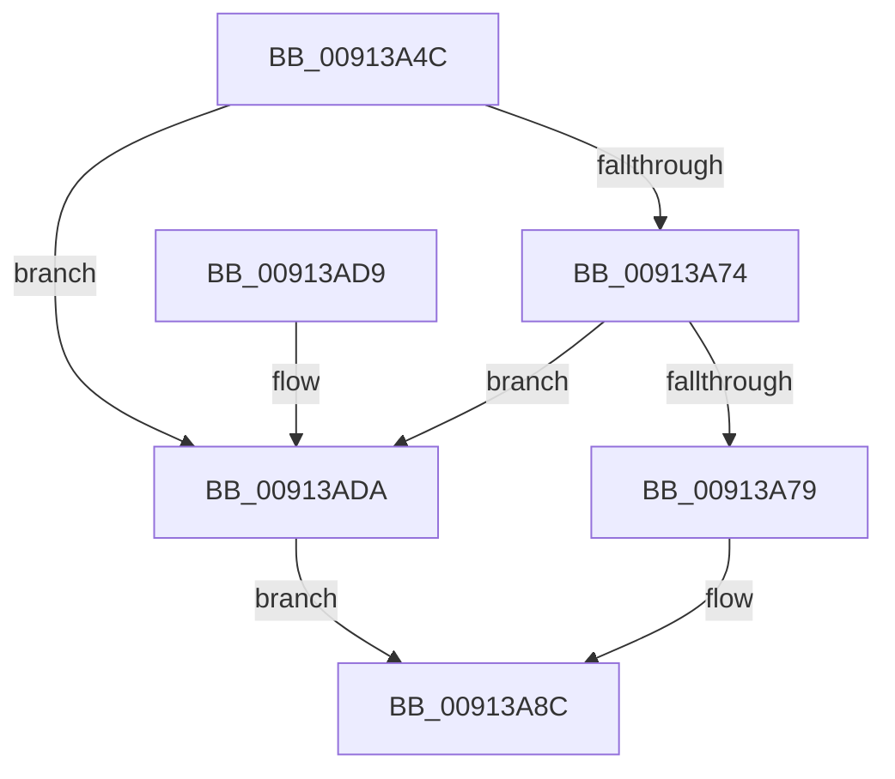

# PopAdaptiveGetSessionStateUnsafe

- RVA: `0x00913A4C`–`0x00913AF0` (길이 `164` bytes)
- VA: `0x0000000140913A4C`
- 실행 섹션: `PAGE`
- PDB 이름 있음: `예`; PDB Function 태그: `아니요`
- unwind 정보 RVA: `0x0008A500`
- 디코드: `46`개 명령, `164/164` bytes 표시
- 미해석 바이트: `0` (있으면 어셈블리에 `.byte`로 보존)

> 이 문서는 커널 이미지의 기계어와 PDB 기호를 분석해 생성했습니다. 4번과 5번은 함수 원형과 자료형을 바이너리 사용 방식에서 추정한 C 해석이며 원본 소스 복구 결과는 아닙니다.

## 1. Dependencies

- 직접 호출 지점: **3**; 고유 호출 대상: **3**
- 직접 호출자로 확인된 함수: **3**
- RIP 상대 이미지 참조: **1**

### Outgoing calls
- `0x00913A87` → [PopAdaptiveGetConsoleSessionState](PopAdaptiveGetConsoleSessionState_function_00913FB4.md) (function, `0x00913FB4`)
- `0x00913AC4` → [PopDiagTraceAdaptiveSessionState](PopDiagTraceAdaptiveSessionState_function_00913AF8.md) (function, `0x00913AF8`)
- `0x00913AE9` → [PopAdaptiveGetRemoteSessionState](PopAdaptiveGetRemoteSessionState_function_00915998.md) (function, `0x00915998`)

### Direct callers
- [PopSessionConnected](../76/PopSessionConnected_function_0076BC74.md) at `0x0076BD0D`
- [PopSessionConnectedV2](../76/PopSessionConnectedV2_function_0076BD2C.md) at `0x0076BDC9`
- [PopAdaptiveGetSessionState](PopAdaptiveGetSessionState_function_00913894.md) at `0x009138FD`

### Static image references
- `0x00913A6A` → RVA `0x00F08238` (`.data`; read)

## 2. Other-region calls and transfers

- 다른 실행 섹션으로 향하는 call: **0**
- 별도 외부 분기/꼬리 이동을 확인하지 못했습니다.

## 3. Assembly (complete function range)

```asm
00913A4C  48 8B C4                        mov rax, rsp
00913A4F  48 89 58 18                     mov qword ptr [rax + 0x18], rbx
00913A53  48 89 70 20                     mov qword ptr [rax + 0x20], rsi
00913A57  57                              push rdi
00913A58  48 83 EC 50                     sub rsp, 0x50
00913A5C  83 60 08 00                     and dword ptr [rax + 8], 0
00913A60  49 8B F8                        mov rdi, r8
00913A63  83 60 10 00                     and dword ptr [rax + 0x10], 0
00913A67  48 8B F2                        mov rsi, rdx
00913A6A  39 0D C8 47 5F 00               cmp dword ptr [rip + 0x5f47c8], ecx
00913A70  8B D9                           mov ebx, ecx
00913A72  75 66                           jne 0x140913ada
00913A74  83 F9 FF                        cmp ecx, -1
00913A77  74 61                           je 0x140913ada
00913A79  48 8D 40 08                     lea rax, [rax + 8]
00913A7D  4C 8D 4C 24 68                  lea r9, [rsp + 0x68]
00913A82  48 89 44 24 20                  mov qword ptr [rsp + 0x20], rax
00913A87  E8 28 05 00 00                  call 0x140913fb4
00913A8C  8B 44 24 60                     mov eax, dword ptr [rsp + 0x60]
00913A90  8B CB                           mov ecx, ebx
00913A92  44 8B 4E 18                     mov r9d, dword ptr [rsi + 0x18]
00913A96  4C 8B 46 10                     mov r8, qword ptr [rsi + 0x10]
00913A9A  48 8B 16                        mov rdx, qword ptr [rsi]
00913A9D  89 44 24 48                     mov dword ptr [rsp + 0x48], eax
00913AA1  8B 47 04                        mov eax, dword ptr [rdi + 4]
00913AA4  89 44 24 40                     mov dword ptr [rsp + 0x40], eax
00913AA8  8B 44 24 68                     mov eax, dword ptr [rsp + 0x68]
00913AAC  89 44 24 38                     mov dword ptr [rsp + 0x38], eax
00913AB0  8A 47 0C                        mov al, byte ptr [rdi + 0xc]
00913AB3  88 44 24 30                     mov byte ptr [rsp + 0x30], al
00913AB7  8B 47 08                        mov eax, dword ptr [rdi + 8]
00913ABA  89 44 24 28                     mov dword ptr [rsp + 0x28], eax
00913ABE  8B 07                           mov eax, dword ptr [rdi]
00913AC0  89 44 24 20                     mov dword ptr [rsp + 0x20], eax
00913AC4  E8 2F 00 00 00                  call 0x140913af8
00913AC9  48 8B 5C 24 70                  mov rbx, qword ptr [rsp + 0x70]
00913ACE  48 8B 74 24 78                  mov rsi, qword ptr [rsp + 0x78]
00913AD3  48 83 C4 50                     add rsp, 0x50
00913AD7  5F                              pop rdi
00913AD8  C3                              ret
00913AD9  CC                              int3
00913ADA  48 8D 44 24 60                  lea rax, [rsp + 0x60]
00913ADF  4C 8D 4C 24 68                  lea r9, [rsp + 0x68]
00913AE4  48 89 44 24 20                  mov qword ptr [rsp + 0x20], rax
00913AE9  E8 AA 1E 00 00                  call 0x140915998
00913AEE  EB 9C                           jmp 0x140913a8c
```

## 4. C-style interpretation (structured pseudocode)

```c
__int64 __fastcall PopAdaptiveGetSessionStateUnsafe(int a1, __int64 a2, __int64 a3)
{
    __int64 result;
    __int64 v_rsp;
    unsigned int v_stack_m10;
    unsigned int v_stack_m18;
    unsigned int v_stack_m20;
    unsigned __int8 v_stack_m28;
    unsigned int v_stack_m30;
    unsigned __int64 v_stack_m38;
    unsigned __int64 v_stack_p10;
    unsigned __int64 v_stack_p18;
    unsigned __int64 v_stack_p20;
    unsigned __int64 v_stack_p60;
    unsigned __int64 v_stack_p68;
    unsigned int v_stack_p8;

    *(unsigned __int64 *)(v_rsp + 24) = v_rbx;
    *(unsigned __int64 *)(v_rsp + 32) = v_rsi;
    v_rsp = (v_rsp) - (80);
    if ((*(unsigned int *)(v_rip + 6244296)) != a1) goto loc_00913ADA;
    if (a1 == -1) goto loc_00913ADA;
    v_stack_m38 = v_rsp + 8;
    result = PopAdaptiveGetConsoleSessionState(a1, a2, a3, v_stack_p10);
loc_00913A8C:
    v_stack_m10 = (unsigned int)((unsigned int)(v_stack_p8));
    v_stack_m18 = (unsigned int)((unsigned int)(*(unsigned int *)(a3 + 4)));
    v_stack_m20 = (unsigned int)((unsigned int)(v_stack_p10));
    v_stack_m28 = (unsigned __int8)(*(unsigned __int8 *)(a3 + 12));
    v_stack_m30 = (unsigned int)((unsigned int)(*(unsigned int *)(a3 + 8)));
    v_stack_m38 = (unsigned int)((unsigned int)(*(unsigned int *)(a3)));
    result = PopDiagTraceAdaptiveSessionState((unsigned int)((unsigned int)((unsigned int)(a1))), *(unsigned __int64 *)(a2), *(unsigned __int64 *)(a2 + 16), (unsigned int)(*(unsigned int *)(a2 + 24)));
    v_rsp = (v_rsp) + (80);
    return result;
loc_00913ADA:
    v_stack_p20 = v_stack_p60;
    result = PopAdaptiveGetRemoteSessionState((unsigned int)((unsigned int)((unsigned int)(a1))), *(unsigned __int64 *)(a2), *(unsigned __int64 *)(a2 + 16), v_stack_p68);
    goto loc_00913A8C;
}
```

## 5. (Beta) C Style

```c
int64_t PopAdaptiveGetSessionStateUnsafe(int32_t Arg1, void *Arg2, void *Arg3)
{
    uint8_t *arg2 = (uint8_t *)Arg2;
    uint8_t *arg3 = (uint8_t *)Arg3;

    int64_t result;
    int64_t local_rsp;
    uint32_t v_stack_m10;
    uint32_t v_stack_m18;
    uint32_t v_stack_m20;
    uint8_t v_stack_m28;
    uint32_t v_stack_m30;
    uint64_t v_stack_m38;
    uint64_t v_stack_p10;
    uint64_t v_stack_p18;
    uint64_t v_stack_p20;
    uint64_t v_stack_p60;
    uint64_t v_stack_p68;
    uint32_t v_stack_p8;

    *(uint64_t *)(local_rsp + 0x18) = local_rbx;
    *(uint64_t *)(local_rsp + 0x20) = local_rsi;
    local_rsp = (local_rsp) - (80);
    if ((*(uint32_t *)(v_rip + 0x5F47C8)) != Arg1) goto loc_00913ADA;
    if (Arg1 == -1) goto loc_00913ADA;
    v_stack_m38 = local_rsp + 8;
    result = PopAdaptiveGetConsoleSessionState(Arg1, Arg2, Arg3, v_stack_p10);
loc_00913A8C:
    v_stack_m10 = (uint32_t)((uint32_t)(v_stack_p8));
    v_stack_m18 = (uint32_t)((uint32_t)(*(uint32_t *)(arg3 + 0x4)));
    v_stack_m20 = (uint32_t)((uint32_t)(v_stack_p10));
    v_stack_m28 = (uint8_t)(*(uint8_t *)(arg3 + 0xC));
    v_stack_m30 = (uint32_t)((uint32_t)(*(uint32_t *)(arg3 + 0x8)));
    v_stack_m38 = (uint32_t)((uint32_t)(*(uint32_t *)(arg3)));
    result = PopDiagTraceAdaptiveSessionState((uint32_t)((uint32_t)((uint32_t)(Arg1))), *(uint64_t *)(arg2), *(uint64_t *)(arg2 + 0x10), (uint32_t)(*(uint32_t *)(arg2 + 0x18)));
    local_rsp = (local_rsp) + (80);
    return result;
loc_00913ADA:
    v_stack_p20 = v_stack_p60;
    result = PopAdaptiveGetRemoteSessionState((uint32_t)((uint32_t)((uint32_t)(Arg1))), *(uint64_t *)(arg2), *(uint64_t *)(arg2 + 0x10), v_stack_p68);
    goto loc_00913A8C;
}
```

### 관측된 메모리 오프셋

구조체 형식이 확인되지 않은 접근은 인자 기준의 오프셋으로만 기록했습니다.

| 기준 인자 | 오프셋 표현 | 폭 (bit) | 접근 |
|---|---:|---:|---|
| `Arg2` | `+ 0x0` | `64` | `R` |
| `Arg2` | `+ 0x10` | `64` | `R` |
| `Arg2` | `+ 0x18` | `32` | `R` |
| `Arg3` | `+ 0x0` | `32` | `R` |
| `Arg3` | `+ 0x4` | `32` | `R` |
| `Arg3` | `+ 0x8` | `32` | `R` |
| `Arg3` | `+ 0xC` | `8` | `R` |

## 6. Execution-region graph

[열기: 2D/3D 그래프와 함수 탐색 컨트롤 패널](../../../control-panel.html?section=page&rva=0x00913A4C&view=graph)

- 2D 그래프는 위에서 아래로 흐르고, 3D 그래프는 빈 공간을 드래그해 회전합니다. Shift+드래그는 이동, 휠은 확대·축소, 함수 노드 선택은 대상 보고서 이동입니다.

### Static fallback


