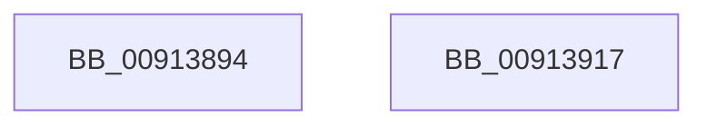

# PopAdaptiveGetSessionState

- RVA: `0x00913894`–`0x00913918` (길이 `132` bytes)
- VA: `0x0000000140913894`
- 실행 섹션: `PAGE`
- PDB 이름 있음: `예`; PDB Function 태그: `아니요`
- unwind 정보 RVA: `0x0008A4C8`
- 디코드: `32`개 명령, `132/132` bytes 표시
- 미해석 바이트: `0` (있으면 어셈블리에 `.byte`로 보존)

> 이 문서는 커널 이미지의 기계어와 PDB 기호를 분석해 생성했습니다. 4번과 5번은 함수 원형과 자료형을 바이너리 사용 방식에서 추정한 C 해석이며 원본 소스 복구 결과는 아닙니다.

## 1. Dependencies

- 직접 호출 지점: **3**; 고유 호출 대상: **3**
- 직접 호출자로 확인된 함수: **1**
- RIP 상대 이미지 참조: **3**

### Outgoing calls
- `0x009138D9` → [ExAcquireResourceExclusiveLite](../../text/21/ExAcquireResourceExclusiveLite_function_00214E20.md) (function, `0x00214E20`)
- `0x009138FD` → [PopAdaptiveGetSessionStateUnsafe](PopAdaptiveGetSessionStateUnsafe_function_00913A4C.md) (function, `0x00913A4C`)
- `0x00913902` → [PopReleaseAdaptiveLock](PopReleaseAdaptiveLock_function_009137DC.md) (function, `0x009137DC`)

### Direct callers
- [PopPowerInformationInternal](../A8/PopPowerInformationInternal_function_00A8B7C0.md) at `0x00A8CE91`

### Static image references
- `0x009138C7` → RVA `0x00F08140` (`.data`; read)
- `0x009138ED` → RVA `0x00FD82A0` (`PAGEDATA`; write)
- `0x009138F6` → RVA `0x00F08220` (`.data`; write)

## 2. Other-region calls and transfers

- 다른 실행 섹션으로 향하는 call: **1**
  - `0x009138D9` → [ExAcquireResourceExclusiveLite](../../text/21/ExAcquireResourceExclusiveLite_function_00214E20.md) (`PAGE` → `.text`)
- 별도 외부 분기/꼬리 이동을 확인하지 못했습니다.

## 3. Assembly (complete function range)

```asm
00913894  48 89 5C 24 08                  mov qword ptr [rsp + 8], rbx
00913899  48 89 74 24 10                  mov qword ptr [rsp + 0x10], rsi
0091389E  57                              push rdi
0091389F  48 83 EC 50                     sub rsp, 0x50
009138A3  0F 57 C0                        xorps xmm0, xmm0
009138A6  33 C0                           xor eax, eax
009138A8  0F 11 44 24 20                  movups xmmword ptr [rsp + 0x20], xmm0
009138AD  48 89 44 24 40                  mov qword ptr [rsp + 0x40], rax
009138B2  48 8B FA                        mov rdi, rdx
009138B5  0F 11 44 24 30                  movups xmmword ptr [rsp + 0x30], xmm0
009138BA  65 48 8B 04 25 88 01 00 00      mov rax, qword ptr gs:[0x188]
009138C3  8B F1                           mov esi, ecx
009138C5  B2 01                           mov dl, 1
009138C7  48 8D 0D 72 48 5F 00            lea rcx, [rip + 0x5f4872]
009138CE  49 8B D8                        mov rbx, r8
009138D1  66 FF 88 E4 01 00 00            dec word ptr [rax + 0x1e4]
009138D8  90                              nop
009138D9  E8 42 15 90 FF                  call 0x140214e20
009138DE  65 48 8B 04 25 88 01 00 00      mov rax, qword ptr gs:[0x188]
009138E7  4C 8B C3                        mov r8, rbx
009138EA  48 8B D7                        mov rdx, rdi
009138ED  48 89 05 AC 49 6C 00            mov qword ptr [rip + 0x6c49ac], rax
009138F4  8B CE                           mov ecx, esi
009138F6  C6 05 23 49 5F 00 00            mov byte ptr [rip + 0x5f4923], 0
009138FD  E8 4A 01 00 00                  call 0x140913a4c
00913902  E8 D5 FE FF FF                  call 0x1409137dc
00913907  48 8B 5C 24 60                  mov rbx, qword ptr [rsp + 0x60]
0091390C  48 8B 74 24 68                  mov rsi, qword ptr [rsp + 0x68]
00913911  48 83 C4 50                     add rsp, 0x50
00913915  5F                              pop rdi
00913916  C3                              ret
00913917  CC                              int3
```

## 4. C-style interpretation (structured pseudocode)

```c
__int64 __fastcall PopAdaptiveGetSessionState(int a1, __int64 a2, __int64 a3)
{
    __int64 result;
    __int64 v_rsp;
    unsigned __int64 v_stack_m18;
    unsigned __int64 v_stack_m28;
    unsigned __int64 v_stack_m38;
    unsigned __int64 v_stack_p10;
    unsigned __int64 v_stack_p8;

    v_stack_p8 = v_rbx;
    v_stack_p10 = v_rsi;
    v_rsp = (v_rsp) - (80);
    result = 0;
    v_stack_m38 = v_xmm0;
    v_stack_m18 = 0;
    v_stack_m28 = v_xmm0;
    result = ExAcquireResourceExclusiveLite(v_rip + 6244466, 1, a3, a4);
    *(unsigned __int64 *)(v_rip + 7096748) = *(unsigned __int64 *)(gs_base + (0 + 392));
    *(unsigned __int8 *)(v_rip + 6244643) = 0;
    result = PopAdaptiveGetSessionStateUnsafe((unsigned int)((unsigned int)((unsigned int)(a1))), a2, a3, a4);
    result = PopReleaseAdaptiveLock((unsigned int)((unsigned int)((unsigned int)(a1))), a2, a3, a4);
    v_rsp = (v_rsp) + (80);
    return result;
}
```

## 5. (Beta) C Style

```c
int64_t PopAdaptiveGetSessionState(int32_t Arg1, int64_t Arg2, int64_t Arg3)
{
    int64_t result;
    int64_t local_rsp;
    uint64_t v_stack_m18;
    uint64_t v_stack_m28;
    uint64_t v_stack_m38;
    uint64_t v_stack_p10;
    uint64_t v_stack_p8;

    v_stack_p8 = local_rbx;
    v_stack_p10 = local_rsi;
    local_rsp = (local_rsp) - (80);
    result = 0;
    v_stack_m38 = v_xmm0;
    v_stack_m18 = 0;
    v_stack_m28 = v_xmm0;
    result = ExAcquireResourceExclusiveLite(v_rip + 6244466, 1, Arg3, a4);
    *(uint64_t *)(v_rip + 0x6C49AC) = *(uint64_t *)(gs_base + (0 + 0x188));
    *(uint8_t *)(v_rip + 0x5F4923) = 0;
    result = PopAdaptiveGetSessionStateUnsafe((uint32_t)((uint32_t)((uint32_t)(Arg1))), Arg2, Arg3, a4);
    result = PopReleaseAdaptiveLock((uint32_t)((uint32_t)((uint32_t)(Arg1))), Arg2, Arg3, a4);
    local_rsp = (local_rsp) + (80);
    return result;
}
```

## 6. Execution-region graph

[열기: 2D/3D 그래프와 함수 탐색 컨트롤 패널](../../../control-panel.html?section=page&rva=0x00913894&view=graph)

- 2D 그래프는 위에서 아래로 흐르고, 3D 그래프는 빈 공간을 드래그해 회전합니다. Shift+드래그는 이동, 휠은 확대·축소, 함수 노드 선택은 대상 보고서 이동입니다.

### Static fallback


