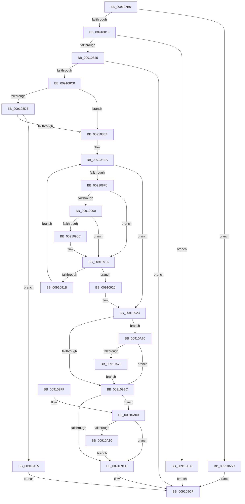

# PopApplyPolicy

- RVA: `0x009107B0`–`0x00910A85` (길이 `725` bytes)
- VA: `0x00000001409107B0`
- 실행 섹션: `PAGE`
- PDB 이름 있음: `예`; PDB Function 태그: `아니요`
- unwind 정보 RVA: `0x0008A130`
- 디코드: `186`개 명령, `725/725` bytes 표시
- 미해석 바이트: `0` (있으면 어셈블리에 `.byte`로 보존)

> 이 문서는 커널 이미지의 기계어와 PDB 기호를 분석해 생성했습니다. 4번과 5번은 함수 원형과 자료형을 바이너리 사용 방식에서 추정한 C 해석이며 원본 소스 복구 결과는 아닙니다.

## 1. Dependencies

- 직접 호출 지점: **11**; 고유 호출 대상: **11**
- 직접 호출자로 확인된 함수: **8**
- RIP 상대 이미지 참조: **3**

### Outgoing calls
- `0x00910803` → [memset](../../text/6C/memset_function_006C6C40.md) (function, `0x006C6C40`)
- `0x009108B1` → [PopVerifySystemPowerPolicy](PopVerifySystemPowerPolicy_function_00910A8C.md) (function, `0x00910A8C`)
- `0x009108D2` → [memcmp](../../text/6C/memcmp_function_006C6B10.md) (function, `0x006C6B10`)
- `0x009109AE` → [PopSetNotificationWork](../../text/48/PopSetNotificationWork_function_00482C78.md) (function, `0x00482C78`)
- `0x009109C3` → [PopUpdateSystemIdleContext](PopUpdateSystemIdleContext_function_00911BB4.md) (function, `0x00911BB4`)
- `0x009109D9` → [_security_check_cookie](../../text/6A/_security_check_cookie_function_006AC640.md) (function, `0x006AC640`)
- `0x00910A05` → [PopOpenPowerKey](../../text/4B/PopOpenPowerKey_function_004B4314.md) (function, `0x004B4314`)
- `0x00910A1C` → [RtlInitUnicodeString](../../text/42/RtlInitUnicodeString_function_0042A780.md) (function, `0x0042A780`)
- `0x00910A3F` → [ZwSetValueKey](../../text/6A/ZwSetValueKey_function_006ADCD0.md) (function, `0x006ADCD0`)
- `0x00910A4B` → [ZwClose](../../text/6A/ZwClose_function_006AD2B0.md) (function, `0x006AD2B0`)
- `0x00910A7B` → [PopResetCBTriggers](../76/PopResetCBTriggers_function_007683F8.md) (function, `0x007683F8`)

### Direct callers
- [PopVideoPowerSettingCallback](../../text/4C/PopVideoPowerSettingCallback_function_004C9F50.md) at `0x004CA04E`
- [PopConsoleLockPowerSettingCallback](../75/PopConsoleLockPowerSettingCallback_function_007580D0.md) at `0x007581C4`
- [PopPowerButtonSettingCallback](../75/PopPowerButtonSettingCallback_function_00758340.md) at `0x007584E5`
- [PopResetCurrentPolicies](../90/PopResetCurrentPolicies_function_0090FF64.md) at `0x00910021`
- [PopBatteryUpdateAlarms](PopBatteryUpdateAlarms_function_00910058.md) at `0x0091022D`
- [PopSleepPowerSettingCallback](PopSleepPowerSettingCallback_function_009103E0.md) at `0x0091055B`
- [NtPowerInformation](../95/NtPowerInformation_function_00955D80.md) at `0x009563DA`
- [PopHardDiskPowerSettingCallback](../AB/PopHardDiskPowerSettingCallback_function_00AB6F60.md) at `0x00AB7066`

### Static image references
- `0x009107D6` → RVA `0x00E0A740` (`.data`; read)
- `0x009108C0` → RVA `0x00F0CE68` (`.data`; read)
- `0x00910A10` → RVA `0x00011940` (`.rdata`; read)

## 2. Other-region calls and transfers

- 다른 실행 섹션으로 향하는 call: **8**
  - `0x00910803` → [memset](../../text/6C/memset_function_006C6C40.md) (`PAGE` → `.text`)
  - `0x009108D2` → [memcmp](../../text/6C/memcmp_function_006C6B10.md) (`PAGE` → `.text`)
  - `0x009109AE` → [PopSetNotificationWork](../../text/48/PopSetNotificationWork_function_00482C78.md) (`PAGE` → `.text`)
  - `0x009109D9` → [_security_check_cookie](../../text/6A/_security_check_cookie_function_006AC640.md) (`PAGE` → `.text`)
  - `0x00910A05` → [PopOpenPowerKey](../../text/4B/PopOpenPowerKey_function_004B4314.md) (`PAGE` → `.text`)
  - `0x00910A1C` → [RtlInitUnicodeString](../../text/42/RtlInitUnicodeString_function_0042A780.md) (`PAGE` → `.text`)
  - `0x00910A3F` → [ZwSetValueKey](../../text/6A/ZwSetValueKey_function_006ADCD0.md) (`PAGE` → `.text`)
  - `0x00910A4B` → [ZwClose](../../text/6A/ZwClose_function_006AD2B0.md) (`PAGE` → `.text`)
- 별도 외부 분기/꼬리 이동을 확인하지 못했습니다.

## 3. Assembly (complete function range)

```asm
009107B0  48 8B C4                        mov rax, rsp
009107B3  48 89 58 08                     mov qword ptr [rax + 8], rbx
009107B7  48 89 70 10                     mov qword ptr [rax + 0x10], rsi
009107BB  48 89 78 20                     mov qword ptr [rax + 0x20], rdi
009107BF  55                              push rbp
009107C0  41 54                           push r12
009107C2  41 55                           push r13
009107C4  41 56                           push r14
009107C6  41 57                           push r15
009107C8  48 8D A8 98 FE FF FF            lea rbp, [rax - 0x168]
009107CF  48 81 EC 40 02 00 00            sub rsp, 0x240
009107D6  48 8B 05 63 9F 4F 00            mov rax, qword ptr [rip + 0x4f9f63]
009107DD  48 33 C4                        xor rax, rsp
009107E0  48 89 85 30 01 00 00            mov qword ptr [rbp + 0x130], rax
009107E7  49 8B D8                        mov rbx, r8
009107EA  44 8A FA                        mov r15b, dl
009107ED  40 8A F1                        mov sil, cl
009107F0  41 BC E8 00 00 00               mov r12d, 0xe8
009107F6  45 8B C4                        mov r8d, r12d
009107F9  48 8D 4C 24 50                  lea rcx, [rsp + 0x50]
009107FE  33 D2                           xor edx, edx
00910800  41 8B F9                        mov edi, r9d
00910803  E8 38 64 DB FF                  call 0x1406c6c40
00910808  48 83 64 24 30 00               and qword ptr [rsp + 0x30], 0
0091080E  0F 57 C0                        xorps xmm0, xmm0
00910811  0F 11 44 24 38                  movups xmmword ptr [rsp + 0x38], xmm0
00910816  41 3B FC                        cmp edi, r12d
00910819  0F 82 3D 02 00 00               jb 0x140910a5c
0091081F  0F 87 41 02 00 00               ja 0x140910a66
00910825  0F 10 03                        movups xmm0, xmmword ptr [rbx]
00910828  48 8D 4D 40                     lea rcx, [rbp + 0x40]
0091082C  0F 10 4B 10                     movups xmm1, xmmword ptr [rbx + 0x10]
00910830  45 8D 6C 24 98                  lea r13d, [r12 - 0x68]
00910835  0F 11 01                        movups xmmword ptr [rcx], xmm0
00910838  48 8D 54 24 50                  lea rdx, [rsp + 0x50]
0091083D  0F 10 43 20                     movups xmm0, xmmword ptr [rbx + 0x20]
00910841  0F 11 49 10                     movups xmmword ptr [rcx + 0x10], xmm1
00910845  0F 10 4B 30                     movups xmm1, xmmword ptr [rbx + 0x30]
00910849  0F 11 41 20                     movups xmmword ptr [rcx + 0x20], xmm0
0091084D  0F 10 43 40                     movups xmm0, xmmword ptr [rbx + 0x40]
00910851  0F 11 49 30                     movups xmmword ptr [rcx + 0x30], xmm1
00910855  0F 10 4B 50                     movups xmm1, xmmword ptr [rbx + 0x50]
00910859  0F 11 41 40                     movups xmmword ptr [rcx + 0x40], xmm0
0091085D  0F 10 43 60                     movups xmm0, xmmword ptr [rbx + 0x60]
00910861  0F 11 49 50                     movups xmmword ptr [rcx + 0x50], xmm1
00910865  0F 11 41 60                     movups xmmword ptr [rcx + 0x60], xmm0
00910869  49 03 CD                        add rcx, r13
0091086C  0F 10 43 70                     movups xmm0, xmmword ptr [rbx + 0x70]
00910870  49 03 DD                        add rbx, r13
00910873  0F 11 41 F0                     movups xmmword ptr [rcx - 0x10], xmm0
00910877  0F 10 0B                        movups xmm1, xmmword ptr [rbx]
0091087A  48 8B 43 60                     mov rax, qword ptr [rbx + 0x60]
0091087E  0F 10 43 10                     movups xmm0, xmmword ptr [rbx + 0x10]
00910882  0F 11 09                        movups xmmword ptr [rcx], xmm1
00910885  0F 10 4B 20                     movups xmm1, xmmword ptr [rbx + 0x20]
00910889  0F 11 41 10                     movups xmmword ptr [rcx + 0x10], xmm0
0091088D  0F 10 43 30                     movups xmm0, xmmword ptr [rbx + 0x30]
00910891  0F 11 49 20                     movups xmmword ptr [rcx + 0x20], xmm1
00910895  0F 10 4B 40                     movups xmm1, xmmword ptr [rbx + 0x40]
00910899  0F 11 41 30                     movups xmmword ptr [rcx + 0x30], xmm0
0091089D  0F 10 43 50                     movups xmm0, xmmword ptr [rbx + 0x50]
009108A1  0F 11 49 40                     movups xmmword ptr [rcx + 0x40], xmm1
009108A5  0F 11 41 50                     movups xmmword ptr [rcx + 0x50], xmm0
009108A9  48 89 41 60                     mov qword ptr [rcx + 0x60], rax
009108AD  48 8D 4D 40                     lea rcx, [rbp + 0x40]
009108B1  E8 D6 01 00 00                  call 0x140910a8c
009108B6  8B D8                           mov ebx, eax
009108B8  85 C0                           test eax, eax
009108BA  0F 88 0F 01 00 00               js 0x1409109cf
009108C0  48 8B 3D A1 C5 5F 00            mov rdi, qword ptr [rip + 0x5fc5a1]
009108C7  48 8D 4C 24 50                  lea rcx, [rsp + 0x50]
009108CC  48 8B D7                        mov rdx, rdi
009108CF  45 8B C4                        mov r8d, r12d
009108D2  E8 39 62 DB FF                  call 0x1406c6b10
009108D7  85 C0                           test eax, eax
009108D9  75 09                           jne 0x1409108e4
009108DB  40 84 F6                        test sil, sil
009108DE  0F 84 71 01 00 00               je 0x140910a55
009108E4  45 32 F6                        xor r14b, r14b
009108E7  45 33 C0                        xor r8d, r8d
009108EA  41 83 F8 04                     cmp r8d, 4
009108EE  73 33                           jae 0x140910923
009108F0  4B 8D 14 40                     lea rdx, [r8 + r8*2]
009108F4  48 8B 4C D5 B0                  mov rcx, qword ptr [rbp + rdx*8 - 0x50]
009108F9  48 2B 4C D7 60                  sub rcx, qword ptr [rdi + rdx*8 + 0x60]
009108FE  75 16                           jne 0x140910916
00910900  48 8B 4C D5 B8                  mov rcx, qword ptr [rbp + rdx*8 - 0x48]
00910905  48 2B 4C D7 68                  sub rcx, qword ptr [rdi + rdx*8 + 0x68]
0091090A  75 0A                           jne 0x140910916
0091090C  48 8B 4C D5 C0                  mov rcx, qword ptr [rbp + rdx*8 - 0x40]
00910911  48 2B 4C D7 70                  sub rcx, qword ptr [rdi + rdx*8 + 0x70]
00910916  48 85 C9                        test rcx, rcx
00910919  75 05                           jne 0x140910920
0091091B  41 FF C0                        inc r8d
0091091E  EB CA                           jmp 0x1409108ea
00910920  41 B6 01                        mov r14b, 1
00910923  48 8B 0D 3E C5 5F 00            mov rcx, qword ptr [rip + 0x5fc53e]
0091092A  48 8D 44 24 50                  lea rax, [rsp + 0x50]
0091092F  0F 10 00                        movups xmm0, xmmword ptr [rax]
00910932  0F 10 48 10                     movups xmm1, xmmword ptr [rax + 0x10]
00910936  0F 11 01                        movups xmmword ptr [rcx], xmm0
00910939  0F 10 40 20                     movups xmm0, xmmword ptr [rax + 0x20]
0091093D  0F 11 49 10                     movups xmmword ptr [rcx + 0x10], xmm1
00910941  0F 10 48 30                     movups xmm1, xmmword ptr [rax + 0x30]
00910945  0F 11 41 20                     movups xmmword ptr [rcx + 0x20], xmm0
00910949  0F 10 40 40                     movups xmm0, xmmword ptr [rax + 0x40]
0091094D  0F 11 49 30                     movups xmmword ptr [rcx + 0x30], xmm1
00910951  0F 10 48 50                     movups xmm1, xmmword ptr [rax + 0x50]
00910955  0F 11 41 40                     movups xmmword ptr [rcx + 0x40], xmm0
00910959  0F 10 40 60                     movups xmm0, xmmword ptr [rax + 0x60]
0091095D  0F 11 49 50                     movups xmmword ptr [rcx + 0x50], xmm1
00910961  0F 10 48 70                     movups xmm1, xmmword ptr [rax + 0x70]
00910965  49 03 C5                        add rax, r13
00910968  0F 11 41 60                     movups xmmword ptr [rcx + 0x60], xmm0
0091096C  49 03 CD                        add rcx, r13
0091096F  0F 10 00                        movups xmm0, xmmword ptr [rax]
00910972  0F 11 49 F0                     movups xmmword ptr [rcx - 0x10], xmm1
00910976  0F 10 48 10                     movups xmm1, xmmword ptr [rax + 0x10]
0091097A  0F 11 01                        movups xmmword ptr [rcx], xmm0
0091097D  0F 10 40 20                     movups xmm0, xmmword ptr [rax + 0x20]
00910981  0F 11 49 10                     movups xmmword ptr [rcx + 0x10], xmm1
00910985  0F 10 48 30                     movups xmm1, xmmword ptr [rax + 0x30]
00910989  0F 11 41 20                     movups xmmword ptr [rcx + 0x20], xmm0
0091098D  0F 10 40 40                     movups xmm0, xmmword ptr [rax + 0x40]
00910991  0F 11 49 30                     movups xmmword ptr [rcx + 0x30], xmm1
00910995  0F 10 48 50                     movups xmm1, xmmword ptr [rax + 0x50]
00910999  48 8B 40 60                     mov rax, qword ptr [rax + 0x60]
0091099D  0F 11 41 40                     movups xmmword ptr [rcx + 0x40], xmm0
009109A1  0F 11 49 50                     movups xmmword ptr [rcx + 0x50], xmm1
009109A5  48 89 41 60                     mov qword ptr [rcx + 0x60], rax
009109A9  B9 02 00 00 00                  mov ecx, 2
009109AE  E8 C5 22 B7 FF                  call 0x140482c78
009109B3  45 84 F6                        test r14b, r14b
009109B6  0F 85 B4 00 00 00               jne 0x140910a70
009109BC  BF 03 00 00 00                  mov edi, 3
009109C1  8B CF                           mov ecx, edi
009109C3  E8 EC 11 00 00                  call 0x140911bb4
009109C8  40 84 F6                        test sil, sil
009109CB  75 33                           jne 0x140910a00
009109CD  8B C3                           mov eax, ebx
009109CF  48 8B 8D 30 01 00 00            mov rcx, qword ptr [rbp + 0x130]
009109D6  48 33 CC                        xor rcx, rsp
009109D9  E8 62 BC D9 FF                  call 0x1406ac640
009109DE  4C 8D 9C 24 40 02 00 00         lea r11, [rsp + 0x240]
009109E6  49 8B 5B 30                     mov rbx, qword ptr [r11 + 0x30]
009109EA  49 8B 73 38                     mov rsi, qword ptr [r11 + 0x38]
009109EE  49 8B 7B 48                     mov rdi, qword ptr [r11 + 0x48]
009109F2  49 8B E3                        mov rsp, r11
009109F5  41 5F                           pop r15
009109F7  41 5E                           pop r14
009109F9  41 5D                           pop r13
009109FB  41 5C                           pop r12
009109FD  5D                              pop rbp
009109FE  C3                              ret
009109FF  CC                              int3
00910A00  48 8D 4C 24 30                  lea rcx, [rsp + 0x30]
00910A05  E8 0A 39 BA FF                  call 0x1404b4314
00910A0A  8B D8                           mov ebx, eax
00910A0C  85 C0                           test eax, eax
00910A0E  78 BD                           js 0x1409109cd
00910A10  48 8D 15 29 0F 70 FF            lea rdx, [rip - 0x8ff0d7]
00910A17  48 8D 4C 24 38                  lea rcx, [rsp + 0x38]
00910A1C  E8 5F 9D B1 FF                  call 0x14042a780
00910A21  48 8B 4C 24 30                  mov rcx, qword ptr [rsp + 0x30]
00910A26  48 8D 45 40                     lea rax, [rbp + 0x40]
00910A2A  44 89 64 24 28                  mov dword ptr [rsp + 0x28], r12d
00910A2F  48 8D 54 24 38                  lea rdx, [rsp + 0x38]
00910A34  44 8B CF                        mov r9d, edi
00910A37  48 89 44 24 20                  mov qword ptr [rsp + 0x20], rax
00910A3C  45 33 C0                        xor r8d, r8d
00910A3F  E8 8C D2 D9 FF                  call 0x1406adcd0
00910A44  48 8B 4C 24 30                  mov rcx, qword ptr [rsp + 0x30]
00910A49  8B D8                           mov ebx, eax
00910A4B  E8 60 C8 D9 FF                  call 0x1406ad2b0
00910A50  E9 78 FF FF FF                  jmp 0x1409109cd
00910A55  33 C0                           xor eax, eax
00910A57  E9 73 FF FF FF                  jmp 0x1409109cf
00910A5C  B8 23 00 00 C0                  mov eax, 0xc0000023
00910A61  E9 69 FF FF FF                  jmp 0x1409109cf
00910A66  B8 05 00 00 80                  mov eax, 0x80000005
00910A6B  E9 5F FF FF FF                  jmp 0x1409109cf
00910A70  45 84 FF                        test r15b, r15b
00910A73  0F 85 43 FF FF FF               jne 0x1409109bc
00910A79  B1 83                           mov cl, 0x83
00910A7B  E8 78 79 E5 FF                  call 0x1407683f8
00910A80  E9 37 FF FF FF                  jmp 0x1409109bc
```

## 4. C-style interpretation (structured pseudocode)

```c
__int64 __fastcall PopApplyPolicy(unsigned __int8 a1, int a2, __int64 a3, int a4)
{
    __int64 result;
    __int64 v_r14;
    __int64 v_rbx;
    __int64 v_rsp;
    unsigned __int64 v_stack_m208;
    unsigned __int64 v_stack_m210;
    unsigned __int64 v_stack_m218;
    unsigned __int64 v_stack_m220;
    unsigned __int64 v_stack_m230;
    unsigned __int64 v_stack_m238;
    unsigned __int64 v_stack_m28;

    *(unsigned __int64 *)(v_rsp + 8) = v_rbx;
    *(unsigned __int64 *)(v_rsp + 16) = v_rsi;
    *(unsigned __int64 *)(v_rsp + 32) = v_rdi;
    v_rsp = (v_rsp) - (576);
    result = (*(unsigned __int64 *)(v_rip + 5218147)) ^ (v_rsp);
    *(unsigned __int64 *)(v_rsp - 360 + 304) = result;
    a2 = 0;
    result = memset(v_stack_m218, a2, 232, a4);
    v_stack_m230 = v_xmm0;
    if (((unsigned int)((unsigned int)(a4))) < 232) goto loc_00910A5C;
    if (((unsigned int)((unsigned int)(a4))) > 232) goto loc_00910A66;
    *(unsigned __int64 *)(v_rsp - 360 + 64) = v_xmm0;
    *(unsigned __int64 *)(v_rsp - 360 + 64 + 16) = v_xmm1;
    *(unsigned __int64 *)(v_rsp - 360 + 64 + 32) = v_xmm0;
    *(unsigned __int64 *)(v_rsp - 360 + 64 + 48) = v_xmm1;
    *(unsigned __int64 *)(v_rsp - 360 + 64 + 64) = v_xmm0;
    *(unsigned __int64 *)(v_rsp - 360 + 64 + 80) = v_xmm1;
    *(unsigned __int64 *)(v_rsp - 360 + 64 + 96) = v_xmm0;
    a1 = (v_rsp - 360 + 64) + (232 - 104);
    v_rbx = (a3) + (232 - 104);
    *(unsigned __int64 *)(a1 - 16) = v_xmm0;
    *(unsigned __int64 *)(a1) = v_xmm1;
    *(unsigned __int64 *)(a1 + 16) = v_xmm0;
    *(unsigned __int64 *)(a1 + 32) = v_xmm1;
    *(unsigned __int64 *)(a1 + 48) = v_xmm0;
    *(unsigned __int64 *)(a1 + 64) = v_xmm1;
    *(unsigned __int64 *)(a1 + 80) = v_xmm0;
    *(unsigned __int64 *)(a1 + 96) = *(unsigned __int64 *)(v_rbx + 96);
    result = PopVerifySystemPowerPolicy(v_rsp - 360 + 64, v_stack_m218, 232, a4);
    if (sign_flag) goto loc_009109CF;
    result = memcmp(v_stack_m218, *(unsigned __int64 *)(v_rip + 6276513), 232, a4);
    if ((unsigned int)(result) != 0) goto loc_009108E4;
    if (a1 == 0) goto loc_00910A55;
loc_009108E4:
    v_r14 = 0;
    a3 = 0;
loc_009108EA:
    if (0 >= 4) goto loc_00910923;
    a1 = (*(unsigned __int64 *)(v_rsp - 360 + a3 + a3 * 2 * 8 - 80)) - (*(unsigned __int64 *)(*(unsigned __int64 *)(v_rip + 6276513) + a3 + a3 * 2 * 8 + 96));
    if (condition_is_not_equal) goto loc_00910916;
    a1 = (*(unsigned __int64 *)(v_rsp - 360 + a3 + a3 * 2 * 8 - 72)) - (*(unsigned __int64 *)(*(unsigned __int64 *)(v_rip + 6276513) + a3 + a3 * 2 * 8 + 104));
    if (!(condition_is_not_equal)) {
        a1 = *(unsigned __int64 *)(v_rsp - 360 + a3 + a3 * 2 * 8 - 64);
        a1 = (a1) - (*(unsigned __int64 *)(*(unsigned __int64 *)(v_rip + 6276513) + a3 + a3 * 2 * 8 + 112));
    }
    if (a1 != 0) goto loc_00910920;
    a3 = (unsigned int)((a3) + 1);
    goto loc_009108EA;
loc_00910920:
loc_00910923:
    *(unsigned __int64 *)(*(unsigned __int64 *)(v_rip + 6276414)) = v_xmm0;
    *(unsigned __int64 *)(*(unsigned __int64 *)(v_rip + 6276414) + 16) = v_xmm1;
    *(unsigned __int64 *)(*(unsigned __int64 *)(v_rip + 6276414) + 32) = v_xmm0;
    *(unsigned __int64 *)(*(unsigned __int64 *)(v_rip + 6276414) + 48) = v_xmm1;
    *(unsigned __int64 *)(*(unsigned __int64 *)(v_rip + 6276414) + 64) = v_xmm0;
    *(unsigned __int64 *)(*(unsigned __int64 *)(v_rip + 6276414) + 80) = v_xmm1;
    result = (v_stack_m218) + (232 - 104);
    *(unsigned __int64 *)(*(unsigned __int64 *)(v_rip + 6276414) + 96) = v_xmm0;
    a1 = (*(unsigned __int64 *)(v_rip + 6276414)) + (232 - 104);
    *(unsigned __int64 *)(a1 - 16) = v_xmm1;
    *(unsigned __int64 *)(a1) = v_xmm0;
    *(unsigned __int64 *)(a1 + 16) = v_xmm1;
    *(unsigned __int64 *)(a1 + 32) = v_xmm0;
    *(unsigned __int64 *)(a1 + 48) = v_xmm1;
    *(unsigned __int64 *)(a1 + 64) = v_xmm0;
    *(unsigned __int64 *)(a1 + 80) = v_xmm1;
    *(unsigned __int64 *)(a1 + 96) = *(unsigned __int64 *)(result + 96);
    result = PopSetNotificationWork(2, a3 + a3 * 2, a3, a4);
    if (1 != 0) goto loc_00910A70;
loc_009109BC:
    result = PopUpdateSystemIdleContext(3, a3 + a3 * 2, a3, a4);
    if (a1 != 0) goto loc_00910A00;
loc_009109CD:
loc_009109CF:
    a1 = (*(unsigned __int64 *)(v_rsp - 360 + 304)) ^ (v_rsp);
    result = _security_check_cookie(a1, a3 + a3 * 2, a3, a4);
    return result;
loc_00910A00:
    result = PopOpenPowerKey(v_stack_m210, a3 + a3 * 2, a3, a4);
    if (sign_flag) goto loc_009109CD;
    result = RtlInitUnicodeString(v_stack_m208, v_rip - 9433303, a3, a4);
    v_stack_m218 = 232;
    v_stack_m220 = v_rsp - 360 + 64;
    a3 = 0;
    result = ZwSetValueKey(v_stack_m210, v_stack_m208, a3, (unsigned int)((unsigned int)(*(unsigned __int64 *)(v_stack_m28 + 72))));
    result = ZwClose(v_stack_m210, v_stack_m208, a3, (unsigned int)((unsigned int)(*(unsigned __int64 *)(v_stack_m28 + 72))));
    goto loc_009109CD;
loc_00910A55:
    result = 0;
    goto loc_009109CF;
loc_00910A5C:
    goto loc_009109CF;
loc_00910A66:
    goto loc_009109CF;
loc_00910A70:
    if ((unsigned __int8)((unsigned __int8)(a2)) != 0) goto loc_009109BC;
    result = PopResetCBTriggers(131, v_stack_m208, a3, (unsigned int)((unsigned int)(*(unsigned __int64 *)(v_stack_m28 + 72))));
    goto loc_009109BC;
}
```

## 5. (Beta) C Style

```c
int64_t PopApplyPolicy(uint8_t Arg1, int32_t Arg2, void *Arg3, int32_t Arg4)
{
    uint8_t *arg3 = (uint8_t *)Arg3;

    int64_t result;
    int64_t local_r14;
    int64_t local_rbx;
    int64_t local_rsp;
    uint64_t v_stack_m208;
    uint64_t v_stack_m210;
    uint64_t v_stack_m218;
    uint64_t v_stack_m220;
    uint64_t v_stack_m230;
    uint64_t v_stack_m238;
    uint64_t v_stack_m28;

    *(uint64_t *)(local_rsp + 0x8) = local_rbx;
    *(uint64_t *)(local_rsp + 0x10) = local_rsi;
    *(uint64_t *)(local_rsp + 0x20) = local_rdi;
    local_rsp = (local_rsp) - (576);
    result = (*(uint64_t *)(v_rip + 0x4F9F63)) ^ (local_rsp);
    *(uint64_t *)(local_rsp - 0x168 + 0x130) = result;
    Arg2 = 0;
    result = memset(v_stack_m218, Arg2, 232, Arg4);
    v_stack_m230 = v_xmm0;
    if (((uint32_t)((uint32_t)(Arg4))) < 232) goto loc_00910A5C;
    if (((uint32_t)((uint32_t)(Arg4))) > 232) goto loc_00910A66;
    *(uint64_t *)(local_rsp - 0x168 + 0x40) = v_xmm0;
    *(uint64_t *)(local_rsp - 0x168 + 0x40 + 0x10) = v_xmm1;
    *(uint64_t *)(local_rsp - 0x168 + 0x40 + 0x20) = v_xmm0;
    *(uint64_t *)(local_rsp - 0x168 + 0x40 + 0x30) = v_xmm1;
    *(uint64_t *)(local_rsp - 0x168 + 0x40 + 0x40) = v_xmm0;
    *(uint64_t *)(local_rsp - 0x168 + 0x40 + 0x50) = v_xmm1;
    *(uint64_t *)(local_rsp - 0x168 + 0x40 + 0x60) = v_xmm0;
    Arg1 = (local_rsp - 360 + 64) + (232 - 104);
    local_rbx = (Arg3) + (232 - 104);
    *(uint64_t *)(Arg1 - 0x10) = v_xmm0;
    *(uint64_t *)(Arg1) = v_xmm1;
    *(uint64_t *)(Arg1 + 0x10) = v_xmm0;
    *(uint64_t *)(Arg1 + 0x20) = v_xmm1;
    *(uint64_t *)(Arg1 + 0x30) = v_xmm0;
    *(uint64_t *)(Arg1 + 0x40) = v_xmm1;
    *(uint64_t *)(Arg1 + 0x50) = v_xmm0;
    *(uint64_t *)(Arg1 + 0x60) = *(uint64_t *)(local_rbx + 0x60);
    result = PopVerifySystemPowerPolicy(local_rsp - 360 + 64, v_stack_m218, 232, Arg4);
    if (sign_flag) goto loc_009109CF;
    result = memcmp(v_stack_m218, *(uint64_t *)(v_rip + 0x5FC5A1), 232, Arg4);
    if ((uint32_t)(result) != 0) goto loc_009108E4;
    if (Arg1 == 0) goto loc_00910A55;
loc_009108E4:
    local_r14 = 0;
    Arg3 = 0;
loc_009108EA:
    if (0 >= 4) goto loc_00910923;
    Arg1 = (*(uint64_t *)(local_rsp - 0x168 + arg3 + arg3 * 2 * 8 - 0x50)) - (*(uint64_t *)(*(uint64_t *)(v_rip + 0x5FC5A1) + arg3 + arg3 * 2 * 8 + 0x60));
    if (condition_is_not_equal) goto loc_00910916;
    Arg1 = (*(uint64_t *)(local_rsp - 0x168 + arg3 + arg3 * 2 * 8 - 0x48)) - (*(uint64_t *)(*(uint64_t *)(v_rip + 0x5FC5A1) + arg3 + arg3 * 2 * 8 + 0x68));
    if (!(condition_is_not_equal)) {
        Arg1 = *(uint64_t *)(local_rsp - 0x168 + arg3 + arg3 * 2 * 8 - 0x40);
        Arg1 = (Arg1) - (*(uint64_t *)(*(uint64_t *)(v_rip + 0x5FC5A1) + arg3 + arg3 * 2 * 8 + 0x70));
    }
    if (Arg1 != 0) goto loc_00910920;
    Arg3 = (uint32_t)((Arg3) + 1);
    goto loc_009108EA;
loc_00910920:
loc_00910923:
    *(uint64_t *)(*(uint64_t *)(v_rip + 0x5FC53E)) = v_xmm0;
    *(uint64_t *)(*(uint64_t *)(v_rip + 0x5FC53E) + 0x10) = v_xmm1;
    *(uint64_t *)(*(uint64_t *)(v_rip + 0x5FC53E) + 0x20) = v_xmm0;
    *(uint64_t *)(*(uint64_t *)(v_rip + 0x5FC53E) + 0x30) = v_xmm1;
    *(uint64_t *)(*(uint64_t *)(v_rip + 0x5FC53E) + 0x40) = v_xmm0;
    *(uint64_t *)(*(uint64_t *)(v_rip + 0x5FC53E) + 0x50) = v_xmm1;
    result = (v_stack_m218) + (232 - 104);
    *(uint64_t *)(*(uint64_t *)(v_rip + 0x5FC53E) + 0x60) = v_xmm0;
    Arg1 = (*(uint64_t *)(v_rip + 0x5FC53E)) + (232 - 104);
    *(uint64_t *)(Arg1 - 0x10) = v_xmm1;
    *(uint64_t *)(Arg1) = v_xmm0;
    *(uint64_t *)(Arg1 + 0x10) = v_xmm1;
    *(uint64_t *)(Arg1 + 0x20) = v_xmm0;
    *(uint64_t *)(Arg1 + 0x30) = v_xmm1;
    *(uint64_t *)(Arg1 + 0x40) = v_xmm0;
    *(uint64_t *)(Arg1 + 0x50) = v_xmm1;
    *(uint64_t *)(Arg1 + 0x60) = *(uint64_t *)(result + 0x60);
    result = PopSetNotificationWork(2, Arg3 + Arg3 * 2, Arg3, Arg4);
    if (1 != 0) goto loc_00910A70;
loc_009109BC:
    result = PopUpdateSystemIdleContext(3, Arg3 + Arg3 * 2, Arg3, Arg4);
    if (Arg1 != 0) goto loc_00910A00;
loc_009109CD:
loc_009109CF:
    Arg1 = (*(uint64_t *)(local_rsp - 0x168 + 0x130)) ^ (local_rsp);
    result = _security_check_cookie(Arg1, Arg3 + Arg3 * 2, Arg3, Arg4);
    return result;
loc_00910A00:
    result = PopOpenPowerKey(v_stack_m210, Arg3 + Arg3 * 2, Arg3, Arg4);
    if (sign_flag) goto loc_009109CD;
    result = RtlInitUnicodeString(v_stack_m208, v_rip - 9433303, Arg3, Arg4);
    v_stack_m218 = 232;
    v_stack_m220 = local_rsp - 360 + 64;
    Arg3 = 0;
    result = ZwSetValueKey(v_stack_m210, v_stack_m208, Arg3, (uint32_t)((uint32_t)(*(uint64_t *)(v_stack_m28 + 0x48))));
    result = ZwClose(v_stack_m210, v_stack_m208, Arg3, (uint32_t)((uint32_t)(*(uint64_t *)(v_stack_m28 + 0x48))));
    goto loc_009109CD;
loc_00910A55:
    result = 0;
    goto loc_009109CF;
loc_00910A5C:
    goto loc_009109CF;
loc_00910A66:
    goto loc_009109CF;
loc_00910A70:
    if ((uint8_t)((uint8_t)(Arg2)) != 0) goto loc_009109BC;
    result = PopResetCBTriggers(131, v_stack_m208, Arg3, (uint32_t)((uint32_t)(*(uint64_t *)(v_stack_m28 + 0x48))));
    goto loc_009109BC;
}
```

### 관측된 메모리 오프셋

구조체 형식이 확인되지 않은 접근은 인자 기준의 오프셋으로만 기록했습니다.

| 기준 인자 | 오프셋 표현 | 폭 (bit) | 접근 |
|---|---:|---:|---|
| `Arg3` | `+ 0x0` | `128` | `R` |
| `Arg3` | `+ 0x10` | `128` | `R` |
| `Arg3` | `+ 0x20` | `128` | `R` |
| `Arg3` | `+ 0x30` | `128` | `R` |
| `Arg3` | `+ 0x40` | `128` | `R` |
| `Arg3` | `+ 0x50` | `128` | `R` |
| `Arg3` | `+ 0x60` | `64` | `R` |
| `Arg3` | `+ 0x60` | `128` | `R` |
| `Arg3` | `+ 0x70` | `128` | `R` |

## 6. Execution-region graph

[열기: 2D/3D 그래프와 함수 탐색 컨트롤 패널](../../../control-panel.html?section=page&rva=0x009107B0&view=graph)

- 2D 그래프는 위에서 아래로 흐르고, 3D 그래프는 빈 공간을 드래그해 회전합니다. Shift+드래그는 이동, 휠은 확대·축소, 함수 노드 선택은 대상 보고서 이동입니다.

### Static fallback


