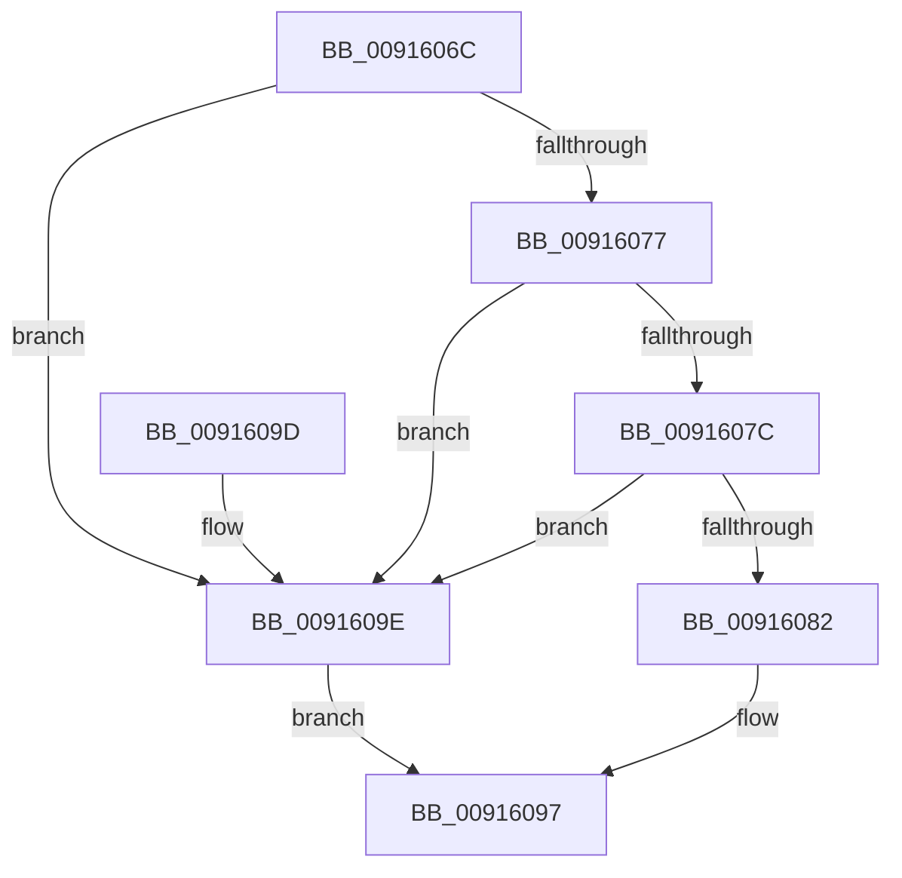

# PopArePowerSettingsEqual

- RVA: `0x0091606C`–`0x009160A2` (길이 `54` bytes)
- VA: `0x000000014091606C`
- 실행 섹션: `PAGE`
- PDB 이름 있음: `예`; PDB Function 태그: `아니요`
- unwind 정보 RVA: `0x00065BAC`
- 디코드: `20`개 명령, `54/54` bytes 표시
- 미해석 바이트: `0` (있으면 어셈블리에 `.byte`로 보존)

> 이 문서는 커널 이미지의 기계어와 PDB 기호를 분석해 생성했습니다. 4번과 5번은 함수 원형과 자료형을 바이너리 사용 방식에서 추정한 C 해석이며 원본 소스 복구 결과는 아닙니다.

## 1. Dependencies

- 직접 호출 지점: **1**; 고유 호출 대상: **1**
- 직접 호출자로 확인된 함수: **1**
- RIP 상대 이미지 참조: **0**

### Outgoing calls
- `0x0091608C` → [RtlCompareMemory](../../text/6B/RtlCompareMemory_function_006BA670.md) (function, `0x006BA670`)

### Direct callers
- [PopSetPowerSettingValue](PopSetPowerSettingValue_function_00914E54.md) at `0x0091500F`

### Static image references
- 디코드된 RIP-relative 메모리 참조가 없습니다.

## 2. Other-region calls and transfers

- 다른 실행 섹션으로 향하는 call: **1**
  - `0x0091608C` → [RtlCompareMemory](../../text/6B/RtlCompareMemory_function_006BA670.md) (`PAGE` → `.text`)
- 별도 외부 분기/꼬리 이동을 확인하지 못했습니다.

## 3. Assembly (complete function range)

```asm
0091606C  40 53                           push rbx
0091606E  48 83 EC 20                     sub rsp, 0x20
00916072  48 85 C9                        test rcx, rcx
00916075  74 27                           je 0x14091609e
00916077  48 85 D2                        test rdx, rdx
0091607A  74 22                           je 0x14091609e
0091607C  44 39 41 04                     cmp dword ptr [rcx + 4], r8d
00916080  75 1C                           jne 0x14091609e
00916082  41 8B D8                        mov ebx, r8d
00916085  48 83 C1 0C                     add rcx, 0xc
00916089  45 8B C0                        mov r8d, r8d
0091608C  E8 DF 45 DA FF                  call 0x1406ba670
00916091  48 3B C3                        cmp rax, rbx
00916094  0F 94 C0                        sete al
00916097  48 83 C4 20                     add rsp, 0x20
0091609B  5B                              pop rbx
0091609C  C3                              ret
0091609D  CC                              int3
0091609E  32 C0                           xor al, al
009160A0  EB F5                           jmp 0x140916097
```

## 4. C-style interpretation (structured pseudocode)

```c
__int64 __fastcall PopArePowerSettingsEqual(__int64 a1, __int64 a2, int a3)
{
    __int64 result;
    __int64 v_rsp;

    v_rsp = (v_rsp) - (32);
    if (a1 == 0) goto loc_0091609E;
    if (a2 == 0) goto loc_0091609E;
    if ((*(unsigned int *)(a1 + 4)) != a3) goto loc_0091609E;
    a1 = (a1) + (12);
    result = RtlCompareMemory(a1, a2, (unsigned int)(a3), a4);
    result = (result == ((unsigned int)(a3))) ? 1 : 0;
loc_00916097:
    v_rsp = (v_rsp) + (32);
    return result;
loc_0091609E:
    result = 0;
    goto loc_00916097;
}
```

## 5. (Beta) C Style

```c
int64_t PopArePowerSettingsEqual(int64_t Arg1, int64_t Arg2, int32_t Arg3)
{
    int64_t result;
    int64_t local_rsp;

    local_rsp = (local_rsp) - (32);
    if (Arg1 == 0) goto loc_0091609E;
    if (Arg2 == 0) goto loc_0091609E;
    if ((*(uint32_t *)(Arg1 + 0x4)) != Arg3) goto loc_0091609E;
    Arg1 = (Arg1) + (12);
    result = RtlCompareMemory(Arg1, Arg2, (uint32_t)(Arg3), a4);
    result = (result == ((uint32_t)(Arg3))) ? 1 : 0;
loc_00916097:
    local_rsp = (local_rsp) + (32);
    return result;
loc_0091609E:
    result = 0;
    goto loc_00916097;
}
```

## 6. Execution-region graph

[열기: 2D/3D 그래프와 함수 탐색 컨트롤 패널](../../../control-panel.html?section=page&rva=0x0091606C&view=graph)

- 2D 그래프는 위에서 아래로 흐르고, 3D 그래프는 빈 공간을 드래그해 회전합니다. Shift+드래그는 이동, 휠은 확대·축소, 함수 노드 선택은 대상 보고서 이동입니다.

### Static fallback


