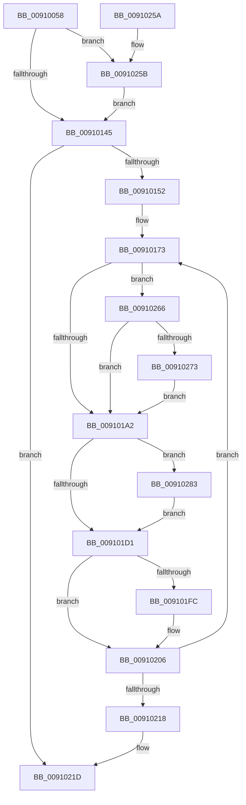

# PopBatteryUpdateAlarms

- RVA: `0x00910058`–`0x00910298` (길이 `576` bytes)
- VA: `0x0000000140910058`
- 실행 섹션: `PAGE`
- PDB 이름 있음: `예`; PDB Function 태그: `아니요`
- unwind 정보 RVA: `0x0008A0B0`
- 디코드: `136`개 명령, `576/576` bytes 표시
- 미해석 바이트: `0` (있으면 어셈블리에 `.byte`로 보존)

> 이 문서는 커널 이미지의 기계어와 PDB 기호를 분석해 생성했습니다. 4번과 5번은 함수 원형과 자료형을 바이너리 사용 방식에서 추정한 C 해석이며 원본 소스 복구 결과는 아닙니다.

## 1. Dependencies

- 직접 호출 지점: **5**; 고유 호출 대상: **3**
- 직접 호출자로 확인된 함수: **2**
- RIP 상대 이미지 참조: **4**

### Outgoing calls
- `0x00910195` → [PopGetPowerSettingValue](../../text/49/PopGetPowerSettingValue_function_0049C6CC.md) (function, `0x0049C6CC`)
- `0x009101C4` → [PopGetPowerSettingValue](../../text/49/PopGetPowerSettingValue_function_0049C6CC.md) (function, `0x0049C6CC`)
- `0x009101F3` → [PopGetPowerSettingValue](../../text/49/PopGetPowerSettingValue_function_0049C6CC.md) (function, `0x0049C6CC`)
- `0x0091022D` → [PopApplyPolicy](PopApplyPolicy_function_009107B0.md) (function, `0x009107B0`)
- `0x00910239` → [_security_check_cookie](../../text/6A/_security_check_cookie_function_006AC640.md) (function, `0x006AC640`)

### Direct callers
- [PopBatteryAlarmPowerSettingCallback](../75/PopBatteryAlarmPowerSettingCallback_function_007580A0.md) at `0x007580B2`
- [PopBatteryApplyCompositeState](../AE/PopBatteryApplyCompositeState_function_00AE0CD0.md) at `0x00AE0D32`

### Static image references
- `0x00910076` → RVA `0x00E0A740` (`.data`; read)
- `0x00910084` → RVA `0x00F0CE68` (`.data`; read)
- `0x00910090` → RVA `0x00F0CE0C` (`.data`; read)
- `0x0091016C` → RVA `0x00000000` (`image boundary/outside`; read)

## 2. Other-region calls and transfers

- 다른 실행 섹션으로 향하는 call: **4**
  - `0x00910195` → [PopGetPowerSettingValue](../../text/49/PopGetPowerSettingValue_function_0049C6CC.md) (`PAGE` → `.text`)
  - `0x009101C4` → [PopGetPowerSettingValue](../../text/49/PopGetPowerSettingValue_function_0049C6CC.md) (`PAGE` → `.text`)
  - `0x009101F3` → [PopGetPowerSettingValue](../../text/49/PopGetPowerSettingValue_function_0049C6CC.md) (`PAGE` → `.text`)
  - `0x00910239` → [_security_check_cookie](../../text/6A/_security_check_cookie_function_006AC640.md) (`PAGE` → `.text`)
- 별도 외부 분기/꼬리 이동을 확인하지 못했습니다.

## 3. Assembly (complete function range)

```asm
00910058  48 89 5C 24 08                  mov qword ptr [rsp + 8], rbx
0091005D  48 89 74 24 18                  mov qword ptr [rsp + 0x18], rsi
00910062  55                              push rbp
00910063  57                              push rdi
00910064  41 54                           push r12
00910066  41 56                           push r14
00910068  41 57                           push r15
0091006A  48 8D 6C 24 C0                  lea rbp, [rsp - 0x40]
0091006F  48 81 EC 40 01 00 00            sub rsp, 0x140
00910076  48 8B 05 C3 A6 4F 00            mov rax, qword ptr [rip + 0x4fa6c3]
0091007D  48 33 C4                        xor rax, rsp
00910080  48 89 45 30                     mov qword ptr [rbp + 0x30], rax
00910084  48 8B 05 DD CD 5F 00            mov rax, qword ptr [rip + 0x5fcddd]
0091008B  4C 8D 44 24 40                  lea r8, [rsp + 0x40]
00910090  44 8B 3D 75 CD 5F 00            mov r15d, dword ptr [rip + 0x5fcd75]
00910097  45 33 E4                        xor r12d, r12d
0091009A  44 8A F1                        mov r14b, cl
0091009D  88 4C 24 30                     mov byte ptr [rsp + 0x30], cl
009100A1  B9 80 00 00 00                  mov ecx, 0x80
009100A6  44 89 64 24 38                  mov dword ptr [rsp + 0x38], r12d
009100AB  0F 10 00                        movups xmm0, xmmword ptr [rax]
009100AE  44 89 64 24 34                  mov dword ptr [rsp + 0x34], r12d
009100B3  0F 10 48 10                     movups xmm1, xmmword ptr [rax + 0x10]
009100B7  41 0F 11 00                     movups xmmword ptr [r8], xmm0
009100BB  0F 10 40 20                     movups xmm0, xmmword ptr [rax + 0x20]
009100BF  41 0F 11 48 10                  movups xmmword ptr [r8 + 0x10], xmm1
009100C4  0F 10 48 30                     movups xmm1, xmmword ptr [rax + 0x30]
009100C8  41 0F 11 40 20                  movups xmmword ptr [r8 + 0x20], xmm0
009100CD  0F 10 40 40                     movups xmm0, xmmword ptr [rax + 0x40]
009100D1  41 0F 11 48 30                  movups xmmword ptr [r8 + 0x30], xmm1
009100D6  0F 10 48 50                     movups xmm1, xmmword ptr [rax + 0x50]
009100DA  41 0F 11 40 40                  movups xmmword ptr [r8 + 0x40], xmm0
009100DF  0F 10 40 60                     movups xmm0, xmmword ptr [rax + 0x60]
009100E3  41 0F 11 48 50                  movups xmmword ptr [r8 + 0x50], xmm1
009100E8  41 0F 11 40 60                  movups xmmword ptr [r8 + 0x60], xmm0
009100ED  4C 03 C1                        add r8, rcx
009100F0  0F 10 40 70                     movups xmm0, xmmword ptr [rax + 0x70]
009100F4  48 03 C1                        add rax, rcx
009100F7  41 0F 11 40 F0                  movups xmmword ptr [r8 - 0x10], xmm0
009100FC  0F 10 08                        movups xmm1, xmmword ptr [rax]
009100FF  0F 10 40 10                     movups xmm0, xmmword ptr [rax + 0x10]
00910103  41 0F 11 08                     movups xmmword ptr [r8], xmm1
00910107  0F 10 48 20                     movups xmm1, xmmword ptr [rax + 0x20]
0091010B  41 0F 11 40 10                  movups xmmword ptr [r8 + 0x10], xmm0
00910110  0F 10 40 30                     movups xmm0, xmmword ptr [rax + 0x30]
00910114  41 0F 11 48 20                  movups xmmword ptr [r8 + 0x20], xmm1
00910119  0F 10 48 40                     movups xmm1, xmmword ptr [rax + 0x40]
0091011D  41 0F 11 40 30                  movups xmmword ptr [r8 + 0x30], xmm0
00910122  0F 10 40 50                     movups xmm0, xmmword ptr [rax + 0x50]
00910126  48 8B 40 60                     mov rax, qword ptr [rax + 0x60]
0091012A  41 0F 11 48 40                  movups xmmword ptr [r8 + 0x40], xmm1
0091012F  41 0F 11 40 50                  movups xmmword ptr [r8 + 0x50], xmm0
00910134  49 89 40 60                     mov qword ptr [r8 + 0x60], rax
00910138  44 8D 42 01                     lea r8d, [rdx + 1]
0091013C  45 84 F6                        test r14b, r14b
0091013F  0F 85 16 01 00 00               jne 0x14091025b
00910145  41 0F 45 D4                     cmovne edx, r12d
00910149  41 3B D0                        cmp edx, r8d
0091014C  0F 83 CB 00 00 00               jae 0x14091021d
00910152  48 8D 04 52                     lea rax, [rdx + rdx*2]
00910156  44 2B C2                        sub r8d, edx
00910159  48 8D 5D A4                     lea rbx, [rbp - 0x5c]
0091015D  41 8B F0                        mov esi, r8d
00910160  48 8D 1C C3                     lea rbx, [rbx + rax*8]
00910164  48 8D 3C D5 00 00 00 00         lea rdi, [rdx*8]
0091016C  4C 8D 35 8D FE 6E FF            lea r14, [rip - 0x910173]
00910173  4A 8B 8C 37 B0 B3 00 00         mov rcx, qword ptr [rdi + r14 + 0xb3b0]
0091017B  48 8D 44 24 38                  lea rax, [rsp + 0x38]
00910180  48 89 44 24 28                  mov qword ptr [rsp + 0x28], rax
00910185  4C 8D 4C 24 34                  lea r9, [rsp + 0x34]
0091018A  45 8B C7                        mov r8d, r15d
0091018D  C7 44 24 20 04 00 00 00         mov dword ptr [rsp + 0x20], 4
00910195  E8 32 C5 B8 FF                  call 0x14049c6cc
0091019A  85 C0                           test eax, eax
0091019C  0F 89 C4 00 00 00               jns 0x140910266
009101A2  4A 8B 8C 37 D0 B3 00 00         mov rcx, qword ptr [rdi + r14 + 0xb3d0]
009101AA  48 8D 44 24 38                  lea rax, [rsp + 0x38]
009101AF  48 89 44 24 28                  mov qword ptr [rsp + 0x28], rax
009101B4  4C 8D 4C 24 34                  lea r9, [rsp + 0x34]
009101B9  45 8B C7                        mov r8d, r15d
009101BC  C7 44 24 20 04 00 00 00         mov dword ptr [rsp + 0x20], 4
009101C4  E8 03 C5 B8 FF                  call 0x14049c6cc
009101C9  85 C0                           test eax, eax
009101CB  0F 89 B2 00 00 00               jns 0x140910283
009101D1  4A 8B 8C 37 F0 B3 00 00         mov rcx, qword ptr [rdi + r14 + 0xb3f0]
009101D9  48 8D 44 24 38                  lea rax, [rsp + 0x38]
009101DE  48 89 44 24 28                  mov qword ptr [rsp + 0x28], rax
009101E3  4C 8D 4C 24 34                  lea r9, [rsp + 0x34]
009101E8  45 8B C7                        mov r8d, r15d
009101EB  C7 44 24 20 04 00 00 00         mov dword ptr [rsp + 0x20], 4
009101F3  E8 D4 C4 B8 FF                  call 0x14049c6cc
009101F8  85 C0                           test eax, eax
009101FA  78 0A                           js 0x140910206
009101FC  8B 44 24 34                     mov eax, dword ptr [rsp + 0x34]
00910200  83 E0 07                        and eax, 7
00910203  89 43 0C                        mov dword ptr [rbx + 0xc], eax
00910206  48 83 C3 18                     add rbx, 0x18
0091020A  48 83 C7 08                     add rdi, 8
0091020E  48 83 EE 01                     sub rsi, 1
00910212  0F 85 5B FF FF FF               jne 0x140910173
00910218  44 8A 74 24 30                  mov r14b, byte ptr [rsp + 0x30]
0091021D  41 B9 E8 00 00 00               mov r9d, 0xe8
00910223  4C 8D 44 24 40                  lea r8, [rsp + 0x40]
00910228  41 8A D6                        mov dl, r14b
0091022B  B1 01                           mov cl, 1
0091022D  E8 7E 05 00 00                  call 0x1409107b0
00910232  48 8B 4D 30                     mov rcx, qword ptr [rbp + 0x30]
00910236  48 33 CC                        xor rcx, rsp
00910239  E8 02 C4 D9 FF                  call 0x1406ac640
0091023E  4C 8D 9C 24 40 01 00 00         lea r11, [rsp + 0x140]
00910246  49 8B 5B 30                     mov rbx, qword ptr [r11 + 0x30]
0091024A  49 8B 73 40                     mov rsi, qword ptr [r11 + 0x40]
0091024E  49 8B E3                        mov rsp, r11
00910251  41 5F                           pop r15
00910253  41 5E                           pop r14
00910255  41 5C                           pop r12
00910257  5F                              pop rdi
00910258  5D                              pop rbp
00910259  C3                              ret
0091025A  CC                              int3
0091025B  41 B8 04 00 00 00               mov r8d, 4
00910261  E9 DF FE FF FF                  jmp 0x140910145
00910266  8B 44 24 34                     mov eax, dword ptr [rsp + 0x34]
0091026A  83 F8 06                        cmp eax, 6
0091026D  0F 87 2F FF FF FF               ja 0x1409101a2
00910273  85 C0                           test eax, eax
00910275  89 43 04                        mov dword ptr [rbx + 4], eax
00910278  0F 95 C0                        setne al
0091027B  88 43 FC                        mov byte ptr [rbx - 4], al
0091027E  E9 1F FF FF FF                  jmp 0x1409101a2
00910283  8B 44 24 34                     mov eax, dword ptr [rsp + 0x34]
00910287  B9 64 00 00 00                  mov ecx, 0x64
0091028C  3B C1                           cmp eax, ecx
0091028E  0F 47 C1                        cmova eax, ecx
00910291  89 03                           mov dword ptr [rbx], eax
00910293  E9 39 FF FF FF                  jmp 0x1409101d1
```

## 4. C-style interpretation (structured pseudocode)

```c
__int64 __fastcall PopBatteryUpdateAlarms(unsigned __int8 a1, __int64 a2)
{
    __int64 result;
    __int64 v_r12;
    __int64 v_rbx;
    __int64 v_rdi;
    __int64 v_rsi;
    __int64 v_rsp;
    unsigned int v_stack_m10C;
    unsigned __int64 v_stack_m128;
    unsigned int v_stack_m130;
    unsigned int v_stack_m134;
    unsigned __int8 v_stack_m138;
    unsigned __int64 v_stack_m140;
    unsigned int v_stack_m148;
    unsigned __int64 v_stack_m28;
    unsigned __int64 v_stack_m38;
    unsigned __int64 v_stack_m68;
    unsigned __int64 v_stack_mC4;
    unsigned __int64 v_stack_p18;
    unsigned __int64 v_stack_p8;

    v_stack_p8 = v_rbx;
    v_stack_p18 = v_rsi;
    v_rsp = (v_rsp) - (320);
    result = (*(unsigned __int64 *)(v_rip + 5220035)) ^ (v_rsp);
    v_stack_m38 = result;
    v_r12 = 0;
    v_stack_m138 = a1;
    v_stack_m130 = 0;
    v_stack_m134 = 0;
    *(unsigned __int64 *)(v_stack_m128) = v_xmm0;
    *(unsigned __int64 *)(v_stack_m128 + 16) = v_xmm1;
    *(unsigned __int64 *)(v_stack_m128 + 32) = v_xmm0;
    *(unsigned __int64 *)(v_stack_m128 + 48) = v_xmm1;
    *(unsigned __int64 *)(v_stack_m128 + 64) = v_xmm0;
    *(unsigned __int64 *)(v_stack_m128 + 80) = v_xmm1;
    *(unsigned __int64 *)(v_stack_m128 + 96) = v_xmm0;
    a3 = (v_stack_m128) + (128);
    result = (*(unsigned __int64 *)(v_rip + 6278621)) + (128);
    *(unsigned __int64 *)(a3 - 16) = v_xmm0;
    *(unsigned __int64 *)(a3) = v_xmm1;
    *(unsigned __int64 *)(a3 + 16) = v_xmm0;
    *(unsigned __int64 *)(a3 + 32) = v_xmm1;
    *(unsigned __int64 *)(a3 + 48) = v_xmm0;
    *(unsigned __int64 *)(a3 + 64) = v_xmm1;
    *(unsigned __int64 *)(a3 + 80) = v_xmm0;
    *(unsigned __int64 *)(a3 + 96) = *(unsigned __int64 *)(result + 96);
    if (a1 != 0) goto loc_0091025B;
loc_00910145:
    if (a1 != 0) { a2 = 0; }
    if (((unsigned int)(a2)) >= ((unsigned int)(a2 + 1))) goto loc_0091021D;
    a3 = (unsigned int)((a2 + 1) - ((unsigned int)(a2)));
loc_00910173:
    v_stack_m140 = v_stack_m130;
    v_stack_m148 = 4;
    result = PopGetPowerSettingValue(*(unsigned __int64 *)(a2 * 8 + v_rip - 9503091 * 1 + 46000), a2, (unsigned int)((unsigned int)((unsigned int)(*(unsigned int *)(v_rip + 6278517)))), v_stack_m134);
    if (!sign_flag) goto loc_00910266;
loc_009101A2:
    v_stack_m140 = v_stack_m130;
    v_stack_m148 = 4;
    result = PopGetPowerSettingValue(*(unsigned __int64 *)(a2 * 8 + v_rip - 9503091 * 1 + 46032), a2, (unsigned int)((unsigned int)((unsigned int)(*(unsigned int *)(v_rip + 6278517)))), v_stack_m134);
    if (!sign_flag) goto loc_00910283;
loc_009101D1:
    v_stack_m140 = v_stack_m130;
    v_stack_m148 = 4;
    result = PopGetPowerSettingValue(*(unsigned __int64 *)(a2 * 8 + v_rip - 9503091 * 1 + 46064), a2, (unsigned int)((unsigned int)((unsigned int)(*(unsigned int *)(v_rip + 6278517)))), v_stack_m134);
    if (!(sign_flag)) {
        result = v_stack_m134;
        result = (unsigned int)((result) & (7));
        *(unsigned int *)(v_stack_mC4 + a2 + a2 * 2 * 8 + 12) = (unsigned int)(result);
    }
    v_rbx = (v_stack_mC4 + a2 + a2 * 2 * 8) + (24);
    v_rdi = (a2 * 8) + (8);
    v_rsi = ((unsigned int)((unsigned int)(a3))) - (1);
    if (condition_is_not_equal) goto loc_00910173;
loc_0091021D:
    result = PopApplyPolicy(1, (unsigned __int8)(v_stack_m138), v_stack_m128, 232);
    a1 = (v_stack_m38) ^ (v_rsp);
    result = _security_check_cookie(a1, (unsigned __int8)(v_stack_m138), v_stack_m128, 232);
    return result;
loc_0091025B:
    goto loc_00910145;
loc_00910266:
    if (((unsigned int)((unsigned int)(v_stack_m10C))) > 6) goto loc_009101A2;
    *(unsigned int *)(*(unsigned __int64 *)(v_stack_m28 + 48) + 4) = (unsigned int)((unsigned int)(v_stack_m10C));
    result = ((unsigned int)((unsigned int)(v_stack_m10C)) != 0) ? 1 : 0;
    *(unsigned __int8 *)(*(unsigned __int64 *)(v_stack_m28 + 48) - 4) = (unsigned __int8)(result);
    goto loc_009101A2;
loc_00910283:
    result = (unsigned int)(v_stack_m10C);
    if (((unsigned int)((unsigned int)(v_stack_m10C))) > 100) { result = 100; }
    *(unsigned int *)(*(unsigned __int64 *)(v_stack_m28 + 48)) = (unsigned int)(result);
    goto loc_009101D1;
}
```

## 5. (Beta) C Style

```c
int64_t PopBatteryUpdateAlarms(uint8_t Arg1, void *Arg2)
{
    uint8_t *arg2 = (uint8_t *)Arg2;

    int64_t result;
    int64_t local_r12;
    int64_t local_rbx;
    int64_t local_rdi;
    int64_t local_rsi;
    int64_t local_rsp;
    uint32_t v_stack_m10C;
    uint64_t v_stack_m128;
    uint32_t v_stack_m130;
    uint32_t v_stack_m134;
    uint8_t v_stack_m138;
    uint64_t v_stack_m140;
    uint32_t v_stack_m148;
    uint64_t v_stack_m28;
    uint64_t v_stack_m38;
    uint64_t v_stack_m68;
    uint64_t v_stack_mC4;
    uint64_t v_stack_p18;
    uint64_t v_stack_p8;

    v_stack_p8 = local_rbx;
    v_stack_p18 = local_rsi;
    local_rsp = (local_rsp) - (320);
    result = (*(uint64_t *)(v_rip + 0x4FA6C3)) ^ (local_rsp);
    v_stack_m38 = result;
    local_r12 = 0;
    v_stack_m138 = Arg1;
    v_stack_m130 = 0;
    v_stack_m134 = 0;
    *(uint64_t *)(v_stack_m128) = v_xmm0;
    *(uint64_t *)(v_stack_m128 + 0x10) = v_xmm1;
    *(uint64_t *)(v_stack_m128 + 0x20) = v_xmm0;
    *(uint64_t *)(v_stack_m128 + 0x30) = v_xmm1;
    *(uint64_t *)(v_stack_m128 + 0x40) = v_xmm0;
    *(uint64_t *)(v_stack_m128 + 0x50) = v_xmm1;
    *(uint64_t *)(v_stack_m128 + 0x60) = v_xmm0;
    a3 = (v_stack_m128) + (128);
    result = (*(uint64_t *)(v_rip + 0x5FCDDD)) + (128);
    *(uint64_t *)(a3 - 0x10) = v_xmm0;
    *(uint64_t *)(a3) = v_xmm1;
    *(uint64_t *)(a3 + 0x10) = v_xmm0;
    *(uint64_t *)(a3 + 0x20) = v_xmm1;
    *(uint64_t *)(a3 + 0x30) = v_xmm0;
    *(uint64_t *)(a3 + 0x40) = v_xmm1;
    *(uint64_t *)(a3 + 0x50) = v_xmm0;
    *(uint64_t *)(a3 + 0x60) = *(uint64_t *)(result + 0x60);
    if (Arg1 != 0) goto loc_0091025B;
loc_00910145:
    if (Arg1 != 0) { Arg2 = 0; }
    if (((uint32_t)(Arg2)) >= ((uint32_t)(Arg2 + 1))) goto loc_0091021D;
    a3 = (uint32_t)((Arg2 + 1) - ((uint32_t)(Arg2)));
loc_00910173:
    v_stack_m140 = v_stack_m130;
    v_stack_m148 = 4;
    result = PopGetPowerSettingValue(*(uint64_t *)(arg2 * 8 + v_rip - 0x910173 * 1 + 0xB3B0), Arg2, (uint32_t)((uint32_t)((uint32_t)(*(uint32_t *)(v_rip + 0x5FCD75)))), v_stack_m134);
    if (!sign_flag) goto loc_00910266;
loc_009101A2:
    v_stack_m140 = v_stack_m130;
    v_stack_m148 = 4;
    result = PopGetPowerSettingValue(*(uint64_t *)(arg2 * 8 + v_rip - 0x910173 * 1 + 0xB3D0), Arg2, (uint32_t)((uint32_t)((uint32_t)(*(uint32_t *)(v_rip + 0x5FCD75)))), v_stack_m134);
    if (!sign_flag) goto loc_00910283;
loc_009101D1:
    v_stack_m140 = v_stack_m130;
    v_stack_m148 = 4;
    result = PopGetPowerSettingValue(*(uint64_t *)(arg2 * 8 + v_rip - 0x910173 * 1 + 0xB3F0), Arg2, (uint32_t)((uint32_t)((uint32_t)(*(uint32_t *)(v_rip + 0x5FCD75)))), v_stack_m134);
    if (!(sign_flag)) {
        result = v_stack_m134;
        result = (uint32_t)((result) & (7));
        *(uint32_t *)(v_stack_mC4 + arg2 + arg2 * 2 * 8 + 0xC) = (uint32_t)(result);
    }
    local_rbx = (v_stack_mC4 + Arg2 + Arg2 * 2 * 8) + (24);
    local_rdi = (Arg2 * 8) + (8);
    local_rsi = ((uint32_t)((uint32_t)(a3))) - (1);
    if (condition_is_not_equal) goto loc_00910173;
loc_0091021D:
    result = PopApplyPolicy(1, (uint8_t)(v_stack_m138), v_stack_m128, 232);
    Arg1 = (v_stack_m38) ^ (local_rsp);
    result = _security_check_cookie(Arg1, (uint8_t)(v_stack_m138), v_stack_m128, 232);
    return result;
loc_0091025B:
    goto loc_00910145;
loc_00910266:
    if (((uint32_t)((uint32_t)(v_stack_m10C))) > 6) goto loc_009101A2;
    *(uint32_t *)(*(uint64_t *)(v_stack_m28 + 0x30) + 0x4) = (uint32_t)((uint32_t)(v_stack_m10C));
    result = ((uint32_t)((uint32_t)(v_stack_m10C)) != 0) ? 1 : 0;
    *(uint8_t *)(*(uint64_t *)(v_stack_m28 + 0x30) - 0x4) = (uint8_t)(result);
    goto loc_009101A2;
loc_00910283:
    result = (uint32_t)(v_stack_m10C);
    if (((uint32_t)((uint32_t)(v_stack_m10C))) > 100) { result = 100; }
    *(uint32_t *)(*(uint64_t *)(v_stack_m28 + 0x30)) = (uint32_t)(result);
    goto loc_009101D1;
}
```

### 관측된 메모리 오프셋

구조체 형식이 확인되지 않은 접근은 인자 기준의 오프셋으로만 기록했습니다.

| 기준 인자 | 오프셋 표현 | 폭 (bit) | 접근 |
|---|---:|---:|---|
| `Arg2` | `+ 0x1` | `32` | `R` |

## 6. Execution-region graph

[열기: 2D/3D 그래프와 함수 탐색 컨트롤 패널](../../../control-panel.html?section=page&rva=0x00910058&view=graph)

- 2D 그래프는 위에서 아래로 흐르고, 3D 그래프는 빈 공간을 드래그해 회전합니다. Shift+드래그는 이동, 휠은 확대·축소, 함수 노드 선택은 대상 보고서 이동입니다.

### Static fallback


