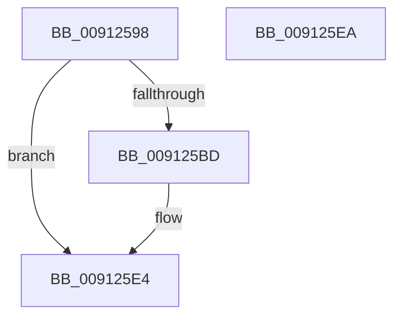

# PopBroadcastSessionInfo

- RVA: `0x00912598`–`0x009125EB` (길이 `83` bytes)
- VA: `0x0000000140912598`
- 실행 섹션: `PAGE`
- PDB 이름 있음: `예`; PDB Function 태그: `아니요`
- unwind 정보 RVA: `0x0008A308`
- 디코드: `26`개 명령, `83/83` bytes 표시
- 미해석 바이트: `0` (있으면 어셈블리에 `.byte`로 보존)

> 이 문서는 커널 이미지의 기계어와 PDB 기호를 분석해 생성했습니다. 4번과 5번은 함수 원형과 자료형을 바이너리 사용 방식에서 추정한 C 해석이며 원본 소스 복구 결과는 아닙니다.

## 1. Dependencies

- 직접 호출 지점: **1**; 고유 호출 대상: **1**
- 직접 호출자로 확인된 함수: **7**
- RIP 상대 이미지 참조: **1**

### Outgoing calls
- `0x009125DF` → [PopInvokeWin32Callout](PopInvokeWin32Callout_function_009125F4.md) (function, `0x009125F4`)

### Direct callers
- [PopWin32kPowerSettingCallback](../../text/4B/PopWin32kPowerSettingCallback_function_004BD870.md) at `0x004BD8B5`
- [PopPowerSourceChangeCallback](../../text/4C/PopPowerSourceChangeCallback_function_004C3A60.md) at `0x004C3C00`
- [PopLidSwitchReliabilityUpdateCallback](../75/PopLidSwitchReliabilityUpdateCallback_function_007582A0.md) at `0x00758309`
- [PopSetAwayModeStatus](../75/PopSetAwayModeStatus_function_0075EE84.md) at `0x0075EEC3`
- [PopEvaluateInputSuppressionAction](../76/PopEvaluateInputSuppressionAction_function_00765454.md) at `0x00765643`
- [PopAdaptivePowerSettingCallback](../76/PopAdaptivePowerSettingCallback_function_0076B7A0.md) at `0x0076B990`
- [PopPowerInformationInternal](../A8/PopPowerInformationInternal_function_00A8B7C0.md) at `0x00A8BF51`

### Static image references
- `0x009125A6` → RVA `0x00F06628` (`.data`; read)

## 2. Other-region calls and transfers

- 다른 실행 섹션으로 향하는 call: **0**
- 별도 외부 분기/꼬리 이동을 확인하지 못했습니다.

## 3. Assembly (complete function range)

```asm
00912598  40 55                           push rbp
0091259A  48 8B EC                        mov rbp, rsp
0091259D  48 83 EC 60                     sub rsp, 0x60
009125A1  0F 57 C0                        xorps xmm0, xmm0
009125A4  33 C0                           xor eax, eax
009125A6  38 05 7C 40 5F 00               cmp byte ptr [rip + 0x5f407c], al
009125AC  0F 11 45 C0                     movups xmmword ptr [rbp - 0x40], xmm0
009125B0  89 45 F0                        mov dword ptr [rbp - 0x10], eax
009125B3  0F 11 45 D0                     movups xmmword ptr [rbp - 0x30], xmm0
009125B7  0F 11 45 E0                     movups xmmword ptr [rbp - 0x20], xmm0
009125BB  74 27                           je 0x1409125e4
009125BD  89 4D D0                        mov dword ptr [rbp - 0x30], ecx
009125C0  45 33 C9                        xor r9d, r9d
009125C3  89 55 D8                        mov dword ptr [rbp - 0x28], edx
009125C6  8D 48 05                        lea ecx, [rax + 5]
009125C9  4C 89 45 E0                     mov qword ptr [rbp - 0x20], r8
009125CD  48 8D 55 C0                     lea rdx, [rbp - 0x40]
009125D1  44 8D 40 02                     lea r8d, [rax + 2]
009125D5  88 45 D4                        mov byte ptr [rbp - 0x2c], al
009125D8  89 45 E8                        mov dword ptr [rbp - 0x18], eax
009125DB  48 89 45 F0                     mov qword ptr [rbp - 0x10], rax
009125DF  E8 10 00 00 00                  call 0x1409125f4
009125E4  48 83 C4 60                     add rsp, 0x60
009125E8  5D                              pop rbp
009125E9  C3                              ret
009125EA  CC                              int3
```

## 4. C-style interpretation (structured pseudocode)

```c
__int64 __fastcall PopBroadcastSessionInfo(int a1, int a2, __int64 a3, int a4)
{
    __int64 result;
    __int64 v_rsp;
    unsigned int v_stack_m18;
    unsigned int v_stack_m20;
    unsigned __int64 v_stack_m28;
    unsigned int v_stack_m30;
    unsigned __int8 v_stack_m34;
    unsigned __int64 v_stack_m38;
    unsigned __int64 v_stack_m48;

    v_rsp = (v_rsp) - (96);
    result = 0;
    v_stack_m48 = v_xmm0;
    v_stack_m18 = 0;
    v_stack_m38 = v_xmm0;
    v_stack_m28 = v_xmm0;
    if ((*(unsigned __int8 *)(v_rip + 6242428)) != 0) {
        v_stack_m38 = a1;
        a4 = 0;
        v_stack_m30 = a2;
        a1 = result + 5;
        v_stack_m28 = a3;
        a2 = v_stack_m48;
        a3 = result + 2;
        v_stack_m34 = 0;
        v_stack_m20 = 0;
        v_stack_m18 = 0;
        result = PopInvokeWin32Callout(a1, a2, a3, a4);
    }
    v_rsp = (v_rsp) + (96);
    return result;
}
```

## 5. (Beta) C Style

```c
int64_t PopBroadcastSessionInfo(int32_t Arg1, int32_t Arg2, int64_t Arg3, int32_t Arg4)
{
    int64_t result;
    int64_t local_rsp;
    uint32_t v_stack_m18;
    uint32_t v_stack_m20;
    uint64_t v_stack_m28;
    uint32_t v_stack_m30;
    uint8_t v_stack_m34;
    uint64_t v_stack_m38;
    uint64_t v_stack_m48;

    local_rsp = (local_rsp) - (96);
    result = 0;
    v_stack_m48 = v_xmm0;
    v_stack_m18 = 0;
    v_stack_m38 = v_xmm0;
    v_stack_m28 = v_xmm0;
    if ((*(uint8_t *)(v_rip + 0x5F407C)) != 0) {
        v_stack_m38 = Arg1;
        Arg4 = 0;
        v_stack_m30 = Arg2;
        Arg1 = result + 5;
        v_stack_m28 = Arg3;
        Arg2 = v_stack_m48;
        Arg3 = result + 2;
        v_stack_m34 = 0;
        v_stack_m20 = 0;
        v_stack_m18 = 0;
        result = PopInvokeWin32Callout(Arg1, Arg2, Arg3, Arg4);
    }
    local_rsp = (local_rsp) + (96);
    return result;
}
```

## 6. Execution-region graph

[열기: 2D/3D 그래프와 함수 탐색 컨트롤 패널](../../../control-panel.html?section=page&rva=0x00912598&view=graph)

- 2D 그래프는 위에서 아래로 흐르고, 3D 그래프는 빈 공간을 드래그해 회전합니다. Shift+드래그는 이동, 휠은 확대·축소, 함수 노드 선택은 대상 보고서 이동입니다.

### Static fallback


