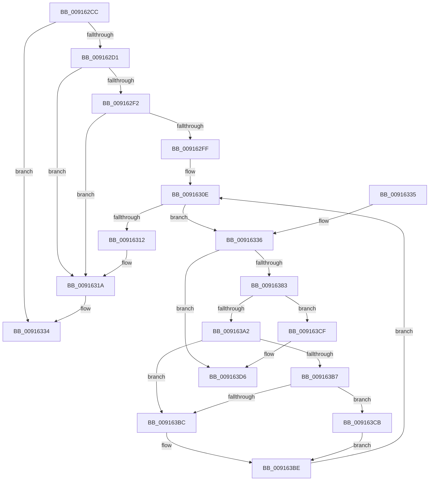

# PopCallPowerSettingCallback

- RVA: `0x009162CC`–`0x009163F6` (길이 `298` bytes)
- VA: `0x00000001409162CC`
- 실행 섹션: `PAGE`
- PDB 이름 있음: `예`; PDB Function 태그: `아니요`
- unwind 정보 RVA: `0x0008A7A0`
- 디코드: `78`개 명령, `298/298` bytes 표시
- 미해석 바이트: `0` (있으면 어셈블리에 `.byte`로 보존)

> 이 문서는 커널 이미지의 기계어와 PDB 기호를 분석해 생성했습니다. 4번과 5번은 함수 원형과 자료형을 바이너리 사용 방식에서 추정한 C 해석이며 원본 소스 복구 결과는 아닙니다.

## 1. Dependencies

- 직접 호출 지점: **7**; 고유 호출 대상: **7**
- 직접 호출자로 확인된 함수: **1**
- RIP 상대 이미지 참조: **1**

### Outgoing calls
- `0x00916343` → [ExReleaseFastMutex](../../text/25/ExReleaseFastMutex_function_002519C0.md) (function, `0x002519C0`)
- `0x00916358` → [PopDiagTracePowerSettingStart](PopDiagTracePowerSettingStart_function_009164C4.md) (function, `0x009164C4`)
- `0x00916375` → [guard_dispatch_icall](../../text/6B/guard_dispatch_icall_function_006BAAD0.md) (function, `0x006BAAD0`)
- `0x0091638B` → [PopDiagTracePowerSettingStop](PopDiagTracePowerSettingStop_function_009163FC.md) (function, `0x009163FC`)
- `0x009163A9` → [ExAcquireFastMutex](../../text/20/ExAcquireFastMutex_function_0020E5A0.md) (function, `0x0020E5A0`)
- `0x009163C1` → [PopUnreferencePowerSetting](PopUnreferencePowerSetting_function_009164A4.md) (function, `0x009164A4`)
- `0x009163F0` → [KeBugCheckEx](../../text/4F/KeBugCheckEx_function_004FD660.md) (function, `0x004FD660`)

### Direct callers
- [PopDispatchPowerSettingCallbacks](PopDispatchPowerSettingCallbacks_function_00916190.md) at `0x00916208`

### Static image references
- `0x0091633A` → RVA `0x00F0DF40` (`.data`; read)

## 2. Other-region calls and transfers

- 다른 실행 섹션으로 향하는 call: **4**
  - `0x00916343` → [ExReleaseFastMutex](../../text/25/ExReleaseFastMutex_function_002519C0.md) (`PAGE` → `.text`)
  - `0x00916375` → [guard_dispatch_icall](../../text/6B/guard_dispatch_icall_function_006BAAD0.md) (`PAGE` → `.text`)
  - `0x009163A9` → [ExAcquireFastMutex](../../text/20/ExAcquireFastMutex_function_0020E5A0.md) (`PAGE` → `.text`)
  - `0x009163F0` → [KeBugCheckEx](../../text/4F/KeBugCheckEx_function_004FD660.md) (`PAGE` → `.text`)
- 별도 외부 분기/꼬리 이동을 확인하지 못했습니다.

## 3. Assembly (complete function range)

```asm
009162CC  48 85 D2                        test rdx, rdx
009162CF  74 63                           je 0x140916334
009162D1  48 8B C4                        mov rax, rsp
009162D4  48 89 58 08                     mov qword ptr [rax + 8], rbx
009162D8  48 89 68 10                     mov qword ptr [rax + 0x10], rbp
009162DC  48 89 70 18                     mov qword ptr [rax + 0x18], rsi
009162E0  48 89 78 20                     mov qword ptr [rax + 0x20], rdi
009162E4  41 56                           push r14
009162E6  48 83 EC 30                     sub rsp, 0x30
009162EA  48 8B F9                        mov rdi, rcx
009162ED  48 85 C9                        test rcx, rcx
009162F0  74 28                           je 0x14091631a
009162F2  48 89 51 48                     mov qword ptr [rcx + 0x48], rdx
009162F6  48 8B 41 18                     mov rax, qword ptr [rcx + 0x18]
009162FA  48 85 C0                        test rax, rax
009162FD  75 1B                           jne 0x14091631a
009162FF  65 48 8B 04 25 88 01 00 00      mov rax, qword ptr gs:[0x188]
00916308  B3 01                           mov bl, 1
0091630A  48 89 41 18                     mov qword ptr [rcx + 0x18], rax
0091630E  84 DB                           test bl, bl
00916310  75 24                           jne 0x140916336
00916312  48 C7 47 18 00 00 00 00         mov qword ptr [rdi + 0x18], 0
0091631A  48 8B 5C 24 40                  mov rbx, qword ptr [rsp + 0x40]
0091631F  48 8B 6C 24 48                  mov rbp, qword ptr [rsp + 0x48]
00916324  48 8B 74 24 50                  mov rsi, qword ptr [rsp + 0x50]
00916329  48 8B 7C 24 58                  mov rdi, qword ptr [rsp + 0x58]
0091632E  48 83 C4 30                     add rsp, 0x30
00916332  41 5E                           pop r14
00916334  C3                              ret
00916335  CC                              int3
00916336  48 8B 77 48                     mov rsi, qword ptr [rdi + 0x48]
0091633A  48 8D 0D FF 7B 5F 00            lea rcx, [rip + 0x5f7bff]
00916341  FF 06                           inc dword ptr [rsi]
00916343  E8 78 B6 93 FF                  call 0x1402519c0
00916348  44 8B 46 04                     mov r8d, dword ptr [rsi + 4]
0091634C  4C 8D 4E 0C                     lea r9, [rsi + 0xc]
00916350  48 8B 4F 50                     mov rcx, qword ptr [rdi + 0x50]
00916354  48 8D 57 24                     lea rdx, [rdi + 0x24]
00916358  E8 67 01 00 00                  call 0x1409164c4
0091635D  44 0F 20 C5                     mov rbp, cr8
00916361  48 8B 47 50                     mov rax, qword ptr [rdi + 0x50]
00916365  48 8D 4F 34                     lea rcx, [rdi + 0x34]
00916369  4C 8B 4F 58                     mov r9, qword ptr [rdi + 0x58]
0091636D  48 8D 56 0C                     lea rdx, [rsi + 0xc]
00916371  44 8B 46 04                     mov r8d, dword ptr [rsi + 4]
00916375  E8 56 47 DA FF                  call 0x1406baad0
0091637A  44 0F 20 C0                     mov rax, cr8
0091637E  40 3A C5                        cmp al, bpl
00916381  75 53                           jne 0x1409163d6
00916383  48 8B 4F 50                     mov rcx, qword ptr [rdi + 0x50]
00916387  48 8D 57 24                     lea rdx, [rdi + 0x24]
0091638B  E8 6C 00 00 00                  call 0x1409163fc
00916390  65 48 8B 04 25 88 01 00 00      mov rax, qword ptr gs:[0x188]
00916399  83 B8 E4 01 00 00 00            cmp dword ptr [rax + 0x1e4], 0
009163A0  75 2D                           jne 0x1409163cf
009163A2  48 8D 0D 97 7B 5F 00            lea rcx, [rip + 0x5f7b97]
009163A9  E8 F2 81 8F FF                  call 0x14020e5a0
009163AE  48 8B 47 48                     mov rax, qword ptr [rdi + 0x48]
009163B2  48 85 C0                        test rax, rax
009163B5  74 05                           je 0x1409163bc
009163B7  48 3B F0                        cmp rsi, rax
009163BA  75 0F                           jne 0x1409163cb
009163BC  32 DB                           xor bl, bl
009163BE  48 8B CE                        mov rcx, rsi
009163C1  E8 DE 00 00 00                  call 0x1409164a4
009163C6  E9 43 FF FF FF                  jmp 0x14091630e
009163CB  B3 01                           mov bl, 1
009163CD  EB EF                           jmp 0x1409163be
009163CF  B9 20 00 00 00                  mov ecx, 0x20
009163D4  CD 29                           int 0x29
009163D6  4C 8B 47 50                     mov r8, qword ptr [rdi + 0x50]
009163DA  BA 00 09 00 00                  mov edx, 0x900
009163DF  0F B6 C0                        movzx eax, al
009163E2  B9 A0 00 00 00                  mov ecx, 0xa0
009163E7  44 0F B6 CD                     movzx r9d, bpl
009163EB  48 89 44 24 20                  mov qword ptr [rsp + 0x20], rax
009163F0  E8 6B 72 BE FF                  call 0x1404fd660
009163F5  CC                              int3
```

## 4. C-style interpretation (structured pseudocode)

```c
__int64 __fastcall PopCallPowerSettingCallback(__int64 a1, __int64 a2)
{
    __int64 result;
    __int64 v_rbx;
    __int64 v_rsp;
    unsigned __int64 v_stack_p10;
    unsigned __int64 v_stack_p18;
    unsigned __int64 v_stack_p20;
    unsigned __int64 v_stack_p8;

    if (a2 == 0) goto loc_00916334;
    *(unsigned __int64 *)(v_rsp + 8) = v_rbx;
    *(unsigned __int64 *)(v_rsp + 16) = v_rbp;
    *(unsigned __int64 *)(v_rsp + 24) = v_rsi;
    *(unsigned __int64 *)(v_rsp + 32) = v_rdi;
    v_rsp = (v_rsp) - (48);
    if (a1 == 0) goto loc_0091631A;
    *(unsigned __int64 *)(a1 + 72) = a2;
    if (*(unsigned __int64 *)(a1 + 24) != 0) goto loc_0091631A;
    *(unsigned __int64 *)(a1 + 24) = *(unsigned __int64 *)(gs_base + (0 + 392));
loc_0091630E:
    if (1 != 0) goto loc_00916336;
    *(unsigned __int64 *)(a1 + 24) = 0;
loc_0091631A:
    v_rsp = (v_rsp) + (48);
loc_00916334:
    return *(unsigned __int64 *)(gs_base + (0 + 392));
loc_00916336:
    result = ExReleaseFastMutex(v_rip + 6257663, a2, a3, a4);
    result = PopDiagTracePowerSettingStart(*(unsigned __int64 *)(v_stack_p20 + 80), v_stack_p20 + 36, (unsigned int)(*(unsigned int *)(*(unsigned __int64 *)(v_stack_p20 + 72) + 4)), *(unsigned __int64 *)(v_stack_p20 + 72) + 12);
    result = guard_dispatch_icall(v_stack_p20 + 52, *(unsigned __int64 *)(v_stack_p20 + 72) + 12, (unsigned int)(*(unsigned int *)(*(unsigned __int64 *)(v_stack_p20 + 72) + 4)), *(unsigned __int64 *)(v_stack_p20 + 88));
    if (((unsigned __int8)(v_cr8)) != ((unsigned __int8)(v_cr8))) goto loc_009163D6;
    result = PopDiagTracePowerSettingStop(*(unsigned __int64 *)(v_stack_p20 + 80), v_stack_p20 + 36, (unsigned int)(*(unsigned int *)(*(unsigned __int64 *)(v_stack_p20 + 72) + 4)), *(unsigned __int64 *)(v_stack_p20 + 88));
    if ((*(unsigned int *)(*(unsigned __int64 *)(gs_base + (0 + 392)) + 484)) != 0) goto loc_009163CF;
    result = ExAcquireFastMutex(v_rip + 6257559, v_stack_p20 + 36, (unsigned int)(*(unsigned int *)(*(unsigned __int64 *)(v_stack_p20 + 72) + 4)), *(unsigned __int64 *)(v_stack_p20 + 88));
    if (*(unsigned __int64 *)(v_stack_p20 + 72) == 0) goto loc_009163BC;
    if ((*(unsigned __int64 *)(v_stack_p20 + 72)) != (*(unsigned __int64 *)(v_stack_p20 + 72))) goto loc_009163CB;
loc_009163BC:
    v_rbx = 0;
loc_009163BE:
    result = PopUnreferencePowerSetting(*(unsigned __int64 *)(v_stack_p20 + 72), v_stack_p20 + 36, (unsigned int)(*(unsigned int *)(*(unsigned __int64 *)(v_stack_p20 + 72) + 4)), *(unsigned __int64 *)(v_stack_p20 + 88));
    goto loc_0091630E;
loc_009163CB:
    goto loc_009163BE;
loc_009163CF:
loc_009163D6:
    v_stack_p20 = (unsigned __int8)(result);
    result = KeBugCheckEx(160, (unsigned int)(0x900ULL), *(unsigned __int64 *)(v_stack_p20 + 80), (unsigned __int8)(v_cr8));
    return result;
}
```

## 5. (Beta) C Style

```c
int64_t PopCallPowerSettingCallback(void *Arg1, int64_t Arg2)
{
    uint8_t *arg1 = (uint8_t *)Arg1;

    int64_t result;
    int64_t local_rbx;
    int64_t local_rsp;
    uint64_t v_stack_p10;
    uint64_t v_stack_p18;
    uint64_t v_stack_p20;
    uint64_t v_stack_p8;

    if (Arg2 == 0) goto loc_00916334;
    *(uint64_t *)(local_rsp + 0x8) = local_rbx;
    *(uint64_t *)(local_rsp + 0x10) = local_rbp;
    *(uint64_t *)(local_rsp + 0x18) = local_rsi;
    *(uint64_t *)(local_rsp + 0x20) = local_rdi;
    local_rsp = (local_rsp) - (48);
    if (Arg1 == NULL) goto loc_0091631A;
    *(uint64_t *)(arg1 + 0x48) = Arg2;
    if (*(uint64_t *)(arg1 + 0x18) != 0) goto loc_0091631A;
    *(uint64_t *)(arg1 + 0x18) = *(uint64_t *)(gs_base + (0 + 0x188));
loc_0091630E:
    if (1 != 0) goto loc_00916336;
    *(uint64_t *)(arg1 + 0x18) = 0;
loc_0091631A:
    local_rsp = (local_rsp) + (48);
loc_00916334:
    return *(uint64_t *)(gs_base + (0 + 0x188));
loc_00916336:
    result = ExReleaseFastMutex(v_rip + 6257663, Arg2, a3, a4);
    result = PopDiagTracePowerSettingStart(*(uint64_t *)(v_stack_p20 + 0x50), v_stack_p20 + 36, (uint32_t)(*(uint32_t *)(*(uint64_t *)(v_stack_p20 + 0x48) + 0x4)), *(uint64_t *)(v_stack_p20 + 0x48) + 12);
    result = guard_dispatch_icall(v_stack_p20 + 52, *(uint64_t *)(v_stack_p20 + 0x48) + 12, (uint32_t)(*(uint32_t *)(*(uint64_t *)(v_stack_p20 + 0x48) + 0x4)), *(uint64_t *)(v_stack_p20 + 0x58));
    if (((uint8_t)(v_cr8)) != ((uint8_t)(v_cr8))) goto loc_009163D6;
    result = PopDiagTracePowerSettingStop(*(uint64_t *)(v_stack_p20 + 0x50), v_stack_p20 + 36, (uint32_t)(*(uint32_t *)(*(uint64_t *)(v_stack_p20 + 0x48) + 0x4)), *(uint64_t *)(v_stack_p20 + 0x58));
    if ((*(uint32_t *)(*(uint64_t *)(gs_base + (0 + 0x188)) + 0x1E4)) != 0) goto loc_009163CF;
    result = ExAcquireFastMutex(v_rip + 6257559, v_stack_p20 + 36, (uint32_t)(*(uint32_t *)(*(uint64_t *)(v_stack_p20 + 0x48) + 0x4)), *(uint64_t *)(v_stack_p20 + 0x58));
    if (*(uint64_t *)(v_stack_p20 + 0x48) == 0) goto loc_009163BC;
    if ((*(uint64_t *)(v_stack_p20 + 0x48)) != (*(uint64_t *)(v_stack_p20 + 0x48))) goto loc_009163CB;
loc_009163BC:
    local_rbx = 0;
loc_009163BE:
    result = PopUnreferencePowerSetting(*(uint64_t *)(v_stack_p20 + 0x48), v_stack_p20 + 36, (uint32_t)(*(uint32_t *)(*(uint64_t *)(v_stack_p20 + 0x48) + 0x4)), *(uint64_t *)(v_stack_p20 + 0x58));
    goto loc_0091630E;
loc_009163CB:
    goto loc_009163BE;
loc_009163CF:
loc_009163D6:
    v_stack_p20 = (uint8_t)(result);
    result = KeBugCheckEx(160, (uint32_t)(0x900ULL), *(uint64_t *)(v_stack_p20 + 0x50), (uint8_t)(v_cr8));
    return result;
}
```

### 관측된 메모리 오프셋

구조체 형식이 확인되지 않은 접근은 인자 기준의 오프셋으로만 기록했습니다.

| 기준 인자 | 오프셋 표현 | 폭 (bit) | 접근 |
|---|---:|---:|---|
| `Arg1` | `+ 0x18` | `64` | `W` |
| `Arg1` | `+ 0x24` | `64` | `R` |
| `Arg1` | `+ 0x34` | `64` | `R` |
| `Arg1` | `+ 0x48` | `64` | `R` |
| `Arg1` | `+ 0x50` | `64` | `R` |
| `Arg1` | `+ 0x58` | `64` | `R` |

## 6. Execution-region graph

[열기: 2D/3D 그래프와 함수 탐색 컨트롤 패널](../../../control-panel.html?section=page&rva=0x009162CC&view=graph)

- 2D 그래프는 위에서 아래로 흐르고, 3D 그래프는 빈 공간을 드래그해 회전합니다. Shift+드래그는 이동, 휠은 확대·축소, 함수 노드 선택은 대상 보고서 이동입니다.

### Static fallback


