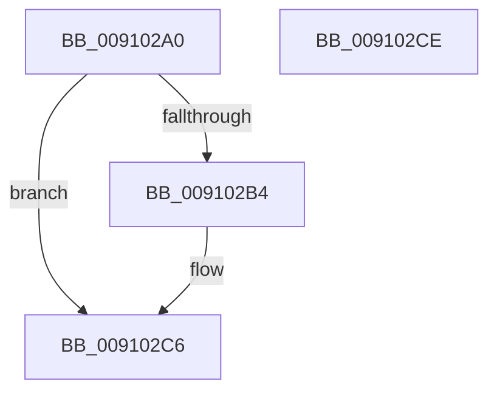

# PopCheckDisabledReason

- RVA: `0x009102A0`–`0x009102CF` (길이 `47` bytes)
- VA: `0x00000001409102A0`
- 실행 섹션: `PAGE`
- PDB 이름 있음: `예`; PDB Function 태그: `아니요`
- unwind 정보 RVA: `0x0005C788`
- 디코드: `15`개 명령, `47/47` bytes 표시
- 미해석 바이트: `0` (있으면 어셈블리에 `.byte`로 보존)

> 이 문서는 커널 이미지의 기계어와 PDB 기호를 분석해 생성했습니다. 4번과 5번은 함수 원형과 자료형을 바이너리 사용 방식에서 추정한 C 해석이며 원본 소스 복구 결과는 아닙니다.

## 1. Dependencies

- 직접 호출 지점: **1**; 고유 호출 대상: **1**
- 직접 호출자로 확인된 함수: **1**
- RIP 상대 이미지 참조: **0**

### Outgoing calls
- `0x009102A7` → [PopGetReasonListByReasonCode](PopGetReasonListByReasonCode_function_00911B7C.md) (function, `0x00911B7C`)

### Direct callers
- [PopEnableHiberFile](../90/PopEnableHiberFile_function_0090F850.md) at `0x0090F91F`
- [PopEnableHiberFile](../90/PopEnableHiberFile_function_0090F850.md) at `0x0090F92A`
- [PopEnableHiberFile](../90/PopEnableHiberFile_function_0090F850.md) at `0x0090F936`
- [PopEnableHiberFile](../90/PopEnableHiberFile_function_0090F850.md) at `0x0090F947`
- [PopEnableHiberFile](../90/PopEnableHiberFile_function_0090F850.md) at `0x0090F964`

### Static image references
- 디코드된 RIP-relative 메모리 참조가 없습니다.

## 2. Other-region calls and transfers

- 다른 실행 섹션으로 향하는 call: **0**
- 별도 외부 분기/꼬리 이동을 확인하지 못했습니다.

## 3. Assembly (complete function range)

```asm
009102A0  48 83 EC 28                     sub rsp, 0x28
009102A4  45 33 D2                        xor r10d, r10d
009102A7  E8 D0 18 00 00                  call 0x140911b7c
009102AC  48 8B C8                        mov rcx, rax
009102AF  48 85 C0                        test rax, rax
009102B2  74 12                           je 0x1409102c6
009102B4  44 38 51 13                     cmp byte ptr [rcx + 0x13], r10b
009102B8  41 8D 52 01                     lea edx, [r10 + 1]
009102BC  41 0F B6 C2                     movzx eax, r10b
009102C0  0F 45 C2                        cmovne eax, edx
009102C3  44 8A D0                        mov r10b, al
009102C6  41 8A C2                        mov al, r10b
009102C9  48 83 C4 28                     add rsp, 0x28
009102CD  C3                              ret
009102CE  CC                              int3
```

## 4. C-style interpretation (structured pseudocode)

```c
__int64 __fastcall PopCheckDisabledReason(void)
{
    __int64 result;
    __int64 v_r10;
    __int64 v_rsp;

    v_rsp = (v_rsp) - (40);
    v_r10 = 0;
    result = PopGetReasonListByReasonCode(a1, a2, a3, a4);
    if (result != 0) {
        a2 = v_r10 + 1;
        result = 0;
        if ((*(unsigned __int8 *)(result + 19)) != 0) { result = (unsigned int)(a2); }
        v_r10 = (unsigned __int8)(result);
    }
    v_rsp = (v_rsp) + (40);
    return (unsigned __int8)(v_r10);
}
```

## 5. (Beta) C Style

```c
void PopCheckDisabledReason(void)
{
    int64_t result;
    int64_t local_r10;
    int64_t local_rsp;

    local_rsp = (local_rsp) - (40);
    local_r10 = 0;
    result = PopGetReasonListByReasonCode(a1, a2, a3, a4);
    if (result != 0) {
        a2 = local_r10 + 1;
        result = 0;
        if ((*(uint8_t *)(result + 0x13)) != 0) { result = (uint32_t)(a2); }
        local_r10 = (uint8_t)(result);
    }
    local_rsp = (local_rsp) + (40);
    return (uint8_t)(local_r10);
}
```

## 6. Execution-region graph

[열기: 2D/3D 그래프와 함수 탐색 컨트롤 패널](../../../control-panel.html?section=page&rva=0x009102A0&view=graph)

- 2D 그래프는 위에서 아래로 흐르고, 3D 그래프는 빈 공간을 드래그해 회전합니다. Shift+드래그는 이동, 휠은 확대·축소, 함수 노드 선택은 대상 보고서 이동입니다.

### Static fallback


