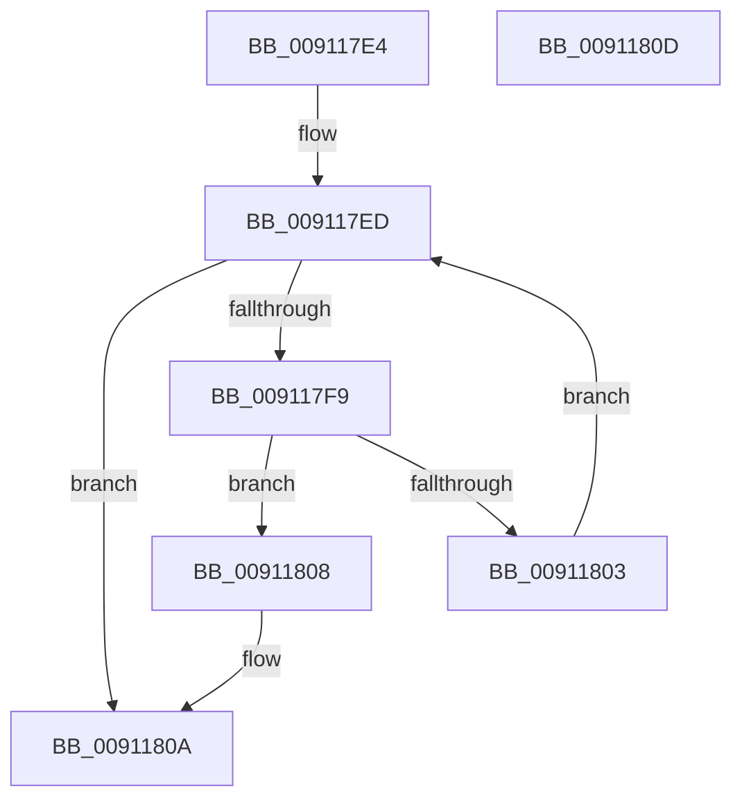

# PopCheckDisabledState

- RVA: `0x009117E4`–`0x0091180E` (길이 `42` bytes)
- VA: `0x00000001409117E4`
- 실행 섹션: `PAGE`
- PDB 이름 있음: `예`; PDB Function 태그: `아니요`
- unwind 정보 RVA: `0x000DB714`
- 디코드: `14`개 명령, `42/42` bytes 표시
- 미해석 바이트: `0` (있으면 어셈블리에 `.byte`로 보존)

> 이 문서는 커널 이미지의 기계어와 PDB 기호를 분석해 생성했습니다. 4번과 5번은 함수 원형과 자료형을 바이너리 사용 방식에서 추정한 C 해석이며 원본 소스 복구 결과는 아닙니다.

## 1. Dependencies

- 직접 호출 지점: **0**; 고유 호출 대상: **0**
- 직접 호출자로 확인된 함수: **1**
- RIP 상대 이미지 참조: **1**

### Outgoing calls
- 직접 디코드된 call 명령이 없습니다.

### Direct callers
- [PopFilterCapabilities](PopFilterCapabilities_function_0091141C.md) at `0x0091158C`
- [PopFilterCapabilities](PopFilterCapabilities_function_0091141C.md) at `0x0091159E`
- [PopFilterCapabilities](PopFilterCapabilities_function_0091141C.md) at `0x009115B0`
- [PopFilterCapabilities](PopFilterCapabilities_function_0091141C.md) at `0x009115C2`
- [PopFilterCapabilities](PopFilterCapabilities_function_0091141C.md) at `0x009115DB`

### Static image references
- `0x009117E4` → RVA `0x00F0CBB0` (`.data`; read)

## 2. Other-region calls and transfers

- 다른 실행 섹션으로 향하는 call: **0**
- 별도 외부 분기/꼬리 이동을 확인하지 못했습니다.

## 3. Assembly (complete function range)

```asm
009117E4  4C 8B 05 C5 B3 5F 00            mov r8, qword ptr [rip + 0x5fb3c5]
009117EB  32 D2                           xor dl, dl
009117ED  48 8D 05 BC B3 5F 00            lea rax, [rip + 0x5fb3bc]
009117F4  4C 3B C0                        cmp r8, rax
009117F7  74 11                           je 0x14091180a
009117F9  48 63 C1                        movsxd rax, ecx
009117FC  42 38 54 00 10                  cmp byte ptr [rax + r8 + 0x10], dl
00911801  75 05                           jne 0x140911808
00911803  4D 8B 00                        mov r8, qword ptr [r8]
00911806  EB E5                           jmp 0x1409117ed
00911808  B2 01                           mov dl, 1
0091180A  8A C2                           mov al, dl
0091180C  C3                              ret
0091180D  CC                              int3
```

## 4. C-style interpretation (structured pseudocode)

```c
__int64 __fastcall PopCheckDisabledState(int a1, unsigned __int8 a2)
{
    a2 = 0;
loc_009117ED:
    if ((*(unsigned __int64 *)(v_rip + 6271941)) == (v_rip + 6271932)) goto loc_0091180A;
    if ((*(unsigned __int8 *)((int)(a1) + *(unsigned __int64 *)(v_rip + 6271941) * 1 + 16)) != 0) goto loc_00911808;
    goto loc_009117ED;
loc_00911808:
loc_0091180A:
    return 1;
}
```

## 5. (Beta) C Style

```c
int64_t PopCheckDisabledState(void *Arg1, uint8_t Arg2)
{
    uint8_t *arg1 = (uint8_t *)Arg1;

    Arg2 = 0;
loc_009117ED:
    if ((*(uint64_t *)(v_rip + 0x5FB3C5)) == (v_rip + 6271932)) goto loc_0091180A;
    if ((*(uint8_t *)((int32_t)(arg1) + *(uint64_t *)(v_rip + 0x5FB3C5) * 1 + 0x10)) != 0) goto loc_00911808;
    goto loc_009117ED;
loc_00911808:
loc_0091180A:
    return 1;
}
```

### 관측된 메모리 오프셋

구조체 형식이 확인되지 않은 접근은 인자 기준의 오프셋으로만 기록했습니다.

| 기준 인자 | 오프셋 표현 | 폭 (bit) | 접근 |
|---|---:|---:|---|
| `Arg1` | `+ 0x10 + r8*1` | `8` | `R` |

## 6. Execution-region graph

[열기: 2D/3D 그래프와 함수 탐색 컨트롤 패널](../../../control-panel.html?section=page&rva=0x009117E4&view=graph)

- 2D 그래프는 위에서 아래로 흐르고, 3D 그래프는 빈 공간을 드래그해 회전합니다. Shift+드래그는 이동, 휠은 확대·축소, 함수 노드 선택은 대상 보고서 이동입니다.

### Static fallback


