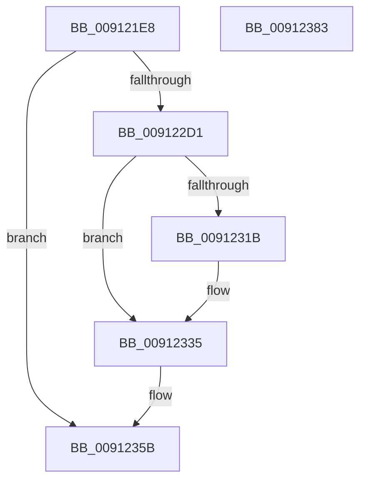

# PopCreateNotificationName

- RVA: `0x009121E8`–`0x00912384` (길이 `412` bytes)
- VA: `0x00000001409121E8`
- 실행 섹션: `PAGE`
- PDB 이름 있음: `예`; PDB Function 태그: `아니요`
- unwind 정보 RVA: `0x0008A2BC`
- 디코드: `93`개 명령, `412/412` bytes 표시
- 미해석 바이트: `0` (있으면 어셈블리에 `.byte`로 보존)

> 이 문서는 커널 이미지의 기계어와 PDB 기호를 분석해 생성했습니다. 4번과 5번은 함수 원형과 자료형을 바이너리 사용 방식에서 추정한 C 해석이며 원본 소스 복구 결과는 아닙니다.

## 1. Dependencies

- 직접 호출 지점: **8**; 고유 호출 대상: **5**
- 직접 호출자로 확인된 함수: **1**
- RIP 상대 이미지 참조: **5**

### Outgoing calls
- `0x00912240` → [RtlCreateAcl](RtlCreateAcl_function_00916F00.md) (function, `0x00916F00`)
- `0x00912267` → [RtlpAddKnownAce](../92/RtlpAddKnownAce_function_00929A20.md) (function, `0x00929A20`)
- `0x0091228C` → [RtlpAddKnownAce](../92/RtlpAddKnownAce_function_00929A20.md) (function, `0x00929A20`)
- `0x009122B1` → [RtlpAddKnownAce](../92/RtlpAddKnownAce_function_00929A20.md) (function, `0x00929A20`)
- `0x009122C4` → [RtlDeriveCapabilitySidsFromName](../../text/47/RtlDeriveCapabilitySidsFromName_function_00474DC0.md) (function, `0x00474DC0`)
- `0x009122EF` → [RtlpAddKnownAce](../92/RtlpAddKnownAce_function_00929A20.md) (function, `0x00929A20`)
- `0x00912356` → [ZwCreateWnfStateName](../../text/6A/ZwCreateWnfStateName_function_006AEB50.md) (function, `0x006AEB50`)
- `0x00912365` → [_security_check_cookie](../../text/6A/_security_check_cookie_function_006AC640.md) (function, `0x006AC640`)

### Direct callers
- [PopGetSettingNotificationName](PopGetSettingNotificationName_function_0091346C.md) at `0x00913627`
- [PopGetSettingNotificationName](PopGetSettingNotificationName_function_0091346C.md) at `0x009136C7`

### Static image references
- `0x00912206` → RVA `0x00E0A740` (`.data`; read)
- `0x00912223` → RVA `0x00AFE000` (` ?? ::NNGAKEGL::`string'`; read)
- `0x00912245` → RVA `0x00E67D58` (`.data`; read)
- `0x0091226C` → RVA `0x00E67D48` (`.data`; read)
- `0x00912291` → RVA `0x00E67D60` (`.data`; read)

## 2. Other-region calls and transfers

- 다른 실행 섹션으로 향하는 call: **3**
  - `0x009122C4` → [RtlDeriveCapabilitySidsFromName](../../text/47/RtlDeriveCapabilitySidsFromName_function_00474DC0.md) (`PAGE` → `.text`)
  - `0x00912356` → [ZwCreateWnfStateName](../../text/6A/ZwCreateWnfStateName_function_006AEB50.md) (`PAGE` → `.text`)
  - `0x00912365` → [_security_check_cookie](../../text/6A/_security_check_cookie_function_006AC640.md) (`PAGE` → `.text`)
- 별도 외부 분기/꼬리 이동을 확인하지 못했습니다.

## 3. Assembly (complete function range)

```asm
009121E8  48 8B C4                        mov rax, rsp
009121EB  48 89 58 10                     mov qword ptr [rax + 0x10], rbx
009121EF  48 89 70 18                     mov qword ptr [rax + 0x18], rsi
009121F3  48 89 78 20                     mov qword ptr [rax + 0x20], rdi
009121F7  55                              push rbp
009121F8  48 8D A8 B8 FE FF FF            lea rbp, [rax - 0x148]
009121FF  48 81 EC 40 02 00 00            sub rsp, 0x240
00912206  48 8B 05 33 85 4F 00            mov rax, qword ptr [rip + 0x4f8533]
0091220D  48 33 C4                        xor rax, rsp
00912210  48 89 85 30 01 00 00            mov qword ptr [rbp + 0x130], rax
00912217  48 8B D9                        mov rbx, rcx
0091221A  48 C7 44 24 40 28 00 2A 00      mov qword ptr [rsp + 0x40], 0x2a0028
00912223  48 8D 05 D6 BD 1E 00            lea rax, [rip + 0x1ebdd6]
0091222A  BE 02 00 00 00                  mov esi, 2
0091222F  44 8B C6                        mov r8d, esi
00912232  48 89 44 24 48                  mov qword ptr [rsp + 0x48], rax
00912237  BA 48 01 00 00                  mov edx, 0x148
0091223C  48 8D 4D E0                     lea rcx, [rbp - 0x20]
00912240  E8 BB 4C 00 00                  call 0x140916f00
00912245  48 8B 05 0C 5B 55 00            mov rax, qword ptr [rip + 0x555b0c]
0091224C  48 8D 4D E0                     lea rcx, [rbp - 0x20]
00912250  33 FF                           xor edi, edi
00912252  41 B9 03 00 1F 00               mov r9d, 0x1f0003
00912258  40 88 7C 24 28                  mov byte ptr [rsp + 0x28], dil
0091225D  45 33 C0                        xor r8d, r8d
00912260  8B D6                           mov edx, esi
00912262  48 89 44 24 20                  mov qword ptr [rsp + 0x20], rax
00912267  E8 B4 77 01 00                  call 0x140929a20
0091226C  48 8B 05 D5 5A 55 00            mov rax, qword ptr [rip + 0x555ad5]
00912273  48 8D 4D E0                     lea rcx, [rbp - 0x20]
00912277  40 88 7C 24 28                  mov byte ptr [rsp + 0x28], dil
0091227C  41 B9 01 00 12 00               mov r9d, 0x120001
00912282  45 33 C0                        xor r8d, r8d
00912285  48 89 44 24 20                  mov qword ptr [rsp + 0x20], rax
0091228A  8B D6                           mov edx, esi
0091228C  E8 8F 77 01 00                  call 0x140929a20
00912291  48 8B 05 C8 5A 55 00            mov rax, qword ptr [rip + 0x555ac8]
00912298  48 8D 4D E0                     lea rcx, [rbp - 0x20]
0091229C  40 88 7C 24 28                  mov byte ptr [rsp + 0x28], dil
009122A1  41 B9 01 00 12 00               mov r9d, 0x120001
009122A7  45 33 C0                        xor r8d, r8d
009122AA  48 89 44 24 20                  mov qword ptr [rsp + 0x20], rax
009122AF  8B D6                           mov edx, esi
009122B1  E8 6A 77 01 00                  call 0x140929a20
009122B6  4C 8D 44 24 78                  lea r8, [rsp + 0x78]
009122BB  48 8D 55 A8                     lea rdx, [rbp - 0x58]
009122BF  48 8D 4C 24 40                  lea rcx, [rsp + 0x40]
009122C4  E8 F7 2A B6 FF                  call 0x140474dc0
009122C9  85 C0                           test eax, eax
009122CB  0F 88 8A 00 00 00               js 0x14091235b
009122D1  48 8D 44 24 78                  lea rax, [rsp + 0x78]
009122D6  40 88 7C 24 28                  mov byte ptr [rsp + 0x28], dil
009122DB  41 B9 01 00 12 00               mov r9d, 0x120001
009122E1  48 89 44 24 20                  mov qword ptr [rsp + 0x20], rax
009122E6  45 33 C0                        xor r8d, r8d
009122E9  48 8D 4D E0                     lea rcx, [rbp - 0x20]
009122ED  8B D6                           mov edx, esi
009122EF  E8 2C 77 01 00                  call 0x140929a20
009122F4  33 C0                           xor eax, eax
009122F6  44 8D 46 02                     lea r8d, [rsi + 2]
009122FA  0F 57 C0                        xorps xmm0, xmm0
009122FD  48 89 44 24 70                  mov qword ptr [rsp + 0x70], rax
00912302  0F 11 44 24 50                  movups xmmword ptr [rsp + 0x50], xmm0
00912307  0F B7 44 24 52                  movzx eax, word ptr [rsp + 0x52]
0091230C  C6 44 24 50 01                  mov byte ptr [rsp + 0x50], 1
00912311  0F 11 44 24 60                  movups xmmword ptr [rsp + 0x60], xmm0
00912316  66 85 C0                        test ax, ax
00912319  78 1A                           js 0x140912335
0091231B  48 8D 4D E0                     lea rcx, [rbp - 0x20]
0091231F  48 89 4C 24 70                  mov qword ptr [rsp + 0x70], rcx
00912324  B9 F7 FF 00 00                  mov ecx, 0xfff7
00912329  66 23 C1                        and ax, cx
0091232C  66 41 0B C0                     or ax, r8w
00912330  66 89 44 24 52                  mov word ptr [rsp + 0x52], ax
00912335  45 33 C9                        xor r9d, r9d
00912338  48 8D 44 24 50                  lea rax, [rsp + 0x50]
0091233D  48 89 44 24 30                  mov qword ptr [rsp + 0x30], rax
00912342  48 8B CB                        mov rcx, rbx
00912345  C7 44 24 28 24 00 00 00         mov dword ptr [rsp + 0x28], 0x24
0091234D  48 89 7C 24 20                  mov qword ptr [rsp + 0x20], rdi
00912352  41 8D 51 03                     lea edx, [r9 + 3]
00912356  E8 F5 C7 D9 FF                  call 0x1406aeb50
0091235B  48 8B 8D 30 01 00 00            mov rcx, qword ptr [rbp + 0x130]
00912362  48 33 CC                        xor rcx, rsp
00912365  E8 D6 A2 D9 FF                  call 0x1406ac640
0091236A  4C 8D 9C 24 40 02 00 00         lea r11, [rsp + 0x240]
00912372  49 8B 5B 18                     mov rbx, qword ptr [r11 + 0x18]
00912376  49 8B 73 20                     mov rsi, qword ptr [r11 + 0x20]
0091237A  49 8B 7B 28                     mov rdi, qword ptr [r11 + 0x28]
0091237E  49 8B E3                        mov rsp, r11
00912381  5D                              pop rbp
00912382  C3                              ret
00912383  CC                              int3
```

## 4. C-style interpretation (structured pseudocode)

```c
__int64 __fastcall PopCreateNotificationName(__int64 a1)
{
    __int64 result;
    __int64 v_rdi;
    __int64 v_rsp;
    unsigned __int64 v_stack_m1D0;
    unsigned __int64 v_stack_m1D8;
    unsigned __int64 v_stack_m1E8;
    unsigned __int16 v_stack_m1F6;
    unsigned __int64 v_stack_m1F8;
    unsigned __int64 v_stack_m200;
    unsigned __int64 v_stack_m208;
    unsigned __int64 v_stack_m218;
    unsigned __int8 v_stack_m220;
    unsigned __int64 v_stack_m228;
    unsigned __int64 v_stack_m8;

    *(unsigned __int64 *)(v_rsp + 16) = v_rbx;
    *(unsigned __int64 *)(v_rsp + 24) = v_rsi;
    *(unsigned __int64 *)(v_rsp + 32) = v_rdi;
    v_rsp = (v_rsp) - (576);
    result = (*(unsigned __int64 *)(v_rip + 5211443)) ^ (v_rsp);
    *(unsigned __int64 *)(v_rsp - 328 + 304) = result;
    v_stack_m208 = 0x2A0028ULL;
    v_stack_m200 = v_rip + 2014678;
    result = RtlCreateAcl(v_rsp - 328 - 32, 328, 2, a4);
    v_rdi = 0;
    v_stack_m220 = 0;
    a3 = 0;
    v_stack_m228 = *(unsigned __int64 *)(v_rip + 5593868);
    result = RtlpAddKnownAce(v_rsp - 328 - 32, 2, a3, (unsigned int)(0x1F0003ULL));
    v_stack_m220 = 0;
    a3 = 0;
    v_stack_m228 = *(unsigned __int64 *)(v_rip + 5593813);
    result = RtlpAddKnownAce(v_rsp - 328 - 32, 2, a3, (unsigned int)(0x120001ULL));
    v_stack_m220 = 0;
    a3 = 0;
    v_stack_m228 = *(unsigned __int64 *)(v_rip + 5593800);
    result = RtlpAddKnownAce(v_rsp - 328 - 32, 2, a3, (unsigned int)(0x120001ULL));
    result = RtlDeriveCapabilitySidsFromName(v_stack_m208, v_rsp - 328 - 88, v_stack_m1D0, (unsigned int)(0x120001ULL));
    if (sign_flag) goto loc_0091235B;
    v_stack_m220 = 0;
    v_stack_m228 = v_stack_m1D0;
    a3 = 0;
    result = RtlpAddKnownAce(v_rsp - 328 - 32, 2, a3, (unsigned int)(0x120001ULL));
    result = 0;
    v_stack_m1D8 = 0;
    v_stack_m1F8 = v_xmm0;
    v_stack_m1F8 = 1;
    v_stack_m1E8 = v_xmm0;
    result = v_stack_m1F6;
    if (!(sign_flag)) {
        a1 = v_rsp - 328 - 32;
        v_stack_m1D8 = a1;
        a1 = 0xFFF7ULL;
        result = (unsigned __int16)((v_stack_m1F6) & ((unsigned __int16)(a1)));
        result = (unsigned __int16)((result) | ((unsigned __int16)(2 + 2)));
        v_stack_m1F6 = (unsigned __int16)(result);
    }
    a4 = 0;
    v_stack_m218 = v_stack_m1F8;
    v_stack_m220 = 36;
    v_stack_m228 = 0;
    result = ZwCreateWnfStateName(a1, a4 + 3, 2 + 2, a4);
loc_0091235B:
    a1 = (*(unsigned __int64 *)(v_rsp - 328 + 304)) ^ (v_rsp);
    result = _security_check_cookie(a1, a4 + 3, 2 + 2, a4);
    return result;
}
```

## 5. (Beta) C Style

```c
int64_t PopCreateNotificationName(int64_t Arg1)
{
    int64_t result;
    int64_t local_rdi;
    int64_t local_rsp;
    uint64_t v_stack_m1D0;
    uint64_t v_stack_m1D8;
    uint64_t v_stack_m1E8;
    uint16_t v_stack_m1F6;
    uint64_t v_stack_m1F8;
    uint64_t v_stack_m200;
    uint64_t v_stack_m208;
    uint64_t v_stack_m218;
    uint8_t v_stack_m220;
    uint64_t v_stack_m228;
    uint64_t v_stack_m8;

    *(uint64_t *)(local_rsp + 0x10) = local_rbx;
    *(uint64_t *)(local_rsp + 0x18) = local_rsi;
    *(uint64_t *)(local_rsp + 0x20) = local_rdi;
    local_rsp = (local_rsp) - (576);
    result = (*(uint64_t *)(v_rip + 0x4F8533)) ^ (local_rsp);
    *(uint64_t *)(local_rsp - 0x148 + 0x130) = result;
    v_stack_m208 = 0x2A0028ULL;
    v_stack_m200 = v_rip + 2014678;
    result = RtlCreateAcl(local_rsp - 328 - 32, 328, 2, a4);
    local_rdi = 0;
    v_stack_m220 = 0;
    a3 = 0;
    v_stack_m228 = *(uint64_t *)(v_rip + 0x555B0C);
    result = RtlpAddKnownAce(local_rsp - 328 - 32, 2, a3, (uint32_t)(0x1F0003ULL));
    v_stack_m220 = 0;
    a3 = 0;
    v_stack_m228 = *(uint64_t *)(v_rip + 0x555AD5);
    result = RtlpAddKnownAce(local_rsp - 328 - 32, 2, a3, (uint32_t)(0x120001ULL));
    v_stack_m220 = 0;
    a3 = 0;
    v_stack_m228 = *(uint64_t *)(v_rip + 0x555AC8);
    result = RtlpAddKnownAce(local_rsp - 328 - 32, 2, a3, (uint32_t)(0x120001ULL));
    result = RtlDeriveCapabilitySidsFromName(v_stack_m208, local_rsp - 328 - 88, v_stack_m1D0, (uint32_t)(0x120001ULL));
    if (sign_flag) goto loc_0091235B;
    v_stack_m220 = 0;
    v_stack_m228 = v_stack_m1D0;
    a3 = 0;
    result = RtlpAddKnownAce(local_rsp - 328 - 32, 2, a3, (uint32_t)(0x120001ULL));
    result = 0;
    v_stack_m1D8 = 0;
    v_stack_m1F8 = v_xmm0;
    v_stack_m1F8 = 1;
    v_stack_m1E8 = v_xmm0;
    result = v_stack_m1F6;
    if (!(sign_flag)) {
        Arg1 = local_rsp - 328 - 32;
        v_stack_m1D8 = Arg1;
        Arg1 = 0xFFF7ULL;
        result = (uint16_t)((v_stack_m1F6) & ((uint16_t)(Arg1)));
        result = (uint16_t)((result) | ((uint16_t)(2 + 2)));
        v_stack_m1F6 = (uint16_t)(result);
    }
    a4 = 0;
    v_stack_m218 = v_stack_m1F8;
    v_stack_m220 = 36;
    v_stack_m228 = 0;
    result = ZwCreateWnfStateName(Arg1, a4 + 3, 2 + 2, a4);
loc_0091235B:
    Arg1 = (*(uint64_t *)(local_rsp - 0x148 + 0x130)) ^ (local_rsp);
    result = _security_check_cookie(Arg1, a4 + 3, 2 + 2, a4);
    return result;
}
```

## 6. Execution-region graph

[열기: 2D/3D 그래프와 함수 탐색 컨트롤 패널](../../../control-panel.html?section=page&rva=0x009121E8&view=graph)

- 2D 그래프는 위에서 아래로 흐르고, 3D 그래프는 빈 공간을 드래그해 회전합니다. Shift+드래그는 이동, 휠은 확대·축소, 함수 노드 선택은 대상 보고서 이동입니다.

### Static fallback


