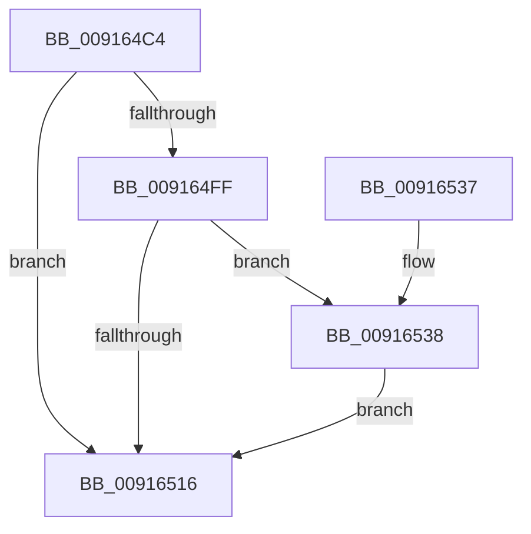

# PopDiagTracePowerSettingStart

- RVA: `0x009164C4`–`0x009165A2` (길이 `222` bytes)
- VA: `0x00000001409164C4`
- 실행 섹션: `PAGE`
- PDB 이름 있음: `예`; PDB Function 태그: `아니요`
- unwind 정보 RVA: `0x0008A7D0`
- 디코드: `53`개 명령, `222/222` bytes 표시
- 미해석 바이트: `0` (있으면 어셈블리에 `.byte`로 보존)

> 이 문서는 커널 이미지의 기계어와 PDB 기호를 분석해 생성했습니다. 4번과 5번은 함수 원형과 자료형을 바이너리 사용 방식에서 추정한 C 해석이며 원본 소스 복구 결과는 아닙니다.

## 1. Dependencies

- 직접 호출 지점: **3**; 고유 호출 대상: **3**
- 직접 호출자로 확인된 함수: **1**
- RIP 상대 이미지 참조: **4**

### Outgoing calls
- `0x0091650D` → [EtwEventEnabled](../../text/39/EtwEventEnabled_function_00392450.md) (function, `0x00392450`)
- `0x0091651D` → [_security_check_cookie](../../text/6A/_security_check_cookie_function_006AC640.md) (function, `0x006AC640`)
- `0x00916598` → [EtwWrite](../../text/41/EtwWrite_function_0041C720.md) (function, `0x0041C720`)

### Direct callers
- [PopCallPowerSettingCallback](PopCallPowerSettingCallback_function_009162CC.md) at `0x00916358`

### Static image references
- `0x009164E2` → RVA `0x00E0A740` (`.data`; read)
- `0x009164F0` → RVA `0x00E67858` (`.data`; read)
- `0x009164FF` → RVA `0x00F0B408` (`.data`; read)
- `0x00916506` → RVA `0x00011B08` (`.rdata`; read)

## 2. Other-region calls and transfers

- 다른 실행 섹션으로 향하는 call: **3**
  - `0x0091650D` → [EtwEventEnabled](../../text/39/EtwEventEnabled_function_00392450.md) (`PAGE` → `.text`)
  - `0x0091651D` → [_security_check_cookie](../../text/6A/_security_check_cookie_function_006AC640.md) (`PAGE` → `.text`)
  - `0x00916598` → [EtwWrite](../../text/41/EtwWrite_function_0041C720.md) (`PAGE` → `.text`)
- 별도 외부 분기/꼬리 이동을 확인하지 못했습니다.

## 3. Assembly (complete function range)

```asm
009164C4  48 8B C4                        mov rax, rsp
009164C7  48 89 58 10                     mov qword ptr [rax + 0x10], rbx
009164CB  48 89 78 20                     mov qword ptr [rax + 0x20], rdi
009164CF  44 89 40 18                     mov dword ptr [rax + 0x18], r8d
009164D3  48 89 48 08                     mov qword ptr [rax + 8], rcx
009164D7  55                              push rbp
009164D8  48 8B EC                        mov rbp, rsp
009164DB  48 81 EC 80 00 00 00            sub rsp, 0x80
009164E2  48 8B 05 57 42 4F 00            mov rax, qword ptr [rip + 0x4f4257]
009164E9  48 33 C4                        xor rax, rsp
009164EC  48 89 45 F0                     mov qword ptr [rbp - 0x10], rax
009164F0  80 3D 61 13 55 00 00            cmp byte ptr [rip + 0x551361], 0
009164F7  49 8B D9                        mov rbx, r9
009164FA  48 8B FA                        mov rdi, rdx
009164FD  74 17                           je 0x140916516
009164FF  48 8B 0D 02 4F 5F 00            mov rcx, qword ptr [rip + 0x5f4f02]
00916506  48 8D 15 FB B5 6F FF            lea rdx, [rip - 0x904a05]
0091650D  E8 3E BF A7 FF                  call 0x140392450
00916512  84 C0                           test al, al
00916514  75 22                           jne 0x140916538
00916516  48 8B 4D F0                     mov rcx, qword ptr [rbp - 0x10]
0091651A  48 33 CC                        xor rcx, rsp
0091651D  E8 1E 61 D9 FF                  call 0x1406ac640
00916522  4C 8D 9C 24 80 00 00 00         lea r11, [rsp + 0x80]
0091652A  49 8B 5B 18                     mov rbx, qword ptr [r11 + 0x18]
0091652E  49 8B 7B 28                     mov rdi, qword ptr [r11 + 0x28]
00916532  49 8B E3                        mov rsp, r11
00916535  5D                              pop rbp
00916536  C3                              ret
00916537  CC                              int3
00916538  83 65 BC 00                     and dword ptr [rbp - 0x44], 0
0091653C  48 8D 45 10                     lea rax, [rbp + 0x10]
00916540  83 65 CC 00                     and dword ptr [rbp - 0x34], 0
00916544  48 8D 15 BD B5 6F FF            lea rdx, [rip - 0x904a43]
0091654B  83 65 DC 00                     and dword ptr [rbp - 0x24], 0
0091654F  41 B9 04 00 00 00               mov r9d, 4
00916555  83 65 EC 00                     and dword ptr [rbp - 0x14], 0
00916559  45 33 C0                        xor r8d, r8d
0091655C  48 8B 0D A5 4E 5F 00            mov rcx, qword ptr [rip + 0x5f4ea5]
00916563  48 89 45 B0                     mov qword ptr [rbp - 0x50], rax
00916567  48 8D 45 20                     lea rax, [rbp + 0x20]
0091656B  48 89 45 D0                     mov qword ptr [rbp - 0x30], rax
0091656F  8B 45 20                        mov eax, dword ptr [rbp + 0x20]
00916572  89 45 E8                        mov dword ptr [rbp - 0x18], eax
00916575  48 8D 45 B0                     lea rax, [rbp - 0x50]
00916579  48 89 44 24 20                  mov qword ptr [rsp + 0x20], rax
0091657E  C7 45 B8 08 00 00 00            mov dword ptr [rbp - 0x48], 8
00916585  48 89 7D C0                     mov qword ptr [rbp - 0x40], rdi
00916589  C7 45 C8 10 00 00 00            mov dword ptr [rbp - 0x38], 0x10
00916590  44 89 4D D8                     mov dword ptr [rbp - 0x28], r9d
00916594  48 89 5D E0                     mov qword ptr [rbp - 0x20], rbx
00916598  E8 83 61 B0 FF                  call 0x14041c720
0091659D  E9 74 FF FF FF                  jmp 0x140916516
```

## 4. C-style interpretation (structured pseudocode)

```c
__int64 __fastcall PopDiagTracePowerSettingStart(__int64 a1, __int64 a2, int a3, __int64 a4)
{
    __int64 result;
    __int64 v_rsp;
    unsigned __int64 v_stack_m18;
    unsigned int v_stack_m1C;
    unsigned int v_stack_m20;
    unsigned __int64 v_stack_m28;
    unsigned int v_stack_m2C;
    unsigned int v_stack_m30;
    unsigned __int64 v_stack_m38;
    unsigned int v_stack_m3C;
    unsigned int v_stack_m40;
    unsigned __int64 v_stack_m48;
    unsigned int v_stack_m4C;
    unsigned int v_stack_m50;
    unsigned __int64 v_stack_m58;
    unsigned __int64 v_stack_m60;
    unsigned __int64 v_stack_m8;
    unsigned __int64 v_stack_p18;
    unsigned __int64 v_stack_p8;

    *(unsigned __int64 *)(v_rsp + 16) = v_rbx;
    *(unsigned __int64 *)(v_rsp + 32) = v_rdi;
    *(unsigned int *)(v_rsp + 24) = a3;
    *(unsigned __int64 *)(v_rsp + 8) = a1;
    v_rsp = (v_rsp) - (128);
    result = (*(unsigned __int64 *)(v_rip + 5194327)) ^ (v_rsp);
    v_stack_m18 = result;
    if ((*(unsigned __int8 *)(v_rip + 5575521)) == 0) goto loc_00916516;
    result = EtwEventEnabled(*(unsigned __int64 *)(v_rip + 6246146), v_rip - 9456133, a3, a4);
    if ((unsigned __int8)(result) != 0) goto loc_00916538;
loc_00916516:
    a1 = (v_stack_m18) ^ (v_rsp);
    result = _security_check_cookie(a1, v_rip - 9456133, a3, a4);
    return result;
loc_00916538:
    a3 = 0;
    v_stack_m58 = v_stack_p8;
    v_stack_m38 = v_stack_p18;
    v_stack_m20 = (unsigned int)((unsigned int)(v_stack_p18));
    v_stack_m60 = v_stack_m58;
    v_stack_m50 = 8;
    v_stack_m48 = *(unsigned __int64 *)(v_stack_m8 + 40);
    v_stack_m40 = 16;
    v_stack_m30 = 4;
    v_stack_m28 = *(unsigned __int64 *)(v_stack_m8 + 24);
    result = EtwWrite(*(unsigned __int64 *)(v_rip + 6246053), v_rip - 9456195, a3, 4);
    goto loc_00916516;
}
```

## 5. (Beta) C Style

```c
int64_t PopDiagTracePowerSettingStart(int64_t Arg1, int64_t Arg2, int32_t Arg3, int64_t Arg4)
{
    int64_t result;
    int64_t local_rsp;
    uint64_t v_stack_m18;
    uint32_t v_stack_m1C;
    uint32_t v_stack_m20;
    uint64_t v_stack_m28;
    uint32_t v_stack_m2C;
    uint32_t v_stack_m30;
    uint64_t v_stack_m38;
    uint32_t v_stack_m3C;
    uint32_t v_stack_m40;
    uint64_t v_stack_m48;
    uint32_t v_stack_m4C;
    uint32_t v_stack_m50;
    uint64_t v_stack_m58;
    uint64_t v_stack_m60;
    uint64_t v_stack_m8;
    uint64_t v_stack_p18;
    uint64_t v_stack_p8;

    *(uint64_t *)(local_rsp + 0x10) = local_rbx;
    *(uint64_t *)(local_rsp + 0x20) = local_rdi;
    *(uint32_t *)(local_rsp + 0x18) = Arg3;
    *(uint64_t *)(local_rsp + 0x8) = Arg1;
    local_rsp = (local_rsp) - (128);
    result = (*(uint64_t *)(v_rip + 0x4F4257)) ^ (local_rsp);
    v_stack_m18 = result;
    if ((*(uint8_t *)(v_rip + 0x551361)) == 0) goto loc_00916516;
    result = EtwEventEnabled(*(uint64_t *)(v_rip + 0x5F4F02), v_rip - 9456133, Arg3, Arg4);
    if ((uint8_t)(result) != 0) goto loc_00916538;
loc_00916516:
    Arg1 = (v_stack_m18) ^ (local_rsp);
    result = _security_check_cookie(Arg1, v_rip - 9456133, Arg3, Arg4);
    return result;
loc_00916538:
    Arg3 = 0;
    v_stack_m58 = v_stack_p8;
    v_stack_m38 = v_stack_p18;
    v_stack_m20 = (uint32_t)((uint32_t)(v_stack_p18));
    v_stack_m60 = v_stack_m58;
    v_stack_m50 = 8;
    v_stack_m48 = *(uint64_t *)(v_stack_m8 + 0x28);
    v_stack_m40 = 16;
    v_stack_m30 = 4;
    v_stack_m28 = *(uint64_t *)(v_stack_m8 + 0x18);
    result = EtwWrite(*(uint64_t *)(v_rip + 0x5F4EA5), v_rip - 9456195, Arg3, 4);
    goto loc_00916516;
}
```

## 6. Execution-region graph

[열기: 2D/3D 그래프와 함수 탐색 컨트롤 패널](../../../control-panel.html?section=page&rva=0x009164C4&view=graph)

- 2D 그래프는 위에서 아래로 흐르고, 3D 그래프는 빈 공간을 드래그해 회전합니다. Shift+드래그는 이동, 휠은 확대·축소, 함수 노드 선택은 대상 보고서 이동입니다.

### Static fallback


