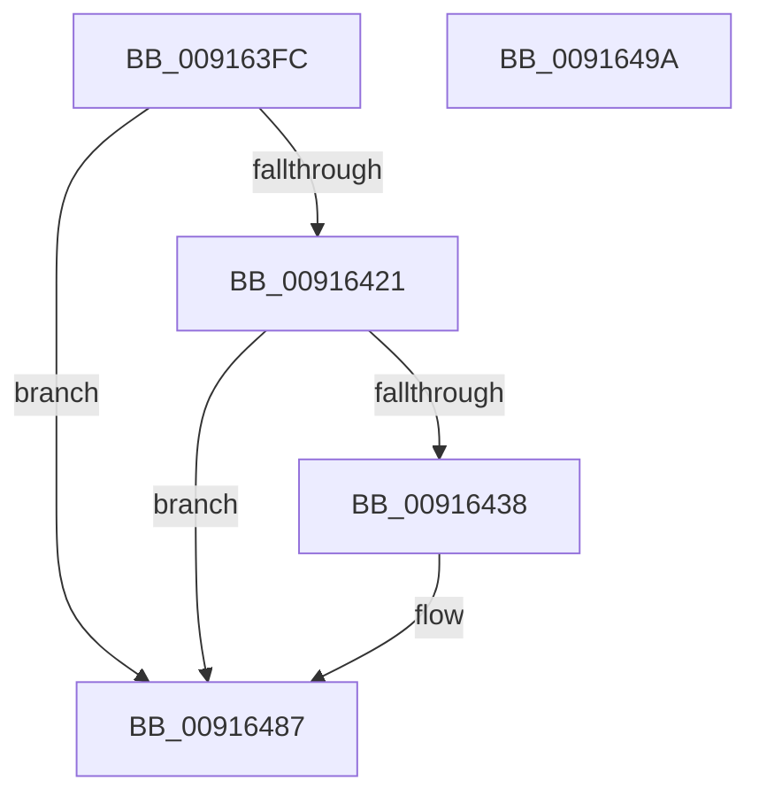

# PopDiagTracePowerSettingStop

- RVA: `0x009163FC`–`0x0091649B` (길이 `159` bytes)
- VA: `0x00000001409163FC`
- 실행 섹션: `PAGE`
- PDB 이름 있음: `예`; PDB Function 태그: `아니요`
- unwind 정보 RVA: `0x0008A7BC`
- 디코드: `35`개 명령, `159/159` bytes 표시
- 미해석 바이트: `0` (있으면 어셈블리에 `.byte`로 보존)

> 이 문서는 커널 이미지의 기계어와 PDB 기호를 분석해 생성했습니다. 4번과 5번은 함수 원형과 자료형을 바이너리 사용 방식에서 추정한 C 해석이며 원본 소스 복구 결과는 아닙니다.

## 1. Dependencies

- 직접 호출 지점: **3**; 고유 호출 대상: **3**
- 직접 호출자로 확인된 함수: **1**
- RIP 상대 이미지 참조: **4**

### Outgoing calls
- `0x0091642F` → [EtwEventEnabled](../../text/39/EtwEventEnabled_function_00392450.md) (function, `0x00392450`)
- `0x00916482` → [EtwWrite](../../text/41/EtwWrite_function_0041C720.md) (function, `0x0041C720`)
- `0x0091648F` → [_security_check_cookie](../../text/6A/_security_check_cookie_function_006AC640.md) (function, `0x006AC640`)

### Direct callers
- [PopCallPowerSettingCallback](PopCallPowerSettingCallback_function_009162CC.md) at `0x0091638B`

### Static image references
- `0x00916406` → RVA `0x00E0A740` (`.data`; read)
- `0x00916415` → RVA `0x00E67858` (`.data`; read)
- `0x00916421` → RVA `0x00F0B408` (`.data`; read)
- `0x00916428` → RVA `0x00011AF8` (`.rdata`; read)

## 2. Other-region calls and transfers

- 다른 실행 섹션으로 향하는 call: **3**
  - `0x0091642F` → [EtwEventEnabled](../../text/39/EtwEventEnabled_function_00392450.md) (`PAGE` → `.text`)
  - `0x00916482` → [EtwWrite](../../text/41/EtwWrite_function_0041C720.md) (`PAGE` → `.text`)
  - `0x0091648F` → [_security_check_cookie](../../text/6A/_security_check_cookie_function_006AC640.md) (`PAGE` → `.text`)
- 별도 외부 분기/꼬리 이동을 확인하지 못했습니다.

## 3. Assembly (complete function range)

```asm
009163FC  48 89 4C 24 08                  mov qword ptr [rsp + 8], rcx
00916401  53                              push rbx
00916402  48 83 EC 60                     sub rsp, 0x60
00916406  48 8B 05 33 43 4F 00            mov rax, qword ptr [rip + 0x4f4333]
0091640D  48 33 C4                        xor rax, rsp
00916410  48 89 44 24 50                  mov qword ptr [rsp + 0x50], rax
00916415  80 3D 3C 14 55 00 00            cmp byte ptr [rip + 0x55143c], 0
0091641C  48 8B DA                        mov rbx, rdx
0091641F  74 66                           je 0x140916487
00916421  48 8B 0D E0 4F 5F 00            mov rcx, qword ptr [rip + 0x5f4fe0]
00916428  48 8D 15 C9 B6 6F FF            lea rdx, [rip - 0x904937]
0091642F  E8 1C C0 A7 FF                  call 0x140392450
00916434  84 C0                           test al, al
00916436  74 4F                           je 0x140916487
00916438  83 64 24 3C 00                  and dword ptr [rsp + 0x3c], 0
0091643D  48 8D 44 24 70                  lea rax, [rsp + 0x70]
00916442  83 64 24 4C 00                  and dword ptr [rsp + 0x4c], 0
00916447  48 8D 15 AA B6 6F FF            lea rdx, [rip - 0x904956]
0091644E  48 8B 0D B3 4F 5F 00            mov rcx, qword ptr [rip + 0x5f4fb3]
00916455  41 B9 02 00 00 00               mov r9d, 2
0091645B  48 89 44 24 30                  mov qword ptr [rsp + 0x30], rax
00916460  45 33 C0                        xor r8d, r8d
00916463  48 8D 44 24 30                  lea rax, [rsp + 0x30]
00916468  C7 44 24 38 08 00 00 00         mov dword ptr [rsp + 0x38], 8
00916470  48 89 44 24 20                  mov qword ptr [rsp + 0x20], rax
00916475  48 89 5C 24 40                  mov qword ptr [rsp + 0x40], rbx
0091647A  C7 44 24 48 10 00 00 00         mov dword ptr [rsp + 0x48], 0x10
00916482  E8 99 62 B0 FF                  call 0x14041c720
00916487  48 8B 4C 24 50                  mov rcx, qword ptr [rsp + 0x50]
0091648C  48 33 CC                        xor rcx, rsp
0091648F  E8 AC 61 D9 FF                  call 0x1406ac640
00916494  48 83 C4 60                     add rsp, 0x60
00916498  5B                              pop rbx
00916499  C3                              ret
0091649A  CC                              int3
```

## 4. C-style interpretation (structured pseudocode)

```c
__int64 __fastcall PopDiagTracePowerSettingStop(__int64 a1, __int64 a2, int a3)
{
    __int64 result;
    __int64 v_rsp;
    unsigned __int64 v_stack_m18;
    unsigned int v_stack_m1C;
    unsigned int v_stack_m20;
    unsigned __int64 v_stack_m28;
    unsigned int v_stack_m2C;
    unsigned int v_stack_m30;
    unsigned __int64 v_stack_m38;
    unsigned __int64 v_stack_m48;
    unsigned __int64 v_stack_p8;

    v_stack_p8 = a1;
    v_rsp = (v_rsp) - (96);
    result = (*(unsigned __int64 *)(v_rip + 5194547)) ^ (v_rsp);
    v_stack_m18 = result;
    if ((*(unsigned __int8 *)(v_rip + 5575740)) == 0) goto loc_00916487;
    result = EtwEventEnabled(*(unsigned __int64 *)(v_rip + 6246368), v_rip - 9455927, a3, a4);
    if ((unsigned __int8)(result) != 0) {
        result = v_stack_p8;
        a2 = v_rip - 9455958;
        a1 = *(unsigned __int64 *)(v_rip + 6246323);
        a4 = 2;
        v_stack_m38 = result;
        a3 = 0;
        result = v_stack_m38;
        v_stack_m30 = 8;
        v_stack_m48 = result;
        v_stack_m28 = a2;
        v_stack_m20 = 16;
        result = EtwWrite(a1, a2, a3, a4);
    }
    a1 = (v_stack_m18) ^ (v_rsp);
    result = _security_check_cookie(a1, a2, a3, a4);
    v_rsp = (v_rsp) + (96);
    return result;
}
```

## 5. (Beta) C Style

```c
int64_t PopDiagTracePowerSettingStop(int64_t Arg1, int64_t Arg2, int32_t Arg3)
{
    int64_t result;
    int64_t local_rsp;
    uint64_t v_stack_m18;
    uint32_t v_stack_m1C;
    uint32_t v_stack_m20;
    uint64_t v_stack_m28;
    uint32_t v_stack_m2C;
    uint32_t v_stack_m30;
    uint64_t v_stack_m38;
    uint64_t v_stack_m48;
    uint64_t v_stack_p8;

    v_stack_p8 = Arg1;
    local_rsp = (local_rsp) - (96);
    result = (*(uint64_t *)(v_rip + 0x4F4333)) ^ (local_rsp);
    v_stack_m18 = result;
    if ((*(uint8_t *)(v_rip + 0x55143C)) == 0) goto loc_00916487;
    result = EtwEventEnabled(*(uint64_t *)(v_rip + 0x5F4FE0), v_rip - 9455927, Arg3, a4);
    if ((uint8_t)(result) != 0) {
        result = v_stack_p8;
        Arg2 = v_rip - 9455958;
        Arg1 = *(uint64_t *)(v_rip + 0x5F4FB3);
        a4 = 2;
        v_stack_m38 = result;
        Arg3 = 0;
        result = v_stack_m38;
        v_stack_m30 = 8;
        v_stack_m48 = result;
        v_stack_m28 = Arg2;
        v_stack_m20 = 16;
        result = EtwWrite(Arg1, Arg2, Arg3, a4);
    }
    Arg1 = (v_stack_m18) ^ (local_rsp);
    result = _security_check_cookie(Arg1, Arg2, Arg3, a4);
    local_rsp = (local_rsp) + (96);
    return result;
}
```

## 6. Execution-region graph

[열기: 2D/3D 그래프와 함수 탐색 컨트롤 패널](../../../control-panel.html?section=page&rva=0x009163FC&view=graph)

- 2D 그래프는 위에서 아래로 흐르고, 3D 그래프는 빈 공간을 드래그해 회전합니다. Shift+드래그는 이동, 휠은 확대·축소, 함수 노드 선택은 대상 보고서 이동입니다.

### Static fallback


