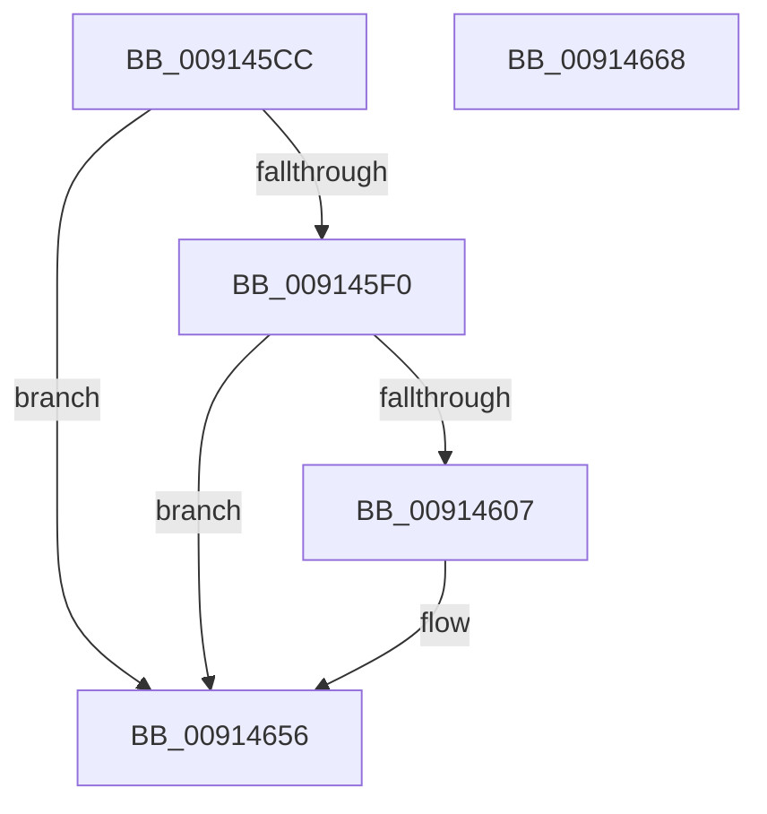

# PopDiagTracePowerStateEvent

- RVA: `0x009145CC`–`0x00914669` (길이 `157` bytes)
- VA: `0x00000001409145CC`
- 실행 섹션: `PAGE`
- PDB 이름 있음: `예`; PDB Function 태그: `아니요`
- unwind 정보 RVA: `0x0008A5C4`
- 디코드: `35`개 명령, `157/157` bytes 표시
- 미해석 바이트: `0` (있으면 어셈블리에 `.byte`로 보존)

> 이 문서는 커널 이미지의 기계어와 PDB 기호를 분석해 생성했습니다. 4번과 5번은 함수 원형과 자료형을 바이너리 사용 방식에서 추정한 C 해석이며 원본 소스 복구 결과는 아닙니다.

## 1. Dependencies

- 직접 호출 지점: **3**; 고유 호출 대상: **3**
- 직접 호출자로 확인된 함수: **1**
- RIP 상대 이미지 참조: **4**

### Outgoing calls
- `0x009145FE` → [EtwEventEnabled](../../text/39/EtwEventEnabled_function_00392450.md) (function, `0x00392450`)
- `0x00914651` → [EtwWrite](../../text/41/EtwWrite_function_0041C720.md) (function, `0x0041C720`)
- `0x0091465E` → [_security_check_cookie](../../text/6A/_security_check_cookie_function_006AC640.md) (function, `0x006AC640`)

### Direct callers
- [PopTriggerMonitorPowerEvent](PopTriggerMonitorPowerEvent_function_0091446C.md) at `0x00914577`

### Static image references
- `0x009145D8` → RVA `0x00E0A740` (`.data`; read)
- `0x009145E7` → RVA `0x00E67858` (`.data`; read)
- `0x009145F0` → RVA `0x00F0B408` (`.data`; read)
- `0x009145F7` → RVA `0x00011AD8` (`.rdata`; read)

## 2. Other-region calls and transfers

- 다른 실행 섹션으로 향하는 call: **3**
  - `0x009145FE` → [EtwEventEnabled](../../text/39/EtwEventEnabled_function_00392450.md) (`PAGE` → `.text`)
  - `0x00914651` → [EtwWrite](../../text/41/EtwWrite_function_0041C720.md) (`PAGE` → `.text`)
  - `0x0091465E` → [_security_check_cookie](../../text/6A/_security_check_cookie_function_006AC640.md) (`PAGE` → `.text`)
- 별도 외부 분기/꼬리 이동을 확인하지 못했습니다.

## 3. Assembly (complete function range)

```asm
009145CC  89 54 24 10                     mov dword ptr [rsp + 0x10], edx
009145D0  89 4C 24 08                     mov dword ptr [rsp + 8], ecx
009145D4  48 83 EC 68                     sub rsp, 0x68
009145D8  48 8B 05 61 61 4F 00            mov rax, qword ptr [rip + 0x4f6161]
009145DF  48 33 C4                        xor rax, rsp
009145E2  48 89 44 24 50                  mov qword ptr [rsp + 0x50], rax
009145E7  80 3D 6A 32 55 00 00            cmp byte ptr [rip + 0x55326a], 0
009145EE  74 66                           je 0x140914656
009145F0  48 8B 0D 11 6E 5F 00            mov rcx, qword ptr [rip + 0x5f6e11]
009145F7  48 8D 15 DA D4 6F FF            lea rdx, [rip - 0x902b26]
009145FE  E8 4D DE A7 FF                  call 0x140392450
00914603  84 C0                           test al, al
00914605  74 4F                           je 0x140914656
00914607  83 64 24 3C 00                  and dword ptr [rsp + 0x3c], 0
0091460C  48 8D 44 24 70                  lea rax, [rsp + 0x70]
00914611  83 64 24 4C 00                  and dword ptr [rsp + 0x4c], 0
00914616  48 8D 15 BB D4 6F FF            lea rdx, [rip - 0x902b45]
0091461D  B9 04 00 00 00                  mov ecx, 4
00914622  48 89 44 24 30                  mov qword ptr [rsp + 0x30], rax
00914627  48 8D 44 24 78                  lea rax, [rsp + 0x78]
0091462C  89 4C 24 38                     mov dword ptr [rsp + 0x38], ecx
00914630  48 89 44 24 40                  mov qword ptr [rsp + 0x40], rax
00914635  45 33 C0                        xor r8d, r8d
00914638  48 8D 44 24 30                  lea rax, [rsp + 0x30]
0091463D  89 4C 24 48                     mov dword ptr [rsp + 0x48], ecx
00914641  44 8D 49 FE                     lea r9d, [rcx - 2]
00914645  48 89 44 24 20                  mov qword ptr [rsp + 0x20], rax
0091464A  48 8B 0D B7 6D 5F 00            mov rcx, qword ptr [rip + 0x5f6db7]
00914651  E8 CA 80 B0 FF                  call 0x14041c720
00914656  48 8B 4C 24 50                  mov rcx, qword ptr [rsp + 0x50]
0091465B  48 33 CC                        xor rcx, rsp
0091465E  E8 DD 7F D9 FF                  call 0x1406ac640
00914663  48 83 C4 68                     add rsp, 0x68
00914667  C3                              ret
00914668  CC                              int3
```

## 4. C-style interpretation (structured pseudocode)

```c
__int64 __fastcall PopDiagTracePowerStateEvent(int a1, int a2, int a3)
{
    __int64 result;
    __int64 v_rsp;
    unsigned __int64 v_stack_m18;
    unsigned int v_stack_m1C;
    unsigned int v_stack_m20;
    unsigned __int64 v_stack_m28;
    unsigned int v_stack_m2C;
    unsigned int v_stack_m30;
    unsigned __int64 v_stack_m38;
    unsigned __int64 v_stack_m48;
    unsigned int v_stack_p10;
    unsigned int v_stack_p8;

    v_stack_p10 = a2;
    v_stack_p8 = a1;
    v_rsp = (v_rsp) - (104);
    result = (*(unsigned __int64 *)(v_rip + 5202273)) ^ (v_rsp);
    v_stack_m18 = result;
    if ((*(unsigned __int8 *)(v_rip + 5583466)) == 0) goto loc_00914656;
    result = EtwEventEnabled(*(unsigned __int64 *)(v_rip + 6254097), v_rip - 9448230, a3, a4);
    if ((unsigned __int8)(result) != 0) {
        result = v_stack_p8;
        a2 = v_rip - 9448261;
        a1 = 4;
        v_stack_m38 = result;
        result = v_stack_p10;
        v_stack_m30 = a1;
        v_stack_m28 = result;
        a3 = 0;
        result = v_stack_m38;
        v_stack_m20 = a1;
        a4 = a1 - 2;
        v_stack_m48 = result;
        a1 = *(unsigned __int64 *)(v_rip + 6254007);
        result = EtwWrite(a1, a2, a3, a4);
    }
    a1 = (v_stack_m18) ^ (v_rsp);
    result = _security_check_cookie(a1, a2, a3, a4);
    v_rsp = (v_rsp) + (104);
    return result;
}
```

## 5. (Beta) C Style

```c
int64_t PopDiagTracePowerStateEvent(int32_t Arg1, int32_t Arg2, int32_t Arg3)
{
    int64_t result;
    int64_t local_rsp;
    uint64_t v_stack_m18;
    uint32_t v_stack_m1C;
    uint32_t v_stack_m20;
    uint64_t v_stack_m28;
    uint32_t v_stack_m2C;
    uint32_t v_stack_m30;
    uint64_t v_stack_m38;
    uint64_t v_stack_m48;
    uint32_t v_stack_p10;
    uint32_t v_stack_p8;

    v_stack_p10 = Arg2;
    v_stack_p8 = Arg1;
    local_rsp = (local_rsp) - (104);
    result = (*(uint64_t *)(v_rip + 0x4F6161)) ^ (local_rsp);
    v_stack_m18 = result;
    if ((*(uint8_t *)(v_rip + 0x55326A)) == 0) goto loc_00914656;
    result = EtwEventEnabled(*(uint64_t *)(v_rip + 0x5F6E11), v_rip - 9448230, Arg3, a4);
    if ((uint8_t)(result) != 0) {
        result = v_stack_p8;
        Arg2 = v_rip - 9448261;
        Arg1 = 4;
        v_stack_m38 = result;
        result = v_stack_p10;
        v_stack_m30 = Arg1;
        v_stack_m28 = result;
        Arg3 = 0;
        result = v_stack_m38;
        v_stack_m20 = Arg1;
        a4 = Arg1 - 2;
        v_stack_m48 = result;
        Arg1 = *(uint64_t *)(v_rip + 0x5F6DB7);
        result = EtwWrite(Arg1, Arg2, Arg3, a4);
    }
    Arg1 = (v_stack_m18) ^ (local_rsp);
    result = _security_check_cookie(Arg1, Arg2, Arg3, a4);
    local_rsp = (local_rsp) + (104);
    return result;
}
```

## 6. Execution-region graph

[열기: 2D/3D 그래프와 함수 탐색 컨트롤 패널](../../../control-panel.html?section=page&rva=0x009145CC&view=graph)

- 2D 그래프는 위에서 아래로 흐르고, 3D 그래프는 빈 공간을 드래그해 회전합니다. Shift+드래그는 이동, 휠은 확대·축소, 함수 노드 선택은 대상 보고서 이동입니다.

### Static fallback


