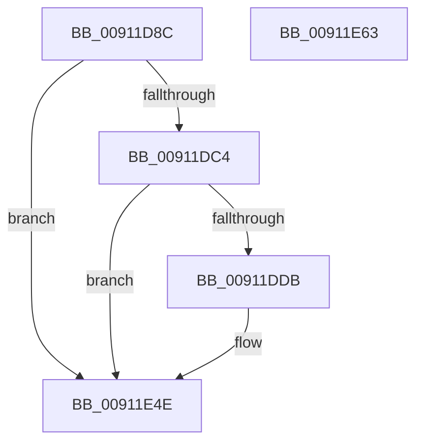

# PopDiagTraceSystemIdleContextUpdate

- RVA: `0x00911D8C`–`0x00911E64` (길이 `216` bytes)
- VA: `0x0000000140911D8C`
- 실행 섹션: `PAGE`
- PDB 이름 있음: `예`; PDB Function 태그: `아니요`
- unwind 정보 RVA: `0x0008A288`
- 디코드: `53`개 명령, `216/216` bytes 표시
- 미해석 바이트: `0` (있으면 어셈블리에 `.byte`로 보존)

> 이 문서는 커널 이미지의 기계어와 PDB 기호를 분석해 생성했습니다. 4번과 5번은 함수 원형과 자료형을 바이너리 사용 방식에서 추정한 C 해석이며 원본 소스 복구 결과는 아닙니다.

## 1. Dependencies

- 직접 호출 지점: **3**; 고유 호출 대상: **3**
- 직접 호출자로 확인된 함수: **1**
- RIP 상대 이미지 참조: **4**

### Outgoing calls
- `0x00911DD2` → [EtwEventEnabled](../../text/39/EtwEventEnabled_function_00392450.md) (function, `0x00392450`)
- `0x00911E49` → [EtwWrite](../../text/41/EtwWrite_function_0041C720.md) (function, `0x0041C720`)
- `0x00911E55` → [_security_check_cookie](../../text/6A/_security_check_cookie_function_006AC640.md) (function, `0x006AC640`)

### Direct callers
- [PopUpdateSystemIdleContext](PopUpdateSystemIdleContext_function_00911BB4.md) at `0x00911D56`

### Static image references
- `0x00911DA9` → RVA `0x00E0A740` (`.data`; read)
- `0x00911DB7` → RVA `0x00E67858` (`.data`; read)
- `0x00911DC4` → RVA `0x00F0B408` (`.data`; read)
- `0x00911DCB` → RVA `0x00011B98` (`.rdata`; read)

## 2. Other-region calls and transfers

- 다른 실행 섹션으로 향하는 call: **3**
  - `0x00911DD2` → [EtwEventEnabled](../../text/39/EtwEventEnabled_function_00392450.md) (`PAGE` → `.text`)
  - `0x00911E49` → [EtwWrite](../../text/41/EtwWrite_function_0041C720.md) (`PAGE` → `.text`)
  - `0x00911E55` → [_security_check_cookie](../../text/6A/_security_check_cookie_function_006AC640.md) (`PAGE` → `.text`)
- 별도 외부 분기/꼬리 이동을 확인하지 못했습니다.

## 3. Assembly (complete function range)

```asm
00911D8C  48 8B C4                        mov rax, rsp
00911D8F  44 89 48 20                     mov dword ptr [rax + 0x20], r9d
00911D93  44 89 40 18                     mov dword ptr [rax + 0x18], r8d
00911D97  89 50 10                        mov dword ptr [rax + 0x10], edx
00911D9A  89 48 08                        mov dword ptr [rax + 8], ecx
00911D9D  55                              push rbp
00911D9E  48 8D 68 A9                     lea rbp, [rax - 0x57]
00911DA2  48 81 EC 90 00 00 00            sub rsp, 0x90
00911DA9  48 8B 05 90 89 4F 00            mov rax, qword ptr [rip + 0x4f8990]
00911DB0  48 33 C4                        xor rax, rsp
00911DB3  48 89 45 3F                     mov qword ptr [rbp + 0x3f], rax
00911DB7  80 3D 9A 5A 55 00 00            cmp byte ptr [rip + 0x555a9a], 0
00911DBE  0F 84 8A 00 00 00               je 0x140911e4e
00911DC4  48 8B 0D 3D 96 5F 00            mov rcx, qword ptr [rip + 0x5f963d]
00911DCB  48 8D 15 C6 FD 6F FF            lea rdx, [rip - 0x90023a]
00911DD2  E8 79 06 A8 FF                  call 0x140392450
00911DD7  84 C0                           test al, al
00911DD9  74 73                           je 0x140911e4e
00911DDB  83 65 FB 00                     and dword ptr [rbp - 5], 0
00911DDF  48 8D 45 5F                     lea rax, [rbp + 0x5f]
00911DE3  83 65 0B 00                     and dword ptr [rbp + 0xb], 0
00911DE7  48 8D 15 AA FD 6F FF            lea rdx, [rip - 0x900256]
00911DEE  83 65 1B 00                     and dword ptr [rbp + 0x1b], 0
00911DF2  B9 04 00 00 00                  mov ecx, 4
00911DF7  83 65 2B 00                     and dword ptr [rbp + 0x2b], 0
00911DFB  45 33 C0                        xor r8d, r8d
00911DFE  83 65 3B 00                     and dword ptr [rbp + 0x3b], 0
00911E02  48 89 45 EF                     mov qword ptr [rbp - 0x11], rax
00911E06  48 8D 45 67                     lea rax, [rbp + 0x67]
00911E0A  48 89 45 FF                     mov qword ptr [rbp - 1], rax
00911E0E  44 8D 49 01                     lea r9d, [rcx + 1]
00911E12  48 8D 45 6F                     lea rax, [rbp + 0x6f]
00911E16  89 4D F7                        mov dword ptr [rbp - 9], ecx
00911E19  48 89 45 0F                     mov qword ptr [rbp + 0xf], rax
00911E1D  48 8D 45 77                     lea rax, [rbp + 0x77]
00911E21  48 89 45 1F                     mov qword ptr [rbp + 0x1f], rax
00911E25  48 8D 45 7F                     lea rax, [rbp + 0x7f]
00911E29  48 89 45 2F                     mov qword ptr [rbp + 0x2f], rax
00911E2D  48 8D 45 EF                     lea rax, [rbp - 0x11]
00911E31  89 4D 07                        mov dword ptr [rbp + 7], ecx
00911E34  89 4D 17                        mov dword ptr [rbp + 0x17], ecx
00911E37  89 4D 27                        mov dword ptr [rbp + 0x27], ecx
00911E3A  89 4D 37                        mov dword ptr [rbp + 0x37], ecx
00911E3D  48 8B 0D C4 95 5F 00            mov rcx, qword ptr [rip + 0x5f95c4]
00911E44  48 89 44 24 20                  mov qword ptr [rsp + 0x20], rax
00911E49  E8 D2 A8 B0 FF                  call 0x14041c720
00911E4E  48 8B 4D 3F                     mov rcx, qword ptr [rbp + 0x3f]
00911E52  48 33 CC                        xor rcx, rsp
00911E55  E8 E6 A7 D9 FF                  call 0x1406ac640
00911E5A  48 81 C4 90 00 00 00            add rsp, 0x90
00911E61  5D                              pop rbp
00911E62  C3                              ret
00911E63  CC                              int3
```

## 4. C-style interpretation (structured pseudocode)

```c
__int64 __fastcall PopDiagTraceSystemIdleContextUpdate(int a1, int a2, int a3, int a4)
{
    __int64 result;
    __int64 v_rsp;
    unsigned __int64 v_stack_m78;

    *(unsigned int *)(v_rsp + 32) = a4;
    *(unsigned int *)(v_rsp + 24) = a3;
    *(unsigned int *)(v_rsp + 16) = a2;
    *(unsigned int *)(v_rsp + 8) = a1;
    v_rsp = (v_rsp) - (144);
    result = (*(unsigned __int64 *)(v_rip + 5212560)) ^ (v_rsp);
    *(unsigned __int64 *)(v_rsp - 87 + 63) = result;
    if ((*(unsigned __int8 *)(v_rip + 5593754)) == 0) goto loc_00911E4E;
    result = EtwEventEnabled(*(unsigned __int64 *)(v_rip + 6264381), v_rip - 9437754, a3, a4);
    if ((unsigned __int8)(result) != 0) {
        result = v_rsp - 87 + 95;
        a2 = v_rip - 9437782;
        a1 = 4;
        a3 = 0;
        *(unsigned __int64 *)(v_rsp - 87 - 17) = result;
        result = v_rsp - 87 + 103;
        *(unsigned __int64 *)(v_rsp - 87 - 1) = result;
        a4 = a1 + 1;
        result = v_rsp - 87 + 111;
        *(unsigned int *)(v_rsp - 87 - 9) = a1;
        *(unsigned __int64 *)(v_rsp - 87 + 15) = result;
        result = v_rsp - 87 + 119;
        *(unsigned __int64 *)(v_rsp - 87 + 31) = result;
        result = v_rsp - 87 + 127;
        *(unsigned __int64 *)(v_rsp - 87 + 47) = result;
        result = v_rsp - 87 - 17;
        *(unsigned int *)(v_rsp - 87 + 7) = a1;
        *(unsigned int *)(v_rsp - 87 + 23) = a1;
        *(unsigned int *)(v_rsp - 87 + 39) = a1;
        *(unsigned int *)(v_rsp - 87 + 55) = a1;
        a1 = *(unsigned __int64 *)(v_rip + 6264260);
        v_stack_m78 = result;
        result = EtwWrite(a1, a2, a3, a4);
    }
    a1 = (*(unsigned __int64 *)(v_rsp - 87 + 63)) ^ (v_rsp);
    result = _security_check_cookie(a1, a2, a3, a4);
    v_rsp = (v_rsp) + (144);
    return result;
}
```

## 5. (Beta) C Style

```c
int64_t PopDiagTraceSystemIdleContextUpdate(int32_t Arg1, int32_t Arg2, int32_t Arg3, int32_t Arg4)
{
    int64_t result;
    int64_t local_rsp;
    uint64_t v_stack_m78;

    *(uint32_t *)(local_rsp + 0x20) = Arg4;
    *(uint32_t *)(local_rsp + 0x18) = Arg3;
    *(uint32_t *)(local_rsp + 0x10) = Arg2;
    *(uint32_t *)(local_rsp + 0x8) = Arg1;
    local_rsp = (local_rsp) - (144);
    result = (*(uint64_t *)(v_rip + 0x4F8990)) ^ (local_rsp);
    *(uint64_t *)(local_rsp - 0x57 + 0x3F) = result;
    if ((*(uint8_t *)(v_rip + 0x555A9A)) == 0) goto loc_00911E4E;
    result = EtwEventEnabled(*(uint64_t *)(v_rip + 0x5F963D), v_rip - 9437754, Arg3, Arg4);
    if ((uint8_t)(result) != 0) {
        result = local_rsp - 87 + 95;
        Arg2 = v_rip - 9437782;
        Arg1 = 4;
        Arg3 = 0;
        *(uint64_t *)(local_rsp - 0x57 - 0x11) = result;
        result = local_rsp - 87 + 103;
        *(uint64_t *)(local_rsp - 0x57 - 0x1) = result;
        Arg4 = Arg1 + 1;
        result = local_rsp - 87 + 111;
        *(uint32_t *)(local_rsp - 0x57 - 0x9) = Arg1;
        *(uint64_t *)(local_rsp - 0x57 + 0xF) = result;
        result = local_rsp - 87 + 119;
        *(uint64_t *)(local_rsp - 0x57 + 0x1F) = result;
        result = local_rsp - 87 + 127;
        *(uint64_t *)(local_rsp - 0x57 + 0x2F) = result;
        result = local_rsp - 87 - 17;
        *(uint32_t *)(local_rsp - 0x57 + 0x7) = Arg1;
        *(uint32_t *)(local_rsp - 0x57 + 0x17) = Arg1;
        *(uint32_t *)(local_rsp - 0x57 + 0x27) = Arg1;
        *(uint32_t *)(local_rsp - 0x57 + 0x37) = Arg1;
        Arg1 = *(uint64_t *)(v_rip + 0x5F95C4);
        v_stack_m78 = result;
        result = EtwWrite(Arg1, Arg2, Arg3, Arg4);
    }
    Arg1 = (*(uint64_t *)(local_rsp - 0x57 + 0x3F)) ^ (local_rsp);
    result = _security_check_cookie(Arg1, Arg2, Arg3, Arg4);
    local_rsp = (local_rsp) + (144);
    return result;
}
```

## 6. Execution-region graph

[열기: 2D/3D 그래프와 함수 탐색 컨트롤 패널](../../../control-panel.html?section=page&rva=0x00911D8C&view=graph)

- 2D 그래프는 위에서 아래로 흐르고, 3D 그래프는 빈 공간을 드래그해 회전합니다. Shift+드래그는 이동, 휠은 확대·축소, 함수 노드 선택은 대상 보고서 이동입니다.

### Static fallback


