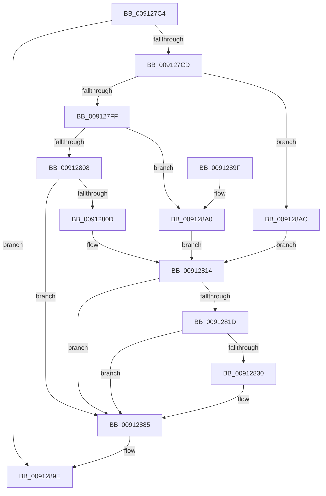

# PopDiagTraceWin32kCalloutEnd

- RVA: `0x009127C4`–`0x009128B8` (길이 `244` bytes)
- VA: `0x00000001409127C4`
- 실행 섹션: `PAGE`
- PDB 이름 있음: `예`; PDB Function 태그: `아니요`
- unwind 정보 RVA: `0x0008A338`
- 디코드: `59`개 명령, `244/244` bytes 표시
- 미해석 바이트: `0` (있으면 어셈블리에 `.byte`로 보존)

> 이 문서는 커널 이미지의 기계어와 PDB 기호를 분석해 생성했습니다. 4번과 5번은 함수 원형과 자료형을 바이너리 사용 방식에서 추정한 C 해석이며 원본 소스 복구 결과는 아닙니다.

## 1. Dependencies

- 직접 호출 지점: **3**; 고유 호출 대상: **3**
- 직접 호출자로 확인된 함수: **1**
- RIP 상대 이미지 참조: **6**

### Outgoing calls
- `0x00912827` → [EtwEventEnabled](../../text/39/EtwEventEnabled_function_00392450.md) (function, `0x00392450`)
- `0x00912880` → [EtwWrite](../../text/41/EtwWrite_function_0041C720.md) (function, `0x0041C720`)
- `0x0091288C` → [_security_check_cookie](../../text/6A/_security_check_cookie_function_006AC640.md) (function, `0x006AC640`)

### Direct callers
- [PopInvokeWin32Callout](PopInvokeWin32Callout_function_009125F4.md) at `0x0091270C`

### Static image references
- `0x009127E8` → RVA `0x00E0A740` (`.data`; read)
- `0x0091280D` → RVA `0x000119C8` (`.rdata`; read)
- `0x00912814` → RVA `0x00E67858` (`.data`; read)
- `0x0091281D` → RVA `0x00F0B408` (`.data`; read)
- `0x009128A0` → RVA `0x000119D8` (`.rdata`; read)
- `0x009128AC` → RVA `0x00022E10` (`.rdata`; read)

## 2. Other-region calls and transfers

- 다른 실행 섹션으로 향하는 call: **3**
  - `0x00912827` → [EtwEventEnabled](../../text/39/EtwEventEnabled_function_00392450.md) (`PAGE` → `.text`)
  - `0x00912880` → [EtwWrite](../../text/41/EtwWrite_function_0041C720.md) (`PAGE` → `.text`)
  - `0x0091288C` → [_security_check_cookie](../../text/6A/_security_check_cookie_function_006AC640.md) (`PAGE` → `.text`)
- 별도 외부 분기/꼬리 이동을 확인하지 못했습니다.

## 3. Assembly (complete function range)

```asm
009127C4  48 85 D2                        test rdx, rdx
009127C7  0F 84 D1 00 00 00               je 0x14091289e
009127CD  48 8B C4                        mov rax, rsp
009127D0  48 89 58 08                     mov qword ptr [rax + 8], rbx
009127D4  44 89 48 20                     mov dword ptr [rax + 0x20], r9d
009127D8  44 89 40 18                     mov dword ptr [rax + 0x18], r8d
009127DC  48 89 50 10                     mov qword ptr [rax + 0x10], rdx
009127E0  55                              push rbp
009127E1  48 8B EC                        mov rbp, rsp
009127E4  48 83 EC 70                     sub rsp, 0x70
009127E8  48 8B 05 51 7F 4F 00            mov rax, qword ptr [rip + 0x4f7f51]
009127EF  48 33 C4                        xor rax, rsp
009127F2  48 89 45 F0                     mov qword ptr [rbp - 0x10], rax
009127F6  83 E9 03                        sub ecx, 3
009127F9  0F 84 AD 00 00 00               je 0x1409128ac
009127FF  83 E9 01                        sub ecx, 1
00912802  0F 84 98 00 00 00               je 0x1409128a0
00912808  83 F9 01                        cmp ecx, 1
0091280B  75 78                           jne 0x140912885
0091280D  48 8D 1D B4 F1 6F FF            lea rbx, [rip - 0x900e4c]
00912814  80 3D 3D 50 55 00 00            cmp byte ptr [rip + 0x55503d], 0
0091281B  74 68                           je 0x140912885
0091281D  48 8B 0D E4 8B 5F 00            mov rcx, qword ptr [rip + 0x5f8be4]
00912824  48 8B D3                        mov rdx, rbx
00912827  E8 24 FC A7 FF                  call 0x140392450
0091282C  84 C0                           test al, al
0091282E  74 55                           je 0x140912885
00912830  83 65 CC 00                     and dword ptr [rbp - 0x34], 0
00912834  48 8D 45 18                     lea rax, [rbp + 0x18]
00912838  83 65 DC 00                     and dword ptr [rbp - 0x24], 0
0091283C  B9 04 00 00 00                  mov ecx, 4
00912841  83 65 EC 00                     and dword ptr [rbp - 0x14], 0
00912845  45 33 C0                        xor r8d, r8d
00912848  48 89 45 C0                     mov qword ptr [rbp - 0x40], rax
0091284C  48 8B D3                        mov rdx, rbx
0091284F  48 8D 45 20                     lea rax, [rbp + 0x20]
00912853  89 4D D8                        mov dword ptr [rbp - 0x28], ecx
00912856  48 89 45 D0                     mov qword ptr [rbp - 0x30], rax
0091285A  44 8D 49 FF                     lea r9d, [rcx - 1]
0091285E  48 8D 45 28                     lea rax, [rbp + 0x28]
00912862  89 4D E8                        mov dword ptr [rbp - 0x18], ecx
00912865  48 8B 0D 9C 8B 5F 00            mov rcx, qword ptr [rip + 0x5f8b9c]
0091286C  48 89 45 E0                     mov qword ptr [rbp - 0x20], rax
00912870  48 8D 45 C0                     lea rax, [rbp - 0x40]
00912874  48 89 44 24 20                  mov qword ptr [rsp + 0x20], rax
00912879  C7 45 C8 08 00 00 00            mov dword ptr [rbp - 0x38], 8
00912880  E8 9B 9E B0 FF                  call 0x14041c720
00912885  48 8B 4D F0                     mov rcx, qword ptr [rbp - 0x10]
00912889  48 33 CC                        xor rcx, rsp
0091288C  E8 AF 9D D9 FF                  call 0x1406ac640
00912891  48 8B 9C 24 80 00 00 00         mov rbx, qword ptr [rsp + 0x80]
00912899  48 83 C4 70                     add rsp, 0x70
0091289D  5D                              pop rbp
0091289E  C3                              ret
0091289F  CC                              int3
009128A0  48 8D 1D 31 F1 6F FF            lea rbx, [rip - 0x900ecf]
009128A7  E9 68 FF FF FF                  jmp 0x140912814
009128AC  48 8D 1D 5D 05 71 FF            lea rbx, [rip - 0x8efaa3]
009128B3  E9 5C FF FF FF                  jmp 0x140912814
```

## 4. C-style interpretation (structured pseudocode)

```c
__int64 __fastcall PopDiagTraceWin32kCalloutEnd(int a1, __int64 a2, int a3, int a4)
{
    __int64 result;
    __int64 v_rsp;
    unsigned __int64 v_stack_m18;
    unsigned int v_stack_m1C;
    unsigned int v_stack_m20;
    unsigned __int64 v_stack_m28;
    unsigned int v_stack_m2C;
    unsigned int v_stack_m30;
    unsigned __int64 v_stack_m38;
    unsigned int v_stack_m3C;
    unsigned int v_stack_m40;
    unsigned __int64 v_stack_m48;
    unsigned __int64 v_stack_m58;
    unsigned __int64 v_stack_p10;
    unsigned __int64 v_stack_p18;
    unsigned __int64 v_stack_p20;
    unsigned __int64 v_stack_p8;

    if (a2 == 0) goto loc_0091289E;
    *(unsigned __int64 *)(v_rsp + 8) = v_rbx;
    *(unsigned int *)(v_rsp + 32) = a4;
    *(unsigned int *)(v_rsp + 24) = a3;
    *(unsigned __int64 *)(v_rsp + 16) = a2;
    v_rsp = (v_rsp) - (112);
    result = (*(unsigned __int64 *)(v_rip + 5209937)) ^ (v_rsp);
    v_stack_m18 = result;
    a1 = (unsigned int)((a1) - (3));
    if (condition_is_equal) goto loc_009128AC;
    a1 = (unsigned int)((a1) - (1));
    if (condition_is_equal) goto loc_009128A0;
    if (a1 != 1) goto loc_00912885;
loc_00912814:
    if ((*(unsigned __int8 *)(v_rip + 5591101)) == 0) goto loc_00912885;
    result = EtwEventEnabled(*(unsigned __int64 *)(v_rip + 6261732), v_rip - 9440844, a3, a4);
    if ((unsigned __int8)(result) != 0) {
        result = v_stack_p10;
        a1 = 4;
        a3 = 0;
        v_stack_m48 = result;
        a2 = v_rip - 9440844;
        result = v_stack_p18;
        v_stack_m30 = a1;
        v_stack_m38 = result;
        a4 = a1 - 1;
        result = v_stack_p20;
        v_stack_m20 = a1;
        a1 = *(unsigned __int64 *)(v_rip + 6261660);
        v_stack_m28 = result;
        result = v_stack_m48;
        v_stack_m58 = result;
        v_stack_m40 = 8;
        result = EtwWrite(a1, a2, a3, a4);
    }
    a1 = (v_stack_m18) ^ (v_rsp);
    result = _security_check_cookie(a1, a2, a3, a4);
    v_rsp = (v_rsp) + (112);
loc_0091289E:
    return result;
loc_009128A0:
    goto loc_00912814;
loc_009128AC:
    goto loc_00912814;
}
```

## 5. (Beta) C Style

```c
int64_t PopDiagTraceWin32kCalloutEnd(int32_t Arg1, int64_t Arg2, int32_t Arg3, int32_t Arg4)
{
    int64_t result;
    int64_t local_rsp;
    uint64_t v_stack_m18;
    uint32_t v_stack_m1C;
    uint32_t v_stack_m20;
    uint64_t v_stack_m28;
    uint32_t v_stack_m2C;
    uint32_t v_stack_m30;
    uint64_t v_stack_m38;
    uint32_t v_stack_m3C;
    uint32_t v_stack_m40;
    uint64_t v_stack_m48;
    uint64_t v_stack_m58;
    uint64_t v_stack_p10;
    uint64_t v_stack_p18;
    uint64_t v_stack_p20;
    uint64_t v_stack_p8;

    if (Arg2 == 0) goto loc_0091289E;
    *(uint64_t *)(local_rsp + 0x8) = local_rbx;
    *(uint32_t *)(local_rsp + 0x20) = Arg4;
    *(uint32_t *)(local_rsp + 0x18) = Arg3;
    *(uint64_t *)(local_rsp + 0x10) = Arg2;
    local_rsp = (local_rsp) - (112);
    result = (*(uint64_t *)(v_rip + 0x4F7F51)) ^ (local_rsp);
    v_stack_m18 = result;
    Arg1 = (uint32_t)((Arg1) - (3));
    if (condition_is_equal) goto loc_009128AC;
    Arg1 = (uint32_t)((Arg1) - (1));
    if (condition_is_equal) goto loc_009128A0;
    if (Arg1 != 1) goto loc_00912885;
loc_00912814:
    if ((*(uint8_t *)(v_rip + 0x55503D)) == 0) goto loc_00912885;
    result = EtwEventEnabled(*(uint64_t *)(v_rip + 0x5F8BE4), v_rip - 9440844, Arg3, Arg4);
    if ((uint8_t)(result) != 0) {
        result = v_stack_p10;
        Arg1 = 4;
        Arg3 = 0;
        v_stack_m48 = result;
        Arg2 = v_rip - 9440844;
        result = v_stack_p18;
        v_stack_m30 = Arg1;
        v_stack_m38 = result;
        Arg4 = Arg1 - 1;
        result = v_stack_p20;
        v_stack_m20 = Arg1;
        Arg1 = *(uint64_t *)(v_rip + 0x5F8B9C);
        v_stack_m28 = result;
        result = v_stack_m48;
        v_stack_m58 = result;
        v_stack_m40 = 8;
        result = EtwWrite(Arg1, Arg2, Arg3, Arg4);
    }
    Arg1 = (v_stack_m18) ^ (local_rsp);
    result = _security_check_cookie(Arg1, Arg2, Arg3, Arg4);
    local_rsp = (local_rsp) + (112);
loc_0091289E:
    return result;
loc_009128A0:
    goto loc_00912814;
loc_009128AC:
    goto loc_00912814;
}
```

## 6. Execution-region graph

[열기: 2D/3D 그래프와 함수 탐색 컨트롤 패널](../../../control-panel.html?section=page&rva=0x009127C4&view=graph)

- 2D 그래프는 위에서 아래로 흐르고, 3D 그래프는 빈 공간을 드래그해 회전합니다. Shift+드래그는 이동, 휠은 확대·축소, 함수 노드 선택은 대상 보고서 이동입니다.

### Static fallback


