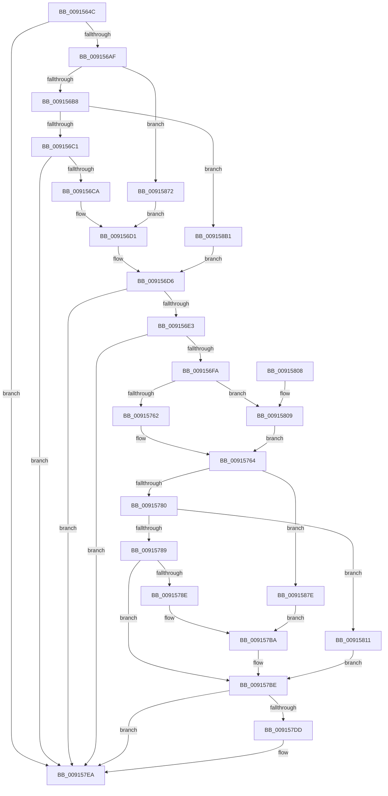

# PopDiagTraceWin32kCalloutStart

- RVA: `0x0091564C`–`0x009158C2` (길이 `630` bytes)
- VA: `0x000000014091564C`
- 실행 섹션: `PAGE`
- PDB 이름 있음: `예`; PDB Function 태그: `아니요`
- unwind 정보 RVA: `0x0008A704`
- 디코드: `153`개 명령, `630/630` bytes 표시
- 미해석 바이트: `0` (있으면 어셈블리에 `.byte`로 보존)

> 이 문서는 커널 이미지의 기계어와 PDB 기호를 분석해 생성했습니다. 4번과 5번은 함수 원형과 자료형을 바이너리 사용 방식에서 추정한 C 해석이며 원본 소스 복구 결과는 아닙니다.

## 1. Dependencies

- 직접 호출 지점: **4**; 고유 호출 대상: **4**
- 직접 호출자로 확인된 함수: **3**
- RIP 상대 이미지 참조: **5**

### Outgoing calls
- `0x009156ED` → [EtwEventEnabled](../../text/39/EtwEventEnabled_function_00392450.md) (function, `0x00392450`)
- `0x0091570B` → [ExAllocatePool2](../../poolcode/B8/ExAllocatePool2_function_00B820F0.md) (function, `0x00B820F0`)
- `0x009157D3` → [EtwWrite](../../text/41/EtwWrite_function_0041C720.md) (function, `0x0041C720`)
- `0x009157E5` → [ExFreePoolWithTag](../../poolcode/B8/ExFreePoolWithTag_function_00B82870.md) (function, `0x00B82870`)

### Direct callers
- [PopInvokeWin32Callout](PopInvokeWin32Callout_function_009125F4.md) at `0x00912659`
- [PopNotifyConsoleUserPresent](PopNotifyConsoleUserPresent_function_00913C50.md) at `0x00913D3C`
- [PopPowerAggregatorNotifyCsStateExited](../98/PopPowerAggregatorNotifyCsStateExited_function_0098A434.md) at `0x0098A53A`

### Static image references
- `0x009156CA` → RVA `0x00011AC8` (`.rdata`; read)
- `0x009156D6` → RVA `0x00E67858` (`.data`; read)
- `0x009156E3` → RVA `0x00F0B408` (`.data`; read)
- `0x00915872` → RVA `0x00011B68` (`.rdata`; read)
- `0x009158B1` → RVA `0x00011B78` (`.rdata`; read)

## 2. Other-region calls and transfers

- 다른 실행 섹션으로 향하는 call: **4**
  - `0x009156ED` → [EtwEventEnabled](../../text/39/EtwEventEnabled_function_00392450.md) (`PAGE` → `.text`)
  - `0x0091570B` → [ExAllocatePool2](../../poolcode/B8/ExAllocatePool2_function_00B820F0.md) (`PAGE` → `POOLCODE`)
  - `0x009157D3` → [EtwWrite](../../text/41/EtwWrite_function_0041C720.md) (`PAGE` → `.text`)
  - `0x009157E5` → [ExFreePoolWithTag](../../poolcode/B8/ExFreePoolWithTag_function_00B82870.md) (`PAGE` → `POOLCODE`)
- 별도 외부 분기/꼬리 이동을 확인하지 못했습니다.

## 3. Assembly (complete function range)

```asm
0091564C  48 8B C4                        mov rax, rsp
0091564F  48 89 58 08                     mov qword ptr [rax + 8], rbx
00915653  48 89 70 18                     mov qword ptr [rax + 0x18], rsi
00915657  48 89 78 20                     mov qword ptr [rax + 0x20], rdi
0091565B  48 89 50 10                     mov qword ptr [rax + 0x10], rdx
0091565F  55                              push rbp
00915660  41 54                           push r12
00915662  41 55                           push r13
00915664  41 56                           push r14
00915666  41 57                           push r15
00915668  48 8B EC                        mov rbp, rsp
0091566B  48 83 EC 60                     sub rsp, 0x60
0091566F  45 33 ED                        xor r13d, r13d
00915672  45 8A F9                        mov r15b, r9b
00915675  44 89 6D D4                     mov dword ptr [rbp - 0x2c], r13d
00915679  45 8B E0                        mov r12d, r8d
0091567C  4C 89 6D F0                     mov qword ptr [rbp - 0x10], r13
00915680  8B F9                           mov edi, ecx
00915682  44 88 6D D2                     mov byte ptr [rbp - 0x2e], r13b
00915686  44 89 6D E8                     mov dword ptr [rbp - 0x18], r13d
0091568A  44 88 6D D0                     mov byte ptr [rbp - 0x30], r13b
0091568E  44 88 6D D1                     mov byte ptr [rbp - 0x2f], r13b
00915692  44 89 6D E4                     mov dword ptr [rbp - 0x1c], r13d
00915696  44 89 6D EC                     mov dword ptr [rbp - 0x14], r13d
0091569A  44 89 6D DC                     mov dword ptr [rbp - 0x24], r13d
0091569E  44 89 6D D8                     mov dword ptr [rbp - 0x28], r13d
009156A2  44 89 6D E0                     mov dword ptr [rbp - 0x20], r13d
009156A6  48 85 D2                        test rdx, rdx
009156A9  0F 84 3B 01 00 00               je 0x1409157ea
009156AF  83 E9 03                        sub ecx, 3
009156B2  0F 84 BA 01 00 00               je 0x140915872
009156B8  83 E9 01                        sub ecx, 1
009156BB  0F 84 F0 01 00 00               je 0x1409158b1
009156C1  83 F9 01                        cmp ecx, 1
009156C4  0F 85 20 01 00 00               jne 0x1409157ea
009156CA  4C 8D 35 F7 C3 6F FF            lea r14, [rip - 0x903c09]
009156D1  BE 06 00 00 00                  mov esi, 6
009156D6  44 38 2D 7B 21 55 00            cmp byte ptr [rip + 0x55217b], r13b
009156DD  0F 84 07 01 00 00               je 0x1409157ea
009156E3  48 8B 0D 1E 5D 5F 00            mov rcx, qword ptr [rip + 0x5f5d1e]
009156EA  49 8B D6                        mov rdx, r14
009156ED  E8 5E CD A7 FF                  call 0x140392450
009156F2  84 C0                           test al, al
009156F4  0F 84 F0 00 00 00               je 0x1409157ea
009156FA  8B D6                           mov edx, esi
009156FC  B9 00 01 00 00                  mov ecx, 0x100
00915701  48 C1 E2 04                     shl rdx, 4
00915705  41 B8 54 56 45 50               mov r8d, 0x50455654
0091570B  E8 E0 C9 26 00                  call 0x140b820f0
00915710  48 8B D8                        mov rbx, rax
00915713  45 84 FF                        test r15b, r15b
00915716  48 8D 45 38                     lea rax, [rbp + 0x38]
0091571A  48 89 03                        mov qword ptr [rbx], rax
0091571D  48 C7 43 08 08 00 00 00         mov qword ptr [rbx + 8], 8
00915725  41 0F B6 C4                     movzx eax, r12b
00915729  89 45 D4                        mov dword ptr [rbp - 0x2c], eax
0091572C  48 8D 45 D4                     lea rax, [rbp - 0x2c]
00915730  48 89 43 10                     mov qword ptr [rbx + 0x10], rax
00915734  41 8B C5                        mov eax, r13d
00915737  0F 95 C0                        setne al
0091573A  48 C7 43 18 01 00 00 00         mov qword ptr [rbx + 0x18], 1
00915742  89 45 D8                        mov dword ptr [rbp - 0x28], eax
00915745  48 8D 45 D8                     lea rax, [rbp - 0x28]
00915749  48 89 43 20                     mov qword ptr [rbx + 0x20], rax
0091574D  48 8B 45 50                     mov rax, qword ptr [rbp + 0x50]
00915751  48 C7 43 28 01 00 00 00         mov qword ptr [rbx + 0x28], 1
00915759  48 85 C0                        test rax, rax
0091575C  0F 84 A7 00 00 00               je 0x140915809
00915762  8B 00                           mov eax, dword ptr [rax]
00915764  89 45 DC                        mov dword ptr [rbp - 0x24], eax
00915767  48 8D 45 DC                     lea rax, [rbp - 0x24]
0091576B  48 89 43 30                     mov qword ptr [rbx + 0x30], rax
0091576F  48 C7 43 38 04 00 00 00         mov qword ptr [rbx + 0x38], 4
00915777  83 EF 03                        sub edi, 3
0091577A  0F 84 FE 00 00 00               je 0x14091587e
00915780  83 EF 01                        sub edi, 1
00915783  0F 84 88 00 00 00               je 0x140915811
00915789  83 FF 01                        cmp edi, 1
0091578C  75 30                           jne 0x1409157be
0091578E  48 8B 4D 38                     mov rcx, qword ptr [rbp + 0x38]
00915792  8A 41 10                        mov al, byte ptr [rcx + 0x10]
00915795  88 45 D0                        mov byte ptr [rbp - 0x30], al
00915798  48 8D 45 D0                     lea rax, [rbp - 0x30]
0091579C  48 89 43 40                     mov qword ptr [rbx + 0x40], rax
009157A0  48 C7 43 48 01 00 00 00         mov qword ptr [rbx + 0x48], 1
009157A8  8A 41 14                        mov al, byte ptr [rcx + 0x14]
009157AB  88 45 D1                        mov byte ptr [rbp - 0x2f], al
009157AE  48 8D 45 D1                     lea rax, [rbp - 0x2f]
009157B2  48 C7 43 58 01 00 00 00         mov qword ptr [rbx + 0x58], 1
009157BA  48 89 43 50                     mov qword ptr [rbx + 0x50], rax
009157BE  48 8B 0D 43 5C 5F 00            mov rcx, qword ptr [rip + 0x5f5c43]
009157C5  44 8B CE                        mov r9d, esi
009157C8  45 33 C0                        xor r8d, r8d
009157CB  48 89 5C 24 20                  mov qword ptr [rsp + 0x20], rbx
009157D0  49 8B D6                        mov rdx, r14
009157D3  E8 48 6F B0 FF                  call 0x14041c720
009157D8  48 85 DB                        test rbx, rbx
009157DB  74 0D                           je 0x1409157ea
009157DD  BA 54 56 45 50                  mov edx, 0x50455654
009157E2  48 8B CB                        mov rcx, rbx
009157E5  E8 86 D0 26 00                  call 0x140b82870
009157EA  4C 8D 5C 24 60                  lea r11, [rsp + 0x60]
009157EF  49 8B 5B 30                     mov rbx, qword ptr [r11 + 0x30]
009157F3  49 8B 73 40                     mov rsi, qword ptr [r11 + 0x40]
009157F7  49 8B 7B 48                     mov rdi, qword ptr [r11 + 0x48]
009157FB  49 8B E3                        mov rsp, r11
009157FE  41 5F                           pop r15
00915800  41 5E                           pop r14
00915802  41 5D                           pop r13
00915804  41 5C                           pop r12
00915806  5D                              pop rbp
00915807  C3                              ret
00915808  CC                              int3
00915809  83 C8 FF                        or eax, 0xffffffff
0091580C  E9 53 FF FF FF                  jmp 0x140915764
00915811  48 8B 4D 38                     mov rcx, qword ptr [rbp + 0x38]
00915815  8B 41 14                        mov eax, dword ptr [rcx + 0x14]
00915818  89 45 E0                        mov dword ptr [rbp - 0x20], eax
0091581B  48 8D 45 E0                     lea rax, [rbp - 0x20]
0091581F  48 89 43 40                     mov qword ptr [rbx + 0x40], rax
00915823  48 C7 43 48 04 00 00 00         mov qword ptr [rbx + 0x48], 4
0091582B  8B 41 18                        mov eax, dword ptr [rcx + 0x18]
0091582E  89 45 E4                        mov dword ptr [rbp - 0x1c], eax
00915831  48 8D 45 E4                     lea rax, [rbp - 0x1c]
00915835  48 89 43 50                     mov qword ptr [rbx + 0x50], rax
00915839  48 C7 43 58 04 00 00 00         mov qword ptr [rbx + 0x58], 4
00915841  8B 41 1C                        mov eax, dword ptr [rcx + 0x1c]
00915844  89 45 E8                        mov dword ptr [rbp - 0x18], eax
00915847  48 8D 45 E8                     lea rax, [rbp - 0x18]
0091584B  48 89 43 60                     mov qword ptr [rbx + 0x60], rax
0091584F  48 C7 43 68 04 00 00 00         mov qword ptr [rbx + 0x68], 4
00915857  8B 41 20                        mov eax, dword ptr [rcx + 0x20]
0091585A  89 45 EC                        mov dword ptr [rbp - 0x14], eax
0091585D  48 8D 45 EC                     lea rax, [rbp - 0x14]
00915861  48 89 43 70                     mov qword ptr [rbx + 0x70], rax
00915865  48 C7 43 78 04 00 00 00         mov qword ptr [rbx + 0x78], 4
0091586D  E9 4C FF FF FF                  jmp 0x1409157be
00915872  4C 8D 35 EF C2 6F FF            lea r14, [rip - 0x903d11]
00915879  E9 53 FE FF FF                  jmp 0x1409156d1
0091587E  48 8B 4D 38                     mov rcx, qword ptr [rbp + 0x38]
00915882  8A 41 10                        mov al, byte ptr [rcx + 0x10]
00915885  88 45 D2                        mov byte ptr [rbp - 0x2e], al
00915888  48 8D 45 D2                     lea rax, [rbp - 0x2e]
0091588C  48 89 43 40                     mov qword ptr [rbx + 0x40], rax
00915890  48 C7 43 48 01 00 00 00         mov qword ptr [rbx + 0x48], 1
00915898  48 8B 41 18                     mov rax, qword ptr [rcx + 0x18]
0091589C  48 89 45 F0                     mov qword ptr [rbp - 0x10], rax
009158A0  48 8D 45 F0                     lea rax, [rbp - 0x10]
009158A4  48 C7 43 58 08 00 00 00         mov qword ptr [rbx + 0x58], 8
009158AC  E9 09 FF FF FF                  jmp 0x1409157ba
009158B1  4C 8D 35 C0 C2 6F FF            lea r14, [rip - 0x903d40]
009158B8  BE 08 00 00 00                  mov esi, 8
009158BD  E9 14 FE FF FF                  jmp 0x1409156d6
```

## 4. C-style interpretation (structured pseudocode)

```c
__int64 __fastcall PopDiagTraceWin32kCalloutStart(int a1, __int64 a2, int a3, unsigned __int8 a4, __int64 a5)
{
    __int64 result;
    __int64 v_r13;
    __int64 v_rdi;
    __int64 v_rsp;
    unsigned __int64 v_stack_m28;
    unsigned __int64 v_stack_m38;
    unsigned int v_stack_m3C;
    unsigned int v_stack_m40;
    unsigned int v_stack_m44;
    unsigned int v_stack_m48;
    unsigned int v_stack_m4C;
    unsigned int v_stack_m50;
    unsigned int v_stack_m54;
    unsigned __int8 v_stack_m56;
    unsigned __int8 v_stack_m57;
    unsigned __int8 v_stack_m58;
    unsigned __int64 v_stack_m68;
    unsigned __int64 v_stack_p10;

    *(unsigned __int64 *)(v_rsp + 8) = v_rbx;
    *(unsigned __int64 *)(v_rsp + 24) = v_rsi;
    *(unsigned __int64 *)(v_rsp + 32) = v_rdi;
    *(unsigned __int64 *)(v_rsp + 16) = a2;
    v_rsp = (v_rsp) - (96);
    v_r13 = 0;
    v_stack_m54 = 0;
    v_stack_m38 = 0;
    v_stack_m56 = 0;
    v_stack_m40 = 0;
    v_stack_m58 = 0;
    v_stack_m57 = 0;
    v_stack_m44 = 0;
    v_stack_m3C = 0;
    v_stack_m4C = 0;
    v_stack_m50 = 0;
    v_stack_m48 = 0;
    if (a2 == 0) goto loc_009157EA;
    a1 = (unsigned int)((a1) - (3));
    if (condition_is_equal) goto loc_00915872;
    a1 = (unsigned int)((a1) - (1));
    if (condition_is_equal) goto loc_009158B1;
    if (a1 != 1) goto loc_009157EA;
loc_009156D1:
loc_009156D6:
    if ((*(unsigned __int8 *)(v_rip + 5579131)) == 0) goto loc_009157EA;
    result = EtwEventEnabled(*(unsigned __int64 *)(v_rip + 6249758), v_rip - 9452553, a3, a4);
    if ((unsigned __int8)(result) == 0) goto loc_009157EA;
    a2 = (6) << (4);
    result = ExAllocatePool2(256, a2, (unsigned int)(0x50455654ULL), a4);
    *(unsigned __int64 *)(result) = v_stack_p10;
    *(unsigned __int64 *)(result + 8) = 8;
    v_stack_m54 = (unsigned int)((unsigned __int8)((unsigned int)(a3)));
    *(unsigned __int64 *)(result + 16) = v_stack_m54;
    result = (a4 != 0) ? 1 : 0;
    *(unsigned __int64 *)(result + 24) = 1;
    v_stack_m50 = (unsigned int)(result);
    *(unsigned __int64 *)(result + 32) = v_stack_m50;
    *(unsigned __int64 *)(result + 40) = 1;
    if (a5 == 0) goto loc_00915809;
loc_00915764:
    v_stack_m4C = (unsigned int)((unsigned int)(*(unsigned int *)(a5)));
    *(unsigned __int64 *)(result + 48) = v_stack_m4C;
    *(unsigned __int64 *)(result + 56) = 4;
    v_rdi = (unsigned int)(((unsigned int)(a1)) - (3));
    if (condition_is_equal) goto loc_0091587E;
    v_rdi = (unsigned int)((v_rdi) - (1));
    if (condition_is_equal) goto loc_00915811;
    if (((unsigned int)(v_rdi)) != 1) goto loc_009157BE;
    v_stack_m58 = (unsigned __int8)(*(unsigned __int8 *)(v_stack_p10 + 16));
    *(unsigned __int64 *)(result + 64) = v_stack_m58;
    *(unsigned __int64 *)(result + 72) = 1;
    v_stack_m57 = (unsigned __int8)(*(unsigned __int8 *)(v_stack_p10 + 20));
    *(unsigned __int64 *)(result + 88) = 1;
loc_009157BA:
    *(unsigned __int64 *)(result + 80) = v_stack_m57;
loc_009157BE:
    a3 = 0;
    v_stack_m68 = result;
    result = EtwWrite(*(unsigned __int64 *)(v_rip + 6249539), v_rip - 9452553, a3, 6);
    if (result != 0) {
        a2 = 0x50455654ULL;
        a1 = result;
        result = ExFreePoolWithTag(a1, a2, a3, 6);
    }
    return result;
loc_00915809:
    result = (unsigned int)((result) | (0xFFFFFFFFULL));
    goto loc_00915764;
loc_00915811:
    v_stack_m48 = (unsigned int)((unsigned int)(*(unsigned int *)(v_stack_p10 + 20)));
    *(unsigned __int64 *)(*(unsigned __int64 *)(v_stack_m28 + 48) + 64) = v_stack_m48;
    *(unsigned __int64 *)(*(unsigned __int64 *)(v_stack_m28 + 48) + 72) = 4;
    v_stack_m44 = (unsigned int)((unsigned int)(*(unsigned int *)(v_stack_p10 + 24)));
    *(unsigned __int64 *)(*(unsigned __int64 *)(v_stack_m28 + 48) + 80) = v_stack_m44;
    *(unsigned __int64 *)(*(unsigned __int64 *)(v_stack_m28 + 48) + 88) = 4;
    v_stack_m40 = (unsigned int)((unsigned int)(*(unsigned int *)(v_stack_p10 + 28)));
    *(unsigned __int64 *)(*(unsigned __int64 *)(v_stack_m28 + 48) + 96) = v_stack_m40;
    *(unsigned __int64 *)(*(unsigned __int64 *)(v_stack_m28 + 48) + 104) = 4;
    v_stack_m3C = (unsigned int)((unsigned int)(*(unsigned int *)(v_stack_p10 + 32)));
    *(unsigned __int64 *)(*(unsigned __int64 *)(v_stack_m28 + 48) + 112) = v_stack_m3C;
    *(unsigned __int64 *)(*(unsigned __int64 *)(v_stack_m28 + 48) + 120) = 4;
    goto loc_009157BE;
loc_00915872:
    goto loc_009156D1;
loc_0091587E:
    v_stack_m56 = (unsigned __int8)(*(unsigned __int8 *)(v_stack_p10 + 16));
    *(unsigned __int64 *)(*(unsigned __int64 *)(v_stack_m28 + 48) + 64) = v_stack_m56;
    *(unsigned __int64 *)(*(unsigned __int64 *)(v_stack_m28 + 48) + 72) = 1;
    v_stack_m38 = *(unsigned __int64 *)(v_stack_p10 + 24);
    *(unsigned __int64 *)(*(unsigned __int64 *)(v_stack_m28 + 48) + 88) = 8;
    goto loc_009157BA;
loc_009158B1:
    goto loc_009156D6;
}
```

## 5. (Beta) C Style

```c
int64_t PopDiagTraceWin32kCalloutStart(int32_t Arg1, int64_t Arg2, int32_t Arg3, uint8_t Arg4, int64_t Arg5)
{
    int64_t result;
    int64_t local_r13;
    int64_t local_rdi;
    int64_t local_rsp;
    uint64_t v_stack_m28;
    uint64_t v_stack_m38;
    uint32_t v_stack_m3C;
    uint32_t v_stack_m40;
    uint32_t v_stack_m44;
    uint32_t v_stack_m48;
    uint32_t v_stack_m4C;
    uint32_t v_stack_m50;
    uint32_t v_stack_m54;
    uint8_t v_stack_m56;
    uint8_t v_stack_m57;
    uint8_t v_stack_m58;
    uint64_t v_stack_m68;
    uint64_t v_stack_p10;

    *(uint64_t *)(local_rsp + 0x8) = local_rbx;
    *(uint64_t *)(local_rsp + 0x18) = local_rsi;
    *(uint64_t *)(local_rsp + 0x20) = local_rdi;
    *(uint64_t *)(local_rsp + 0x10) = Arg2;
    local_rsp = (local_rsp) - (96);
    local_r13 = 0;
    v_stack_m54 = 0;
    v_stack_m38 = 0;
    v_stack_m56 = 0;
    v_stack_m40 = 0;
    v_stack_m58 = 0;
    v_stack_m57 = 0;
    v_stack_m44 = 0;
    v_stack_m3C = 0;
    v_stack_m4C = 0;
    v_stack_m50 = 0;
    v_stack_m48 = 0;
    if (Arg2 == 0) goto loc_009157EA;
    Arg1 = (uint32_t)((Arg1) - (3));
    if (condition_is_equal) goto loc_00915872;
    Arg1 = (uint32_t)((Arg1) - (1));
    if (condition_is_equal) goto loc_009158B1;
    if (Arg1 != 1) goto loc_009157EA;
loc_009156D1:
loc_009156D6:
    if ((*(uint8_t *)(v_rip + 0x55217B)) == 0) goto loc_009157EA;
    result = EtwEventEnabled(*(uint64_t *)(v_rip + 0x5F5D1E), v_rip - 9452553, Arg3, Arg4);
    if ((uint8_t)(result) == 0) goto loc_009157EA;
    Arg2 = (6) << (4);
    result = ExAllocatePool2(256, Arg2, (uint32_t)(0x50455654ULL), Arg4);
    *(uint64_t *)(result) = v_stack_p10;
    *(uint64_t *)(result + 0x8) = 8;
    v_stack_m54 = (uint32_t)((uint8_t)((uint32_t)(Arg3)));
    *(uint64_t *)(result + 0x10) = v_stack_m54;
    result = (Arg4 != 0) ? 1 : 0;
    *(uint64_t *)(result + 0x18) = 1;
    v_stack_m50 = (uint32_t)(result);
    *(uint64_t *)(result + 0x20) = v_stack_m50;
    *(uint64_t *)(result + 0x28) = 1;
    if (Arg5 == 0) goto loc_00915809;
loc_00915764:
    v_stack_m4C = (uint32_t)((uint32_t)(*(uint32_t *)(Arg5)));
    *(uint64_t *)(result + 0x30) = v_stack_m4C;
    *(uint64_t *)(result + 0x38) = 4;
    local_rdi = (uint32_t)(((uint32_t)(Arg1)) - (3));
    if (condition_is_equal) goto loc_0091587E;
    local_rdi = (uint32_t)((local_rdi) - (1));
    if (condition_is_equal) goto loc_00915811;
    if (((uint32_t)(local_rdi)) != 1) goto loc_009157BE;
    v_stack_m58 = (uint8_t)(*(uint8_t *)(v_stack_p10 + 0x10));
    *(uint64_t *)(result + 0x40) = v_stack_m58;
    *(uint64_t *)(result + 0x48) = 1;
    v_stack_m57 = (uint8_t)(*(uint8_t *)(v_stack_p10 + 0x14));
    *(uint64_t *)(result + 0x58) = 1;
loc_009157BA:
    *(uint64_t *)(result + 0x50) = v_stack_m57;
loc_009157BE:
    Arg3 = 0;
    v_stack_m68 = result;
    result = EtwWrite(*(uint64_t *)(v_rip + 0x5F5C43), v_rip - 9452553, Arg3, 6);
    if (result != 0) {
        Arg2 = 0x50455654ULL;
        Arg1 = result;
        result = ExFreePoolWithTag(Arg1, Arg2, Arg3, 6);
    }
    return result;
loc_00915809:
    result = (uint32_t)((result) | (0xFFFFFFFFULL));
    goto loc_00915764;
loc_00915811:
    v_stack_m48 = (uint32_t)((uint32_t)(*(uint32_t *)(v_stack_p10 + 0x14)));
    *(uint64_t *)(*(uint64_t *)(v_stack_m28 + 0x30) + 0x40) = v_stack_m48;
    *(uint64_t *)(*(uint64_t *)(v_stack_m28 + 0x30) + 0x48) = 4;
    v_stack_m44 = (uint32_t)((uint32_t)(*(uint32_t *)(v_stack_p10 + 0x18)));
    *(uint64_t *)(*(uint64_t *)(v_stack_m28 + 0x30) + 0x50) = v_stack_m44;
    *(uint64_t *)(*(uint64_t *)(v_stack_m28 + 0x30) + 0x58) = 4;
    v_stack_m40 = (uint32_t)((uint32_t)(*(uint32_t *)(v_stack_p10 + 0x1C)));
    *(uint64_t *)(*(uint64_t *)(v_stack_m28 + 0x30) + 0x60) = v_stack_m40;
    *(uint64_t *)(*(uint64_t *)(v_stack_m28 + 0x30) + 0x68) = 4;
    v_stack_m3C = (uint32_t)((uint32_t)(*(uint32_t *)(v_stack_p10 + 0x20)));
    *(uint64_t *)(*(uint64_t *)(v_stack_m28 + 0x30) + 0x70) = v_stack_m3C;
    *(uint64_t *)(*(uint64_t *)(v_stack_m28 + 0x30) + 0x78) = 4;
    goto loc_009157BE;
loc_00915872:
    goto loc_009156D1;
loc_0091587E:
    v_stack_m56 = (uint8_t)(*(uint8_t *)(v_stack_p10 + 0x10));
    *(uint64_t *)(*(uint64_t *)(v_stack_m28 + 0x30) + 0x40) = v_stack_m56;
    *(uint64_t *)(*(uint64_t *)(v_stack_m28 + 0x30) + 0x48) = 1;
    v_stack_m38 = *(uint64_t *)(v_stack_p10 + 0x18);
    *(uint64_t *)(*(uint64_t *)(v_stack_m28 + 0x30) + 0x58) = 8;
    goto loc_009157BA;
loc_009158B1:
    goto loc_009156D6;
}
```

## 6. Execution-region graph

[열기: 2D/3D 그래프와 함수 탐색 컨트롤 패널](../../../control-panel.html?section=page&rva=0x0091564C&view=graph)

- 2D 그래프는 위에서 아래로 흐르고, 3D 그래프는 빈 공간을 드래그해 회전합니다. Shift+드래그는 이동, 휠은 확대·축소, 함수 노드 선택은 대상 보고서 이동입니다.

### Static fallback


