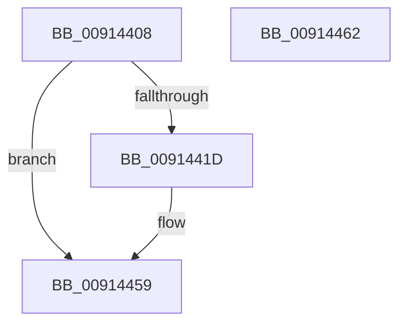

# PopDisarmIdlePhaseWatchdog

- RVA: `0x00914408`–`0x00914463` (길이 `91` bytes)
- VA: `0x0000000140914408`
- 실행 섹션: `PAGE`
- PDB 이름 있음: `예`; PDB Function 태그: `아니요`
- unwind 정보 RVA: `0x0008A5A0`
- 디코드: `22`개 명령, `91/91` bytes 표시
- 미해석 바이트: `0` (있으면 어셈블리에 `.byte`로 보존)

> 이 문서는 커널 이미지의 기계어와 PDB 기호를 분석해 생성했습니다. 4번과 5번은 함수 원형과 자료형을 바이너리 사용 방식에서 추정한 C 해석이며 원본 소스 복구 결과는 아닙니다.

## 1. Dependencies

- 직접 호출 지점: **3**; 고유 호출 대상: **3**
- 직접 호출자로 확인된 함수: **2**
- RIP 상대 이미지 참조: **1**

### Outgoing calls
- `0x00914428` → [memset](../../text/6C/memset_function_006C6C40.md) (function, `0x006C6C40`)
- `0x0091444F` → [ZwPowerInformation](../../text/6A/ZwPowerInformation_function_006ADCB0.md) (function, `0x006ADCB0`)
- `0x00914454` → [PopResetIdlePhaseWatchdogDiagnosticContext](PopResetIdlePhaseWatchdogDiagnosticContext_function_009149B4.md) (function, `0x009149B4`)

### Direct callers
- [PdcPoCurrentPdcPhase](../../text/5D/PdcPoCurrentPdcPhase_function_005D9E70.md) at `0x005D9F8A`
- [PopProcessSessionDisplayStateChange](PopProcessSessionDisplayStateChange_function_00914380.md) at `0x0091439A`

### Static image references
- `0x00914411` → RVA `0x00F08480` (`.data`; read)

## 2. Other-region calls and transfers

- 다른 실행 섹션으로 향하는 call: **2**
  - `0x00914428` → [memset](../../text/6C/memset_function_006C6C40.md) (`PAGE` → `.text`)
  - `0x0091444F` → [ZwPowerInformation](../../text/6A/ZwPowerInformation_function_006ADCB0.md) (`PAGE` → `.text`)
- 별도 외부 분기/꼬리 이동을 확인하지 못했습니다.

## 3. Assembly (complete function range)

```asm
00914408  40 53                           push rbx
0091440A  48 81 EC 90 00 00 00            sub rsp, 0x90
00914411  48 8B 1D 68 40 5F 00            mov rbx, qword ptr [rip + 0x5f4068]
00914418  48 85 DB                        test rbx, rbx
0091441B  74 3C                           je 0x140914459
0091441D  33 D2                           xor edx, edx
0091441F  48 8D 4C 24 30                  lea rcx, [rsp + 0x30]
00914424  44 8D 42 60                     lea r8d, [rdx + 0x60]
00914428  E8 13 28 DB FF                  call 0x1406c6c40
0091442D  83 64 24 20 00                  and dword ptr [rsp + 0x20], 0
00914432  48 8D 54 24 30                  lea rdx, [rsp + 0x30]
00914437  45 33 C9                        xor r9d, r9d
0091443A  C7 44 24 30 15 00 00 00         mov dword ptr [rsp + 0x30], 0x15
00914442  48 89 5C 24 38                  mov qword ptr [rsp + 0x38], rbx
00914447  45 8D 41 60                     lea r8d, [r9 + 0x60]
0091444B  41 8D 49 57                     lea ecx, [r9 + 0x57]
0091444F  E8 5C 98 D9 FF                  call 0x1406adcb0
00914454  E8 5B 05 00 00                  call 0x1409149b4
00914459  48 81 C4 90 00 00 00            add rsp, 0x90
00914460  5B                              pop rbx
00914461  C3                              ret
00914462  CC                              int3
```

## 4. C-style interpretation (structured pseudocode)

```c
__int64 __fastcall PopDisarmIdlePhaseWatchdog(__int64 a1, int a2, __int64 a3, int a4)
{
    __int64 result;
    __int64 v_rsp;
    unsigned __int64 v_stack_m60;
    unsigned __int64 v_stack_m68;
    unsigned int v_stack_m78;

    v_rsp = (v_rsp) - (144);
    if (*(unsigned __int64 *)(v_rip + 6242408) != 0) {
        a2 = 0;
        a1 = v_stack_m68;
        a3 = a2 + 96;
        result = memset(a1, a2, a3, a4);
        a2 = v_stack_m68;
        a4 = 0;
        v_stack_m68 = 21;
        v_stack_m60 = *(unsigned __int64 *)(v_rip + 6242408);
        a3 = a4 + 96;
        a1 = a4 + 87;
        result = ZwPowerInformation(a1, a2, a3, a4);
        result = PopResetIdlePhaseWatchdogDiagnosticContext(a1, a2, a3, a4);
    }
    v_rsp = (v_rsp) + (144);
    return result;
}
```

## 5. (Beta) C Style

```c
int64_t PopDisarmIdlePhaseWatchdog(int64_t Arg1, int32_t Arg2, int64_t Arg3, int32_t Arg4)
{
    int64_t result;
    int64_t local_rsp;
    uint64_t v_stack_m60;
    uint64_t v_stack_m68;
    uint32_t v_stack_m78;

    local_rsp = (local_rsp) - (144);
    if (*(uint64_t *)(v_rip + 0x5F4068) != 0) {
        Arg2 = 0;
        Arg1 = v_stack_m68;
        Arg3 = Arg2 + 96;
        result = memset(Arg1, Arg2, Arg3, Arg4);
        Arg2 = v_stack_m68;
        Arg4 = 0;
        v_stack_m68 = 21;
        v_stack_m60 = *(uint64_t *)(v_rip + 0x5F4068);
        Arg3 = Arg4 + 96;
        Arg1 = Arg4 + 87;
        result = ZwPowerInformation(Arg1, Arg2, Arg3, Arg4);
        result = PopResetIdlePhaseWatchdogDiagnosticContext(Arg1, Arg2, Arg3, Arg4);
    }
    local_rsp = (local_rsp) + (144);
    return result;
}
```

## 6. Execution-region graph

[열기: 2D/3D 그래프와 함수 탐색 컨트롤 패널](../../../control-panel.html?section=page&rva=0x00914408&view=graph)

- 2D 그래프는 위에서 아래로 흐르고, 3D 그래프는 빈 공간을 드래그해 회전합니다. Shift+드래그는 이동, 휠은 확대·축소, 함수 노드 선택은 대상 보고서 이동입니다.

### Static fallback


