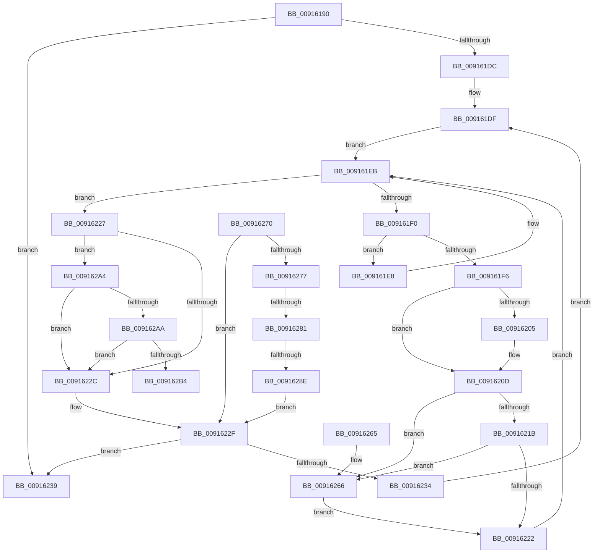

# PopDispatchPowerSettingCallbacks

- RVA: `0x00916190`–`0x009162C5` (길이 `309` bytes)
- VA: `0x0000000140916190`
- 실행 섹션: `PAGE`
- PDB 이름 있음: `예`; PDB Function 태그: `예`
- unwind 정보 RVA: `0x0008A774`
- 디코드: `88`개 명령, `309/309` bytes 표시
- 미해석 바이트: `0` (있으면 어셈블리에 `.byte`로 보존)

> 이 문서는 커널 이미지의 기계어와 PDB 기호를 분석해 생성했습니다. 4번과 5번은 함수 원형과 자료형을 바이너리 사용 방식에서 추정한 C 해석이며 원본 소스 복구 결과는 아닙니다.

## 1. Dependencies

- 직접 호출 지점: **8**; 고유 호출 대상: **7**
- 직접 호출자로 확인된 함수: **0**
- RIP 상대 이미지 참조: **3**

### Outgoing calls
- `0x009161AA` → [PopIncrementPowerSettingPendingUpdates](../../text/38/PopIncrementPowerSettingPendingUpdates_function_0038FE38.md) (function, `0x0038FE38`)
- `0x009161B1` → [PopDecrementPowerSettingPendingUpdates](../../text/39/PopDecrementPowerSettingPendingUpdates_function_0039007C.md) (function, `0x0039007C`)
- `0x009161C4` → [ExAcquireFastMutex](../../text/20/ExAcquireFastMutex_function_0020E5A0.md) (function, `0x0020E5A0`)
- `0x00916208` → [PopCallPowerSettingCallback](PopCallPowerSettingCallback_function_009162CC.md) (function, `0x009162CC`)
- `0x00916240` → [ExReleaseFastMutex](../../text/25/ExReleaseFastMutex_function_002519C0.md) (function, `0x002519C0`)
- `0x00916247` → [PopDecrementPowerSettingPendingUpdates](../../text/39/PopDecrementPowerSettingPendingUpdates_function_0039007C.md) (function, `0x0039007C`)
- `0x00916269` → [PopUnregisterPowerSettingCallback](../../text/4B/PopUnregisterPowerSettingCallback_function_004B7594.md) (function, `0x004B7594`)
- `0x0091629D` → [ExFreePoolWithTag](../../poolcode/B8/ExFreePoolWithTag_function_00B82870.md) (function, `0x00B82870`)

### Direct callers
- 이 함수 시작 RVA로 연결되는 직접 call은 확인되지 않았습니다. 간접 호출은 완전히 역산할 수 없습니다.

### Static image references
- `0x009161B6` → RVA `0x00F0CE0C` (`.data`; read)
- `0x009161BD` → RVA `0x00F0DF40` (`.data`; read)
- `0x009161C9` → RVA `0x00F0C6A0` (`.data`; read)

## 2. Other-region calls and transfers

- 다른 실행 섹션으로 향하는 call: **7**
  - `0x009161AA` → [PopIncrementPowerSettingPendingUpdates](../../text/38/PopIncrementPowerSettingPendingUpdates_function_0038FE38.md) (`PAGE` → `.text`)
  - `0x009161B1` → [PopDecrementPowerSettingPendingUpdates](../../text/39/PopDecrementPowerSettingPendingUpdates_function_0039007C.md) (`PAGE` → `.text`)
  - `0x009161C4` → [ExAcquireFastMutex](../../text/20/ExAcquireFastMutex_function_0020E5A0.md) (`PAGE` → `.text`)
  - `0x00916240` → [ExReleaseFastMutex](../../text/25/ExReleaseFastMutex_function_002519C0.md) (`PAGE` → `.text`)
  - `0x00916247` → [PopDecrementPowerSettingPendingUpdates](../../text/39/PopDecrementPowerSettingPendingUpdates_function_0039007C.md) (`PAGE` → `.text`)
  - `0x00916269` → [PopUnregisterPowerSettingCallback](../../text/4B/PopUnregisterPowerSettingCallback_function_004B7594.md) (`PAGE` → `.text`)
  - `0x0091629D` → [ExFreePoolWithTag](../../poolcode/B8/ExFreePoolWithTag_function_00B82870.md) (`PAGE` → `POOLCODE`)
- call이 아닌 외부 분기/꼬리 이동: **3**
  - `0x0091627B` → [sub_00B21A1A + 0x1C](../B2/Unknown_function_00B21A1A.md) (`tail-transfer`)
  - `0x00916288` → [sub_00B21A1A + 0x1C](../B2/Unknown_function_00B21A1A.md) (`tail-transfer`)
  - `0x009162C0` → [sub_00B21A1A](../B2/Unknown_function_00B21A1A.md) (`tail-transfer`)

## 3. Assembly (complete function range)

```asm
00916190  48 89 5C 24 08                  mov qword ptr [rsp + 8], rbx
00916195  48 89 6C 24 10                  mov qword ptr [rsp + 0x10], rbp
0091619A  48 89 74 24 18                  mov qword ptr [rsp + 0x18], rsi
0091619F  57                              push rdi
009161A0  41 55                           push r13
009161A2  41 56                           push r14
009161A4  48 83 EC 20                     sub rsp, 0x20
009161A8  33 C9                           xor ecx, ecx
009161AA  E8 89 9C A7 FF                  call 0x14038fe38
009161AF  B1 01                           mov cl, 1
009161B1  E8 C6 9E A7 FF                  call 0x14039007c
009161B6  48 63 3D 4F 6C 5F 00            movsxd rdi, dword ptr [rip + 0x5f6c4f]
009161BD  48 8D 0D 7C 7D 5F 00            lea rcx, [rip + 0x5f7d7c]
009161C4  E8 D7 83 8F FF                  call 0x14020e5a0
009161C9  48 8B 1D D0 64 5F 00            mov rbx, qword ptr [rip + 0x5f64d0]
009161D0  4C 8D 2D C9 64 5F 00            lea r13, [rip + 0x5f64c9]
009161D7  49 3B DD                        cmp rbx, r13
009161DA  74 5D                           je 0x140916239
009161DC  4C 8B F7                        mov r14, rdi
009161DF  48 8D 73 10                     lea rsi, [rbx + 0x10]
009161E3  48 8B 3E                        mov rdi, qword ptr [rsi]
009161E6  EB 03                           jmp 0x1409161eb
009161E8  48 8B 3F                        mov rdi, qword ptr [rdi]
009161EB  48 3B FE                        cmp rdi, rsi
009161EE  74 37                           je 0x140916227
009161F0  80 7F 68 00                     cmp byte ptr [rdi + 0x68], 0
009161F4  75 F2                           jne 0x1409161e8
009161F6  C6 47 68 01                     mov byte ptr [rdi + 0x68], 1
009161FA  4A 8B 54 F3 40                  mov rdx, qword ptr [rbx + r14*8 + 0x40]
009161FF  48 39 57 48                     cmp qword ptr [rdi + 0x48], rdx
00916203  74 08                           je 0x14091620d
00916205  48 8B CF                        mov rcx, rdi
00916208  E8 BF 00 00 00                  call 0x1409162cc
0091620D  48 8B 2F                        mov rbp, qword ptr [rdi]
00916210  C6 47 68 00                     mov byte ptr [rdi + 0x68], 0
00916214  8A 47 21                        mov al, byte ptr [rdi + 0x21]
00916217  84 C0                           test al, al
00916219  75 4B                           jne 0x140916266
0091621B  8A 47 20                        mov al, byte ptr [rdi + 0x20]
0091621E  84 C0                           test al, al
00916220  75 44                           jne 0x140916266
00916222  48 8B FD                        mov rdi, rbp
00916225  EB C4                           jmp 0x1409161eb
00916227  48 39 36                        cmp qword ptr [rsi], rsi
0091622A  74 78                           je 0x1409162a4
0091622C  48 8B 3B                        mov rdi, qword ptr [rbx]
0091622F  49 3B FD                        cmp rdi, r13
00916232  74 05                           je 0x140916239
00916234  48 8B DF                        mov rbx, rdi
00916237  EB A6                           jmp 0x1409161df
00916239  48 8D 0D 00 7D 5F 00            lea rcx, [rip + 0x5f7d00]
00916240  E8 7B B7 93 FF                  call 0x1402519c0
00916245  33 C9                           xor ecx, ecx
00916247  E8 30 9E A7 FF                  call 0x14039007c
0091624C  48 8B 5C 24 40                  mov rbx, qword ptr [rsp + 0x40]
00916251  48 8B 6C 24 48                  mov rbp, qword ptr [rsp + 0x48]
00916256  48 8B 74 24 50                  mov rsi, qword ptr [rsp + 0x50]
0091625B  48 83 C4 20                     add rsp, 0x20
0091625F  41 5E                           pop r14
00916261  41 5D                           pop r13
00916263  5F                              pop rdi
00916264  C3                              ret
00916265  CC                              int3
00916266  48 8B CF                        mov rcx, rdi
00916269  E8 26 13 BA FF                  call 0x1404b7594
0091626E  EB B2                           jmp 0x140916222
00916270  48 8B 3B                        mov rdi, qword ptr [rbx]
00916273  84 C0                           test al, al
00916275  74 B8                           je 0x14091622f
00916277  48 39 5F 08                     cmp qword ptr [rdi + 8], rbx
0091627B  0F 85 B5 B7 20 00               jne 0x140b21a36
00916281  48 8B 43 08                     mov rax, qword ptr [rbx + 8]
00916285  48 39 18                        cmp qword ptr [rax], rbx
00916288  0F 85 A8 B7 20 00               jne 0x140b21a36
0091628E  48 89 38                        mov qword ptr [rax], rdi
00916291  BA 50 53 65 74                  mov edx, 0x74655350
00916296  48 8B CB                        mov rcx, rbx
00916299  48 89 47 08                     mov qword ptr [rdi + 8], rax
0091629D  E8 CE C5 26 00                  call 0x140b82870
009162A2  EB 8B                           jmp 0x14091622f
009162A4  83 7B 38 00                     cmp dword ptr [rbx + 0x38], 0
009162A8  75 82                           jne 0x14091622c
009162AA  83 7B 3C 00                     cmp dword ptr [rbx + 0x3c], 0
009162AE  0F 85 78 FF FF FF               jne 0x14091622c
009162B4  B0 01                           mov al, 1
009162B6  48 8D 53 40                     lea rdx, [rbx + 0x40]
009162BA  41 B8 03 00 00 00               mov r8d, 3
009162C0  E9 55 B7 20 00                  jmp 0x140b21a1a
```

## 4. C-style interpretation (structured pseudocode)

```c
__int64 __fastcall PopDispatchPowerSettingCallbacks(int a1)
{
    __int64 result;
    __int64 v_rsp;
    unsigned __int64 v_stack_p10;
    unsigned __int64 v_stack_p18;
    unsigned __int64 v_stack_p8;

    v_stack_p8 = v_rbx;
    v_stack_p10 = v_rbp;
    v_stack_p18 = v_rsi;
    v_rsp = (v_rsp) - (32);
    a1 = 0;
    result = PopIncrementPowerSettingPendingUpdates(a1, a2, a3, a4);
    result = PopDecrementPowerSettingPendingUpdates(1, a2, a3, a4);
    result = ExAcquireFastMutex(v_rip + 6258044, a2, a3, a4);
    if ((*(unsigned __int64 *)(v_rip + 6251728)) == (v_rip + 6251721)) goto loc_00916239;
loc_009161DF:
    goto loc_009161EB;
loc_009161E8:
loc_009161EB:
    if ((*(unsigned __int64 *)(*(unsigned __int64 *)(*(unsigned __int64 *)(v_rip + 6251728) + 16))) == (*(unsigned __int64 *)(v_rip + 6251728) + 16)) goto loc_00916227;
    if ((*(unsigned __int8 *)(*(unsigned __int64 *)(*(unsigned __int64 *)(*(unsigned __int64 *)(v_rip + 6251728) + 16)) + 104)) != 0) goto loc_009161E8;
    *(unsigned __int8 *)(*(unsigned __int64 *)(*(unsigned __int64 *)(*(unsigned __int64 *)(v_rip + 6251728) + 16)) + 104) = 1;
    if ((*(unsigned __int64 *)(*(unsigned __int64 *)(*(unsigned __int64 *)(*(unsigned __int64 *)(v_rip + 6251728) + 16)) + 72)) != (*(unsigned __int64 *)(*(unsigned __int64 *)(v_rip + 6251728) + (int)(*(unsigned int *)(v_rip + 6253647)) * 8 + 64))) {
        a1 = *(unsigned __int64 *)(*(unsigned __int64 *)(*(unsigned __int64 *)(v_rip + 6251728) + 16));
        result = PopCallPowerSettingCallback(a1, *(unsigned __int64 *)(*(unsigned __int64 *)(v_rip + 6251728) + (int)(*(unsigned int *)(v_rip + 6253647)) * 8 + 64), a3, a4);
    }
    *(unsigned __int8 *)(*(unsigned __int64 *)(*(unsigned __int64 *)(*(unsigned __int64 *)(v_rip + 6251728) + 16)) + 104) = 0;
    if ((unsigned __int8)(*(unsigned __int8 *)(*(unsigned __int64 *)(*(unsigned __int64 *)(*(unsigned __int64 *)(v_rip + 6251728) + 16)) + 33)) != 0) goto loc_00916266;
    if ((unsigned __int8)(*(unsigned __int8 *)(*(unsigned __int64 *)(*(unsigned __int64 *)(*(unsigned __int64 *)(v_rip + 6251728) + 16)) + 32)) != 0) goto loc_00916266;
loc_00916222:
    goto loc_009161EB;
loc_00916227:
    if ((*(unsigned __int64 *)(*(unsigned __int64 *)(v_rip + 6251728) + 16)) == (*(unsigned __int64 *)(v_rip + 6251728) + 16)) goto loc_009162A4;
loc_0091622C:
loc_0091622F:
    if ((*(unsigned __int64 *)(*(unsigned __int64 *)(v_rip + 6251728))) == (v_rip + 6251721)) goto loc_00916239;
    goto loc_009161DF;
loc_00916239:
    result = ExReleaseFastMutex(v_rip + 6257920, *(unsigned __int64 *)(*(unsigned __int64 *)(v_rip + 6251728) + (int)(*(unsigned int *)(v_rip + 6253647)) * 8 + 64), a3, a4);
    a1 = 0;
    result = PopDecrementPowerSettingPendingUpdates(a1, *(unsigned __int64 *)(*(unsigned __int64 *)(v_rip + 6251728) + (int)(*(unsigned int *)(v_rip + 6253647)) * 8 + 64), a3, a4);
    v_rsp = (v_rsp) + (32);
    return result;
loc_00916266:
    result = PopUnregisterPowerSettingCallback(*(unsigned __int64 *)(*(unsigned __int64 *)(v_rip + 6251728)), *(unsigned __int64 *)(*(unsigned __int64 *)(v_rip + 6251728) + (int)(*(unsigned int *)(v_rip + 6253647)) * 8 + 64), a3, a4);
    goto loc_00916222;
loc_009162A4:
    if ((*(unsigned int *)(v_stack_p8 + 56)) != 0) goto loc_0091622C;
    if ((*(unsigned int *)(v_stack_p8 + 60)) != 0) goto loc_0091622C;
}
```

## 5. (Beta) C Style

```c
int64_t PopDispatchPowerSettingCallbacks(int32_t Arg1)
{
    int64_t result;
    int64_t local_rsp;
    uint64_t v_stack_p10;
    uint64_t v_stack_p18;
    uint64_t v_stack_p8;

    v_stack_p8 = local_rbx;
    v_stack_p10 = local_rbp;
    v_stack_p18 = local_rsi;
    local_rsp = (local_rsp) - (32);
    Arg1 = 0;
    result = PopIncrementPowerSettingPendingUpdates(Arg1, a2, a3, a4);
    result = PopDecrementPowerSettingPendingUpdates(1, a2, a3, a4);
    result = ExAcquireFastMutex(v_rip + 6258044, a2, a3, a4);
    if ((*(uint64_t *)(v_rip + 0x5F64D0)) == (v_rip + 6251721)) goto loc_00916239;
loc_009161DF:
    goto loc_009161EB;
loc_009161E8:
loc_009161EB:
    if ((*(uint64_t *)(*(uint64_t *)(*(uint64_t *)(v_rip + 0x5F64D0) + 0x10))) == (*(uint64_t *)(v_rip + 0x5F64D0) + 16)) goto loc_00916227;
    if ((*(uint8_t *)(*(uint64_t *)(*(uint64_t *)(*(uint64_t *)(v_rip + 0x5F64D0) + 0x10)) + 0x68)) != 0) goto loc_009161E8;
    *(uint8_t *)(*(uint64_t *)(*(uint64_t *)(*(uint64_t *)(v_rip + 0x5F64D0) + 0x10)) + 0x68) = 1;
    if ((*(uint64_t *)(*(uint64_t *)(*(uint64_t *)(*(uint64_t *)(v_rip + 0x5F64D0) + 0x10)) + 0x48)) != (*(uint64_t *)(*(uint64_t *)(v_rip + 0x5F64D0) + (int32_t)(*(uint32_t *)(v_rip + 0x5F6C4F)) * 8 + 0x40))) {
        Arg1 = *(uint64_t *)(*(uint64_t *)(*(uint64_t *)(v_rip + 0x5F64D0) + 0x10));
        result = PopCallPowerSettingCallback(Arg1, *(uint64_t *)(*(uint64_t *)(v_rip + 0x5F64D0) + (int32_t)(*(uint32_t *)(v_rip + 0x5F6C4F)) * 8 + 0x40), a3, a4);
    }
    *(uint8_t *)(*(uint64_t *)(*(uint64_t *)(*(uint64_t *)(v_rip + 0x5F64D0) + 0x10)) + 0x68) = 0;
    if ((uint8_t)(*(uint8_t *)(*(uint64_t *)(*(uint64_t *)(*(uint64_t *)(v_rip + 0x5F64D0) + 0x10)) + 0x21)) != 0) goto loc_00916266;
    if ((uint8_t)(*(uint8_t *)(*(uint64_t *)(*(uint64_t *)(*(uint64_t *)(v_rip + 0x5F64D0) + 0x10)) + 0x20)) != 0) goto loc_00916266;
loc_00916222:
    goto loc_009161EB;
loc_00916227:
    if ((*(uint64_t *)(*(uint64_t *)(v_rip + 0x5F64D0) + 0x10)) == (*(uint64_t *)(v_rip + 0x5F64D0) + 16)) goto loc_009162A4;
loc_0091622C:
loc_0091622F:
    if ((*(uint64_t *)(*(uint64_t *)(v_rip + 0x5F64D0))) == (v_rip + 6251721)) goto loc_00916239;
    goto loc_009161DF;
loc_00916239:
    result = ExReleaseFastMutex(v_rip + 6257920, *(uint64_t *)(*(uint64_t *)(v_rip + 0x5F64D0) + (int32_t)(*(uint32_t *)(v_rip + 0x5F6C4F)) * 8 + 0x40), a3, a4);
    Arg1 = 0;
    result = PopDecrementPowerSettingPendingUpdates(Arg1, *(uint64_t *)(*(uint64_t *)(v_rip + 0x5F64D0) + (int32_t)(*(uint32_t *)(v_rip + 0x5F6C4F)) * 8 + 0x40), a3, a4);
    local_rsp = (local_rsp) + (32);
    return result;
loc_00916266:
    result = PopUnregisterPowerSettingCallback(*(uint64_t *)(*(uint64_t *)(v_rip + 0x5F64D0)), *(uint64_t *)(*(uint64_t *)(v_rip + 0x5F64D0) + (int32_t)(*(uint32_t *)(v_rip + 0x5F6C4F)) * 8 + 0x40), a3, a4);
    goto loc_00916222;
loc_009162A4:
    if ((*(uint32_t *)(v_stack_p8 + 0x38)) != 0) goto loc_0091622C;
    if ((*(uint32_t *)(v_stack_p8 + 0x3C)) != 0) goto loc_0091622C;
}
```

## 6. Execution-region graph

[열기: 2D/3D 그래프와 함수 탐색 컨트롤 패널](../../../control-panel.html?section=page&rva=0x00916190&view=graph)

- 2D 그래프는 위에서 아래로 흐르고, 3D 그래프는 빈 공간을 드래그해 회전합니다. Shift+드래그는 이동, 휠은 확대·축소, 함수 노드 선택은 대상 보고서 이동입니다.

### Static fallback


