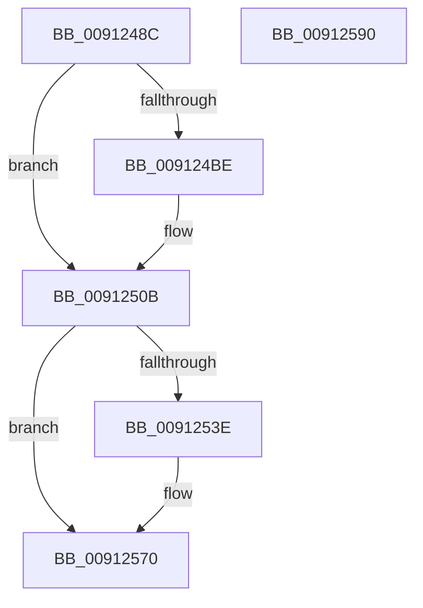

# PopDispatchStateCallout

- RVA: `0x0091248C`–`0x00912591` (길이 `261` bytes)
- VA: `0x000000014091248C`
- 실행 섹션: `PAGE`
- PDB 이름 있음: `예`; PDB Function 태그: `아니요`
- unwind 정보 RVA: `0x0008A2EC`
- 디코드: `66`개 명령, `261/261` bytes 표시
- 미해석 바이트: `0` (있으면 어셈블리에 `.byte`로 보존)

> 이 문서는 커널 이미지의 기계어와 PDB 기호를 분석해 생성했습니다. 4번과 5번은 함수 원형과 자료형을 바이너리 사용 방식에서 추정한 C 해석이며 원본 소스 복구 결과는 아닙니다.

## 1. Dependencies

- 직접 호출 지점: **4**; 고유 호출 대상: **3**
- 직접 호출자로 확인된 함수: **20**
- RIP 상대 이미지 참조: **2**

### Outgoing calls
- `0x00912506` → [EtwTraceKernelEvent](../../text/23/EtwTraceKernelEvent_function_00235350.md) (function, `0x00235350`)
- `0x0091252B` → [PopInvokeWin32Callout](PopInvokeWin32Callout_function_009125F4.md) (function, `0x009125F4`)
- `0x0091256B` → [EtwTraceKernelEvent](../../text/23/EtwTraceKernelEvent_function_00235350.md) (function, `0x00235350`)
- `0x00912579` → [_security_check_cookie](../../text/6A/_security_check_cookie_function_006AC640.md) (function, `0x006AC640`)

### Direct callers
- [PoBlockConsoleSwitchEx](../../text/43/PoBlockConsoleSwitchEx_function_00435CD4.md) at `0x00435D37`
- [PopPrepareSleep](../../text/4C/PopPrepareSleep_function_004C80BC.md) at `0x004C80E0`
- [PoPowerOffMonitor](../../text/4D/PoPowerOffMonitor_function_004D63C0.md) at `0x004D6409`
- [PoStartPowerStateTasks](../70/PoStartPowerStateTasks_function_00702064.md) at `0x00702071`
- [PoEndPowerStateTasks](../70/PoEndPowerStateTasks_function_00702130.md) at `0x0070213D`
- [PopDirectedDripsNotifyAppsAndServices](../75/PopDirectedDripsNotifyAppsAndServices_function_0075792C.md) at `0x007579D7`
- [PoEndPartitionReplace](../75/PoEndPartitionReplace_function_0075E554.md) at `0x0075E568`
- [PoStartPartitionReplace](../75/PoStartPartitionReplace_function_0075E678.md) at `0x0075E690`
- [PoStartPartitionReplace](../75/PoStartPartitionReplace_function_0075E678.md) at `0x0075E6A1`
- [PopResumeApps](../75/PopResumeApps_function_0075EBFC.md) at `0x0075EC3C`
- [PopSendSuspendResumeApplicationNotification](../75/PopSendSuspendResumeApplicationNotification_function_0075EC74.md) at `0x0075ED48`
- [PopSuspendApps](../75/PopSuspendApps_function_0075F008.md) at `0x0075F033`
- [PopSuspendServices](../75/PopSuspendServices_function_0075F05C.md) at `0x0075F092`
- [PdcPoBlockSessionSwitchEx](../76/PdcPoBlockSessionSwitchEx_function_00769340.md) at `0x00769389`
- [PopResumeServices](PopResumeServices_function_00912410.md) at `0x00912454`
- [PopReleaseAdaptiveLock](PopReleaseAdaptiveLock_function_009137DC.md) at `0x00913887`
- [PopPowerAggregatorNotifyCsStateExited](../98/PopPowerAggregatorNotifyCsStateExited_function_0098A434.md) at `0x0098A688`
- [PopScreenOff](../98/PopScreenOff_function_0098A758.md) at `0x0098A7D1`
- [PopIssueActionRequest](../A9/PopIssueActionRequest_function_00A9CE54.md) at `0x00A9D0ED`
- [PopIssueActionRequest](../A9/PopIssueActionRequest_function_00A9CE54.md) at `0x00A9D1EF`
- [PopIssueActionRequest](../A9/PopIssueActionRequest_function_00A9CE54.md) at `0x00A9D253`
- [PopBlockSessionSwitch](../AC/PopBlockSessionSwitch_function_00ACE4C0.md) at `0x00ACE516`
- [PoUnblockConsoleSwitch](../AD/PoUnblockConsoleSwitch_function_00ADB8A0.md) at `0x00ADB8B4`

### Static image references
- `0x0091249E` → RVA `0x00E0A740` (`.data`; read)
- `0x009124AC` → RVA `0x00FC6B10` (`ALMOSTRO`; read)

## 2. Other-region calls and transfers

- 다른 실행 섹션으로 향하는 call: **3**
  - `0x00912506` → [EtwTraceKernelEvent](../../text/23/EtwTraceKernelEvent_function_00235350.md) (`PAGE` → `.text`)
  - `0x0091256B` → [EtwTraceKernelEvent](../../text/23/EtwTraceKernelEvent_function_00235350.md) (`PAGE` → `.text`)
  - `0x00912579` → [_security_check_cookie](../../text/6A/_security_check_cookie_function_006AC640.md) (`PAGE` → `.text`)
- 별도 외부 분기/꼬리 이동을 확인하지 못했습니다.

## 3. Assembly (complete function range)

```asm
0091248C  48 89 5C 24 18                  mov qword ptr [rsp + 0x18], rbx
00912491  48 89 7C 24 20                  mov qword ptr [rsp + 0x20], rdi
00912496  55                              push rbp
00912497  48 8B EC                        mov rbp, rsp
0091249A  48 83 EC 60                     sub rsp, 0x60
0091249E  48 8B 05 9B 82 4F 00            mov rax, qword ptr [rip + 0x4f829b]
009124A5  48 33 C4                        xor rax, rsp
009124A8  48 89 45 F8                     mov qword ptr [rbp - 8], rax
009124AC  F7 05 5A 46 6B 00 00 80 00 00   test dword ptr [rip + 0x6b465a], 0x8000
009124B6  48 8B FA                        mov rdi, rdx
009124B9  48 8B D9                        mov rbx, rcx
009124BC  74 4D                           je 0x14091250b
009124BE  8B 41 14                        mov eax, dword ptr [rcx + 0x14]
009124C1  41 B9 28 12 00 00               mov r9d, 0x1228
009124C7  83 65 E4 00                     and dword ptr [rbp - 0x1c], 0
009124CB  BA 01 00 00 00                  mov edx, 1
009124D0  89 45 E8                        mov dword ptr [rbp - 0x18], eax
009124D3  41 B8 00 80 00 80               mov r8d, 0x80008000
009124D9  8B 41 18                        mov eax, dword ptr [rcx + 0x18]
009124DC  89 45 EC                        mov dword ptr [rbp - 0x14], eax
009124DF  8B 41 1C                        mov eax, dword ptr [rcx + 0x1c]
009124E2  89 45 F0                        mov dword ptr [rbp - 0x10], eax
009124E5  8B 41 20                        mov eax, dword ptr [rcx + 0x20]
009124E8  48 8D 4D D8                     lea rcx, [rbp - 0x28]
009124EC  89 45 F4                        mov dword ptr [rbp - 0xc], eax
009124EF  48 8D 45 E8                     lea rax, [rbp - 0x18]
009124F3  48 89 45 D8                     mov qword ptr [rbp - 0x28], rax
009124F7  C7 45 E0 10 00 00 00            mov dword ptr [rbp - 0x20], 0x10
009124FE  C7 44 24 20 02 18 50 00         mov dword ptr [rsp + 0x20], 0x501802
00912506  E8 45 2E 92 FF                  call 0x140235350
0091250B  48 8B C7                        mov rax, rdi
0091250E  48 8B D3                        mov rdx, rbx
00912511  48 F7 D8                        neg rax
00912514  4D 1B C9                        sbb r9, r9
00912517  4C 23 CF                        and r9, rdi
0091251A  48 F7 DF                        neg rdi
0091251D  BF 04 00 00 00                  mov edi, 4
00912522  45 1B C0                        sbb r8d, r8d
00912525  8B CF                           mov ecx, edi
00912527  41 83 C0 02                     add r8d, 2
0091252B  E8 C4 00 00 00                  call 0x1409125f4
00912530  F7 05 D6 45 6B 00 00 80 00 00   test dword ptr [rip + 0x6b45d6], 0x8000
0091253A  8B D8                           mov ebx, eax
0091253C  74 32                           je 0x140912570
0091253E  83 65 E4 00                     and dword ptr [rbp - 0x1c], 0
00912542  8D 57 FD                        lea edx, [rdi - 3]
00912545  89 45 D0                        mov dword ptr [rbp - 0x30], eax
00912548  48 8D 4D D8                     lea rcx, [rbp - 0x28]
0091254C  48 8D 45 D0                     lea rax, [rbp - 0x30]
00912550  89 7D E0                        mov dword ptr [rbp - 0x20], edi
00912553  41 B9 29 12 00 00               mov r9d, 0x1229
00912559  48 89 45 D8                     mov qword ptr [rbp - 0x28], rax
0091255D  41 B8 00 80 00 80               mov r8d, 0x80008000
00912563  C7 44 24 20 02 18 50 00         mov dword ptr [rsp + 0x20], 0x501802
0091256B  E8 E0 2D 92 FF                  call 0x140235350
00912570  8B C3                           mov eax, ebx
00912572  48 8B 4D F8                     mov rcx, qword ptr [rbp - 8]
00912576  48 33 CC                        xor rcx, rsp
00912579  E8 C2 A0 D9 FF                  call 0x1406ac640
0091257E  4C 8D 5C 24 60                  lea r11, [rsp + 0x60]
00912583  49 8B 5B 20                     mov rbx, qword ptr [r11 + 0x20]
00912587  49 8B 7B 28                     mov rdi, qword ptr [r11 + 0x28]
0091258B  49 8B E3                        mov rsp, r11
0091258E  5D                              pop rbp
0091258F  C3                              ret
00912590  CC                              int3
```

## 4. C-style interpretation (structured pseudocode)

```c
__int64 __fastcall PopDispatchStateCallout(__int64 a1, __int64 a2)
{
    __int64 result;
    __int64 v_rdi;
    __int64 v_rsp;
    unsigned __int64 v_stack_m10;
    unsigned int v_stack_m14;
    unsigned int v_stack_m18;
    unsigned int v_stack_m1C;
    unsigned int v_stack_m20;
    unsigned int v_stack_m24;
    unsigned int v_stack_m28;
    unsigned __int64 v_stack_m30;
    unsigned int v_stack_m38;
    unsigned int v_stack_m48;
    unsigned __int64 v_stack_m8;
    unsigned __int64 v_stack_p18;
    unsigned __int64 v_stack_p20;

    v_stack_p18 = v_rbx;
    v_stack_p20 = v_rdi;
    v_rsp = (v_rsp) - (96);
    result = (*(unsigned __int64 *)(v_rip + 5210779)) ^ (v_rsp);
    v_stack_m10 = result;
    if (((*(unsigned int *)(v_rip + 7030362)) & (0x8000ULL)) != 0) {
        result = *(unsigned int *)(a1 + 20);
        a4 = 0x1228ULL;
        a2 = 1;
        v_stack_m20 = (unsigned int)(result);
        a3 = 0x80008000ULL;
        result = *(unsigned int *)(a1 + 24);
        v_stack_m1C = (unsigned int)(result);
        result = *(unsigned int *)(a1 + 28);
        v_stack_m18 = (unsigned int)(result);
        result = *(unsigned int *)(a1 + 32);
        a1 = v_stack_m30;
        v_stack_m14 = (unsigned int)(result);
        result = v_stack_m20;
        v_stack_m30 = result;
        v_stack_m28 = 16;
        v_stack_m48 = 0x501802ULL;
        result = EtwTraceKernelEvent(a1, a2, a3, a4);
    }
    result = -(a2);
    a4 = (a4) & (a2);
    v_rdi = -(a2);
    a3 = (unsigned int)((a3) + (2));
    result = PopInvokeWin32Callout(4, a1, a3, a4);
    if (((*(unsigned int *)(v_rip + 7030230)) & (0x8000ULL)) != 0) {
        a2 = 4 - 3;
        v_stack_m38 = (unsigned int)(result);
        a1 = v_stack_m30;
        result = v_stack_m38;
        v_stack_m28 = 4;
        a4 = 0x1229ULL;
        v_stack_m30 = result;
        a3 = 0x80008000ULL;
        v_stack_m48 = 0x501802ULL;
        result = EtwTraceKernelEvent(a1, a2, a3, a4);
    }
    a1 = (v_stack_m10) ^ (v_rsp);
    result = _security_check_cookie(a1, a2, a3, a4);
    return result;
}
```

## 5. (Beta) C Style

```c
int64_t PopDispatchStateCallout(void *Arg1, int64_t Arg2)
{
    uint8_t *arg1 = (uint8_t *)Arg1;

    int64_t result;
    int64_t local_rdi;
    int64_t local_rsp;
    uint64_t v_stack_m10;
    uint32_t v_stack_m14;
    uint32_t v_stack_m18;
    uint32_t v_stack_m1C;
    uint32_t v_stack_m20;
    uint32_t v_stack_m24;
    uint32_t v_stack_m28;
    uint64_t v_stack_m30;
    uint32_t v_stack_m38;
    uint32_t v_stack_m48;
    uint64_t v_stack_m8;
    uint64_t v_stack_p18;
    uint64_t v_stack_p20;

    v_stack_p18 = local_rbx;
    v_stack_p20 = local_rdi;
    local_rsp = (local_rsp) - (96);
    result = (*(uint64_t *)(v_rip + 0x4F829B)) ^ (local_rsp);
    v_stack_m10 = result;
    if (((*(uint32_t *)(v_rip + 0x6B465A)) & (0x8000ULL)) != 0) {
        result = *(uint32_t *)(arg1 + 0x14);
        a4 = 0x1228ULL;
        Arg2 = 1;
        v_stack_m20 = (uint32_t)(result);
        a3 = 0x80008000ULL;
        result = *(uint32_t *)(arg1 + 0x18);
        v_stack_m1C = (uint32_t)(result);
        result = *(uint32_t *)(arg1 + 0x1C);
        v_stack_m18 = (uint32_t)(result);
        result = *(uint32_t *)(arg1 + 0x20);
        Arg1 = v_stack_m30;
        v_stack_m14 = (uint32_t)(result);
        result = v_stack_m20;
        v_stack_m30 = result;
        v_stack_m28 = 16;
        v_stack_m48 = 0x501802ULL;
        result = EtwTraceKernelEvent(Arg1, Arg2, a3, a4);
    }
    result = -(Arg2);
    a4 = (a4) & (Arg2);
    local_rdi = -(Arg2);
    a3 = (uint32_t)((a3) + (2));
    result = PopInvokeWin32Callout(4, Arg1, a3, a4);
    if (((*(uint32_t *)(v_rip + 0x6B45D6)) & (0x8000ULL)) != 0) {
        Arg2 = 4 - 3;
        v_stack_m38 = (uint32_t)(result);
        Arg1 = v_stack_m30;
        result = v_stack_m38;
        v_stack_m28 = 4;
        a4 = 0x1229ULL;
        v_stack_m30 = result;
        a3 = 0x80008000ULL;
        v_stack_m48 = 0x501802ULL;
        result = EtwTraceKernelEvent(Arg1, Arg2, a3, a4);
    }
    Arg1 = (v_stack_m10) ^ (local_rsp);
    result = _security_check_cookie(Arg1, Arg2, a3, a4);
    return result;
}
```

### 관측된 메모리 오프셋

구조체 형식이 확인되지 않은 접근은 인자 기준의 오프셋으로만 기록했습니다.

| 기준 인자 | 오프셋 표현 | 폭 (bit) | 접근 |
|---|---:|---:|---|
| `Arg1` | `+ 0x14` | `32` | `R` |
| `Arg1` | `+ 0x18` | `32` | `R` |
| `Arg1` | `+ 0x1C` | `32` | `R` |
| `Arg1` | `+ 0x20` | `32` | `R` |

## 6. Execution-region graph

[열기: 2D/3D 그래프와 함수 탐색 컨트롤 패널](../../../control-panel.html?section=page&rva=0x0091248C&view=graph)

- 2D 그래프는 위에서 아래로 흐르고, 3D 그래프는 빈 공간을 드래그해 회전합니다. Shift+드래그는 이동, 휠은 확대·축소, 함수 노드 선택은 대상 보고서 이동입니다.

### Static fallback


