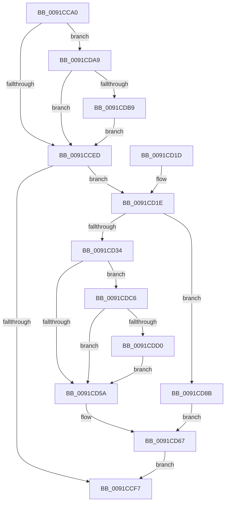

# PopEtProcessEnumSnapshotCallback

- RVA: `0x0091CCA0`–`0x0091CDE3` (길이 `323` bytes)
- VA: `0x000000014091CCA0`
- 실행 섹션: `PAGE`
- PDB 이름 있음: `예`; PDB Function 태그: `아니요`
- unwind 정보 RVA: `0x0008B18C`
- 디코드: `76`개 명령, `323/323` bytes 표시
- 미해석 바이트: `0` (있으면 어셈블리에 `.byte`로 보존)

> 이 문서는 커널 이미지의 기계어와 PDB 기호를 분석해 생성했습니다. 4번과 5번은 함수 원형과 자료형을 바이너리 사용 방식에서 추정한 C 해석이며 원본 소스 복구 결과는 아닙니다.

## 1. Dependencies

- 직접 호출 지점: **10**; 고유 호출 대상: **9**
- 직접 호출자로 확인된 함수: **2**
- RIP 상대 이미지 참조: **2**

### Outgoing calls
- `0x0091CCD8` → [memset](../../text/6C/memset_function_006C6C40.md) (function, `0x006C6C40`)
- `0x0091CD04` → [_security_check_cookie](../../text/6A/_security_check_cookie_function_006AC640.md) (function, `0x006AC640`)
- `0x0091CD40` → [PopEtEnergyTrackerQueryDxgProcessEnergyValues](../A9/PopEtEnergyTrackerQueryDxgProcessEnergyValues_function_00A9FBD4.md) (function, `0x00A9FBD4`)
- `0x0091CD51` → [PopAcquireRwLockShared](../../text/2D/PopAcquireRwLockShared_function_002D9A40.md) (function, `0x002D9A40`)
- `0x0091CD62` → [PsQueryProcessEnergyValues](PsQueryProcessEnergyValues_function_0091A4E0.md) (function, `0x0091A4E0`)
- `0x0091CD6A` → [PopEtProcessSnapshotUpdate](../98/PopEtProcessSnapshotUpdate_function_0098D430.md) (function, `0x0098D430`)
- `0x0091CD79` → [PopReleaseRwLock](../../text/2D/PopReleaseRwLock_function_002DFBBC.md) (function, `0x002DFBBC`)
- `0x0091CD95` → [PopAcquireRwLockShared](../../text/2D/PopAcquireRwLockShared_function_002D9A40.md) (function, `0x002D9A40`)
- `0x0091CDA2` → [PopEtIsrDpcQuery](../A3/PopEtIsrDpcQuery_function_00A3AA3C.md) (function, `0x00A3AA3C`)
- `0x0091CDBC` → [PopEtProcessEnumSnapshotCallback](PopEtProcessEnumSnapshotCallback_function_0091CCA0.md) (function, `0x0091CCA0`)

### Direct callers
- [PsEnumProcesses](PsEnumProcesses_function_0091BE84.md) at `0x0091BEBF`
- [PopEtProcessEnumSnapshotCallback](PopEtProcessEnumSnapshotCallback_function_0091CCA0.md) at `0x0091CDBC`

### Static image references
- `0x0091CCB0` → RVA `0x00E0A740` (`.data`; read)
- `0x0091CD1E` → RVA `0x00FC6B70` (`ALMOSTRO`; read)

## 2. Other-region calls and transfers

- 다른 실행 섹션으로 향하는 call: **5**
  - `0x0091CCD8` → [memset](../../text/6C/memset_function_006C6C40.md) (`PAGE` → `.text`)
  - `0x0091CD04` → [_security_check_cookie](../../text/6A/_security_check_cookie_function_006AC640.md) (`PAGE` → `.text`)
  - `0x0091CD51` → [PopAcquireRwLockShared](../../text/2D/PopAcquireRwLockShared_function_002D9A40.md) (`PAGE` → `.text`)
  - `0x0091CD79` → [PopReleaseRwLock](../../text/2D/PopReleaseRwLock_function_002DFBBC.md) (`PAGE` → `.text`)
  - `0x0091CD95` → [PopAcquireRwLockShared](../../text/2D/PopAcquireRwLockShared_function_002D9A40.md) (`PAGE` → `.text`)
- 별도 외부 분기/꼬리 이동을 확인하지 못했습니다.

## 3. Assembly (complete function range)

```asm
0091CCA0  48 89 5C 24 18                  mov qword ptr [rsp + 0x18], rbx
0091CCA5  56                              push rsi
0091CCA6  57                              push rdi
0091CCA7  41 56                           push r14
0091CCA9  48 81 EC 00 02 00 00            sub rsp, 0x200
0091CCB0  48 8B 05 89 DA 4E 00            mov rax, qword ptr [rip + 0x4eda89]
0091CCB7  48 33 C4                        xor rax, rsp
0091CCBA  48 89 84 24 F0 01 00 00         mov qword ptr [rsp + 0x1f0], rax
0091CCC2  48 8B F2                        mov rsi, rdx
0091CCC5  48 8B F9                        mov rdi, rcx
0091CCC8  41 BE B8 01 00 00               mov r14d, 0x1b8
0091CCCE  48 8D 4C 24 30                  lea rcx, [rsp + 0x30]
0091CCD3  45 8B C6                        mov r8d, r14d
0091CCD6  33 D2                           xor edx, edx
0091CCD8  E8 63 9F DA FF                  call 0x1406c6c40
0091CCDD  48 83 64 24 20 00               and qword ptr [rsp + 0x20], 0
0091CCE3  83 7E 04 00                     cmp dword ptr [rsi + 4], 0
0091CCE7  0F 84 BC 00 00 00               je 0x14091cda9
0091CCED  48 83 BF 68 06 00 00 00         cmp qword ptr [rdi + 0x668], 0
0091CCF5  75 27                           jne 0x14091cd1e
0091CCF7  33 C0                           xor eax, eax
0091CCF9  48 8B 8C 24 F0 01 00 00         mov rcx, qword ptr [rsp + 0x1f0]
0091CD01  48 33 CC                        xor rcx, rsp
0091CD04  E8 37 F9 D8 FF                  call 0x1406ac640
0091CD09  48 8B 9C 24 30 02 00 00         mov rbx, qword ptr [rsp + 0x230]
0091CD11  48 81 C4 00 02 00 00            add rsp, 0x200
0091CD18  41 5E                           pop r14
0091CD1A  5F                              pop rdi
0091CD1B  5E                              pop rsi
0091CD1C  C3                              ret
0091CD1D  CC                              int3
0091CD1E  48 3B 3D 4B 9E 6A 00            cmp rdi, qword ptr [rip + 0x6a9e4b]
0091CD25  48 8D 44 24 30                  lea rax, [rsp + 0x30]
0091CD2A  48 89 46 18                     mov qword ptr [rsi + 0x18], rax
0091CD2E  48 89 7E 08                     mov qword ptr [rsi + 8], rdi
0091CD32  74 57                           je 0x14091cd8b
0091CD34  48 8B 4E 10                     mov rcx, qword ptr [rsi + 0x10]
0091CD38  4C 8D 44 24 20                  lea r8, [rsp + 0x20]
0091CD3D  48 8B D7                        mov rdx, rdi
0091CD40  E8 8F 2E 18 00                  call 0x140a9fbd4
0091CD45  48 8B 8F 68 06 00 00            mov rcx, qword ptr [rdi + 0x668]
0091CD4C  8A D8                           mov bl, al
0091CD4E  49 03 CE                        add rcx, r14
0091CD51  E8 EA CC 9B FF                  call 0x1402d9a40
0091CD56  84 DB                           test bl, bl
0091CD58  75 6C                           jne 0x14091cdc6
0091CD5A  48 8D 54 24 30                  lea rdx, [rsp + 0x30]
0091CD5F  48 8B CF                        mov rcx, rdi
0091CD62  E8 79 D7 FF FF                  call 0x14091a4e0
0091CD67  48 8B CE                        mov rcx, rsi
0091CD6A  E8 C1 06 07 00                  call 0x14098d430
0091CD6F  48 8B 8F 68 06 00 00            mov rcx, qword ptr [rdi + 0x668]
0091CD76  49 03 CE                        add rcx, r14
0091CD79  E8 3E 2E 9C FF                  call 0x1402dfbbc
0091CD7E  48 83 66 08 00                  and qword ptr [rsi + 8], 0
0091CD83  FF 46 04                        inc dword ptr [rsi + 4]
0091CD86  E9 6C FF FF FF                  jmp 0x14091ccf7
0091CD8B  48 8B 8F 68 06 00 00            mov rcx, qword ptr [rdi + 0x668]
0091CD92  49 03 CE                        add rcx, r14
0091CD95  E8 A6 CC 9B FF                  call 0x1402d9a40
0091CD9A  48 8D 54 24 30                  lea rdx, [rsp + 0x30]
0091CD9F  48 8B CF                        mov rcx, rdi
0091CDA2  E8 95 DC 11 00                  call 0x140a3aa3c
0091CDA7  EB BE                           jmp 0x14091cd67
0091CDA9  48 8B 0D C0 9D 6A 00            mov rcx, qword ptr [rip + 0x6a9dc0]
0091CDB0  48 3B F9                        cmp rdi, rcx
0091CDB3  0F 84 34 FF FF FF               je 0x14091cced
0091CDB9  48 8B D6                        mov rdx, rsi
0091CDBC  E8 DF FE FF FF                  call 0x14091cca0
0091CDC1  E9 27 FF FF FF                  jmp 0x14091cced
0091CDC6  48 8B 4C 24 20                  mov rcx, qword ptr [rsp + 0x20]
0091CDCB  48 85 C9                        test rcx, rcx
0091CDCE  74 8A                           je 0x14091cd5a
0091CDD0  48 8B 87 68 06 00 00            mov rax, qword ptr [rdi + 0x668]
0091CDD7  48 89 88 B0 01 00 00            mov qword ptr [rax + 0x1b0], rcx
0091CDDE  E9 77 FF FF FF                  jmp 0x14091cd5a
```

## 4. C-style interpretation (structured pseudocode)

```c
__int64 __fastcall PopEtProcessEnumSnapshotCallback(__int64 a1, __int64 a2)
{
    __int64 result;
    __int64 v_rsp;
    unsigned __int64 v_stack_m1E8;
    unsigned __int64 v_stack_m1F8;
    unsigned __int64 v_stack_m28;
    unsigned __int64 v_stack_p18;
    unsigned __int64 v_stack_p20;
    unsigned __int64 v_stack_p30;

    v_stack_p18 = v_rbx;
    v_rsp = (v_rsp) - (512);
    result = (*(unsigned __int64 *)(v_rip + 5167753)) ^ (v_rsp);
    v_stack_m28 = result;
    a2 = 0;
    result = memset(v_stack_m1E8, a2, 440, a4);
    if ((*(unsigned int *)(a2 + 4)) == 0) goto loc_0091CDA9;
loc_0091CCED:
    if ((*(unsigned __int64 *)(a1 + 1640)) != 0) goto loc_0091CD1E;
loc_0091CCF7:
    result = 0;
    a1 = (v_stack_m28) ^ (v_rsp);
    result = _security_check_cookie(a1, a2, 440, a4);
    v_rsp = (v_rsp) + (512);
    return result;
loc_0091CD1E:
    *(unsigned __int64 *)(a2 + 24) = v_stack_p30;
    *(unsigned __int64 *)(a2 + 8) = a1;
    if (a1 == (*(unsigned __int64 *)(v_rip + 6987339))) goto loc_0091CD8B;
    result = PopEtEnergyTrackerQueryDxgProcessEnergyValues(*(unsigned __int64 *)(a2 + 16), a1, v_stack_p20, a4);
    a1 = (*(unsigned __int64 *)(a1 + 1640)) + (440);
    result = PopAcquireRwLockShared(a1, a1, v_stack_p20, a4);
    if ((unsigned __int8)((unsigned __int8)(result)) != 0) goto loc_0091CDC6;
loc_0091CD5A:
    result = PsQueryProcessEnergyValues(a1, v_stack_p30, v_stack_p20, a4);
loc_0091CD67:
    result = PopEtProcessSnapshotUpdate(0, v_stack_p30, v_stack_p20, a4);
    a1 = (*(unsigned __int64 *)(a1 + 1640)) + (440);
    result = PopReleaseRwLock(a1, v_stack_p30, v_stack_p20, a4);
    goto loc_0091CCF7;
loc_0091CD8B:
    a1 = (*(unsigned __int64 *)(a1 + 1640)) + (440);
    result = PopAcquireRwLockShared(a1, v_stack_p30, v_stack_p20, a4);
    result = PopEtIsrDpcQuery(a1, v_stack_p30, v_stack_p20, a4);
    goto loc_0091CD67;
loc_0091CDA9:
    if (a1 == (*(unsigned __int64 *)(v_rip + 6987200))) goto loc_0091CCED;
    result = PopEtProcessEnumSnapshotCallback(*(unsigned __int64 *)(v_rip + 6987200), 0, v_stack_p20, a4);
    goto loc_0091CCED;
loc_0091CDC6:
    if (v_stack_p20 == 0) goto loc_0091CD5A;
    *(unsigned __int64 *)(*(unsigned __int64 *)(a1 + 1640) + 432) = v_stack_p20;
    goto loc_0091CD5A;
}
```

## 5. (Beta) C Style

```c
int64_t PopEtProcessEnumSnapshotCallback(int64_t Arg1, void *Arg2)
{
    uint8_t *arg2 = (uint8_t *)Arg2;

    int64_t result;
    int64_t local_rsp;
    uint64_t v_stack_m1E8;
    uint64_t v_stack_m1F8;
    uint64_t v_stack_m28;
    uint64_t v_stack_p18;
    uint64_t v_stack_p20;
    uint64_t v_stack_p30;

    v_stack_p18 = local_rbx;
    local_rsp = (local_rsp) - (512);
    result = (*(uint64_t *)(v_rip + 0x4EDA89)) ^ (local_rsp);
    v_stack_m28 = result;
    Arg2 = 0;
    result = memset(v_stack_m1E8, Arg2, 440, a4);
    if ((*(uint32_t *)(arg2 + 0x4)) == 0) goto loc_0091CDA9;
loc_0091CCED:
    if ((*(uint64_t *)(Arg1 + 0x668)) != 0) goto loc_0091CD1E;
loc_0091CCF7:
    result = 0;
    Arg1 = (v_stack_m28) ^ (local_rsp);
    result = _security_check_cookie(Arg1, Arg2, 440, a4);
    local_rsp = (local_rsp) + (512);
    return result;
loc_0091CD1E:
    *(uint64_t *)(arg2 + 0x18) = v_stack_p30;
    *(uint64_t *)(arg2 + 0x8) = Arg1;
    if (Arg1 == (*(uint64_t *)(v_rip + 0x6A9E4B))) goto loc_0091CD8B;
    result = PopEtEnergyTrackerQueryDxgProcessEnergyValues(*(uint64_t *)(arg2 + 0x10), Arg1, v_stack_p20, a4);
    Arg1 = (*(uint64_t *)(Arg1 + 0x668)) + (440);
    result = PopAcquireRwLockShared(Arg1, Arg1, v_stack_p20, a4);
    if ((uint8_t)((uint8_t)(result)) != 0) goto loc_0091CDC6;
loc_0091CD5A:
    result = PsQueryProcessEnergyValues(Arg1, v_stack_p30, v_stack_p20, a4);
loc_0091CD67:
    result = PopEtProcessSnapshotUpdate(0, v_stack_p30, v_stack_p20, a4);
    Arg1 = (*(uint64_t *)(Arg1 + 0x668)) + (440);
    result = PopReleaseRwLock(Arg1, v_stack_p30, v_stack_p20, a4);
    goto loc_0091CCF7;
loc_0091CD8B:
    Arg1 = (*(uint64_t *)(Arg1 + 0x668)) + (440);
    result = PopAcquireRwLockShared(Arg1, v_stack_p30, v_stack_p20, a4);
    result = PopEtIsrDpcQuery(Arg1, v_stack_p30, v_stack_p20, a4);
    goto loc_0091CD67;
loc_0091CDA9:
    if (Arg1 == (*(uint64_t *)(v_rip + 0x6A9DC0))) goto loc_0091CCED;
    result = PopEtProcessEnumSnapshotCallback(*(uint64_t *)(v_rip + 0x6A9DC0), 0, v_stack_p20, a4);
    goto loc_0091CCED;
loc_0091CDC6:
    if (v_stack_p20 == 0) goto loc_0091CD5A;
    *(uint64_t *)(*(uint64_t *)(Arg1 + 0x668) + 0x1B0) = v_stack_p20;
    goto loc_0091CD5A;
}
```

### 관측된 메모리 오프셋

구조체 형식이 확인되지 않은 접근은 인자 기준의 오프셋으로만 기록했습니다.

| 기준 인자 | 오프셋 표현 | 폭 (bit) | 접근 |
|---|---:|---:|---|
| `Arg2` | `+ 0x4` | `32` | `R` |
| `Arg2` | `+ 0x4` | `32` | `R/W` |
| `Arg2` | `+ 0x8` | `64` | `R/W` |
| `Arg2` | `+ 0x8` | `64` | `W` |
| `Arg2` | `+ 0x10` | `64` | `R` |
| `Arg2` | `+ 0x18` | `64` | `W` |

## 6. Execution-region graph

[열기: 2D/3D 그래프와 함수 탐색 컨트롤 패널](../../../control-panel.html?section=page&rva=0x0091CCA0&view=graph)

- 2D 그래프는 위에서 아래로 흐르고, 3D 그래프는 빈 공간을 드래그해 회전합니다. Shift+드래그는 이동, 휠은 확대·축소, 함수 노드 선택은 대상 보고서 이동입니다.

### Static fallback


