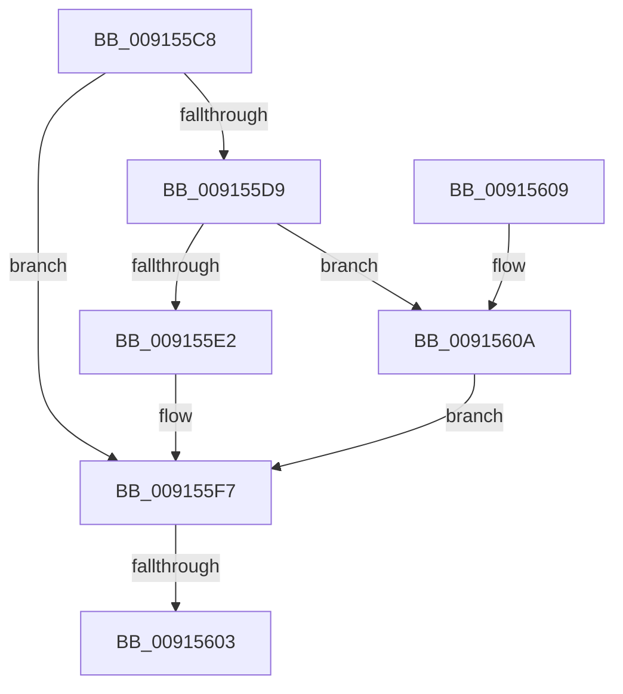

# PopEvaluateGlobalUserStatus

- RVA: `0x009155C8`–`0x0091560E` (길이 `70` bytes)
- VA: `0x00000001409155C8`
- 실행 섹션: `PAGE`
- PDB 이름 있음: `예`; PDB Function 태그: `예`
- unwind 정보 RVA: `0x0008A6E8`
- 디코드: `21`개 명령, `70/70` bytes 표시
- 미해석 바이트: `0` (있으면 어셈블리에 `.byte`로 보존)

> 이 문서는 커널 이미지의 기계어와 PDB 기호를 분석해 생성했습니다. 4번과 5번은 함수 원형과 자료형을 바이너리 사용 방식에서 추정한 C 해석이며 원본 소스 복구 결과는 아닙니다.

## 1. Dependencies

- 직접 호출 지점: **1**; 고유 호출 대상: **1**
- 직접 호출자로 확인된 함수: **2**
- RIP 상대 이미지 참조: **4**

### Outgoing calls
- `0x009155E9` → [RtlNumberOfSetBits](../../text/43/RtlNumberOfSetBits_function_00433F70.md) (function, `0x00433F70`)

### Direct callers
- [PopUserPresenceHostStateChange](PopUserPresenceHostStateChange_function_00912DB8.md) at `0x00912E18`
- [PopSetGlobalUserStatus](PopSetGlobalUserStatus_function_0091555C.md) at `0x009155A0`

### Static image references
- `0x009155CE` → RVA `0x00E0C39C` (`.data`; read)
- `0x009155D9` → RVA `0x00F081D8` (`.data`; read)
- `0x009155E2` → RVA `0x00F081E0` (`.data`; read)
- `0x009155F7` → RVA `0x00E0C398` (`.data`; read)

## 2. Other-region calls and transfers

- 다른 실행 섹션으로 향하는 call: **1**
  - `0x009155E9` → [RtlNumberOfSetBits](../../text/43/RtlNumberOfSetBits_function_00433F70.md) (`PAGE` → `.text`)
- call이 아닌 외부 분기/꼬리 이동: **1**
  - `0x009155FD` → [sub_00B218E0](../B2/Unknown_function_00B218E0.md) (`tail-transfer`)

## 3. Assembly (complete function range)

```asm
009155C8  40 53                           push rbx
009155CA  48 83 EC 40                     sub rsp, 0x40
009155CE  8B 1D C8 6D 4F 00               mov ebx, dword ptr [rip + 0x4f6dc8]
009155D4  83 FB 03                        cmp ebx, 3
009155D7  75 1E                           jne 0x1409155f7
009155D9  83 3D F8 2B 5F 00 00            cmp dword ptr [rip + 0x5f2bf8], 0
009155E0  74 28                           je 0x14091560a
009155E2  48 8D 0D F7 2B 5F 00            lea rcx, [rip + 0x5f2bf7]
009155E9  E8 82 E9 B1 FF                  call 0x140433f70
009155EE  F7 D8                           neg eax
009155F0  1B DB                           sbb ebx, ebx
009155F2  F7 D3                           not ebx
009155F4  83 E3 02                        and ebx, 2
009155F7  3B 1D 9B 6D 4F 00               cmp ebx, dword ptr [rip + 0x4f6d9b]
009155FD  0F 85 DD C2 20 00               jne 0x140b218e0
00915603  48 83 C4 40                     add rsp, 0x40
00915607  5B                              pop rbx
00915608  C3                              ret
00915609  CC                              int3
0091560A  33 DB                           xor ebx, ebx
0091560C  EB E9                           jmp 0x1409155f7
```

## 4. C-style interpretation (structured pseudocode)

```c
__int64 __fastcall PopEvaluateGlobalUserStatus(void)
{
    __int64 result;
    __int64 v_rbx;
    __int64 v_rsp;

    v_rsp = (v_rsp) - (64);
    if (((unsigned int)((unsigned int)(*(unsigned int *)(v_rip + 5205448)))) != 3) goto loc_009155F7;
    if ((*(unsigned int *)(v_rip + 6237176)) == 0) goto loc_0091560A;
    result = RtlNumberOfSetBits(v_rip + 6237175, a2, a3, a4);
    result = (unsigned int)(-(result));
    v_rbx = (unsigned int)(~((unsigned int)(*(unsigned int *)(v_rip + 5205448))));
    v_rbx = (unsigned int)((v_rbx) & (2));
loc_009155F7:
    v_rsp = (v_rsp) + (64);
    return result;
loc_0091560A:
    v_rbx = 0;
    goto loc_009155F7;
}
```

## 5. (Beta) C Style

```c
void PopEvaluateGlobalUserStatus(void)
{
    int64_t result;
    int64_t local_rbx;
    int64_t local_rsp;

    local_rsp = (local_rsp) - (64);
    if (((uint32_t)((uint32_t)(*(uint32_t *)(v_rip + 0x4F6DC8)))) != 3) goto loc_009155F7;
    if ((*(uint32_t *)(v_rip + 0x5F2BF8)) == 0) goto loc_0091560A;
    result = RtlNumberOfSetBits(v_rip + 6237175, a2, a3, a4);
    result = (uint32_t)(-(result));
    local_rbx = (uint32_t)(~((uint32_t)(*(uint32_t *)(v_rip + 0x4F6DC8))));
    local_rbx = (uint32_t)((local_rbx) & (2));
loc_009155F7:
    local_rsp = (local_rsp) + (64);
    return result;
loc_0091560A:
    local_rbx = 0;
    goto loc_009155F7;
}
```

## 6. Execution-region graph

[열기: 2D/3D 그래프와 함수 탐색 컨트롤 패널](../../../control-panel.html?section=page&rva=0x009155C8&view=graph)

- 2D 그래프는 위에서 아래로 흐르고, 3D 그래프는 빈 공간을 드래그해 회전합니다. Shift+드래그는 이동, 휠은 확대·축소, 함수 노드 선택은 대상 보고서 이동입니다.

### Static fallback


