# PopFilterCapabilities

- RVA: `0x0091141C`–`0x00911729` (길이 `781` bytes)
- VA: `0x000000014091141C`
- 실행 섹션: `PAGE`
- PDB 이름 있음: `예`; PDB Function 태그: `예`
- unwind 정보 RVA: `0x0008A1CC`
- 디코드: `193`개 명령, `781/781` bytes 표시
- 미해석 바이트: `0` (있으면 어셈블리에 `.byte`로 보존)

> 이 문서는 커널 이미지의 기계어와 PDB 기호를 분석해 생성했습니다. 4번과 5번은 함수 원형과 자료형을 바이너리 사용 방식에서 추정한 C 해석이며 원본 소스 복구 결과는 아닙니다.

## 1. Dependencies

- 직접 호출 지점: **21**; 고유 호출 대상: **13**
- 직접 호출자로 확인된 함수: **9**
- RIP 상대 이미지 참조: **9**

### Outgoing calls
- `0x009114A1` → [IopGetLegacyVetoListDrivers](IopGetLegacyVetoListDrivers_function_00911814.md) (function, `0x00911814`)
- `0x009114D5` → [ExAcquireResourceSharedLite](../../text/21/ExAcquireResourceSharedLite_function_00211BC0.md) (function, `0x00211BC0`)
- `0x009114E5` → [IopGetLegacyVetoListDeviceNode](IopGetLegacyVetoListDeviceNode_function_00911ABC.md) (function, `0x00911ABC`)
- `0x009114F1` → [ExReleaseResourceLite](../../text/25/ExReleaseResourceLite_function_0025FA10.md) (function, `0x0025FA10`)
- `0x009114F6` → [KeLeaveCriticalRegion](../../text/25/KeLeaveCriticalRegion_function_0025D8B0.md) (function, `0x0025D8B0`)
- `0x00911528` → [PopRemoveReasonRecordByReasonCode](PopRemoveReasonRecordByReasonCode_function_00911B30.md) (function, `0x00911B30`)
- `0x0091153F` → [EmClientQueryRuleState](../../pagelk/B7/EmClientQueryRuleState_function_00B77D70.md) (function, `0x00B77D70`)
- `0x00911566` → [PopRemoveReasonRecordByReasonCode](PopRemoveReasonRecordByReasonCode_function_00911B30.md) (function, `0x00911B30`)
- `0x0091157D` → [PopRemoveReasonRecordByReasonCode](PopRemoveReasonRecordByReasonCode_function_00911B30.md) (function, `0x00911B30`)
- `0x00911582` → [PopLogDisabledSleepReason](PopLogDisabledSleepReason_function_00911730.md) (function, `0x00911730`)
- `0x0091158C` → [PopCheckDisabledState](PopCheckDisabledState_function_009117E4.md) (function, `0x009117E4`)
- `0x0091159E` → [PopCheckDisabledState](PopCheckDisabledState_function_009117E4.md) (function, `0x009117E4`)
- `0x009115B0` → [PopCheckDisabledState](PopCheckDisabledState_function_009117E4.md) (function, `0x009117E4`)
- `0x009115C2` → [PopCheckDisabledState](PopCheckDisabledState_function_009117E4.md) (function, `0x009117E4`)
- `0x009115DB` → [PopCheckDisabledState](PopCheckDisabledState_function_009117E4.md) (function, `0x009117E4`)
- `0x00911616` → [PopGetReasonListByReasonCode](PopGetReasonListByReasonCode_function_00911B7C.md) (function, `0x00911B7C`)
- `0x00911629` → [PopGetReasonListByReasonCode](PopGetReasonListByReasonCode_function_00911B7C.md) (function, `0x00911B7C`)
- `0x00911640` → [ExAllocatePool2](../../poolcode/B8/ExAllocatePool2_function_00B820F0.md) (function, `0x00B820F0`)
- `0x009116CA` → [IopAppendLegacyVeto](../73/IopAppendLegacyVeto_function_0073D310.md) (function, `0x0073D310`)
- `0x009116E6` → [ExFreePoolWithTag](../../poolcode/B8/ExFreePoolWithTag_function_00B82870.md) (function, `0x00B82870`)
- `0x00911713` → [ExFreePoolWithTag](../../poolcode/B8/ExFreePoolWithTag_function_00B82870.md) (function, `0x00B82870`)

### Direct callers
- [PopCaptureSleepStudyStatistics](../../text/43/PopCaptureSleepStudyStatistics_function_004399F4.md) at `0x00439D71`
- [PopIdleArmAoAcDozeS4Timer](../../text/4E/PopIdleArmAoAcDozeS4Timer_function_004E03A8.md) at `0x004E03F7`
- [PoTtmInitiatePowerStateTransition](../76/PoTtmInitiatePowerStateTransition_function_007695E8.md) at `0x00769627`
- [PopPowerAggregatorDetermineTargetSystemPowerState](PopPowerAggregatorDetermineTargetSystemPowerState_function_009106A8.md) at `0x009106E2`
- [PopVerifyPowerActionPolicy](PopVerifyPowerActionPolicy_function_0091114C.md) at `0x009111A8`
- [PopUpdateSystemIdleContext](PopUpdateSystemIdleContext_function_00911BB4.md) at `0x00911C64`
- [NtPowerInformation](../95/NtPowerInformation_function_00955D80.md) at `0x0095632D`
- [NtPowerInformation](../95/NtPowerInformation_function_00955D80.md) at `0x00957673`
- [PopSmartSuspendMakePredictions](../AD/PopSmartSuspendMakePredictions_function_00AD9168.md) at `0x00AD924B`
- [PopTransitionSystemPowerStateEx](../../pagelk/B7/PopTransitionSystemPowerStateEx_function_00B7E8C0.md) at `0x00B7EA7C`

### Static image references
- `0x00911437` → RVA `0x00F8C380` (`.data`; read)
- `0x009114C3` → RVA `0x00F8C560` (`.data`; read)
- `0x009114DA` → RVA `0x00F8C438` (`.data`; read)
- `0x00911538` → RVA `0x00011930` (`.rdata`; read)
- `0x00911548` → RVA `0x00F0CBB0` (`.data`; read)
- `0x0091156B` → RVA `0x00F0CE1D` (`.data`; read)
- `0x00911659` → RVA `0x00F0CBB8` (`.data`; read)
- `0x00911673` → RVA `0x00F0CBB8` (`.data`; write)
- `0x009116B0` → RVA `0x00AFCAD0` (` ?? ::NNGAKEGL::`string'`; read)

## 2. Other-region calls and transfers

- 다른 실행 섹션으로 향하는 call: **7**
  - `0x009114D5` → [ExAcquireResourceSharedLite](../../text/21/ExAcquireResourceSharedLite_function_00211BC0.md) (`PAGE` → `.text`)
  - `0x009114F1` → [ExReleaseResourceLite](../../text/25/ExReleaseResourceLite_function_0025FA10.md) (`PAGE` → `.text`)
  - `0x009114F6` → [KeLeaveCriticalRegion](../../text/25/KeLeaveCriticalRegion_function_0025D8B0.md) (`PAGE` → `.text`)
  - `0x0091153F` → [EmClientQueryRuleState](../../pagelk/B7/EmClientQueryRuleState_function_00B77D70.md) (`PAGE` → `PAGELK`)
  - `0x00911640` → [ExAllocatePool2](../../poolcode/B8/ExAllocatePool2_function_00B820F0.md) (`PAGE` → `POOLCODE`)
  - `0x009116E6` → [ExFreePoolWithTag](../../poolcode/B8/ExFreePoolWithTag_function_00B82870.md) (`PAGE` → `POOLCODE`)
  - `0x00911713` → [ExFreePoolWithTag](../../poolcode/B8/ExFreePoolWithTag_function_00B82870.md) (`PAGE` → `POOLCODE`)
- call이 아닌 외부 분기/꼬리 이동: **4**
  - `0x00911624` → [sub_00B21662 + 0x3A](../B2/Unknown_function_00B21662.md) (`tail-transfer`)
  - `0x00911663` → [sub_00B21662 + 0x86](../B2/Unknown_function_00B21662.md) (`tail-transfer`)
  - `0x00911706` → [sub_00B21662](../B2/Unknown_function_00B21662.md) (`tail-transfer`)
  - `0x0091170C` → [sub_00B21662 + 0x1D](../B2/Unknown_function_00B21662.md) (`tail-transfer`)

## 3. Assembly (complete function range)

```asm
0091141C  48 89 5C 24 20                  mov qword ptr [rsp + 0x20], rbx
00911421  55                              push rbp
00911422  56                              push rsi
00911423  57                              push rdi
00911424  41 55                           push r13
00911426  41 57                           push r15
00911428  48 8B EC                        mov rbp, rsp
0091142B  48 83 EC 50                     sub rsp, 0x50
0091142F  0F 10 01                        movups xmm0, xmmword ptr [rcx]
00911432  33 F6                           xor esi, esi
00911434  48 8B DA                        mov rbx, rdx
00911437  40 38 35 42 AF 67 00            cmp byte ptr [rip + 0x67af42], sil
0091143E  40 8A FE                        mov dil, sil
00911441  0F 11 02                        movups xmmword ptr [rdx], xmm0
00911444  89 75 EC                        mov dword ptr [rbp - 0x14], esi
00911447  0F 10 49 10                     movups xmm1, xmmword ptr [rcx + 0x10]
0091144B  89 75 D4                        mov dword ptr [rbp - 0x2c], esi
0091144E  48 89 75 40                     mov qword ptr [rbp + 0x40], rsi
00911452  0F 11 4A 10                     movups xmmword ptr [rdx + 0x10], xmm1
00911456  89 75 38                        mov dword ptr [rbp + 0x38], esi
00911459  0F 10 41 20                     movups xmm0, xmmword ptr [rcx + 0x20]
0091145D  89 75 30                        mov dword ptr [rbp + 0x30], esi
00911460  0F 11 42 20                     movups xmmword ptr [rdx + 0x20], xmm0
00911464  0F 10 49 30                     movups xmm1, xmmword ptr [rcx + 0x30]
00911468  0F 11 4A 30                     movups xmmword ptr [rdx + 0x30], xmm1
0091146C  F2 0F 10 41 40                  movsd xmm0, qword ptr [rcx + 0x40]
00911471  F2 0F 11 42 40                  movsd qword ptr [rdx + 0x40], xmm0
00911476  8B 41 48                        mov eax, dword ptr [rcx + 0x48]
00911479  89 42 48                        mov dword ptr [rdx + 0x48], eax
0091147C  0F 84 A1 00 00 00               je 0x140911523
00911482  48 8D 45 40                     lea rax, [rbp + 0x40]
00911486  89 75 E8                        mov dword ptr [rbp - 0x18], esi
00911489  48 89 45 E0                     mov qword ptr [rbp - 0x20], rax
0091148D  48 8D 4D E0                     lea rcx, [rbp - 0x20]
00911491  48 8D 45 38                     lea rax, [rbp + 0x38]
00911495  48 89 45 F0                     mov qword ptr [rbp - 0x10], rax
00911499  48 8D 45 30                     lea rax, [rbp + 0x30]
0091149D  48 89 45 F8                     mov qword ptr [rbp - 8], rax
009114A1  E8 6E 03 00 00                  call 0x140911814
009114A6  8B 45 30                        mov eax, dword ptr [rbp + 0x30]
009114A9  49 83 CF FF                     or r15, 0xffffffffffffffff
009114AD  85 C0                           test eax, eax
009114AF  0F 88 22 02 00 00               js 0x1409116d7
009114B5  39 75 38                        cmp dword ptr [rbp + 0x38], esi
009114B8  75 44                           jne 0x1409114fe
009114BA  65 48 8B 04 25 88 01 00 00      mov rax, qword ptr gs:[0x188]
009114C3  48 8D 0D 96 B0 67 00            lea rcx, [rip + 0x67b096]
009114CA  B2 01                           mov dl, 1
009114CC  66 44 01 B8 E4 01 00 00         add word ptr [rax + 0x1e4], r15w
009114D4  90                              nop
009114D5  E8 E6 06 90 FF                  call 0x140211bc0
009114DA  48 8B 0D 57 AF 67 00            mov rcx, qword ptr [rip + 0x67af57]
009114E1  48 8D 55 E0                     lea rdx, [rbp - 0x20]
009114E5  E8 D2 05 00 00                  call 0x140911abc
009114EA  48 8D 0D 6F B0 67 00            lea rcx, [rip + 0x67b06f]
009114F1  E8 1A E5 94 FF                  call 0x14025fa10
009114F6  E8 B5 C3 94 FF                  call 0x14025d8b0
009114FB  8B 45 30                        mov eax, dword ptr [rbp + 0x30]
009114FE  85 C0                           test eax, eax
00911500  0F 88 D1 01 00 00               js 0x1409116d7
00911506  39 75 38                        cmp dword ptr [rbp + 0x38], esi
00911509  0F 85 A1 01 00 00               jne 0x1409116b0
0091150F  85 C0                           test eax, eax
00911511  0F 88 C0 01 00 00               js 0x1409116d7
00911517  48 8B 4D 40                     mov rcx, qword ptr [rbp + 0x40]
0091151B  85 C0                           test eax, eax
0091151D  0F 89 75 01 00 00               jns 0x140911698
00911523  B9 04 00 00 00                  mov ecx, 4
00911528  E8 03 06 00 00                  call 0x140911b30
0091152D  48 8D 55 30                     lea rdx, [rbp + 0x30]
00911531  C7 45 30 01 00 00 00            mov dword ptr [rbp + 0x30], 1
00911538  48 8D 0D F1 03 70 FF            lea rcx, [rip - 0x8ffc0f]
0091153F  E8 2C 68 26 00                  call 0x140b77d70
00911544  83 7D 30 02                     cmp dword ptr [rbp + 0x30], 2
00911548  48 8D 3D 61 B6 5F 00            lea rdi, [rip + 0x5fb661]
0091154F  41 BF 63 62 75 66               mov r15d, 0x66756263
00911555  41 BD 00 01 00 00               mov r13d, 0x100
0091155B  B9 07 00 00 00                  mov ecx, 7
00911560  0F 84 C3 00 00 00               je 0x140911629
00911566  E8 C5 05 00 00                  call 0x140911b30
0091156B  40 38 35 AB B8 5F 00            cmp byte ptr [rip + 0x5fb8ab], sil
00911572  B9 0E 00 00 00                  mov ecx, 0xe
00911577  0F 85 99 00 00 00               jne 0x140911616
0091157D  E8 AE 05 00 00                  call 0x140911b30
00911582  E8 A9 01 00 00                  call 0x140911730
00911587  33 C9                           xor ecx, ecx
00911589  44 8B D8                        mov r11d, eax
0091158C  E8 53 02 00 00                  call 0x1409117e4
00911591  84 C0                           test al, al
00911593  74 04                           je 0x140911599
00911595  40 88 73 03                     mov byte ptr [rbx + 3], sil
00911599  B9 01 00 00 00                  mov ecx, 1
0091159E  E8 41 02 00 00                  call 0x1409117e4
009115A3  84 C0                           test al, al
009115A5  74 04                           je 0x1409115ab
009115A7  40 88 73 04                     mov byte ptr [rbx + 4], sil
009115AB  B9 02 00 00 00                  mov ecx, 2
009115B0  E8 2F 02 00 00                  call 0x1409117e4
009115B5  84 C0                           test al, al
009115B7  74 04                           je 0x1409115bd
009115B9  40 88 73 05                     mov byte ptr [rbx + 5], sil
009115BD  B9 03 00 00 00                  mov ecx, 3
009115C2  E8 1D 02 00 00                  call 0x1409117e4
009115C7  84 C0                           test al, al
009115C9  0F 85 4B 01 00 00               jne 0x14091171a
009115CF  44 8A 53 06                     mov r10b, byte ptr [rbx + 6]
009115D3  45 8A CA                        mov r9b, r10b
009115D6  B9 06 00 00 00                  mov ecx, 6
009115DB  E8 04 02 00 00                  call 0x1409117e4
009115E0  84 C0                           test al, al
009115E2  74 04                           je 0x1409115e8
009115E4  40 88 73 11                     mov byte ptr [rbx + 0x11], sil
009115E8  40 38 73 05                     cmp byte ptr [rbx + 5], sil
009115EC  0F 84 8D 00 00 00               je 0x14091167f
009115F2  45 8A D1                        mov r10b, r9b
009115F5  45 84 C9                        test r9b, r9b
009115F8  0F 84 81 00 00 00               je 0x14091167f
009115FE  48 8B 9C 24 98 00 00 00         mov rbx, qword ptr [rsp + 0x98]
00911606  41 8B C3                        mov eax, r11d
00911609  48 83 C4 50                     add rsp, 0x50
0091160D  41 5F                           pop r15
0091160F  41 5D                           pop r13
00911611  5F                              pop rdi
00911612  5E                              pop rsi
00911613  5D                              pop rbp
00911614  C3                              ret
00911615  CC                              int3
00911616  E8 61 05 00 00                  call 0x140911b7c
0091161B  48 85 C0                        test rax, rax
0091161E  0F 85 5E FF FF FF               jne 0x140911582
00911624  E9 73 00 21 00                  jmp 0x140b2169c
00911629  E8 4E 05 00 00                  call 0x140911b7c
0091162E  48 85 C0                        test rax, rax
00911631  0F 85 34 FF FF FF               jne 0x14091156b
00911637  45 8B C7                        mov r8d, r15d
0091163A  8D 50 20                        lea edx, [rax + 0x20]
0091163D  49 8B CD                        mov rcx, r13
00911640  E8 AB 0A 27 00                  call 0x140b820f0
00911645  48 85 C0                        test rax, rax
00911648  0F 84 1D FF FF FF               je 0x14091156b
0091164E  C7 40 18 07 00 00 00            mov dword ptr [rax + 0x18], 7
00911655  C6 40 16 01                     mov byte ptr [rax + 0x16], 1
00911659  48 8B 0D 58 B5 5F 00            mov rcx, qword ptr [rip + 0x5fb558]
00911660  48 39 39                        cmp qword ptr [rcx], rdi
00911663  0F 85 7F 00 21 00               jne 0x140b216e8
00911669  48 89 38                        mov qword ptr [rax], rdi
0091166C  48 89 48 08                     mov qword ptr [rax + 8], rcx
00911670  48 89 01                        mov qword ptr [rcx], rax
00911673  48 89 05 3E B5 5F 00            mov qword ptr [rip + 0x5fb53e], rax
0091167A  E9 EC FE FF FF                  jmp 0x14091156b
0091167F  40 88 73 11                     mov byte ptr [rbx + 0x11], sil
00911683  45 8A CA                        mov r9b, r10b
00911686  45 84 D2                        test r10b, r10b
00911689  0F 85 6F FF FF FF               jne 0x1409115fe
0091168F  40 88 73 12                     mov byte ptr [rbx + 0x12], sil
00911693  E9 66 FF FF FF                  jmp 0x1409115fe
00911698  39 75 38                        cmp dword ptr [rbp + 0x38], esi
0091169B  75 5D                           jne 0x1409116fa
0091169D  48 85 C9                        test rcx, rcx
009116A0  75 6F                           jne 0x140911711
009116A2  40 84 FF                        test dil, dil
009116A5  0F 84 78 FE FF FF               je 0x140911523
009116AB  E9 7D FE FF FF                  jmp 0x14091152d
009116B0  48 8D 05 19 B4 1E 00            lea rax, [rip + 0x1eb419]
009116B7  C7 45 D0 00 00 02 00            mov dword ptr [rbp - 0x30], 0x20000
009116BE  48 8D 55 D0                     lea rdx, [rbp - 0x30]
009116C2  48 89 45 D8                     mov qword ptr [rbp - 0x28], rax
009116C6  48 8D 4D E0                     lea rcx, [rbp - 0x20]
009116CA  E8 41 BC E2 FF                  call 0x14073d310
009116CF  8B 45 30                        mov eax, dword ptr [rbp + 0x30]
009116D2  E9 38 FE FF FF                  jmp 0x14091150f
009116D7  48 8B 4D 40                     mov rcx, qword ptr [rbp + 0x40]
009116DB  48 85 C9                        test rcx, rcx
009116DE  0F 84 37 FE FF FF               je 0x14091151b
009116E4  33 D2                           xor edx, edx
009116E6  E8 85 11 27 00                  call 0x140b82870
009116EB  8B 45 30                        mov eax, dword ptr [rbp + 0x30]
009116EE  48 8B CE                        mov rcx, rsi
009116F1  48 89 4D 40                     mov qword ptr [rbp + 0x40], rcx
009116F5  E9 21 FE FF FF                  jmp 0x14091151b
009116FA  40 B7 01                        mov dil, 1
009116FD  4C 8B CE                        mov r9, rsi
00911700  48 8B D1                        mov rdx, rcx
00911703  66 39 31                        cmp word ptr [rcx], si
00911706  0F 85 56 FF 20 00               jne 0x140b21662
0091170C  E9 6E FF 20 00                  jmp 0x140b2167f
00911711  33 D2                           xor edx, edx
00911713  E8 58 11 27 00                  call 0x140b82870
00911718  EB 88                           jmp 0x1409116a2
0091171A  40 88 73 06                     mov byte ptr [rbx + 6], sil
0091171E  44 8A D6                        mov r10b, sil
00911721  44 8A CE                        mov r9b, sil
00911724  E9 AD FE FF FF                  jmp 0x1409115d6
```

## 4. C-style interpretation (structured pseudocode)

```c
__int64 __fastcall PopFilterCapabilities(__int64 a1, __int64 a2)
{
    __int64 result;
    __int64 v_r15;
    __int64 v_rsi;
    __int64 v_rsp;
    unsigned __int64 v_stack_m30;
    unsigned __int64 v_stack_m38;
    unsigned int v_stack_m3C;
    unsigned int v_stack_m40;
    unsigned __int64 v_stack_m48;
    unsigned __int64 v_stack_m50;
    unsigned int v_stack_m54;
    unsigned int v_stack_m58;
    unsigned int v_stack_p10;
    unsigned __int64 v_stack_p18;
    unsigned __int64 v_stack_p20;
    unsigned int v_stack_p8;

    v_stack_p20 = v_rbx;
    v_rsp = (v_rsp) - (80);
    v_rsi = 0;
    *(unsigned __int64 *)(a2) = v_xmm0;
    v_stack_m3C = 0;
    v_stack_m54 = 0;
    v_stack_p18 = 0;
    *(unsigned __int64 *)(a2 + 16) = v_xmm1;
    v_stack_p10 = 0;
    v_stack_p8 = 0;
    *(unsigned __int64 *)(a2 + 32) = v_xmm0;
    *(unsigned __int64 *)(a2 + 48) = v_xmm1;
    *(unsigned __int64 *)(a2 + 64) = v_xmm0;
    *(unsigned int *)(a2 + 72) = (unsigned int)((unsigned int)(*(unsigned int *)(a1 + 72)));
    if ((*(unsigned __int8 *)(v_rip + 6795074)) == 0) goto loc_00911523;
    v_stack_m40 = 0;
    v_stack_m48 = v_stack_p18;
    v_stack_m38 = v_stack_p10;
    v_stack_m30 = v_stack_p8;
    result = IopGetLegacyVetoListDrivers(v_stack_m48, a2, a3, a4);
    v_r15 = (v_r15) | (-1);
    if (sign_flag) goto loc_009116D7;
    result = (unsigned int)(v_stack_p8);
    if (v_stack_p10 == 0) {
        result = *(unsigned __int64 *)(gs_base + (0 + 392));
        a1 = v_rip + 6795414;
        a2 = 1;
        result = ExAcquireResourceSharedLite(a1, a2, a3, a4);
        a1 = *(unsigned __int64 *)(v_rip + 6795095);
        a2 = v_stack_m48;
        result = IopGetLegacyVetoListDeviceNode(a1, a2, a3, a4);
        a1 = v_rip + 6795375;
        result = ExReleaseResourceLite(a1, a2, a3, a4);
        result = KeLeaveCriticalRegion(a1, a2, a3, a4);
        result = v_stack_p8;
    }
    if (sign_flag) goto loc_009116D7;
    if (v_stack_p10 != 0) goto loc_009116B0;
loc_0091150F:
    if (sign_flag) goto loc_009116D7;
loc_0091151B:
    if (!sign_flag) goto loc_00911698;
loc_00911523:
    result = PopRemoveReasonRecordByReasonCode(4, a2, a3, a4);
loc_0091152D:
    v_stack_p8 = 1;
    result = EmClientQueryRuleState(v_rip - 9436175, v_stack_p8, a3, a4);
    if (v_stack_p8 == 2) goto loc_00911629;
    result = PopRemoveReasonRecordByReasonCode(7, v_stack_p8, a3, a4);
loc_0091156B:
    if ((*(unsigned __int8 *)(v_rip + 6273195)) != 0) goto loc_00911616;
    result = PopRemoveReasonRecordByReasonCode(14, v_stack_p8, a3, a4);
loc_00911582:
    result = PopLogDisabledSleepReason(14, v_stack_p8, a3, a4);
    a1 = 0;
    result = PopCheckDisabledState(a1, v_stack_p8, a3, a4);
    if ((unsigned __int8)(result) != 0) {
        *(unsigned __int8 *)(a2 + 3) = 0;
    }
    result = PopCheckDisabledState(1, v_stack_p8, a3, a4);
    if ((unsigned __int8)(result) != 0) {
        *(unsigned __int8 *)(a2 + 4) = 0;
    }
    result = PopCheckDisabledState(2, v_stack_p8, a3, a4);
    if ((unsigned __int8)(result) != 0) {
        *(unsigned __int8 *)(a2 + 5) = 0;
    }
    result = PopCheckDisabledState(3, v_stack_p8, a3, a4);
    if ((unsigned __int8)(result) != 0) goto loc_0091171A;
loc_009115D6:
    result = PopCheckDisabledState(6, v_stack_p8, a3, (unsigned __int8)(*(unsigned __int8 *)(a2 + 6)));
    if ((unsigned __int8)(result) != 0) {
        *(unsigned __int8 *)(a2 + 17) = 0;
    }
    if ((*(unsigned __int8 *)(a2 + 5)) == 0) goto loc_0091167F;
    if ((unsigned __int8)((unsigned __int8)(*(unsigned __int8 *)(a2 + 6))) == 0) goto loc_0091167F;
loc_009115FE:
    v_rsp = (v_rsp) + (80);
    return (unsigned int)((unsigned int)((unsigned int)((unsigned int)(result))));
loc_00911616:
    result = PopGetReasonListByReasonCode(6, v_stack_p8, a3, (unsigned __int8)(*(unsigned __int8 *)(a2 + 6)));
    if (result != 0) goto loc_00911582;
loc_00911629:
    result = PopGetReasonListByReasonCode(6, v_stack_p8, a3, (unsigned __int8)(*(unsigned __int8 *)(a2 + 6)));
    if (result != 0) goto loc_0091156B;
    result = ExAllocatePool2(256, result + 32, (unsigned int)((unsigned int)((unsigned int)(0x66756263ULL))), (unsigned __int8)(*(unsigned __int8 *)(a2 + 6)));
    if (result == 0) goto loc_0091156B;
    *(unsigned int *)(result + 24) = 7;
    *(unsigned __int8 *)(result + 22) = 1;
    *(unsigned __int64 *)(result) = v_rip + 6272609;
    *(unsigned __int64 *)(result + 8) = *(unsigned __int64 *)(v_rip + 6272344);
    *(unsigned __int64 *)(*(unsigned __int64 *)(v_rip + 6272344)) = result;
    *(unsigned __int64 *)(v_rip + 6272318) = result;
    goto loc_0091156B;
loc_0091167F:
    *(unsigned __int8 *)(v_stack_p20 + 17) = 0;
    if ((unsigned __int8)((unsigned __int8)((unsigned __int8)(*(unsigned __int8 *)(a2 + 6)))) != 0) goto loc_009115FE;
    *(unsigned __int8 *)(v_stack_p20 + 18) = 0;
    goto loc_009115FE;
loc_00911698:
    if (v_stack_p10 != 0) goto loc_009116FA;
    if (*(unsigned __int64 *)(v_rip + 6272344) != 0) goto loc_00911711;
loc_009116A2:
    if ((unsigned __int8)(v_rip + 6272609) == 0) goto loc_00911523;
    goto loc_0091152D;
loc_009116B0:
    v_stack_m58 = 0x20000ULL;
    v_stack_m50 = v_rip + 2012185;
    result = IopAppendLegacyVeto(v_stack_m48, v_stack_m58, (unsigned int)((unsigned int)((unsigned int)(0x66756263ULL))), (unsigned __int8)((unsigned __int8)((unsigned __int8)(*(unsigned __int8 *)(a2 + 6)))));
    goto loc_0091150F;
loc_009116D7:
    if (v_stack_p18 == 0) goto loc_0091151B;
    a2 = 0;
    result = ExFreePoolWithTag(v_stack_p18, a2, (unsigned int)((unsigned int)((unsigned int)(0x66756263ULL))), (unsigned __int8)((unsigned __int8)((unsigned __int8)(*(unsigned __int8 *)(a2 + 6)))));
    v_stack_p18 = 0;
    goto loc_0091151B;
loc_009116FA:
loc_00911711:
    a2 = 0;
    result = ExFreePoolWithTag(0, a2, (unsigned int)((unsigned int)((unsigned int)(0x66756263ULL))), 0);
    goto loc_009116A2;
loc_0091171A:
    *(unsigned __int8 *)(v_stack_p20 + 6) = 0;
    goto loc_009115D6;
}
```

## 5. (Beta) C Style

```c
int64_t PopFilterCapabilities(void *Arg1, void *Arg2)
{
    uint8_t *arg1 = (uint8_t *)Arg1;
    uint8_t *arg2 = (uint8_t *)Arg2;

    int64_t result;
    int64_t local_r15;
    int64_t local_rsi;
    int64_t local_rsp;
    uint64_t v_stack_m30;
    uint64_t v_stack_m38;
    uint32_t v_stack_m3C;
    uint32_t v_stack_m40;
    uint64_t v_stack_m48;
    uint64_t v_stack_m50;
    uint32_t v_stack_m54;
    uint32_t v_stack_m58;
    uint32_t v_stack_p10;
    uint64_t v_stack_p18;
    uint64_t v_stack_p20;
    uint32_t v_stack_p8;

    v_stack_p20 = local_rbx;
    local_rsp = (local_rsp) - (80);
    local_rsi = 0;
    *(uint64_t *)(arg2) = v_xmm0;
    v_stack_m3C = 0;
    v_stack_m54 = 0;
    v_stack_p18 = 0;
    *(uint64_t *)(arg2 + 0x10) = v_xmm1;
    v_stack_p10 = 0;
    v_stack_p8 = 0;
    *(uint64_t *)(arg2 + 0x20) = v_xmm0;
    *(uint64_t *)(arg2 + 0x30) = v_xmm1;
    *(uint64_t *)(arg2 + 0x40) = v_xmm0;
    *(uint32_t *)(arg2 + 0x48) = (uint32_t)((uint32_t)(*(uint32_t *)(arg1 + 0x48)));
    if ((*(uint8_t *)(v_rip + 0x67AF42)) == 0) goto loc_00911523;
    v_stack_m40 = 0;
    v_stack_m48 = v_stack_p18;
    v_stack_m38 = v_stack_p10;
    v_stack_m30 = v_stack_p8;
    result = IopGetLegacyVetoListDrivers(v_stack_m48, Arg2, a3, a4);
    local_r15 = (local_r15) | (-1);
    if (sign_flag) goto loc_009116D7;
    result = (uint32_t)(v_stack_p8);
    if (v_stack_p10 == 0) {
        result = *(uint64_t *)(gs_base + (0 + 0x188));
        Arg1 = v_rip + 6795414;
        Arg2 = 1;
        result = ExAcquireResourceSharedLite(Arg1, Arg2, a3, a4);
        Arg1 = *(uint64_t *)(v_rip + 0x67AF57);
        Arg2 = v_stack_m48;
        result = IopGetLegacyVetoListDeviceNode(Arg1, Arg2, a3, a4);
        Arg1 = v_rip + 6795375;
        result = ExReleaseResourceLite(Arg1, Arg2, a3, a4);
        result = KeLeaveCriticalRegion(Arg1, Arg2, a3, a4);
        result = v_stack_p8;
    }
    if (sign_flag) goto loc_009116D7;
    if (v_stack_p10 != 0) goto loc_009116B0;
loc_0091150F:
    if (sign_flag) goto loc_009116D7;
loc_0091151B:
    if (!sign_flag) goto loc_00911698;
loc_00911523:
    result = PopRemoveReasonRecordByReasonCode(4, Arg2, a3, a4);
loc_0091152D:
    v_stack_p8 = 1;
    result = EmClientQueryRuleState(v_rip - 9436175, v_stack_p8, a3, a4);
    if (v_stack_p8 == 2) goto loc_00911629;
    result = PopRemoveReasonRecordByReasonCode(7, v_stack_p8, a3, a4);
loc_0091156B:
    if ((*(uint8_t *)(v_rip + 0x5FB8AB)) != 0) goto loc_00911616;
    result = PopRemoveReasonRecordByReasonCode(14, v_stack_p8, a3, a4);
loc_00911582:
    result = PopLogDisabledSleepReason(14, v_stack_p8, a3, a4);
    Arg1 = 0;
    result = PopCheckDisabledState(Arg1, v_stack_p8, a3, a4);
    if ((uint8_t)(result) != 0) {
        *(uint8_t *)(arg2 + 0x3) = 0;
    }
    result = PopCheckDisabledState(1, v_stack_p8, a3, a4);
    if ((uint8_t)(result) != 0) {
        *(uint8_t *)(arg2 + 0x4) = 0;
    }
    result = PopCheckDisabledState(2, v_stack_p8, a3, a4);
    if ((uint8_t)(result) != 0) {
        *(uint8_t *)(arg2 + 0x5) = 0;
    }
    result = PopCheckDisabledState(3, v_stack_p8, a3, a4);
    if ((uint8_t)(result) != 0) goto loc_0091171A;
loc_009115D6:
    result = PopCheckDisabledState(6, v_stack_p8, a3, (uint8_t)(*(uint8_t *)(arg2 + 0x6)));
    if ((uint8_t)(result) != 0) {
        *(uint8_t *)(arg2 + 0x11) = 0;
    }
    if ((*(uint8_t *)(arg2 + 0x5)) == 0) goto loc_0091167F;
    if ((uint8_t)((uint8_t)(*(uint8_t *)(arg2 + 0x6))) == 0) goto loc_0091167F;
loc_009115FE:
    local_rsp = (local_rsp) + (80);
    return (uint32_t)((uint32_t)((uint32_t)((uint32_t)(result))));
loc_00911616:
    result = PopGetReasonListByReasonCode(6, v_stack_p8, a3, (uint8_t)(*(uint8_t *)(arg2 + 0x6)));
    if (result != 0) goto loc_00911582;
loc_00911629:
    result = PopGetReasonListByReasonCode(6, v_stack_p8, a3, (uint8_t)(*(uint8_t *)(arg2 + 0x6)));
    if (result != 0) goto loc_0091156B;
    result = ExAllocatePool2(256, result + 32, (uint32_t)((uint32_t)((uint32_t)(0x66756263ULL))), (uint8_t)(*(uint8_t *)(arg2 + 0x6)));
    if (result == 0) goto loc_0091156B;
    *(uint32_t *)(result + 0x18) = 7;
    *(uint8_t *)(result + 0x16) = 1;
    *(uint64_t *)(result) = v_rip + 6272609;
    *(uint64_t *)(result + 0x8) = *(uint64_t *)(v_rip + 0x5FB558);
    *(uint64_t *)(*(uint64_t *)(v_rip + 0x5FB558)) = result;
    *(uint64_t *)(v_rip + 0x5FB53E) = result;
    goto loc_0091156B;
loc_0091167F:
    *(uint8_t *)(v_stack_p20 + 0x11) = 0;
    if ((uint8_t)((uint8_t)((uint8_t)(*(uint8_t *)(arg2 + 0x6)))) != 0) goto loc_009115FE;
    *(uint8_t *)(v_stack_p20 + 0x12) = 0;
    goto loc_009115FE;
loc_00911698:
    if (v_stack_p10 != 0) goto loc_009116FA;
    if (*(uint64_t *)(v_rip + 0x5FB558) != 0) goto loc_00911711;
loc_009116A2:
    if ((uint8_t)(v_rip + 6272609) == 0) goto loc_00911523;
    goto loc_0091152D;
loc_009116B0:
    v_stack_m58 = 0x20000ULL;
    v_stack_m50 = v_rip + 2012185;
    result = IopAppendLegacyVeto(v_stack_m48, v_stack_m58, (uint32_t)((uint32_t)((uint32_t)(0x66756263ULL))), (uint8_t)((uint8_t)((uint8_t)(*(uint8_t *)(arg2 + 0x6)))));
    goto loc_0091150F;
loc_009116D7:
    if (v_stack_p18 == 0) goto loc_0091151B;
    Arg2 = 0;
    result = ExFreePoolWithTag(v_stack_p18, Arg2, (uint32_t)((uint32_t)((uint32_t)(0x66756263ULL))), (uint8_t)((uint8_t)((uint8_t)(*(uint8_t *)(arg2 + 0x6)))));
    v_stack_p18 = 0;
    goto loc_0091151B;
loc_009116FA:
loc_00911711:
    Arg2 = 0;
    result = ExFreePoolWithTag(0, Arg2, (uint32_t)((uint32_t)((uint32_t)(0x66756263ULL))), 0);
    goto loc_009116A2;
loc_0091171A:
    *(uint8_t *)(v_stack_p20 + 0x6) = 0;
    goto loc_009115D6;
}
```

### 관측된 메모리 오프셋

구조체 형식이 확인되지 않은 접근은 인자 기준의 오프셋으로만 기록했습니다.

| 기준 인자 | 오프셋 표현 | 폭 (bit) | 접근 |
|---|---:|---:|---|
| `Arg1` | `+ 0x0` | `128` | `R` |
| `Arg1` | `+ 0x10` | `128` | `R` |
| `Arg1` | `+ 0x20` | `128` | `R` |
| `Arg1` | `+ 0x30` | `128` | `R` |
| `Arg1` | `+ 0x40` | `64` | `R` |
| `Arg1` | `+ 0x48` | `32` | `R` |
| `Arg2` | `+ 0x0` | `128` | `R` |
| `Arg2` | `+ 0x3` | `8` | `W` |
| `Arg2` | `+ 0x4` | `8` | `W` |
| `Arg2` | `+ 0x5` | `8` | `R` |
| `Arg2` | `+ 0x5` | `8` | `W` |
| `Arg2` | `+ 0x6` | `8` | `R` |
| `Arg2` | `+ 0x6` | `8` | `W` |
| `Arg2` | `+ 0x10` | `128` | `R` |
| `Arg2` | `+ 0x11` | `8` | `W` |
| `Arg2` | `+ 0x12` | `8` | `W` |
| `Arg2` | `+ 0x20` | `128` | `R` |
| `Arg2` | `+ 0x30` | `128` | `R` |
| `Arg2` | `+ 0x40` | `64` | `W` |
| `Arg2` | `+ 0x48` | `32` | `W` |

## 6. Execution-region graph

[열기: 2D/3D 그래프와 함수 탐색 컨트롤 패널](../../../control-panel.html?section=page&rva=0x0091141C&view=graph)

- 2D 그래프는 위에서 아래로 흐르고, 3D 그래프는 빈 공간을 드래그해 회전합니다. Shift+드래그는 이동, 휠은 확대·축소, 함수 노드 선택은 대상 보고서 이동입니다.

### Static fallback

```mermaid
flowchart TD
  bb_0091141C[BB_0091141C]
  bb_00911482[BB_00911482]
  bb_009114B5[BB_009114B5]
  bb_009114BA[BB_009114BA]
  bb_009114FE[BB_009114FE]
  bb_00911506[BB_00911506]
  bb_0091150F[BB_0091150F]
  bb_00911517[BB_00911517]
  bb_0091151B[BB_0091151B]
  bb_00911523[BB_00911523]
  bb_0091152D[BB_0091152D]
  bb_00911566[BB_00911566]
  bb_0091156B[BB_0091156B]
  bb_0091157D[BB_0091157D]
  bb_00911582[BB_00911582]
  bb_00911595[BB_00911595]
  bb_00911599[BB_00911599]
  bb_009115A7[BB_009115A7]
  bb_009115AB[BB_009115AB]
  bb_009115B9[BB_009115B9]
  bb_009115BD[BB_009115BD]
  bb_009115CF[BB_009115CF]
  bb_009115D6[BB_009115D6]
  bb_009115E4[BB_009115E4]
  bb_009115E8[BB_009115E8]
  bb_009115F2[BB_009115F2]
  bb_009115FE[BB_009115FE]
  bb_00911615[BB_00911615]
  bb_00911616[BB_00911616]
  bb_00911624[BB_00911624]
  bb_00911629[BB_00911629]
  bb_00911637[BB_00911637]
  bb_0091164E[BB_0091164E]
  bb_00911669[BB_00911669]
  bb_0091167F[BB_0091167F]
  bb_0091168F[BB_0091168F]
  bb_00911698[BB_00911698]
  bb_0091169D[BB_0091169D]
  bb_009116A2[BB_009116A2]
  bb_009116AB[BB_009116AB]
  bb_009116B0[BB_009116B0]
  bb_009116D7[BB_009116D7]
  bb_009116E4[BB_009116E4]
  bb_009116FA[BB_009116FA]
  bb_0091170C[BB_0091170C]
  bb_00911711[BB_00911711]
  bb_0091171A[BB_0091171A]
  bb_0091141C -->|branch| bb_00911523
  bb_0091141C -->|fallthrough| bb_00911482
  bb_00911482 -->|branch| bb_009116D7
  bb_00911482 -->|fallthrough| bb_009114B5
  bb_009114B5 -->|branch| bb_009114FE
  bb_009114B5 -->|fallthrough| bb_009114BA
  bb_009114BA -->|flow| bb_009114FE
  bb_009114FE -->|branch| bb_009116D7
  bb_009114FE -->|fallthrough| bb_00911506
  bb_00911506 -->|branch| bb_009116B0
  bb_00911506 -->|fallthrough| bb_0091150F
  bb_0091150F -->|branch| bb_009116D7
  bb_0091150F -->|fallthrough| bb_00911517
  bb_00911517 -->|flow| bb_0091151B
  bb_0091151B -->|branch| bb_00911698
  bb_0091151B -->|fallthrough| bb_00911523
  bb_00911523 -->|flow| bb_0091152D
  bb_0091152D -->|branch| bb_00911629
  bb_0091152D -->|fallthrough| bb_00911566
  bb_00911566 -->|flow| bb_0091156B
  bb_0091156B -->|branch| bb_00911616
  bb_0091156B -->|fallthrough| bb_0091157D
  bb_0091157D -->|flow| bb_00911582
  bb_00911582 -->|branch| bb_00911599
  bb_00911582 -->|fallthrough| bb_00911595
  bb_00911595 -->|flow| bb_00911599
  bb_00911599 -->|branch| bb_009115AB
  bb_00911599 -->|fallthrough| bb_009115A7
  bb_009115A7 -->|flow| bb_009115AB
  bb_009115AB -->|branch| bb_009115BD
  bb_009115AB -->|fallthrough| bb_009115B9
  bb_009115B9 -->|flow| bb_009115BD
  bb_009115BD -->|branch| bb_0091171A
  bb_009115BD -->|fallthrough| bb_009115CF
  bb_009115CF -->|flow| bb_009115D6
  bb_009115D6 -->|branch| bb_009115E8
  bb_009115D6 -->|fallthrough| bb_009115E4
  bb_009115E4 -->|flow| bb_009115E8
  bb_009115E8 -->|branch| bb_0091167F
  bb_009115E8 -->|fallthrough| bb_009115F2
  bb_009115F2 -->|branch| bb_0091167F
  bb_009115F2 -->|fallthrough| bb_009115FE
  bb_00911615 -->|flow| bb_00911616
  bb_00911616 -->|branch| bb_00911582
  bb_00911616 -->|fallthrough| bb_00911624
  bb_00911629 -->|branch| bb_0091156B
  bb_00911629 -->|fallthrough| bb_00911637
  bb_00911637 -->|branch| bb_0091156B
  bb_00911637 -->|fallthrough| bb_0091164E
  bb_0091164E -->|fallthrough| bb_00911669
  bb_00911669 -->|branch| bb_0091156B
  bb_0091167F -->|branch| bb_009115FE
  bb_0091167F -->|fallthrough| bb_0091168F
  bb_0091168F -->|branch| bb_009115FE
  bb_00911698 -->|branch| bb_009116FA
  bb_00911698 -->|fallthrough| bb_0091169D
  bb_0091169D -->|branch| bb_00911711
  bb_0091169D -->|fallthrough| bb_009116A2
  bb_009116A2 -->|branch| bb_00911523
  bb_009116A2 -->|fallthrough| bb_009116AB
  bb_009116AB -->|branch| bb_0091152D
  bb_009116B0 -->|branch| bb_0091150F
  bb_009116D7 -->|branch| bb_0091151B
  bb_009116D7 -->|fallthrough| bb_009116E4
  bb_009116E4 -->|branch| bb_0091151B
  bb_009116FA -->|fallthrough| bb_0091170C
  bb_00911711 -->|branch| bb_009116A2
  bb_0091171A -->|branch| bb_009115D6
```


