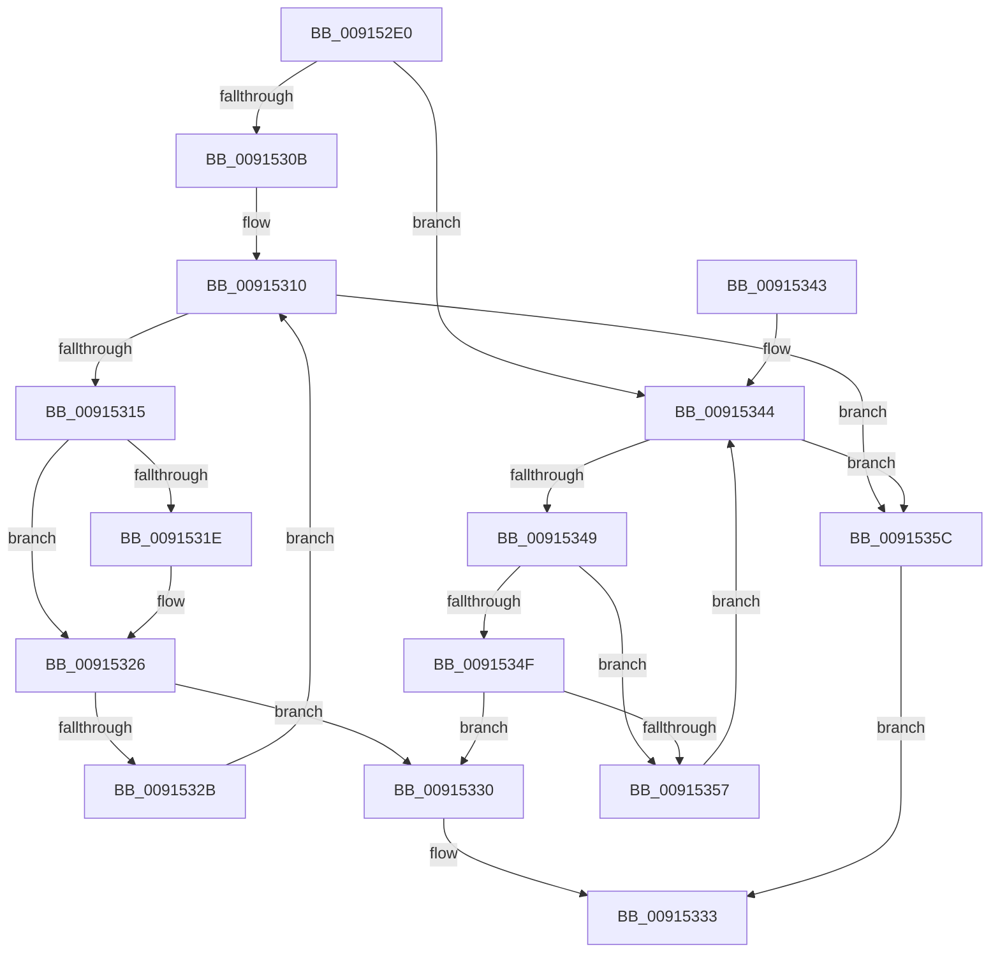

# PopFindPowerSettingConfiguration

- RVA: `0x009152E0`–`0x00915360` (길이 `128` bytes)
- VA: `0x00000001409152E0`
- 실행 섹션: `PAGE`
- PDB 이름 있음: `예`; PDB Function 태그: `아니요`
- unwind 정보 RVA: `0x0006F908`
- 디코드: `43`개 명령, `128/128` bytes 표시
- 미해석 바이트: `0` (있으면 어셈블리에 `.byte`로 보존)

> 이 문서는 커널 이미지의 기계어와 PDB 기호를 분석해 생성했습니다. 4번과 5번은 함수 원형과 자료형을 바이너리 사용 방식에서 추정한 C 해석이며 원본 소스 복구 결과는 아닙니다.

## 1. Dependencies

- 직접 호출 지점: **2**; 고유 호출 대상: **2**
- 직접 호출자로 확인된 함수: **7**
- RIP 상대 이미지 참조: **0**

### Outgoing calls
- `0x009152F4` → [PopGetListHead](PopGetListHead_function_00914DE4.md) (function, `0x00914DE4`)
- `0x00915302` → [PopStateIsSessionSpecific](PopStateIsSessionSpecific_function_0091529C.md) (function, `0x0091529C`)

### Direct callers
- [PopInitilizeAcDcSettings](../../text/48/PopInitilizeAcDcSettings_function_004828D0.md) at `0x0048293F`
- [PopGetPowerSettingValue](../../text/49/PopGetPowerSettingValue_function_0049C6CC.md) at `0x0049C700`
- [PopGetSettingValue](PopGetSettingValue_function_00913310.md) at `0x0091334E`
- [PopGetSettingNotificationName](PopGetSettingNotificationName_function_0091346C.md) at `0x00913507`
- [PopSetPowerSettingValue](PopSetPowerSettingValue_function_00914E54.md) at `0x00914EF7`
- [PoRegisterPowerSettingCallback](../A8/PoRegisterPowerSettingCallback_function_00A82150.md) at `0x00A822D1`
- [PopQueryPowerSettingUlong](../AC/PopQueryPowerSettingUlong_function_00ACCCC8.md) at `0x00ACCCFA`

### Static image references
- 디코드된 RIP-relative 메모리 참조가 없습니다.

## 2. Other-region calls and transfers

- 다른 실행 섹션으로 향하는 call: **0**
- 별도 외부 분기/꼬리 이동을 확인하지 못했습니다.

## 3. Assembly (complete function range)

```asm
009152E0  48 89 5C 24 08                  mov qword ptr [rsp + 8], rbx
009152E5  48 89 74 24 10                  mov qword ptr [rsp + 0x10], rsi
009152EA  57                              push rdi
009152EB  48 83 EC 20                     sub rsp, 0x20
009152EF  8B F2                           mov esi, edx
009152F1  48 8B D9                        mov rbx, rcx
009152F4  E8 EB FA FF FF                  call 0x140914de4
009152F9  48 8B CB                        mov rcx, rbx
009152FC  48 8B F8                        mov rdi, rax
009152FF  4C 8B 18                        mov r11, qword ptr [rax]
00915302  E8 95 FF FF FF                  call 0x14091529c
00915307  84 C0                           test al, al
00915309  75 39                           jne 0x140915344
0091530B  0F 1F 44 00 00                  nop dword ptr [rax + rax]
00915310  4C 3B DF                        cmp r11, rdi
00915313  74 47                           je 0x14091535c
00915315  49 8B 43 20                     mov rax, qword ptr [r11 + 0x20]
00915319  48 2B 03                        sub rax, qword ptr [rbx]
0091531C  75 08                           jne 0x140915326
0091531E  49 8B 43 28                     mov rax, qword ptr [r11 + 0x28]
00915322  48 2B 43 08                     sub rax, qword ptr [rbx + 8]
00915326  48 85 C0                        test rax, rax
00915329  74 05                           je 0x140915330
0091532B  4D 8B 1B                        mov r11, qword ptr [r11]
0091532E  EB E0                           jmp 0x140915310
00915330  49 8B C3                        mov rax, r11
00915333  48 8B 5C 24 30                  mov rbx, qword ptr [rsp + 0x30]
00915338  48 8B 74 24 38                  mov rsi, qword ptr [rsp + 0x38]
0091533D  48 83 C4 20                     add rsp, 0x20
00915341  5F                              pop rdi
00915342  C3                              ret
00915343  CC                              int3
00915344  4C 3B DF                        cmp r11, rdi
00915347  74 13                           je 0x14091535c
00915349  41 39 73 30                     cmp dword ptr [r11 + 0x30], esi
0091534D  75 08                           jne 0x140915357
0091534F  41 8B 43 34                     mov eax, dword ptr [r11 + 0x34]
00915353  A8 04                           test al, 4
00915355  74 D9                           je 0x140915330
00915357  4D 8B 1B                        mov r11, qword ptr [r11]
0091535A  EB E8                           jmp 0x140915344
0091535C  33 C0                           xor eax, eax
0091535E  EB D3                           jmp 0x140915333
```

## 4. C-style interpretation (structured pseudocode)

```c
__int64 __fastcall PopFindPowerSettingConfiguration(__int64 a1, int a2)
{
    __int64 result;
    __int64 v_rsp;
    unsigned __int64 v_stack_p10;
    unsigned __int64 v_stack_p8;

    v_stack_p8 = v_rbx;
    v_stack_p10 = v_rsi;
    v_rsp = (v_rsp) - (32);
    result = PopGetListHead(a1, a2, a3, a4);
    result = PopStateIsSessionSpecific(a1, a2, a3, a4);
    if ((unsigned __int8)(result) != 0) goto loc_00915344;
loc_00915310:
    if ((*(unsigned __int64 *)(result)) == result) goto loc_0091535C;
    result = (*(unsigned __int64 *)(*(unsigned __int64 *)(result) + 32)) - (*(unsigned __int64 *)(a1));
    if (!(condition_is_not_equal)) {
        result = *(unsigned __int64 *)(*(unsigned __int64 *)(result) + 40);
        result = (result) - (*(unsigned __int64 *)(a1 + 8));
    }
    if (result == 0) goto loc_00915330;
    goto loc_00915310;
loc_00915330:
loc_00915333:
    v_rsp = (v_rsp) + (32);
    return *(unsigned __int64 *)(*(unsigned __int64 *)(result));
loc_00915344:
    if ((*(unsigned __int64 *)(*(unsigned __int64 *)(result))) == result) goto loc_0091535C;
    if ((*(unsigned int *)(*(unsigned __int64 *)(*(unsigned __int64 *)(result)) + 48)) != ((unsigned int)(v_stack_p10))) goto loc_00915357;
    if ((((unsigned __int8)((unsigned int)(*(unsigned int *)(*(unsigned __int64 *)(*(unsigned __int64 *)(result)) + 52)))) & (4)) == 0) goto loc_00915330;
loc_00915357:
    goto loc_00915344;
loc_0091535C:
    result = 0;
    goto loc_00915333;
}
```

## 5. (Beta) C Style

```c
int64_t PopFindPowerSettingConfiguration(void *Arg1, int32_t Arg2)
{
    uint8_t *arg1 = (uint8_t *)Arg1;

    int64_t result;
    int64_t local_rsp;
    uint64_t v_stack_p10;
    uint64_t v_stack_p8;

    v_stack_p8 = local_rbx;
    v_stack_p10 = local_rsi;
    local_rsp = (local_rsp) - (32);
    result = PopGetListHead(Arg1, Arg2, a3, a4);
    result = PopStateIsSessionSpecific(Arg1, Arg2, a3, a4);
    if ((uint8_t)(result) != 0) goto loc_00915344;
loc_00915310:
    if ((*(uint64_t *)(result)) == result) goto loc_0091535C;
    result = (*(uint64_t *)(*(uint64_t *)(result) + 0x20)) - (*(uint64_t *)(arg1));
    if (!(condition_is_not_equal)) {
        result = *(uint64_t *)(*(uint64_t *)(result) + 0x28);
        result = (result) - (*(uint64_t *)(arg1 + 0x8));
    }
    if (result == 0) goto loc_00915330;
    goto loc_00915310;
loc_00915330:
loc_00915333:
    local_rsp = (local_rsp) + (32);
    return *(uint64_t *)(*(uint64_t *)(result));
loc_00915344:
    if ((*(uint64_t *)(*(uint64_t *)(result))) == result) goto loc_0091535C;
    if ((*(uint32_t *)(*(uint64_t *)(*(uint64_t *)(result)) + 0x30)) != ((uint32_t)(v_stack_p10))) goto loc_00915357;
    if ((((uint8_t)((uint32_t)(*(uint32_t *)(*(uint64_t *)(*(uint64_t *)(result)) + 0x34)))) & (4)) == 0) goto loc_00915330;
loc_00915357:
    goto loc_00915344;
loc_0091535C:
    result = 0;
    goto loc_00915333;
}
```

### 관측된 메모리 오프셋

구조체 형식이 확인되지 않은 접근은 인자 기준의 오프셋으로만 기록했습니다.

| 기준 인자 | 오프셋 표현 | 폭 (bit) | 접근 |
|---|---:|---:|---|
| `Arg1` | `+ 0x0` | `64` | `R` |
| `Arg1` | `+ 0x8` | `64` | `R` |

## 6. Execution-region graph

[열기: 2D/3D 그래프와 함수 탐색 컨트롤 패널](../../../control-panel.html?section=page&rva=0x009152E0&view=graph)

- 2D 그래프는 위에서 아래로 흐르고, 3D 그래프는 빈 공간을 드래그해 회전합니다. Shift+드래그는 이동, 휠은 확대·축소, 함수 노드 선택은 대상 보고서 이동입니다.

### Static fallback


