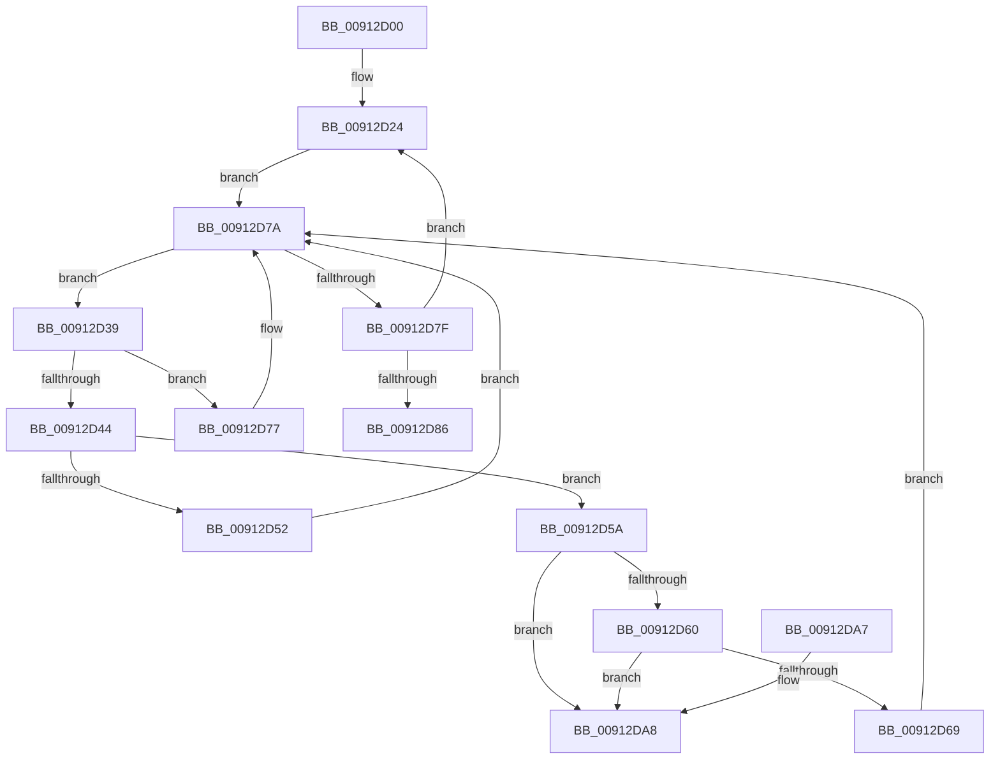

# PopFreeSessionState

- RVA: `0x00912D00`–`0x00912DAF` (길이 `175` bytes)
- VA: `0x0000000140912D00`
- 실행 섹션: `PAGE`
- PDB 이름 있음: `예`; PDB Function 태그: `아니요`
- unwind 정보 RVA: `0x00069AD0`
- 디코드: `53`개 명령, `175/175` bytes 표시
- 미해석 바이트: `0` (있으면 어셈블리에 `.byte`로 보존)

> 이 문서는 커널 이미지의 기계어와 PDB 기호를 분석해 생성했습니다. 4번과 5번은 함수 원형과 자료형을 바이너리 사용 방식에서 추정한 C 해석이며 원본 소스 복구 결과는 아닙니다.

## 1. Dependencies

- 직접 호출 지점: **3**; 고유 호출 대상: **3**
- 직접 호출자로 확인된 함수: **1**
- RIP 상대 이미지 참조: **2**

### Outgoing calls
- `0x00912D1D` → [ExAcquireFastMutex](../../text/20/ExAcquireFastMutex_function_0020E5A0.md) (function, `0x0020E5A0`)
- `0x00912D70` → [PopFreeRegistration](../75/PopFreeRegistration_function_0075C484.md) (function, `0x0075C484`)
- `0x00912D8D` → [ExReleaseFastMutex](../../text/25/ExReleaseFastMutex_function_002519C0.md) (function, `0x002519C0`)

### Direct callers
- [NtPowerInformation](../95/NtPowerInformation_function_00955D80.md) at `0x0095754A`

### Static image references
- `0x00912D16` → RVA `0x00F0DF40` (`.data`; read)
- `0x00912D26` → RVA `0x00F0C6C0` (`.data`; read)

## 2. Other-region calls and transfers

- 다른 실행 섹션으로 향하는 call: **2**
  - `0x00912D1D` → [ExAcquireFastMutex](../../text/20/ExAcquireFastMutex_function_0020E5A0.md) (`PAGE` → `.text`)
  - `0x00912D8D` → [ExReleaseFastMutex](../../text/25/ExReleaseFastMutex_function_002519C0.md) (`PAGE` → `.text`)
- 별도 외부 분기/꼬리 이동을 확인하지 못했습니다.

## 3. Assembly (complete function range)

```asm
00912D00  48 89 5C 24 08                  mov qword ptr [rsp + 8], rbx
00912D05  48 89 6C 24 10                  mov qword ptr [rsp + 0x10], rbp
00912D0A  48 89 74 24 18                  mov qword ptr [rsp + 0x18], rsi
00912D0F  57                              push rdi
00912D10  48 83 EC 20                     sub rsp, 0x20
00912D14  8B E9                           mov ebp, ecx
00912D16  48 8D 0D 23 B2 5F 00            lea rcx, [rip + 0x5fb223]
00912D1D  E8 7E B8 8F FF                  call 0x14020e5a0
00912D22  33 F6                           xor esi, esi
00912D24  8B FE                           mov edi, esi
00912D26  48 8D 05 93 99 5F 00            lea rax, [rip + 0x5f9993]
00912D2D  48 C1 E7 04                     shl rdi, 4
00912D31  48 03 F8                        add rdi, rax
00912D34  48 8B 1F                        mov rbx, qword ptr [rdi]
00912D37  EB 41                           jmp 0x140912d7a
00912D39  48 8B CB                        mov rcx, rbx
00912D3C  48 8B 13                        mov rdx, qword ptr [rbx]
00912D3F  39 6B 30                        cmp dword ptr [rbx + 0x30], ebp
00912D42  75 33                           jne 0x140912d77
00912D44  4C 8D 43 34                     lea r8, [rbx + 0x34]
00912D48  48 8B DA                        mov rbx, rdx
00912D4B  41 8B 00                        mov eax, dword ptr [r8]
00912D4E  A8 02                           test al, 2
00912D50  74 08                           je 0x140912d5a
00912D52  83 C8 04                        or eax, 4
00912D55  41 89 00                        mov dword ptr [r8], eax
00912D58  EB 20                           jmp 0x140912d7a
00912D5A  48 39 4A 08                     cmp qword ptr [rdx + 8], rcx
00912D5E  75 48                           jne 0x140912da8
00912D60  48 8B 41 08                     mov rax, qword ptr [rcx + 8]
00912D64  48 39 08                        cmp qword ptr [rax], rcx
00912D67  75 3F                           jne 0x140912da8
00912D69  48 89 10                        mov qword ptr [rax], rdx
00912D6C  48 89 42 08                     mov qword ptr [rdx + 8], rax
00912D70  E8 0F 97 E4 FF                  call 0x14075c484
00912D75  EB 03                           jmp 0x140912d7a
00912D77  48 8B DA                        mov rbx, rdx
00912D7A  48 3B DF                        cmp rbx, rdi
00912D7D  75 BA                           jne 0x140912d39
00912D7F  FF C6                           inc esi
00912D81  83 FE 02                        cmp esi, 2
00912D84  72 9E                           jb 0x140912d24
00912D86  48 8D 0D B3 B1 5F 00            lea rcx, [rip + 0x5fb1b3]
00912D8D  E8 2E EC 93 FF                  call 0x1402519c0
00912D92  48 8B 5C 24 30                  mov rbx, qword ptr [rsp + 0x30]
00912D97  48 8B 6C 24 38                  mov rbp, qword ptr [rsp + 0x38]
00912D9C  48 8B 74 24 40                  mov rsi, qword ptr [rsp + 0x40]
00912DA1  48 83 C4 20                     add rsp, 0x20
00912DA5  5F                              pop rdi
00912DA6  C3                              ret
00912DA7  CC                              int3
00912DA8  B9 03 00 00 00                  mov ecx, 3
00912DAD  CD 29                           int 0x29
```

## 4. C-style interpretation (structured pseudocode)

```c
__int64 __fastcall PopFreeSessionState(int a1)
{
    __int64 result;
    __int64 v_rdi;
    __int64 v_rsi;
    __int64 v_rsp;
    unsigned __int64 v_stack_p10;
    unsigned __int64 v_stack_p18;
    unsigned __int64 v_stack_p8;

    v_stack_p8 = v_rbx;
    v_stack_p10 = v_rbp;
    v_stack_p18 = v_rsi;
    v_rsp = (v_rsp) - (32);
    result = ExAcquireFastMutex(v_rip + 6271523, a2, a3, a4);
    v_rsi = 0;
loc_00912D24:
    v_rdi = (0) << (4);
    v_rdi = (v_rdi) + (v_rip + 6265235);
    goto loc_00912D7A;
loc_00912D39:
    if ((*(unsigned int *)(*(unsigned __int64 *)(v_rdi) + 48)) != ((unsigned int)((unsigned int)(a1)))) goto loc_00912D77;
    if ((((unsigned __int8)((unsigned int)(*(unsigned int *)(*(unsigned __int64 *)(v_rdi) + 52)))) & (2)) == 0) goto loc_00912D5A;
    result = (unsigned int)(((unsigned int)(*(unsigned int *)(*(unsigned __int64 *)(v_rdi) + 52))) | (4));
    *(unsigned int *)(*(unsigned __int64 *)(v_rdi) + 52) = (unsigned int)(result);
    goto loc_00912D7A;
loc_00912D5A:
    if ((*(unsigned __int64 *)(*(unsigned __int64 *)(*(unsigned __int64 *)(v_rdi)) + 8)) != (*(unsigned __int64 *)(v_rdi))) goto loc_00912DA8;
    if ((*(unsigned __int64 *)(*(unsigned __int64 *)(*(unsigned __int64 *)(v_rdi) + 8))) != (*(unsigned __int64 *)(v_rdi))) goto loc_00912DA8;
    *(unsigned __int64 *)(*(unsigned __int64 *)(*(unsigned __int64 *)(v_rdi) + 8)) = *(unsigned __int64 *)(*(unsigned __int64 *)(v_rdi));
    *(unsigned __int64 *)(*(unsigned __int64 *)(*(unsigned __int64 *)(v_rdi)) + 8) = *(unsigned __int64 *)(*(unsigned __int64 *)(v_rdi) + 8);
    result = PopFreeRegistration(*(unsigned __int64 *)(v_rdi), *(unsigned __int64 *)(*(unsigned __int64 *)(v_rdi)), *(unsigned __int64 *)(v_rdi) + 52, a4);
    goto loc_00912D7A;
loc_00912D77:
loc_00912D7A:
    if ((*(unsigned __int64 *)(*(unsigned __int64 *)(v_rdi))) != v_rdi) goto loc_00912D39;
    v_rsi = (unsigned int)((v_rsi) + 1);
    if (((unsigned int)(v_rsi)) < 2) goto loc_00912D24;
    result = ExReleaseFastMutex(v_rip + 6271411, *(unsigned __int64 *)(*(unsigned __int64 *)(v_rdi)), *(unsigned __int64 *)(v_rdi) + 52, a4);
    v_rsp = (v_rsp) + (32);
    return result;
loc_00912DA8:
    return result;
}
```

## 5. (Beta) C Style

```c
int64_t PopFreeSessionState(int32_t Arg1)
{
    int64_t result;
    int64_t local_rdi;
    int64_t local_rsi;
    int64_t local_rsp;
    uint64_t v_stack_p10;
    uint64_t v_stack_p18;
    uint64_t v_stack_p8;

    v_stack_p8 = local_rbx;
    v_stack_p10 = local_rbp;
    v_stack_p18 = local_rsi;
    local_rsp = (local_rsp) - (32);
    result = ExAcquireFastMutex(v_rip + 6271523, a2, a3, a4);
    local_rsi = 0;
loc_00912D24:
    local_rdi = (0) << (4);
    local_rdi = (local_rdi) + (v_rip + 6265235);
    goto loc_00912D7A;
loc_00912D39:
    if ((*(uint32_t *)(*(uint64_t *)(local_rdi) + 0x30)) != ((uint32_t)((uint32_t)(Arg1)))) goto loc_00912D77;
    if ((((uint8_t)((uint32_t)(*(uint32_t *)(*(uint64_t *)(local_rdi) + 0x34)))) & (2)) == 0) goto loc_00912D5A;
    result = (uint32_t)(((uint32_t)(*(uint32_t *)(*(uint64_t *)(local_rdi) + 0x34))) | (4));
    *(uint32_t *)(*(uint64_t *)(local_rdi) + 0x34) = (uint32_t)(result);
    goto loc_00912D7A;
loc_00912D5A:
    if ((*(uint64_t *)(*(uint64_t *)(*(uint64_t *)(local_rdi)) + 0x8)) != (*(uint64_t *)(local_rdi))) goto loc_00912DA8;
    if ((*(uint64_t *)(*(uint64_t *)(*(uint64_t *)(local_rdi) + 0x8))) != (*(uint64_t *)(local_rdi))) goto loc_00912DA8;
    *(uint64_t *)(*(uint64_t *)(*(uint64_t *)(local_rdi) + 0x8)) = *(uint64_t *)(*(uint64_t *)(local_rdi));
    *(uint64_t *)(*(uint64_t *)(*(uint64_t *)(local_rdi)) + 0x8) = *(uint64_t *)(*(uint64_t *)(local_rdi) + 0x8);
    result = PopFreeRegistration(*(uint64_t *)(local_rdi), *(uint64_t *)(*(uint64_t *)(local_rdi)), *(uint64_t *)(local_rdi) + 52, a4);
    goto loc_00912D7A;
loc_00912D77:
loc_00912D7A:
    if ((*(uint64_t *)(*(uint64_t *)(local_rdi))) != local_rdi) goto loc_00912D39;
    local_rsi = (uint32_t)((local_rsi) + 1);
    if (((uint32_t)(local_rsi)) < 2) goto loc_00912D24;
    result = ExReleaseFastMutex(v_rip + 6271411, *(uint64_t *)(*(uint64_t *)(local_rdi)), *(uint64_t *)(local_rdi) + 52, a4);
    local_rsp = (local_rsp) + (32);
    return result;
loc_00912DA8:
    return result;
}
```

## 6. Execution-region graph

[열기: 2D/3D 그래프와 함수 탐색 컨트롤 패널](../../../control-panel.html?section=page&rva=0x00912D00&view=graph)

- 2D 그래프는 위에서 아래로 흐르고, 3D 그래프는 빈 공간을 드래그해 회전합니다. Shift+드래그는 이동, 휠은 확대·축소, 함수 노드 선택은 대상 보고서 이동입니다.

### Static fallback


