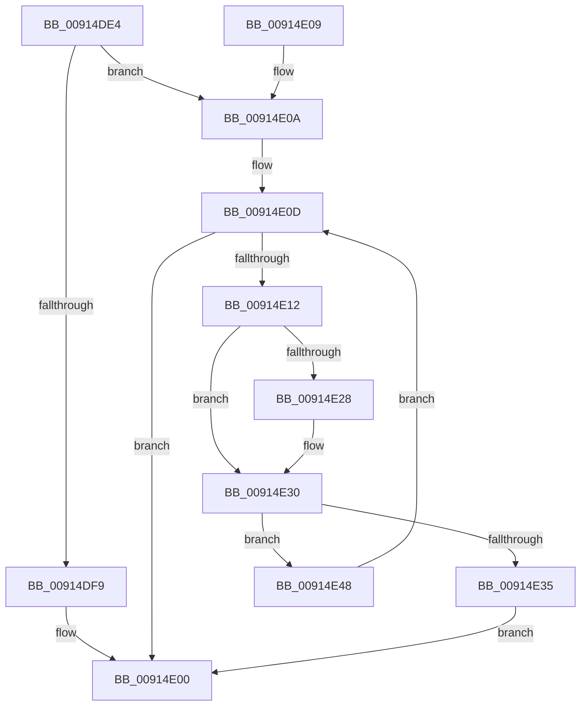

# PopGetListHead

- RVA: `0x00914DE4`–`0x00914E4C` (길이 `104` bytes)
- VA: `0x0000000140914DE4`
- 실행 섹션: `PAGE`
- PDB 이름 있음: `예`; PDB Function 태그: `아니요`
- unwind 정보 RVA: `0x0008A688`
- 디코드: `33`개 명령, `104/104` bytes 표시
- 미해석 바이트: `0` (있으면 어셈블리에 `.byte`로 보존)

> 이 문서는 커널 이미지의 기계어와 PDB 기호를 분석해 생성했습니다. 4번과 5번은 함수 원형과 자료형을 바이너리 사용 방식에서 추정한 C 해석이며 원본 소스 복구 결과는 아닙니다.

## 1. Dependencies

- 직접 호출 지점: **1**; 고유 호출 대상: **1**
- 직접 호출자로 확인된 함수: **2**
- RIP 상대 이미지 참조: **3**

### Outgoing calls
- `0x00914DF0` → [PopStateIsSessionSpecific](PopStateIsSessionSpecific_function_0091529C.md) (function, `0x0091529C`)

### Direct callers
- [PopSetPowerSettingValue](PopSetPowerSettingValue_function_00914E54.md) at `0x00915170`
- [PopFindPowerSettingConfiguration](PopFindPowerSettingConfiguration_function_009152E0.md) at `0x009152F4`

### Static image references
- `0x00914DF9` → RVA `0x00F0C6A0` (`.data`; read)
- `0x00914E15` → RVA `0x0000B410` (`.rdata`; read)
- `0x00914E38` → RVA `0x00F0C6C0` (`.data`; read)

## 2. Other-region calls and transfers

- 다른 실행 섹션으로 향하는 call: **0**
- 별도 외부 분기/꼬리 이동을 확인하지 못했습니다.

## 3. Assembly (complete function range)

```asm
00914DE4  40 53                           push rbx
00914DE6  48 83 EC 20                     sub rsp, 0x20
00914DEA  48 8B D9                        mov rbx, rcx
00914DED  45 33 DB                        xor r11d, r11d
00914DF0  E8 A7 04 00 00                  call 0x14091529c
00914DF5  84 C0                           test al, al
00914DF7  75 11                           jne 0x140914e0a
00914DF9  4C 8D 1D A0 78 5F 00            lea r11, [rip + 0x5f78a0]
00914E00  49 8B C3                        mov rax, r11
00914E03  48 83 C4 20                     add rsp, 0x20
00914E07  5B                              pop rbx
00914E08  C3                              ret
00914E09  CC                              int3
00914E0A  41 8B CB                        mov ecx, r11d
00914E0D  83 F9 02                        cmp ecx, 2
00914E10  73 EE                           jae 0x140914e00
00914E12  44 8B C1                        mov r8d, ecx
00914E15  4C 8D 0D F4 65 6F FF            lea r9, [rip - 0x909a0c]
00914E1C  4F 8B 0C C1                     mov r9, qword ptr [r9 + r8*8]
00914E20  49 8B 11                        mov rdx, qword ptr [r9]
00914E23  48 2B 13                        sub rdx, qword ptr [rbx]
00914E26  75 08                           jne 0x140914e30
00914E28  49 8B 51 08                     mov rdx, qword ptr [r9 + 8]
00914E2C  48 2B 53 08                     sub rdx, qword ptr [rbx + 8]
00914E30  48 85 D2                        test rdx, rdx
00914E33  75 13                           jne 0x140914e48
00914E35  4D 8B D8                        mov r11, r8
00914E38  48 8D 05 81 78 5F 00            lea rax, [rip + 0x5f7881]
00914E3F  49 C1 E3 04                     shl r11, 4
00914E43  4C 03 D8                        add r11, rax
00914E46  EB B8                           jmp 0x140914e00
00914E48  FF C1                           inc ecx
00914E4A  EB C1                           jmp 0x140914e0d
```

## 4. C-style interpretation (structured pseudocode)

```c
__int64 __fastcall PopGetListHead(__int64 a1)
{
    __int64 result;
    __int64 v_r11;
    __int64 v_rsp;

    v_rsp = (v_rsp) - (32);
    v_r11 = 0;
    result = PopStateIsSessionSpecific(a1, a2, a3, a4);
    if ((unsigned __int8)(result) != 0) goto loc_00914E0A;
loc_00914E00:
    v_rsp = (v_rsp) + (32);
    return v_rip + 6256800;
loc_00914E0A:
loc_00914E0D:
    if (((unsigned int)((unsigned int)((unsigned int)(v_rip + 6256800)))) >= 2) goto loc_00914E00;
    a2 = (*(unsigned __int64 *)(*(unsigned __int64 *)(v_rip - 9476620 + (unsigned int)((unsigned int)((unsigned int)((unsigned int)(v_rip + 6256800)))) * 8))) - (*(unsigned __int64 *)(a1));
    if (!(condition_is_not_equal)) {
        a2 = *(unsigned __int64 *)(*(unsigned __int64 *)(v_rip - 9476620 + (unsigned int)((unsigned int)((unsigned int)((unsigned int)(v_rip + 6256800)))) * 8) + 8);
        a2 = (a2) - (*(unsigned __int64 *)(a1 + 8));
    }
    if (a2 != 0) goto loc_00914E48;
    v_r11 = ((unsigned int)((unsigned int)((unsigned int)((unsigned int)(v_rip + 6256800))))) << (4);
    v_r11 = (v_r11) + (v_rip + 6256769);
    goto loc_00914E00;
loc_00914E48:
    a1 = (unsigned int)(((unsigned int)((unsigned int)(v_rip + 6256800))) + 1);
    goto loc_00914E0D;
}
```

## 5. (Beta) C Style

```c
int64_t PopGetListHead(void *Arg1)
{
    uint8_t *arg1 = (uint8_t *)Arg1;

    int64_t result;
    int64_t local_r11;
    int64_t local_rsp;

    local_rsp = (local_rsp) - (32);
    local_r11 = 0;
    result = PopStateIsSessionSpecific(Arg1, a2, a3, a4);
    if ((uint8_t)(result) != 0) goto loc_00914E0A;
loc_00914E00:
    local_rsp = (local_rsp) + (32);
    return v_rip + 6256800;
loc_00914E0A:
loc_00914E0D:
    if (((uint32_t)((uint32_t)((uint32_t)(v_rip + 6256800)))) >= 2) goto loc_00914E00;
    a2 = (*(uint64_t *)(*(uint64_t *)(v_rip - 0x909A0C + (uint32_t)((uint32_t)((uint32_t)((uint32_t)(v_rip + 0x5F78A0)))) * 8))) - (*(uint64_t *)(arg1));
    if (!(condition_is_not_equal)) {
        a2 = *(uint64_t *)(*(uint64_t *)(v_rip - 0x909A0C + (uint32_t)((uint32_t)((uint32_t)((uint32_t)(v_rip + 0x5F78A0)))) * 8) + 0x8);
        a2 = (a2) - (*(uint64_t *)(arg1 + 0x8));
    }
    if (a2 != 0) goto loc_00914E48;
    local_r11 = ((uint32_t)((uint32_t)((uint32_t)((uint32_t)(v_rip + 6256800))))) << (4);
    local_r11 = (local_r11) + (v_rip + 6256769);
    goto loc_00914E00;
loc_00914E48:
    Arg1 = (uint32_t)(((uint32_t)((uint32_t)(v_rip + 6256800))) + 1);
    goto loc_00914E0D;
}
```

### 관측된 메모리 오프셋

구조체 형식이 확인되지 않은 접근은 인자 기준의 오프셋으로만 기록했습니다.

| 기준 인자 | 오프셋 표현 | 폭 (bit) | 접근 |
|---|---:|---:|---|
| `Arg1` | `+ 0x0` | `64` | `R` |
| `Arg1` | `+ 0x8` | `64` | `R` |

## 6. Execution-region graph

[열기: 2D/3D 그래프와 함수 탐색 컨트롤 패널](../../../control-panel.html?section=page&rva=0x00914DE4&view=graph)

- 2D 그래프는 위에서 아래로 흐르고, 3D 그래프는 빈 공간을 드래그해 회전합니다. Shift+드래그는 이동, 휠은 확대·축소, 함수 노드 선택은 대상 보고서 이동입니다.

### Static fallback


