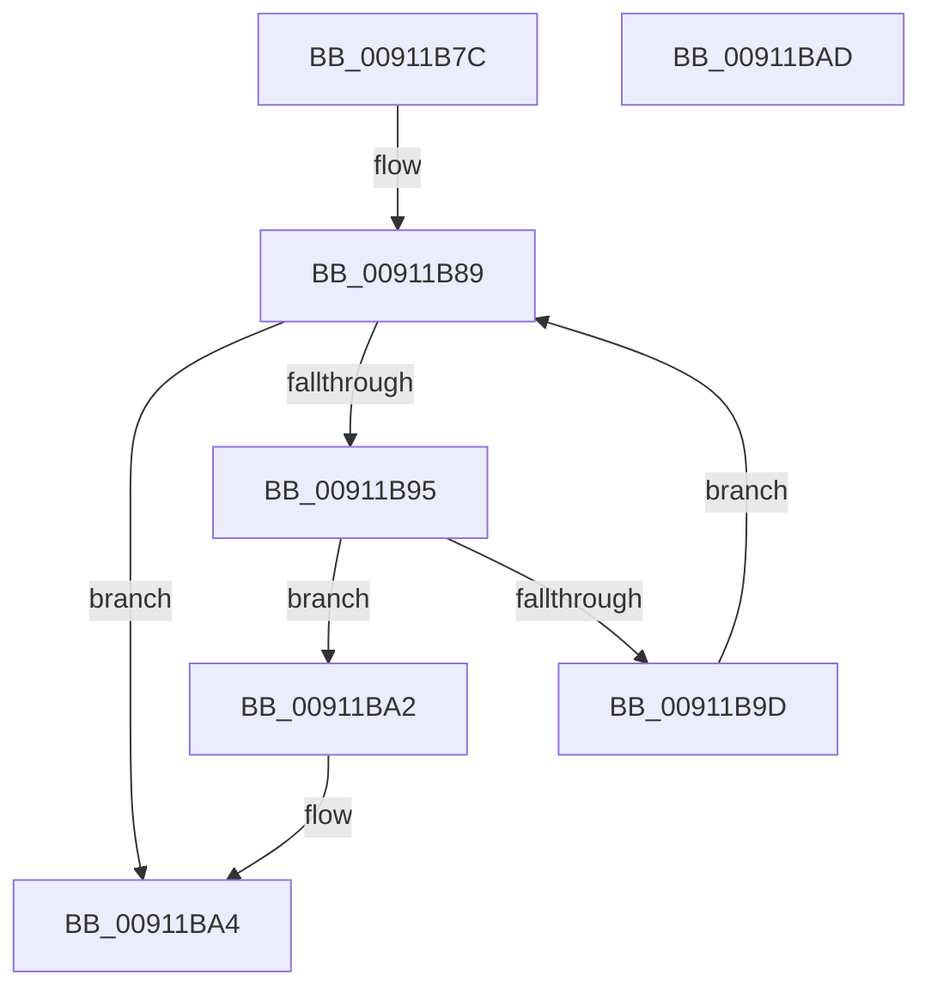

# PopGetReasonListByReasonCode

- RVA: `0x00911B7C`–`0x00911BAE` (길이 `50` bytes)
- VA: `0x0000000140911B7C`
- 실행 섹션: `PAGE`
- PDB 이름 있음: `예`; PDB Function 태그: `아니요`
- unwind 정보 RVA: `0x000DB714`
- 디코드: `17`개 명령, `50/50` bytes 표시
- 미해석 바이트: `0` (있으면 어셈블리에 `.byte`로 보존)

> 이 문서는 커널 이미지의 기계어와 PDB 기호를 분석해 생성했습니다. 4번과 5번은 함수 원형과 자료형을 바이너리 사용 방식에서 추정한 C 해석이며 원본 소스 복구 결과는 아닙니다.

## 1. Dependencies

- 직접 호출 지점: **0**; 고유 호출 대상: **0**
- 직접 호출자로 확인된 함수: **4**
- RIP 상대 이미지 참조: **1**

### Outgoing calls
- 직접 디코드된 call 명령이 없습니다.

### Direct callers
- [PopCheckDisabledReason](PopCheckDisabledReason_function_009102A0.md) at `0x009102A7`
- [PopLogSleepDisabled](PopLogSleepDisabled_function_009102D8.md) at `0x009102FB`
- [PopFilterCapabilities](PopFilterCapabilities_function_0091141C.md) at `0x00911616`
- [PopFilterCapabilities](PopFilterCapabilities_function_0091141C.md) at `0x00911629`
- [PopRemoveReasonRecordByReasonCode](PopRemoveReasonRecordByReasonCode_function_00911B30.md) at `0x00911B34`

### Static image references
- `0x00911B7C` → RVA `0x00F0CBB0` (`.data`; read)

## 2. Other-region calls and transfers

- 다른 실행 섹션으로 향하는 call: **0**
- 별도 외부 분기/꼬리 이동을 확인하지 못했습니다.

## 3. Assembly (complete function range)

```asm
00911B7C  48 8B 05 2D B0 5F 00            mov rax, qword ptr [rip + 0x5fb02d]
00911B83  45 33 C0                        xor r8d, r8d
00911B86  41 8A D0                        mov dl, r8b
00911B89  4C 8D 0D 20 B0 5F 00            lea r9, [rip + 0x5fb020]
00911B90  49 3B C1                        cmp rax, r9
00911B93  74 0F                           je 0x140911ba4
00911B95  4C 8B C0                        mov r8, rax
00911B98  39 48 18                        cmp dword ptr [rax + 0x18], ecx
00911B9B  74 05                           je 0x140911ba2
00911B9D  48 8B 00                        mov rax, qword ptr [rax]
00911BA0  EB E7                           jmp 0x140911b89
00911BA2  B2 01                           mov dl, 1
00911BA4  F6 DA                           neg dl
00911BA6  48 1B C0                        sbb rax, rax
00911BA9  49 23 C0                        and rax, r8
00911BAC  C3                              ret
00911BAD  CC                              int3
```

## 4. C-style interpretation (structured pseudocode)

```c
__int64 __fastcall PopGetReasonListByReasonCode(int a1, __int64 a2, int a3)
{
    __int64 result;

    a3 = 0;
loc_00911B89:
    if ((*(unsigned __int64 *)(v_rip + 6271021)) == (v_rip + 6271008)) goto loc_00911BA4;
    if ((*(unsigned int *)(*(unsigned __int64 *)(v_rip + 6271021) + 24)) == a1) goto loc_00911BA2;
    goto loc_00911B89;
loc_00911BA2:
loc_00911BA4:
    a2 = (unsigned __int8)(-(1));
    result = (*(unsigned __int64 *)(*(unsigned __int64 *)(v_rip + 6271021))) & (*(unsigned __int64 *)(v_rip + 6271021));
    return result;
}
```

## 5. (Beta) C Style

```c
int64_t PopGetReasonListByReasonCode(int32_t Arg1, int64_t Arg2, int32_t Arg3)
{
    int64_t result;

    Arg3 = 0;
loc_00911B89:
    if ((*(uint64_t *)(v_rip + 0x5FB02D)) == (v_rip + 6271008)) goto loc_00911BA4;
    if ((*(uint32_t *)(*(uint64_t *)(v_rip + 0x5FB02D) + 0x18)) == Arg1) goto loc_00911BA2;
    goto loc_00911B89;
loc_00911BA2:
loc_00911BA4:
    Arg2 = (uint8_t)(-(1));
    result = (*(uint64_t *)(*(uint64_t *)(v_rip + 0x5FB02D))) & (*(uint64_t *)(v_rip + 0x5FB02D));
    return result;
}
```

## 6. Execution-region graph

[열기: 2D/3D 그래프와 함수 탐색 컨트롤 패널](../../../control-panel.html?section=page&rva=0x00911B7C&view=graph)

- 2D 그래프는 위에서 아래로 흐르고, 3D 그래프는 빈 공간을 드래그해 회전합니다. Shift+드래그는 이동, 휠은 확대·축소, 함수 노드 선택은 대상 보고서 이동입니다.

### Static fallback


