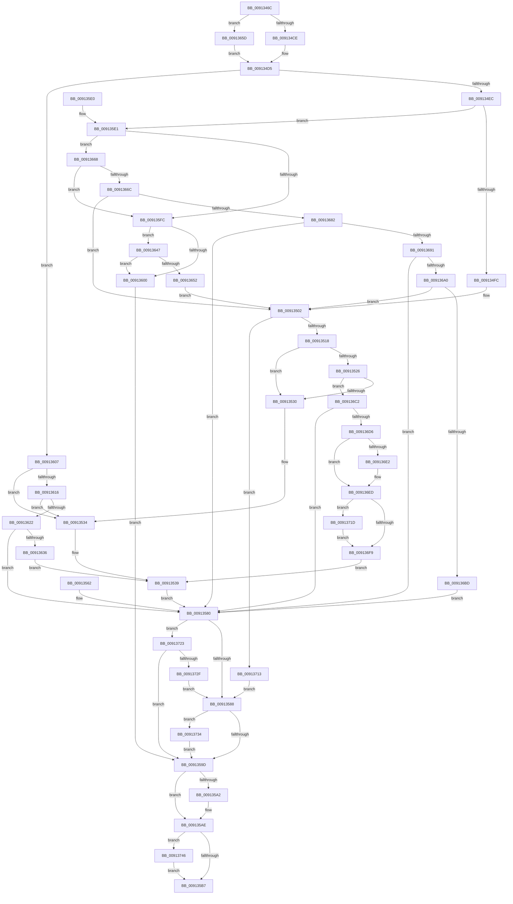

# PopGetSettingNotificationName

- RVA: `0x0091346C`–`0x00913755` (길이 `745` bytes)
- VA: `0x000000014091346C`
- 실행 섹션: `PAGE`
- PDB 이름 있음: `예`; PDB Function 태그: `아니요`
- unwind 정보 RVA: `0x0008A478`
- 디코드: `188`개 명령, `745/745` bytes 표시
- 미해석 바이트: `0` (있으면 어셈블리에 `.byte`로 보존)

> 이 문서는 커널 이미지의 기계어와 PDB 기호를 분석해 생성했습니다. 4번과 5번은 함수 원형과 자료형을 바이너리 사용 방식에서 추정한 C 해석이며 원본 소스 복구 결과는 아닙니다.

## 1. Dependencies

- 직접 호출 지점: **18**; 고유 호출 대상: **14**
- 직접 호출자로 확인된 함수: **1**
- RIP 상대 이미지 참조: **9**

### Outgoing calls
- `0x009134B7` → [ExAcquireFastMutex](../../text/20/ExAcquireFastMutex_function_0020E5A0.md) (function, `0x0020E5A0`)
- `0x009134EF` → [PopStateIsSessionSpecific](PopStateIsSessionSpecific_function_0091529C.md) (function, `0x0091529C`)
- `0x00913507` → [PopFindPowerSettingConfiguration](PopFindPowerSettingConfiguration_function_009152E0.md) (function, `0x009152E0`)
- `0x00913540` → [ExReleaseFastMutex](../../text/25/ExReleaseFastMutex_function_002519C0.md) (function, `0x002519C0`)
- `0x00913588` → [PsGetCurrentSilo](../../text/40/PsGetCurrentSilo_function_004094A0.md) (function, `0x004094A0`)
- `0x00913590` → [PsIsHostSilo](../../text/44/PsIsHostSilo_function_00443B30.md) (function, `0x00443B30`)
- `0x009135A9` → [ExReleaseFastMutex](../../text/25/ExReleaseFastMutex_function_002519C0.md) (function, `0x002519C0`)
- `0x009135C1` → [_security_check_cookie](../../text/6A/_security_check_cookie_function_006AC640.md) (function, `0x006AC640`)
- `0x009135F1` → [PsGetProcessSessionIdEx](../../text/22/PsGetProcessSessionIdEx_function_0022F8F0.md) (function, `0x0022F8F0`)
- `0x00913627` → [PopCreateNotificationName](PopCreateNotificationName_function_009121E8.md) (function, `0x009121E8`)
- `0x00913649` → [PsIsServiceSession](PsIsServiceSession_function_00912FE4.md) (function, `0x00912FE4`)
- `0x00913673` → [PopValidateContextMembership](PopValidateContextMembership_function_009129AC.md) (function, `0x009129AC`)
- `0x00913684` → [PsIsServiceSession](PsIsServiceSession_function_00912FE4.md) (function, `0x00912FE4`)
- `0x00913693` → [PsIsSessionInCurrentServerSilo](../../text/5E/PsIsSessionInCurrentServerSilo_function_005E4FE8.md) (function, `0x005E4FE8`)
- `0x009136AE` → [PopValidateContextMembership](PopValidateContextMembership_function_009129AC.md) (function, `0x009129AC`)
- `0x009136C7` → [PopCreateNotificationName](PopCreateNotificationName_function_009121E8.md) (function, `0x009121E8`)
- `0x0091373C` → [PopDiagTracePowerSettingRegistration](../AA/PopDiagTracePowerSettingRegistration_function_00AA2968.md) (function, `0x00AA2968`)
- `0x0091374B` → [PopSetNotificationWork](../../text/48/PopSetNotificationWork_function_00482C78.md) (function, `0x00482C78`)

### Direct callers
- [NtPowerInformation](../95/NtPowerInformation_function_00955D80.md) at `0x009574F4`

### Static image references
- `0x00913483` → RVA `0x00E0A740` (`.data`; read)
- `0x009134B0` → RVA `0x00F0DF40` (`.data`; read)
- `0x00913607` → RVA `0x00E676D8` (`.data`; read)
- `0x00913616` → RVA `0x00E676DC` (`.data`; read)
- `0x0091363B` → RVA `0x00E676D8` (`.data`; write)
- `0x0091366C` → RVA `0x00E67D58` (`.data`; read)
- `0x009136A0` → RVA `0x00FD9AA0` (`PAGEDATA`; read)
- `0x009136D9` → RVA `0x0001A610` (`.rdata`; read)
- `0x009136E6` → RVA `0x0001A618` (`.rdata`; read)

## 2. Other-region calls and transfers

- 다른 실행 섹션으로 향하는 call: **9**
  - `0x009134B7` → [ExAcquireFastMutex](../../text/20/ExAcquireFastMutex_function_0020E5A0.md) (`PAGE` → `.text`)
  - `0x00913540` → [ExReleaseFastMutex](../../text/25/ExReleaseFastMutex_function_002519C0.md) (`PAGE` → `.text`)
  - `0x00913588` → [PsGetCurrentSilo](../../text/40/PsGetCurrentSilo_function_004094A0.md) (`PAGE` → `.text`)
  - `0x00913590` → [PsIsHostSilo](../../text/44/PsIsHostSilo_function_00443B30.md) (`PAGE` → `.text`)
  - `0x009135A9` → [ExReleaseFastMutex](../../text/25/ExReleaseFastMutex_function_002519C0.md) (`PAGE` → `.text`)
  - `0x009135C1` → [_security_check_cookie](../../text/6A/_security_check_cookie_function_006AC640.md) (`PAGE` → `.text`)
  - `0x009135F1` → [PsGetProcessSessionIdEx](../../text/22/PsGetProcessSessionIdEx_function_0022F8F0.md) (`PAGE` → `.text`)
  - `0x00913693` → [PsIsSessionInCurrentServerSilo](../../text/5E/PsIsSessionInCurrentServerSilo_function_005E4FE8.md) (`PAGE` → `.text`)
  - `0x0091374B` → [PopSetNotificationWork](../../text/48/PopSetNotificationWork_function_00482C78.md) (`PAGE` → `.text`)
- 별도 외부 분기/꼬리 이동을 확인하지 못했습니다.

## 3. Assembly (complete function range)

```asm
0091346C  48 89 5C 24 18                  mov qword ptr [rsp + 0x18], rbx
00913471  48 89 74 24 20                  mov qword ptr [rsp + 0x20], rsi
00913476  57                              push rdi
00913477  41 54                           push r12
00913479  41 55                           push r13
0091347B  41 56                           push r14
0091347D  41 57                           push r15
0091347F  48 83 EC 50                     sub rsp, 0x50
00913483  48 8B 05 B6 72 4F 00            mov rax, qword ptr [rip + 0x4f72b6]
0091348A  48 33 C4                        xor rax, rsp
0091348D  48 89 44 24 48                  mov qword ptr [rsp + 0x48], rax
00913492  48 89 54 24 30                  mov qword ptr [rsp + 0x30], rdx
00913497  48 8B F9                        mov rdi, rcx
0091349A  48 83 64 24 40 00               and qword ptr [rsp + 0x40], 0
009134A0  45 32 E4                        xor r12b, r12b
009134A3  44 88 64 24 20                  mov byte ptr [rsp + 0x20], r12b
009134A8  45 32 ED                        xor r13b, r13b
009134AB  44 88 6C 24 21                  mov byte ptr [rsp + 0x21], r13b
009134B0  48 8D 0D 89 AA 5F 00            lea rcx, [rip + 0x5faa89]
009134B7  E8 E4 B0 8F FF                  call 0x14020e5a0
009134BC  41 BE 01 00 00 00               mov r14d, 1
009134C2  83 CB FF                        or ebx, 0xffffffff
009134C5  48 85 FF                        test rdi, rdi
009134C8  0F 84 8F 01 00 00               je 0x14091365d
009134CE  8B 77 10                        mov esi, dword ptr [rdi + 0x10]
009134D1  89 74 24 24                     mov dword ptr [rsp + 0x24], esi
009134D5  48 8B C7                        mov rax, rdi
009134D8  48 F7 D8                        neg rax
009134DB  4D 1B FF                        sbb r15, r15
009134DE  4C 23 FF                        and r15, rdi
009134E1  4C 89 7C 24 38                  mov qword ptr [rsp + 0x38], r15
009134E6  0F 84 1B 01 00 00               je 0x140913607
009134EC  49 8B CF                        mov rcx, r15
009134EF  E8 A8 1D 00 00                  call 0x14091529c
009134F4  84 C0                           test al, al
009134F6  0F 85 E5 00 00 00               jne 0x1409135e1
009134FC  8B F3                           mov esi, ebx
009134FE  89 5C 24 24                     mov dword ptr [rsp + 0x24], ebx
00913502  8B D6                           mov edx, esi
00913504  49 8B CF                        mov rcx, r15
00913507  E8 D4 1D 00 00                  call 0x1409152e0
0091350C  48 8B F8                        mov rdi, rax
0091350F  48 85 C0                        test rax, rax
00913512  0F 84 FB 01 00 00               je 0x140913713
00913518  45 8A EE                        mov r13b, r14b
0091351B  44 88 74 24 21                  mov byte ptr [rsp + 0x21], r14b
00913520  83 78 38 00                     cmp dword ptr [rax + 0x38], 0
00913524  75 0A                           jne 0x140913530
00913526  83 78 3C 00                     cmp dword ptr [rax + 0x3c], 0
0091352A  0F 84 92 01 00 00               je 0x1409136c2
00913530  48 8B 40 38                     mov rax, qword ptr [rax + 0x38]
00913534  48 89 44 24 40                  mov qword ptr [rsp + 0x40], rax
00913539  48 8D 0D 00 AA 5F 00            lea rcx, [rip + 0x5faa00]
00913540  E8 7B E4 93 FF                  call 0x1402519c0
00913545  45 32 F6                        xor r14b, r14b
00913548  44 88 74 24 22                  mov byte ptr [rsp + 0x22], r14b
0091354D  48 8B 44 24 40                  mov rax, qword ptr [rsp + 0x40]
00913552  48 8B 4C 24 30                  mov rcx, qword ptr [rsp + 0x30]
00913557  48 89 01                        mov qword ptr [rcx], rax
0091355A  33 DB                           xor ebx, ebx
0091355C  89 5C 24 28                     mov dword ptr [rsp + 0x28], ebx
00913560  EB 1E                           jmp 0x140913580
00913562  8B D8                           mov ebx, eax
00913564  89 44 24 28                     mov dword ptr [rsp + 0x28], eax
00913568  44 8A 74 24 22                  mov r14b, byte ptr [rsp + 0x22]
0091356D  44 8A 64 24 20                  mov r12b, byte ptr [rsp + 0x20]
00913572  8B 74 24 24                     mov esi, dword ptr [rsp + 0x24]
00913576  44 8A 6C 24 21                  mov r13b, byte ptr [rsp + 0x21]
0091357B  4C 8B 7C 24 38                  mov r15, qword ptr [rsp + 0x38]
00913580  85 DB                           test ebx, ebx
00913582  0F 85 9B 01 00 00               jne 0x140913723
00913588  E8 13 5F AF FF                  call 0x1404094a0
0091358D  48 8B C8                        mov rcx, rax
00913590  E8 9B 05 B3 FF                  call 0x140443b30
00913595  84 C0                           test al, al
00913597  0F 84 97 01 00 00               je 0x140913734
0091359D  45 84 F6                        test r14b, r14b
009135A0  74 0C                           je 0x1409135ae
009135A2  48 8D 0D 97 A9 5F 00            lea rcx, [rip + 0x5fa997]
009135A9  E8 12 E4 93 FF                  call 0x1402519c0
009135AE  45 84 E4                        test r12b, r12b
009135B1  0F 85 8F 01 00 00               jne 0x140913746
009135B7  8B C3                           mov eax, ebx
009135B9  48 8B 4C 24 48                  mov rcx, qword ptr [rsp + 0x48]
009135BE  48 33 CC                        xor rcx, rsp
009135C1  E8 7A 90 D9 FF                  call 0x1406ac640
009135C6  4C 8D 5C 24 50                  lea r11, [rsp + 0x50]
009135CB  49 8B 5B 40                     mov rbx, qword ptr [r11 + 0x40]
009135CF  49 8B 73 48                     mov rsi, qword ptr [r11 + 0x48]
009135D3  49 8B E3                        mov rsp, r11
009135D6  41 5F                           pop r15
009135D8  41 5E                           pop r14
009135DA  41 5D                           pop r13
009135DC  41 5C                           pop r12
009135DE  5F                              pop rdi
009135DF  C3                              ret
009135E0  CC                              int3
009135E1  65 48 8B 04 25 88 01 00 00      mov rax, qword ptr gs:[0x188]
009135EA  48 8B 88 B8 00 00 00            mov rcx, qword ptr [rax + 0xb8]
009135F1  E8 FA C2 91 FF                  call 0x14022f8f0
009135F6  8B F8                           mov edi, eax
009135F8  3B F3                           cmp esi, ebx
009135FA  75 6C                           jne 0x140913668
009135FC  3B FB                           cmp edi, ebx
009135FE  75 47                           jne 0x140913647
00913600  BB 0D 00 00 C0                  mov ebx, 0xc000000d
00913605  EB 96                           jmp 0x14091359d
00913607  48 8B 05 CA 40 55 00            mov rax, qword ptr [rip + 0x5540ca]
0091360E  85 C0                           test eax, eax
00913610  0F 85 1E FF FF FF               jne 0x140913534
00913616  39 05 C0 40 55 00               cmp dword ptr [rip + 0x5540c0], eax
0091361C  0F 85 12 FF FF FF               jne 0x140913534
00913622  48 8D 4C 24 40                  lea rcx, [rsp + 0x40]
00913627  E8 BC EB FF FF                  call 0x1409121e8
0091362C  8B D8                           mov ebx, eax
0091362E  85 C0                           test eax, eax
00913630  0F 88 4A FF FF FF               js 0x140913580
00913636  48 8B 44 24 40                  mov rax, qword ptr [rsp + 0x40]
0091363B  48 89 05 96 40 55 00            mov qword ptr [rip + 0x554096], rax
00913642  E9 F2 FE FF FF                  jmp 0x140913539
00913647  8B CF                           mov ecx, edi
00913649  E8 96 F9 FF FF                  call 0x140912fe4
0091364E  84 C0                           test al, al
00913650  75 AE                           jne 0x140913600
00913652  8B F7                           mov esi, edi
00913654  89 7C 24 24                     mov dword ptr [rsp + 0x24], edi
00913658  E9 A5 FE FF FF                  jmp 0x140913502
0091365D  8B F3                           mov esi, ebx
0091365F  89 5C 24 24                     mov dword ptr [rsp + 0x24], ebx
00913663  E9 6D FE FF FF                  jmp 0x1409134d5
00913668  3B F7                           cmp esi, edi
0091366A  74 90                           je 0x1409135fc
0091366C  48 8B 0D E5 46 55 00            mov rcx, qword ptr [rip + 0x5546e5]
00913673  E8 34 F3 FF FF                  call 0x1409129ac
00913678  8B D8                           mov ebx, eax
0091367A  85 C0                           test eax, eax
0091367C  0F 89 80 FE FF FF               jns 0x140913502
00913682  8B CF                           mov ecx, edi
00913684  E8 5B F9 FF FF                  call 0x140912fe4
00913689  84 C0                           test al, al
0091368B  0F 84 EF FE FF FF               je 0x140913580
00913691  8B CE                           mov ecx, esi
00913693  E8 50 19 CD FF                  call 0x1405e4fe8
00913698  84 C0                           test al, al
0091369A  0F 84 E0 FE FF FF               je 0x140913580
009136A0  48 8B 0D F9 63 6C 00            mov rcx, qword ptr [rip + 0x6c63f9]
009136A7  48 8B 89 80 01 00 00            mov rcx, qword ptr [rcx + 0x180]
009136AE  E8 F9 F2 FF FF                  call 0x1409129ac
009136B3  8B D8                           mov ebx, eax
009136B5  85 C0                           test eax, eax
009136B7  0F 89 45 FE FF FF               jns 0x140913502
009136BD  E9 BE FE FF FF                  jmp 0x140913580
009136C2  48 8D 4C 24 40                  lea rcx, [rsp + 0x40]
009136C7  E8 1C EB FF FF                  call 0x1409121e8
009136CC  8B D8                           mov ebx, eax
009136CE  85 C0                           test eax, eax
009136D0  0F 88 AA FE FF FF               js 0x140913580
009136D6  49 8B 0F                        mov rcx, qword ptr [r15]
009136D9  48 2B 0D 30 6F 70 FF            sub rcx, qword ptr [rip - 0x8f90d0]
009136E0  75 0B                           jne 0x1409136ed
009136E2  49 8B 4F 08                     mov rcx, qword ptr [r15 + 8]
009136E6  48 2B 0D 2B 6F 70 FF            sub rcx, qword ptr [rip - 0x8f90d5]
009136ED  33 C0                           xor eax, eax
009136EF  48 85 C9                        test rcx, rcx
009136F2  0F 94 C0                        sete al
009136F5  85 C0                           test eax, eax
009136F7  75 24                           jne 0x14091371d
009136F9  48 8B 44 24 40                  mov rax, qword ptr [rsp + 0x40]
009136FE  48 89 47 38                     mov qword ptr [rdi + 0x38], rax
00913702  44 09 77 34                     or dword ptr [rdi + 0x34], r14d
00913706  45 8A E6                        mov r12b, r14b
00913709  44 88 74 24 20                  mov byte ptr [rsp + 0x20], r14b
0091370E  E9 26 FE FF FF                  jmp 0x140913539
00913713  BB 25 02 00 C0                  mov ebx, 0xc0000225
00913718  E9 6B FE FF FF                  jmp 0x140913588
0091371D  83 4F 34 08                     or dword ptr [rdi + 0x34], 8
00913721  EB D6                           jmp 0x1409136f9
00913723  81 FB 25 02 00 C0               cmp ebx, 0xc0000225
00913729  0F 85 6E FE FF FF               jne 0x14091359d
0091372F  E9 54 FE FF FF                  jmp 0x140913588
00913734  45 8A C5                        mov r8b, r13b
00913737  8B D6                           mov edx, esi
00913739  49 8B CF                        mov rcx, r15
0091373C  E8 27 F2 18 00                  call 0x140aa2968
00913741  E9 57 FE FF FF                  jmp 0x14091359d
00913746  B9 80 00 00 00                  mov ecx, 0x80
0091374B  E8 28 F5 B6 FF                  call 0x140482c78
00913750  E9 62 FE FF FF                  jmp 0x1409135b7
```

## 4. C-style interpretation (structured pseudocode)

```c
__int64 __fastcall PopGetSettingNotificationName(__int64 a1, __int64 a2)
{
    __int64 result;
    __int64 v_r12;
    __int64 v_r13;
    __int64 v_r14;
    __int64 v_r15;
    __int64 v_rbx;
    __int64 v_rsp;
    unsigned __int64 v_stack_m10;
    unsigned __int64 v_stack_m28;
    unsigned int v_stack_m2C;
    unsigned __int64 v_stack_m30;
    unsigned __int64 v_stack_m38;
    unsigned __int64 v_stack_m40;
    unsigned __int64 v_stack_m48;
    unsigned int v_stack_m50;
    unsigned int v_stack_m54;
    unsigned __int8 v_stack_m56;
    unsigned __int8 v_stack_m57;
    unsigned __int8 v_stack_m58;
    unsigned __int64 v_stack_p18;
    unsigned __int64 v_stack_p20;

    v_stack_p18 = v_rbx;
    v_stack_p20 = v_rsi;
    v_rsp = (v_rsp) - (80);
    result = (*(unsigned __int64 *)(v_rip + 5206710)) ^ (v_rsp);
    v_stack_m30 = result;
    v_stack_m48 = a2;
    v_r12 = 0;
    v_stack_m58 = 0;
    v_r13 = 0;
    v_stack_m57 = 0;
    result = ExAcquireFastMutex(v_rip + 6269577, a2, a3, a4);
    v_rbx = (unsigned int)((v_rbx) | (0xFFFFFFFFULL));
    if (a1 == 0) goto loc_0091365D;
    v_stack_m54 = (unsigned int)((unsigned int)(*(unsigned int *)(a1 + 16)));
loc_009134D5:
    result = -(a1);
    v_r15 = (v_r15) & (a1);
    v_stack_m40 = v_r15;
    if (condition_is_equal) goto loc_00913607;
    result = PopStateIsSessionSpecific(v_r15, a2, a3, a4);
    if ((unsigned __int8)(result) != 0) goto loc_009135E1;
    v_stack_m54 = (unsigned int)(v_rbx);
loc_00913502:
    result = PopFindPowerSettingConfiguration(v_r15, (unsigned int)((unsigned int)((unsigned int)((unsigned int)(v_rbx)))), a3, a4);
    if (result == 0) goto loc_00913713;
    v_stack_m57 = 1;
    if ((*(unsigned int *)(result + 56)) != 0) goto loc_00913530;
    if ((*(unsigned int *)(result + 60)) == 0) goto loc_009136C2;
loc_00913530:
loc_00913534:
    v_stack_m38 = *(unsigned __int64 *)(result + 56);
loc_00913539:
    result = ExReleaseFastMutex(v_rip + 6269440, (unsigned int)((unsigned int)((unsigned int)((unsigned int)(v_rbx)))), a3, a4);
    v_r14 = 0;
    v_stack_m56 = 0;
    *(unsigned __int64 *)(v_stack_m48) = v_stack_m38;
    v_rbx = 0;
    v_stack_m50 = 0;
    goto loc_00913580;
loc_00913580:
    if (0 != 0) goto loc_00913723;
loc_00913588:
    result = PsGetCurrentSilo(v_stack_m48, (unsigned int)((unsigned int)((unsigned int)((unsigned int)(v_rbx)))), a3, a4);
    result = PsIsHostSilo(result, (unsigned int)((unsigned int)((unsigned int)((unsigned int)(v_rbx)))), a3, a4);
    if ((unsigned __int8)(result) == 0) goto loc_00913734;
loc_0091359D:
    if (0 != 0) {
        a1 = v_rip + 6269335;
        result = ExReleaseFastMutex(a1, (unsigned int)((unsigned int)((unsigned int)((unsigned int)(v_rbx)))), a3, a4);
    }
    if (0 != 0) goto loc_00913746;
loc_009135B7:
    a1 = (v_stack_m30) ^ (v_rsp);
    result = _security_check_cookie(a1, (unsigned int)((unsigned int)((unsigned int)((unsigned int)(v_rbx)))), a3, a4);
    return result;
loc_009135E1:
    result = PsGetProcessSessionIdEx(*(unsigned __int64 *)(*(unsigned __int64 *)(gs_base + (0 + 392)) + 184), (unsigned int)((unsigned int)((unsigned int)((unsigned int)(v_rbx)))), a3, a4);
    if (((unsigned int)(*(unsigned __int64 *)(v_stack_m28 + 72))) != ((unsigned int)(*(unsigned __int64 *)(v_stack_m28 + 64)))) goto loc_00913668;
loc_009135FC:
    if (((unsigned int)((unsigned int)((unsigned int)(result)))) != ((unsigned int)(*(unsigned __int64 *)(v_stack_m28 + 64)))) goto loc_00913647;
loc_00913600:
    goto loc_0091359D;
loc_00913607:
    if ((unsigned int)(*(unsigned __int64 *)(v_rip + 5587146)) != 0) goto loc_00913534;
    if ((*(unsigned int *)(v_rip + 5587136)) != ((unsigned int)(*(unsigned __int64 *)(v_rip + 5587146)))) goto loc_00913534;
    result = PopCreateNotificationName(v_stack_m10, (unsigned int)((unsigned int)((unsigned int)((unsigned int)(v_rbx)))), a3, a4);
    if (sign_flag) goto loc_00913580;
    *(unsigned __int64 *)(v_rip + 5587094) = v_stack_m10;
    goto loc_00913539;
loc_00913647:
    result = PsIsServiceSession((unsigned int)((unsigned int)((unsigned int)((unsigned int)(result)))), (unsigned int)((unsigned int)((unsigned int)((unsigned int)(v_rbx)))), a3, a4);
    if ((unsigned __int8)(result) != 0) goto loc_00913600;
    v_stack_m2C = (unsigned int)((unsigned int)((unsigned int)(result)));
    goto loc_00913502;
loc_0091365D:
    v_stack_m2C = (unsigned int)((unsigned int)((unsigned int)(result)));
    goto loc_009134D5;
loc_00913668:
    if (((unsigned int)((unsigned int)((unsigned int)((unsigned int)((unsigned int)(result)))))) == ((unsigned int)((unsigned int)((unsigned int)(result))))) goto loc_009135FC;
    result = PopValidateContextMembership(*(unsigned __int64 *)(v_rip + 5588709), (unsigned int)((unsigned int)((unsigned int)((unsigned int)(v_rbx)))), a3, a4);
    if (!sign_flag) goto loc_00913502;
    result = PsIsServiceSession((unsigned int)((unsigned int)((unsigned int)((unsigned int)(result)))), (unsigned int)((unsigned int)((unsigned int)((unsigned int)(v_rbx)))), a3, a4);
    if ((unsigned __int8)(result) == 0) goto loc_00913580;
    result = PsIsSessionInCurrentServerSilo((unsigned int)((unsigned int)((unsigned int)((unsigned int)((unsigned int)((unsigned int)(result)))))), (unsigned int)((unsigned int)((unsigned int)((unsigned int)(v_rbx)))), a3, a4);
    if ((unsigned __int8)(result) == 0) goto loc_00913580;
    result = PopValidateContextMembership(*(unsigned __int64 *)(*(unsigned __int64 *)(v_rip + 7103481) + 384), (unsigned int)((unsigned int)((unsigned int)((unsigned int)(v_rbx)))), a3, a4);
    if (!sign_flag) goto loc_00913502;
    goto loc_00913580;
loc_009136C2:
    result = PopCreateNotificationName(v_stack_m10, (unsigned int)((unsigned int)((unsigned int)((unsigned int)(v_rbx)))), a3, a4);
    if (sign_flag) goto loc_00913580;
    a1 = (*(unsigned __int64 *)(v_r15)) - (*(unsigned __int64 *)(v_rip - 9408720));
    if (!(condition_is_not_equal)) {
        a1 = *(unsigned __int64 *)(v_r15 + 8);
        a1 = (a1) - (*(unsigned __int64 *)(v_rip - 9408725));
    }
    result = 0;
    result = (a1 == 0) ? 1 : 0;
    if ((unsigned int)(result) != 0) goto loc_0091371D;
loc_009136F9:
    *(unsigned __int64 *)((unsigned int)((unsigned int)(result)) + 56) = v_stack_m10;
    v_stack_m30 = 0;
    goto loc_00913539;
loc_00913713:
    goto loc_00913588;
loc_0091371D:
    goto loc_009136F9;
loc_00913723:
    if (((unsigned int)((unsigned int)(0xC0000225ULL))) != 0xC0000225ULL) goto loc_0091359D;
    goto loc_00913588;
loc_00913734:
    result = PopDiagTracePowerSettingRegistration(v_r15, (unsigned int)((unsigned int)((unsigned int)((unsigned int)((unsigned int)((unsigned int)(result)))))), 1, a4);
    goto loc_0091359D;
loc_00913746:
    result = PopSetNotificationWork(128, (unsigned int)((unsigned int)((unsigned int)((unsigned int)((unsigned int)((unsigned int)(result)))))), 1, a4);
    goto loc_009135B7;
}
```

## 5. (Beta) C Style

```c
int64_t PopGetSettingNotificationName(int64_t Arg1, int64_t Arg2)
{
    int64_t result;
    int64_t local_r12;
    int64_t local_r13;
    int64_t local_r14;
    int64_t local_r15;
    int64_t local_rbx;
    int64_t local_rsp;
    uint64_t v_stack_m10;
    uint64_t v_stack_m28;
    uint32_t v_stack_m2C;
    uint64_t v_stack_m30;
    uint64_t v_stack_m38;
    uint64_t v_stack_m40;
    uint64_t v_stack_m48;
    uint32_t v_stack_m50;
    uint32_t v_stack_m54;
    uint8_t v_stack_m56;
    uint8_t v_stack_m57;
    uint8_t v_stack_m58;
    uint64_t v_stack_p18;
    uint64_t v_stack_p20;

    v_stack_p18 = local_rbx;
    v_stack_p20 = local_rsi;
    local_rsp = (local_rsp) - (80);
    result = (*(uint64_t *)(v_rip + 0x4F72B6)) ^ (local_rsp);
    v_stack_m30 = result;
    v_stack_m48 = Arg2;
    local_r12 = 0;
    v_stack_m58 = 0;
    local_r13 = 0;
    v_stack_m57 = 0;
    result = ExAcquireFastMutex(v_rip + 6269577, Arg2, a3, a4);
    local_rbx = (uint32_t)((local_rbx) | (0xFFFFFFFFULL));
    if (Arg1 == 0) goto loc_0091365D;
    v_stack_m54 = (uint32_t)((uint32_t)(*(uint32_t *)(Arg1 + 0x10)));
loc_009134D5:
    result = -(Arg1);
    local_r15 = (local_r15) & (Arg1);
    v_stack_m40 = local_r15;
    if (condition_is_equal) goto loc_00913607;
    result = PopStateIsSessionSpecific(local_r15, Arg2, a3, a4);
    if ((uint8_t)(result) != 0) goto loc_009135E1;
    v_stack_m54 = (uint32_t)(local_rbx);
loc_00913502:
    result = PopFindPowerSettingConfiguration(local_r15, (uint32_t)((uint32_t)((uint32_t)((uint32_t)(local_rbx)))), a3, a4);
    if (result == 0) goto loc_00913713;
    v_stack_m57 = 1;
    if ((*(uint32_t *)(result + 0x38)) != 0) goto loc_00913530;
    if ((*(uint32_t *)(result + 0x3C)) == 0) goto loc_009136C2;
loc_00913530:
loc_00913534:
    v_stack_m38 = *(uint64_t *)(result + 0x38);
loc_00913539:
    result = ExReleaseFastMutex(v_rip + 6269440, (uint32_t)((uint32_t)((uint32_t)((uint32_t)(local_rbx)))), a3, a4);
    local_r14 = 0;
    v_stack_m56 = 0;
    *(uint64_t *)(v_stack_m48) = v_stack_m38;
    local_rbx = 0;
    v_stack_m50 = 0;
    goto loc_00913580;
loc_00913580:
    if (0 != 0) goto loc_00913723;
loc_00913588:
    result = PsGetCurrentSilo(v_stack_m48, (uint32_t)((uint32_t)((uint32_t)((uint32_t)(local_rbx)))), a3, a4);
    result = PsIsHostSilo(result, (uint32_t)((uint32_t)((uint32_t)((uint32_t)(local_rbx)))), a3, a4);
    if ((uint8_t)(result) == 0) goto loc_00913734;
loc_0091359D:
    if (0 != 0) {
        Arg1 = v_rip + 6269335;
        result = ExReleaseFastMutex(Arg1, (uint32_t)((uint32_t)((uint32_t)((uint32_t)(local_rbx)))), a3, a4);
    }
    if (0 != 0) goto loc_00913746;
loc_009135B7:
    Arg1 = (v_stack_m30) ^ (local_rsp);
    result = _security_check_cookie(Arg1, (uint32_t)((uint32_t)((uint32_t)((uint32_t)(local_rbx)))), a3, a4);
    return result;
loc_009135E1:
    result = PsGetProcessSessionIdEx(*(uint64_t *)(*(uint64_t *)(gs_base + (0 + 0x188)) + 0xB8), (uint32_t)((uint32_t)((uint32_t)((uint32_t)(local_rbx)))), a3, a4);
    if (((uint32_t)(*(uint64_t *)(v_stack_m28 + 0x48))) != ((uint32_t)(*(uint64_t *)(v_stack_m28 + 0x40)))) goto loc_00913668;
loc_009135FC:
    if (((uint32_t)((uint32_t)((uint32_t)(result)))) != ((uint32_t)(*(uint64_t *)(v_stack_m28 + 0x40)))) goto loc_00913647;
loc_00913600:
    goto loc_0091359D;
loc_00913607:
    if ((uint32_t)(*(uint64_t *)(v_rip + 0x5540CA)) != 0) goto loc_00913534;
    if ((*(uint32_t *)(v_rip + 0x5540C0)) != ((uint32_t)(*(uint64_t *)(v_rip + 0x5540CA)))) goto loc_00913534;
    result = PopCreateNotificationName(v_stack_m10, (uint32_t)((uint32_t)((uint32_t)((uint32_t)(local_rbx)))), a3, a4);
    if (sign_flag) goto loc_00913580;
    *(uint64_t *)(v_rip + 0x554096) = v_stack_m10;
    goto loc_00913539;
loc_00913647:
    result = PsIsServiceSession((uint32_t)((uint32_t)((uint32_t)((uint32_t)(result)))), (uint32_t)((uint32_t)((uint32_t)((uint32_t)(local_rbx)))), a3, a4);
    if ((uint8_t)(result) != 0) goto loc_00913600;
    v_stack_m2C = (uint32_t)((uint32_t)((uint32_t)(result)));
    goto loc_00913502;
loc_0091365D:
    v_stack_m2C = (uint32_t)((uint32_t)((uint32_t)(result)));
    goto loc_009134D5;
loc_00913668:
    if (((uint32_t)((uint32_t)((uint32_t)((uint32_t)((uint32_t)(result)))))) == ((uint32_t)((uint32_t)((uint32_t)(result))))) goto loc_009135FC;
    result = PopValidateContextMembership(*(uint64_t *)(v_rip + 0x5546E5), (uint32_t)((uint32_t)((uint32_t)((uint32_t)(local_rbx)))), a3, a4);
    if (!sign_flag) goto loc_00913502;
    result = PsIsServiceSession((uint32_t)((uint32_t)((uint32_t)((uint32_t)(result)))), (uint32_t)((uint32_t)((uint32_t)((uint32_t)(local_rbx)))), a3, a4);
    if ((uint8_t)(result) == 0) goto loc_00913580;
    result = PsIsSessionInCurrentServerSilo((uint32_t)((uint32_t)((uint32_t)((uint32_t)((uint32_t)((uint32_t)(result)))))), (uint32_t)((uint32_t)((uint32_t)((uint32_t)(local_rbx)))), a3, a4);
    if ((uint8_t)(result) == 0) goto loc_00913580;
    result = PopValidateContextMembership(*(uint64_t *)(*(uint64_t *)(v_rip + 0x6C63F9) + 0x180), (uint32_t)((uint32_t)((uint32_t)((uint32_t)(local_rbx)))), a3, a4);
    if (!sign_flag) goto loc_00913502;
    goto loc_00913580;
loc_009136C2:
    result = PopCreateNotificationName(v_stack_m10, (uint32_t)((uint32_t)((uint32_t)((uint32_t)(local_rbx)))), a3, a4);
    if (sign_flag) goto loc_00913580;
    Arg1 = (*(uint64_t *)(local_r15)) - (*(uint64_t *)(v_rip - 0x8F90D0));
    if (!(condition_is_not_equal)) {
        Arg1 = *(uint64_t *)(local_r15 + 0x8);
        Arg1 = (Arg1) - (*(uint64_t *)(v_rip - 0x8F90D5));
    }
    result = 0;
    result = (Arg1 == 0) ? 1 : 0;
    if ((uint32_t)(result) != 0) goto loc_0091371D;
loc_009136F9:
    *(uint64_t *)((uint32_t)((uint32_t)(result)) + 0x38) = v_stack_m10;
    v_stack_m30 = 0;
    goto loc_00913539;
loc_00913713:
    goto loc_00913588;
loc_0091371D:
    goto loc_009136F9;
loc_00913723:
    if (((uint32_t)((uint32_t)(0xC0000225ULL))) != 0xC0000225ULL) goto loc_0091359D;
    goto loc_00913588;
loc_00913734:
    result = PopDiagTracePowerSettingRegistration(local_r15, (uint32_t)((uint32_t)((uint32_t)((uint32_t)((uint32_t)((uint32_t)(result)))))), 1, a4);
    goto loc_0091359D;
loc_00913746:
    result = PopSetNotificationWork(128, (uint32_t)((uint32_t)((uint32_t)((uint32_t)((uint32_t)((uint32_t)(result)))))), 1, a4);
    goto loc_009135B7;
}
```

## 6. Execution-region graph

[열기: 2D/3D 그래프와 함수 탐색 컨트롤 패널](../../../control-panel.html?section=page&rva=0x0091346C&view=graph)

- 2D 그래프는 위에서 아래로 흐르고, 3D 그래프는 빈 공간을 드래그해 회전합니다. Shift+드래그는 이동, 휠은 확대·축소, 함수 노드 선택은 대상 보고서 이동입니다.

### Static fallback


