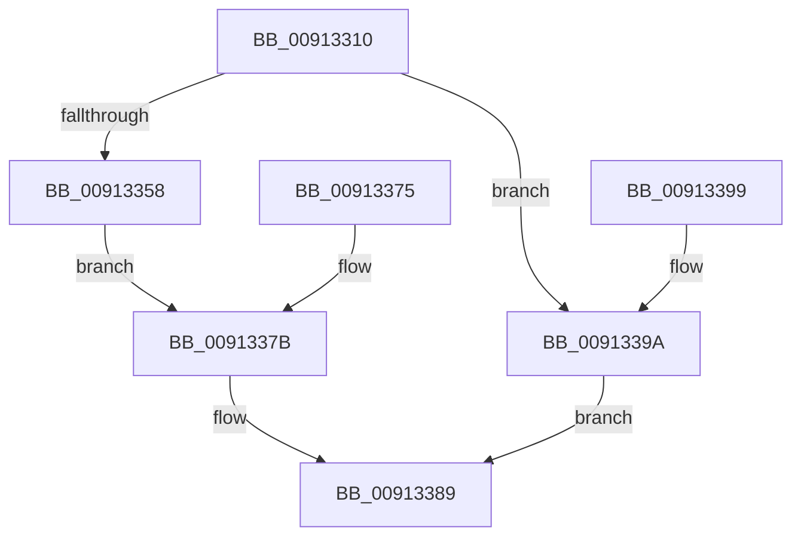

# PopGetSettingValue

- RVA: `0x00913310`–`0x009133AD` (길이 `157` bytes)
- VA: `0x0000000140913310`
- 실행 섹션: `PAGE`
- PDB 이름 있음: `예`; PDB Function 태그: `아니요`
- unwind 정보 RVA: `0x0008A3EC`
- 디코드: `41`개 명령, `157/157` bytes 표시
- 미해석 바이트: `0` (있으면 어셈블리에 `.byte`로 보존)

> 이 문서는 커널 이미지의 기계어와 PDB 기호를 분석해 생성했습니다. 4번과 5번은 함수 원형과 자료형을 바이너리 사용 방식에서 추정한 C 해석이며 원본 소스 복구 결과는 아닙니다.

## 1. Dependencies

- 직접 호출 지점: **6**; 고유 호출 대상: **5**
- 직접 호출자로 확인된 함수: **1**
- RIP 상대 이미지 참조: **1**

### Outgoing calls
- `0x0091332F` → [ExAcquireFastMutex](../../text/20/ExAcquireFastMutex_function_0020E5A0.md) (function, `0x0020E5A0`)
- `0x00913344` → [PsGetProcessSessionIdEx](../../text/22/PsGetProcessSessionIdEx_function_0022F8F0.md) (function, `0x0022F8F0`)
- `0x0091334E` → [PopFindPowerSettingConfiguration](PopFindPowerSettingConfiguration_function_009152E0.md) (function, `0x009152E0`)
- `0x00913368` → [PopMarshalSettingValues](PopMarshalSettingValues_function_009165A8.md) (function, `0x009165A8`)
- `0x00913382` → [ExReleaseFastMutex](../../text/25/ExReleaseFastMutex_function_002519C0.md) (function, `0x002519C0`)
- `0x009133A1` → [ExReleaseFastMutex](../../text/25/ExReleaseFastMutex_function_002519C0.md) (function, `0x002519C0`)

### Direct callers
- [NtPowerInformation](../95/NtPowerInformation_function_00955D80.md) at `0x009574BF`

### Static image references
- `0x00913328` → RVA `0x00F0DF40` (`.data`; read)

## 2. Other-region calls and transfers

- 다른 실행 섹션으로 향하는 call: **4**
  - `0x0091332F` → [ExAcquireFastMutex](../../text/20/ExAcquireFastMutex_function_0020E5A0.md) (`PAGE` → `.text`)
  - `0x00913344` → [PsGetProcessSessionIdEx](../../text/22/PsGetProcessSessionIdEx_function_0022F8F0.md) (`PAGE` → `.text`)
  - `0x00913382` → [ExReleaseFastMutex](../../text/25/ExReleaseFastMutex_function_002519C0.md) (`PAGE` → `.text`)
  - `0x009133A1` → [ExReleaseFastMutex](../../text/25/ExReleaseFastMutex_function_002519C0.md) (`PAGE` → `.text`)
- 별도 외부 분기/꼬리 이동을 확인하지 못했습니다.

## 3. Assembly (complete function range)

```asm
00913310  48 89 5C 24 08                  mov qword ptr [rsp + 8], rbx
00913315  48 89 74 24 10                  mov qword ptr [rsp + 0x10], rsi
0091331A  57                              push rdi
0091331B  48 83 EC 30                     sub rsp, 0x30
0091331F  41 8B F0                        mov esi, r8d
00913322  48 8B FA                        mov rdi, rdx
00913325  48 8B D9                        mov rbx, rcx
00913328  48 8D 0D 11 AC 5F 00            lea rcx, [rip + 0x5fac11]
0091332F  E8 6C B2 8F FF                  call 0x14020e5a0
00913334  65 48 8B 04 25 88 01 00 00      mov rax, qword ptr gs:[0x188]
0091333D  48 8B 88 B8 00 00 00            mov rcx, qword ptr [rax + 0xb8]
00913344  E8 A7 C5 91 FF                  call 0x14022f8f0
00913349  8B D0                           mov edx, eax
0091334B  48 8B CB                        mov rcx, rbx
0091334E  E8 8D 1F 00 00                  call 0x1409152e0
00913353  48 85 C0                        test rax, rax
00913356  74 42                           je 0x14091339a
00913358  4C 8B CF                        mov r9, rdi
0091335B  83 C6 FC                        add esi, -4
0091335E  44 8B C6                        mov r8d, esi
00913361  48 8D 57 04                     lea rdx, [rdi + 4]
00913365  48 8B C8                        mov rcx, rax
00913368  E8 3B 32 00 00                  call 0x1409165a8
0091336D  8B D8                           mov ebx, eax
0091336F  89 44 24 20                     mov dword ptr [rsp + 0x20], eax
00913373  EB 06                           jmp 0x14091337b
00913375  8B D8                           mov ebx, eax
00913377  89 44 24 20                     mov dword ptr [rsp + 0x20], eax
0091337B  48 8D 0D BE AB 5F 00            lea rcx, [rip + 0x5fabbe]
00913382  E8 39 E6 93 FF                  call 0x1402519c0
00913387  8B C3                           mov eax, ebx
00913389  48 8B 5C 24 40                  mov rbx, qword ptr [rsp + 0x40]
0091338E  48 8B 74 24 48                  mov rsi, qword ptr [rsp + 0x48]
00913393  48 83 C4 30                     add rsp, 0x30
00913397  5F                              pop rdi
00913398  C3                              ret
00913399  CC                              int3
0091339A  48 8D 0D 9F AB 5F 00            lea rcx, [rip + 0x5fab9f]
009133A1  E8 1A E6 93 FF                  call 0x1402519c0
009133A6  B8 0D 00 00 C0                  mov eax, 0xc000000d
009133AB  EB DC                           jmp 0x140913389
```

## 4. C-style interpretation (structured pseudocode)

```c
__int64 __fastcall PopGetSettingValue(__int64 a1, __int64 a2, int a3)
{
    __int64 result;
    __int64 v_rsi;
    __int64 v_rsp;
    unsigned int v_stack_m18;
    unsigned __int64 v_stack_p10;
    unsigned __int64 v_stack_p8;

    v_stack_p8 = v_rbx;
    v_stack_p10 = v_rsi;
    v_rsp = (v_rsp) - (48);
    result = ExAcquireFastMutex(v_rip + 6269969, a2, a3, a4);
    result = PsGetProcessSessionIdEx(*(unsigned __int64 *)(*(unsigned __int64 *)(gs_base + (0 + 392)) + 184), a2, a3, a4);
    result = PopFindPowerSettingConfiguration(a1, (unsigned int)((unsigned int)(result)), a3, a4);
    if (result == 0) goto loc_0091339A;
    v_rsi = (unsigned int)(((unsigned int)(a3)) + (-4));
    result = PopMarshalSettingValues(result, a2 + 4, (unsigned int)((unsigned int)(v_rsi)), a2);
    v_stack_m18 = (unsigned int)(result);
    goto loc_0091337B;
loc_0091337B:
    result = ExReleaseFastMutex(v_rip + 6269886, a2 + 4, (unsigned int)((unsigned int)(v_rsi)), a2);
loc_00913389:
    v_rsp = (v_rsp) + (48);
    return (unsigned int)((unsigned int)((unsigned int)((unsigned int)(result))));
loc_0091339A:
    result = ExReleaseFastMutex(v_rip + 6269855, a2 + 4, (unsigned int)((unsigned int)(v_rsi)), a2);
    goto loc_00913389;
}
```

## 5. (Beta) C Style

```c
int64_t PopGetSettingValue(int64_t Arg1, void *Arg2, int32_t Arg3)
{
    uint8_t *arg2 = (uint8_t *)Arg2;

    int64_t result;
    int64_t local_rsi;
    int64_t local_rsp;
    uint32_t v_stack_m18;
    uint64_t v_stack_p10;
    uint64_t v_stack_p8;

    v_stack_p8 = local_rbx;
    v_stack_p10 = local_rsi;
    local_rsp = (local_rsp) - (48);
    result = ExAcquireFastMutex(v_rip + 6269969, Arg2, Arg3, a4);
    result = PsGetProcessSessionIdEx(*(uint64_t *)(*(uint64_t *)(gs_base + (0 + 0x188)) + 0xB8), Arg2, Arg3, a4);
    result = PopFindPowerSettingConfiguration(Arg1, (uint32_t)((uint32_t)(result)), Arg3, a4);
    if (result == 0) goto loc_0091339A;
    local_rsi = (uint32_t)(((uint32_t)(Arg3)) + (-4));
    result = PopMarshalSettingValues(result, Arg2 + 4, (uint32_t)((uint32_t)(local_rsi)), Arg2);
    v_stack_m18 = (uint32_t)(result);
    goto loc_0091337B;
loc_0091337B:
    result = ExReleaseFastMutex(v_rip + 6269886, Arg2 + 4, (uint32_t)((uint32_t)(local_rsi)), Arg2);
loc_00913389:
    local_rsp = (local_rsp) + (48);
    return (uint32_t)((uint32_t)((uint32_t)((uint32_t)(result))));
loc_0091339A:
    result = ExReleaseFastMutex(v_rip + 6269855, Arg2 + 4, (uint32_t)((uint32_t)(local_rsi)), Arg2);
    goto loc_00913389;
}
```

### 관측된 메모리 오프셋

구조체 형식이 확인되지 않은 접근은 인자 기준의 오프셋으로만 기록했습니다.

| 기준 인자 | 오프셋 표현 | 폭 (bit) | 접근 |
|---|---:|---:|---|
| `Arg2` | `+ 0x4` | `64` | `R` |

## 6. Execution-region graph

[열기: 2D/3D 그래프와 함수 탐색 컨트롤 패널](../../../control-panel.html?section=page&rva=0x00913310&view=graph)

- 2D 그래프는 위에서 아래로 흐르고, 3D 그래프는 빈 공간을 드래그해 회전합니다. Shift+드래그는 이동, 휠은 확대·축소, 함수 노드 선택은 대상 보고서 이동입니다.

### Static fallback


