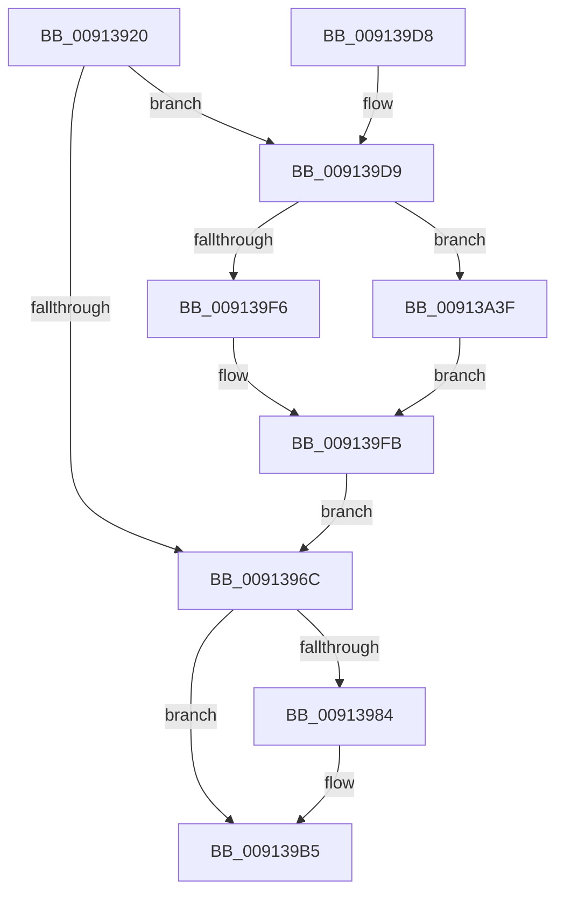

# PopInvokeWin32CalloutWithWatchdog

- RVA: `0x00913920`–`0x00913A45` (길이 `293` bytes)
- VA: `0x0000000140913920`
- 실행 섹션: `PAGE`
- PDB 이름 있음: `예`; PDB Function 태그: `아니요`
- unwind 정보 RVA: `0x0008A4DC`
- 디코드: `78`개 명령, `293/293` bytes 표시
- 미해석 바이트: `0` (있으면 어셈블리에 `.byte`로 보존)

> 이 문서는 커널 이미지의 기계어와 PDB 기호를 분석해 생성했습니다. 4번과 5번은 함수 원형과 자료형을 바이너리 사용 방식에서 추정한 C 해석이며 원본 소스 복구 결과는 아닙니다.

## 1. Dependencies

- 직접 호출 지점: **5**; 고유 호출 대상: **3**
- 직접 호출자로 확인된 함수: **3**
- RIP 상대 이미지 참조: **2**

### Outgoing calls
- `0x0091395E` → [memset](../../text/6C/memset_function_006C6C40.md) (function, `0x006C6C40`)
- `0x00913978` → [PsInvokeWin32Callout](PsInvokeWin32Callout_function_009133C0.md) (function, `0x009133C0`)
- `0x0091398D` → [memset](../../text/6C/memset_function_006C6C40.md) (function, `0x006C6C40`)
- `0x009139B0` → [ZwPowerInformation](../../text/6A/ZwPowerInformation_function_006ADCB0.md) (function, `0x006ADCB0`)
- `0x00913A35` → [ZwPowerInformation](../../text/6A/ZwPowerInformation_function_006ADCB0.md) (function, `0x006ADCB0`)

### Direct callers
- [PopInvokeWin32Callout](PopInvokeWin32Callout_function_009125F4.md) at `0x009126B5`
- [PopInvokeWin32Callout](PopInvokeWin32Callout_function_009125F4.md) at `0x009127A7`
- [PopNotifyConsoleUserPresent](PopNotifyConsoleUserPresent_function_00913C50.md) at `0x00913D8D`
- [PopPowerAggregatorNotifyCsStateExited](../98/PopPowerAggregatorNotifyCsStateExited_function_0098A434.md) at `0x0098A58D`

### Static image references
- `0x009139D9` → RVA `0x00E0B56C` (`.data`; read)
- `0x00913A26` → RVA `0x0076C140` (`PopWin32CalloutWatchdogCallback`; read)

## 2. Other-region calls and transfers

- 다른 실행 섹션으로 향하는 call: **4**
  - `0x0091395E` → [memset](../../text/6C/memset_function_006C6C40.md) (`PAGE` → `.text`)
  - `0x0091398D` → [memset](../../text/6C/memset_function_006C6C40.md) (`PAGE` → `.text`)
  - `0x009139B0` → [ZwPowerInformation](../../text/6A/ZwPowerInformation_function_006ADCB0.md) (`PAGE` → `.text`)
  - `0x00913A35` → [ZwPowerInformation](../../text/6A/ZwPowerInformation_function_006ADCB0.md) (`PAGE` → `.text`)
- 별도 외부 분기/꼬리 이동을 확인하지 못했습니다.

## 3. Assembly (complete function range)

```asm
00913920  48 8B C4                        mov rax, rsp
00913923  48 89 58 08                     mov qword ptr [rax + 8], rbx
00913927  48 89 70 10                     mov qword ptr [rax + 0x10], rsi
0091392B  48 89 78 18                     mov qword ptr [rax + 0x18], rdi
0091392F  4C 89 60 20                     mov qword ptr [rax + 0x20], r12
00913933  55                              push rbp
00913934  41 56                           push r14
00913936  41 57                           push r15
00913938  48 8D 68 A9                     lea rbp, [rax - 0x57]
0091393C  48 81 EC 90 00 00 00            sub rsp, 0x90
00913943  41 8B F0                        mov esi, r8d
00913946  4C 8B F2                        mov r14, rdx
00913949  44 8B F9                        mov r15d, ecx
0091394C  41 BC 60 00 00 00               mov r12d, 0x60
00913952  45 8B C4                        mov r8d, r12d
00913955  48 8D 4D DF                     lea rcx, [rbp - 0x21]
00913959  33 D2                           xor edx, edx
0091395B  49 8B D9                        mov rbx, r9
0091395E  E8 DD 32 DB FF                  call 0x1406c6c40
00913963  48 8B 7D 7F                     mov rdi, qword ptr [rbp + 0x7f]
00913967  48 85 FF                        test rdi, rdi
0091396A  75 6D                           jne 0x1409139d9
0091396C  4C 8B CB                        mov r9, rbx
0091396F  44 8B C6                        mov r8d, esi
00913972  49 8B D6                        mov rdx, r14
00913975  41 8B CF                        mov ecx, r15d
00913978  E8 43 FA FF FF                  call 0x1409133c0
0091397D  8B D8                           mov ebx, eax
0091397F  48 85 FF                        test rdi, rdi
00913982  74 31                           je 0x1409139b5
00913984  4D 8B C4                        mov r8, r12
00913987  48 8D 4D DF                     lea rcx, [rbp - 0x21]
0091398B  33 D2                           xor edx, edx
0091398D  E8 AE 32 DB FF                  call 0x1406c6c40
00913992  83 64 24 20 00                  and dword ptr [rsp + 0x20], 0
00913997  48 8D 55 DF                     lea rdx, [rbp - 0x21]
0091399B  45 33 C9                        xor r9d, r9d
0091399E  C7 45 DF 15 00 00 00            mov dword ptr [rbp - 0x21], 0x15
009139A5  45 8B C4                        mov r8d, r12d
009139A8  48 89 7D E7                     mov qword ptr [rbp - 0x19], rdi
009139AC  41 8D 49 57                     lea ecx, [r9 + 0x57]
009139B0  E8 FB A2 D9 FF                  call 0x1406adcb0
009139B5  4C 8D 9C 24 90 00 00 00         lea r11, [rsp + 0x90]
009139BD  8B C3                           mov eax, ebx
009139BF  49 8B 5B 20                     mov rbx, qword ptr [r11 + 0x20]
009139C3  49 8B 73 28                     mov rsi, qword ptr [r11 + 0x28]
009139C7  49 8B 7B 30                     mov rdi, qword ptr [r11 + 0x30]
009139CB  4D 8B 63 38                     mov r12, qword ptr [r11 + 0x38]
009139CF  49 8B E3                        mov rsp, r11
009139D2  41 5F                           pop r15
009139D4  41 5E                           pop r14
009139D6  5D                              pop rbp
009139D7  C3                              ret
009139D8  CC                              int3
009139D9  69 05 89 7B 4F 00 E8 03 00 00   imul eax, dword ptr [rip + 0x4f7b89], 0x3e8
009139E3  C7 45 DF 15 00 00 00            mov dword ptr [rbp - 0x21], 0x15
009139EA  48 89 7D E7                     mov qword ptr [rbp - 0x19], rdi
009139EE  89 45 EF                        mov dword ptr [rbp - 0x11], eax
009139F1  48 85 DB                        test rbx, rbx
009139F4  74 49                           je 0x140913a3f
009139F6  8B 03                           mov eax, dword ptr [rbx]
009139F8  89 45 F3                        mov dword ptr [rbp - 0xd], eax
009139FB  83 64 24 20 00                  and dword ptr [rsp + 0x20], 0
00913A00  48 8D 55 DF                     lea rdx, [rbp - 0x21]
00913A04  C7 45 F7 A1 01 00 00            mov dword ptr [rbp - 9], 0x1a1
00913A0B  45 33 C9                        xor r9d, r9d
00913A0E  65 48 8B 04 25 88 01 00 00      mov rax, qword ptr gs:[0x188]
00913A17  45 8B C4                        mov r8d, r12d
00913A1A  48 89 45 FF                     mov qword ptr [rbp - 1], rax
00913A1E  48 8D 45 DF                     lea rax, [rbp - 0x21]
00913A22  48 89 45 2F                     mov qword ptr [rbp + 0x2f], rax
00913A26  48 8D 05 13 87 E5 FF            lea rax, [rip - 0x1a78ed]
00913A2D  41 8D 49 57                     lea ecx, [r9 + 0x57]
00913A31  48 89 45 27                     mov qword ptr [rbp + 0x27], rax
00913A35  E8 76 A2 D9 FF                  call 0x1406adcb0
00913A3A  E9 2D FF FF FF                  jmp 0x14091396c
00913A3F  83 4D F3 FF                     or dword ptr [rbp - 0xd], 0xffffffff
00913A43  EB B6                           jmp 0x1409139fb
```

## 4. C-style interpretation (structured pseudocode)

```c
__int64 __fastcall PopInvokeWin32CalloutWithWatchdog(int a1, __int64 a2, int a3, __int64 a4)
{
    __int64 result;
    __int64 v_rsp;
    unsigned __int64 v_stack_m18;
    unsigned int v_stack_m70;
    unsigned int v_stack_m88;

    *(unsigned __int64 *)(v_rsp + 8) = v_rbx;
    *(unsigned __int64 *)(v_rsp + 16) = v_rsi;
    *(unsigned __int64 *)(v_rsp + 24) = v_rdi;
    *(unsigned __int64 *)(v_rsp + 32) = v_r12;
    v_rsp = (v_rsp) - (144);
    a2 = 0;
    result = memset(v_rsp - 87 - 33, a2, 96, a4);
    if (*(unsigned __int64 *)(v_rsp - 87 + 127) != 0) goto loc_009139D9;
loc_0091396C:
    result = PsInvokeWin32Callout((unsigned int)((unsigned int)((unsigned int)(a1))), 0, (unsigned int)((unsigned int)((unsigned int)(a3))), a4);
    if (*(unsigned __int64 *)(v_rsp - 87 + 127) != 0) {
        a3 = 96;
        a1 = v_rsp - 87 - 33;
        a2 = 0;
        result = memset(a1, a2, a3, a4);
        a2 = v_rsp - 87 - 33;
        a4 = 0;
        *(unsigned int *)(v_rsp - 87 - 33) = 21;
        a3 = 96;
        *(unsigned __int64 *)(v_rsp - 87 - 25) = *(unsigned __int64 *)(v_rsp - 87 + 127);
        a1 = a4 + 87;
        result = ZwPowerInformation(a1, a2, a3, a4);
    }
    return (unsigned int)((unsigned int)((unsigned int)((unsigned int)(result))));
loc_009139D9:
    result = (unsigned int)(((unsigned int)((unsigned int)((unsigned int)((unsigned int)(result))))) * (*(unsigned int *)(v_rip + 5208969)));
    *(unsigned int *)(v_rsp - 87 - 33) = 21;
    *(unsigned __int64 *)(v_rsp - 87 - 25) = *(unsigned __int64 *)(v_stack_m18 + 48);
    *(unsigned int *)(v_rsp - 87 - 17) = (unsigned int)(result);
    if (*(unsigned __int64 *)(v_stack_m18 + 32) == 0) goto loc_00913A3F;
    *(unsigned int *)(v_rsp - 87 - 13) = (unsigned int)((unsigned int)(*(unsigned int *)(*(unsigned __int64 *)(v_stack_m18 + 32))));
loc_009139FB:
    *(unsigned int *)(v_rsp - 87 - 9) = 417;
    a4 = 0;
    *(unsigned __int64 *)(v_rsp - 87 - 1) = *(unsigned __int64 *)(gs_base + (0 + 392));
    *(unsigned __int64 *)(v_rsp - 87 + 47) = v_rsp - 87 - 33;
    *(unsigned __int64 *)(v_rsp - 87 + 39) = v_rip - 1734893;
    result = ZwPowerInformation(a4 + 87, v_rsp - 87 - 33, (unsigned int)((unsigned int)(*(unsigned __int64 *)(v_stack_m18 + 56))), a4);
    goto loc_0091396C;
loc_00913A3F:
    goto loc_009139FB;
}
```

## 5. (Beta) C Style

```c
int64_t PopInvokeWin32CalloutWithWatchdog(int32_t Arg1, int64_t Arg2, int32_t Arg3, int64_t Arg4)
{
    int64_t result;
    int64_t local_rsp;
    uint64_t v_stack_m18;
    uint32_t v_stack_m70;
    uint32_t v_stack_m88;

    *(uint64_t *)(local_rsp + 0x8) = local_rbx;
    *(uint64_t *)(local_rsp + 0x10) = local_rsi;
    *(uint64_t *)(local_rsp + 0x18) = local_rdi;
    *(uint64_t *)(local_rsp + 0x20) = local_r12;
    local_rsp = (local_rsp) - (144);
    Arg2 = 0;
    result = memset(local_rsp - 87 - 33, Arg2, 96, Arg4);
    if (*(uint64_t *)(local_rsp - 0x57 + 0x7F) != 0) goto loc_009139D9;
loc_0091396C:
    result = PsInvokeWin32Callout((uint32_t)((uint32_t)((uint32_t)(Arg1))), 0, (uint32_t)((uint32_t)((uint32_t)(Arg3))), Arg4);
    if (*(uint64_t *)(local_rsp - 0x57 + 0x7F) != 0) {
        Arg3 = 96;
        Arg1 = local_rsp - 87 - 33;
        Arg2 = 0;
        result = memset(Arg1, Arg2, Arg3, Arg4);
        Arg2 = local_rsp - 87 - 33;
        Arg4 = 0;
        *(uint32_t *)(local_rsp - 0x57 - 0x21) = 21;
        Arg3 = 96;
        *(uint64_t *)(local_rsp - 0x57 - 0x19) = *(uint64_t *)(local_rsp - 0x57 + 0x7F);
        Arg1 = Arg4 + 87;
        result = ZwPowerInformation(Arg1, Arg2, Arg3, Arg4);
    }
    return (uint32_t)((uint32_t)((uint32_t)((uint32_t)(result))));
loc_009139D9:
    result = (uint32_t)(((uint32_t)((uint32_t)((uint32_t)((uint32_t)(result))))) * (*(uint32_t *)(v_rip + 0x4F7B89)));
    *(uint32_t *)(local_rsp - 0x57 - 0x21) = 21;
    *(uint64_t *)(local_rsp - 0x57 - 0x19) = *(uint64_t *)(v_stack_m18 + 0x30);
    *(uint32_t *)(local_rsp - 0x57 - 0x11) = (uint32_t)(result);
    if (*(uint64_t *)(v_stack_m18 + 0x20) == 0) goto loc_00913A3F;
    *(uint32_t *)(local_rsp - 0x57 - 0xD) = (uint32_t)((uint32_t)(*(uint32_t *)(*(uint64_t *)(v_stack_m18 + 0x20))));
loc_009139FB:
    *(uint32_t *)(local_rsp - 0x57 - 0x9) = 417;
    Arg4 = 0;
    *(uint64_t *)(local_rsp - 0x57 - 0x1) = *(uint64_t *)(gs_base + (0 + 0x188));
    *(uint64_t *)(local_rsp - 0x57 + 0x2F) = local_rsp - 87 - 33;
    *(uint64_t *)(local_rsp - 0x57 + 0x27) = v_rip - 1734893;
    result = ZwPowerInformation(Arg4 + 87, local_rsp - 87 - 33, (uint32_t)((uint32_t)(*(uint64_t *)(v_stack_m18 + 0x38))), Arg4);
    goto loc_0091396C;
loc_00913A3F:
    goto loc_009139FB;
}
```

## 6. Execution-region graph

[열기: 2D/3D 그래프와 함수 탐색 컨트롤 패널](../../../control-panel.html?section=page&rva=0x00913920&view=graph)

- 2D 그래프는 위에서 아래로 흐르고, 3D 그래프는 빈 공간을 드래그해 회전합니다. Shift+드래그는 이동, 휠은 확대·축소, 함수 노드 선택은 대상 보고서 이동입니다.

### Static fallback


