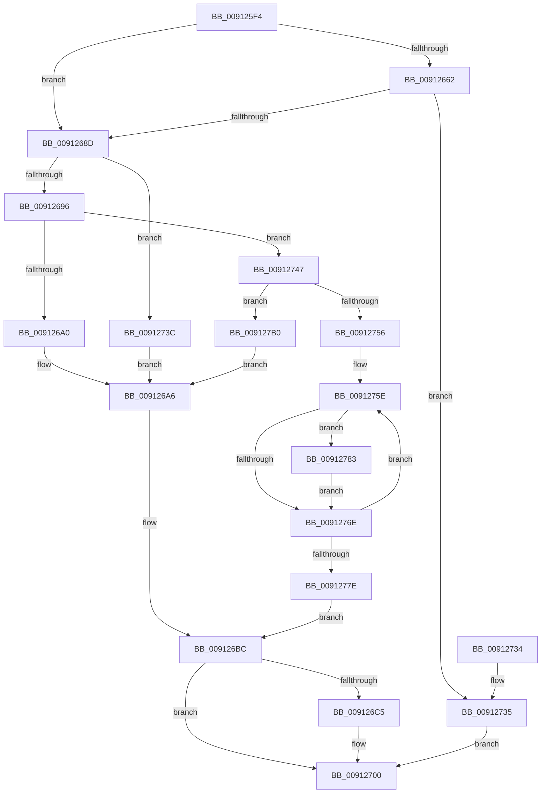

# PopInvokeWin32Callout

- RVA: `0x009125F4`–`0x009127BC` (길이 `456` bytes)
- VA: `0x00000001409125F4`
- 실행 섹션: `PAGE`
- PDB 이름 있음: `예`; PDB Function 태그: `아니요`
- unwind 정보 RVA: `0x0008A314`
- 디코드: `126`개 명령, `456/456` bytes 표시
- 미해석 바이트: `0` (있으면 어셈블리에 `.byte`로 보존)

> 이 문서는 커널 이미지의 기계어와 PDB 기호를 분석해 생성했습니다. 4번과 5번은 함수 원형과 자료형을 바이너리 사용 방식에서 추정한 C 해석이며 원본 소스 복구 결과는 아닙니다.

## 1. Dependencies

- 직접 호출 지점: **13**; 고유 호출 대상: **9**
- 직접 호출자로 확인된 함수: **11**
- RIP 상대 이미지 참조: **0**

### Outgoing calls
- `0x00912632` → [memset](../../text/6C/memset_function_006C6C40.md) (function, `0x006C6C40`)
- `0x0091263D` → [PopIsStateTransitionBlockingThread](../../pagelk/B7/PopIsStateTransitionBlockingThread_function_00B79380.md) (function, `0x00B79380`)
- `0x00912659` → [PopDiagTraceWin32kCalloutStart](PopDiagTraceWin32kCalloutStart_function_0091564C.md) (function, `0x0091564C`)
- `0x00912680` → [ZwPowerInformation](../../text/6A/ZwPowerInformation_function_006ADCB0.md) (function, `0x006ADCB0`)
- `0x009126B5` → [PopInvokeWin32CalloutWithWatchdog](PopInvokeWin32CalloutWithWatchdog_function_00913920.md) (function, `0x00913920`)
- `0x009126D4` → [memset](../../text/6C/memset_function_006C6C40.md) (function, `0x006C6C40`)
- `0x009126FB` → [ZwPowerInformation](../../text/6A/ZwPowerInformation_function_006ADCB0.md) (function, `0x006ADCB0`)
- `0x0091270C` → [PopDiagTraceWin32kCalloutEnd](PopDiagTraceWin32kCalloutEnd_function_009127C4.md) (function, `0x009127C4`)
- `0x00912749` → [PsGetNextSession](PsGetNextSession_function_009128C0.md) (function, `0x009128C0`)
- `0x00912756` → [HalAdjustResourceList](../../text/48/HalAdjustResourceList_function_0048FDC0.md) (function, `0x0048FDC0`)
- `0x00912771` → [PsGetNextSession](PsGetNextSession_function_009128C0.md) (function, `0x009128C0`)
- `0x00912786` → [PsGetProcessSessionId](../../text/22/PsGetProcessSessionId_function_002233A0.md) (function, `0x002233A0`)
- `0x009127A7` → [PopInvokeWin32CalloutWithWatchdog](PopInvokeWin32CalloutWithWatchdog_function_00913920.md) (function, `0x00913920`)

### Direct callers
- [PopUserPresentSetWorker](../../text/49/PopUserPresentSetWorker_function_0049D4F0.md) at `0x0049D5D3`
- [PopEventCalloutDispatch](../../text/4B/PopEventCalloutDispatch_function_004B4870.md) at `0x004B48B4`
- [PoSessionBuiltinPanelState](../../text/5D/PoSessionBuiltinPanelState_function_005DC420.md) at `0x005DC493`
- [PoSessionEngagementUpdate](../../text/5D/PoSessionEngagementUpdate_function_005DC4B8.md) at `0x005DC52B`
- [PoSessionPowerControl](../76/PoSessionPowerControl_function_0076C038.md) at `0x0076C0BC`
- [PopSendSessionInfo](PopSendSessionInfo_function_00911E6C.md) at `0x00911EB5`
- [PopDispatchStateCallout](PopDispatchStateCallout_function_0091248C.md) at `0x0091252B`
- [PopBroadcastSessionInfo](PopBroadcastSessionInfo_function_00912598.md) at `0x009125DF`
- [PopControlMonitor](../98/PopControlMonitor_function_0098A7F0.md) at `0x0098A861`
- [PopPowerRequestCallbackDisplayRequired](../98/PopPowerRequestCallbackDisplayRequired_function_0098C820.md) at `0x0098C8C3`
- [PopLidSwitchChangeCallback](../AB/PopLidSwitchChangeCallback_function_00AB8FF0.md) at `0x00AB9089`

### Static image references
- 디코드된 RIP-relative 메모리 참조가 없습니다.

## 2. Other-region calls and transfers

- 다른 실행 섹션으로 향하는 call: **7**
  - `0x00912632` → [memset](../../text/6C/memset_function_006C6C40.md) (`PAGE` → `.text`)
  - `0x0091263D` → [PopIsStateTransitionBlockingThread](../../pagelk/B7/PopIsStateTransitionBlockingThread_function_00B79380.md) (`PAGE` → `PAGELK`)
  - `0x00912680` → [ZwPowerInformation](../../text/6A/ZwPowerInformation_function_006ADCB0.md) (`PAGE` → `.text`)
  - `0x009126D4` → [memset](../../text/6C/memset_function_006C6C40.md) (`PAGE` → `.text`)
  - `0x009126FB` → [ZwPowerInformation](../../text/6A/ZwPowerInformation_function_006ADCB0.md) (`PAGE` → `.text`)
  - `0x00912756` → [HalAdjustResourceList](../../text/48/HalAdjustResourceList_function_0048FDC0.md) (`PAGE` → `.text`)
  - `0x00912786` → [PsGetProcessSessionId](../../text/22/PsGetProcessSessionId_function_002233A0.md) (`PAGE` → `.text`)
- 별도 외부 분기/꼬리 이동을 확인하지 못했습니다.

## 3. Assembly (complete function range)

```asm
009125F4  48 8B C4                        mov rax, rsp
009125F7  48 89 58 08                     mov qword ptr [rax + 8], rbx
009125FB  48 89 70 10                     mov qword ptr [rax + 0x10], rsi
009125FF  48 89 78 18                     mov qword ptr [rax + 0x18], rdi
00912603  55                              push rbp
00912604  41 54                           push r12
00912606  41 55                           push r13
00912608  41 56                           push r14
0091260A  41 57                           push r15
0091260C  48 8D 68 A1                     lea rbp, [rax - 0x5f]
00912610  48 81 EC A0 00 00 00            sub rsp, 0xa0
00912617  33 FF                           xor edi, edi
00912619  45 8B E0                        mov r12d, r8d
0091261C  4C 8B F2                        mov r14, rdx
0091261F  89 7D 7F                        mov dword ptr [rbp + 0x7f], edi
00912622  44 8B F9                        mov r15d, ecx
00912625  33 D2                           xor edx, edx
00912627  48 8D 4D D7                     lea rcx, [rbp - 0x29]
0091262B  4D 8B E9                        mov r13, r9
0091262E  44 8D 47 60                     lea r8d, [rdi + 0x60]
00912632  E8 09 46 DB FF                  call 0x1406c6c40
00912637  8B F7                           mov esi, edi
00912639  48 89 7D C7                     mov qword ptr [rbp - 0x39], rdi
0091263D  E8 3E 6D 26 00                  call 0x140b79380
00912642  4D 85 ED                        test r13, r13
00912645  4C 89 6C 24 20                  mov qword ptr [rsp + 0x20], r13
0091264A  45 8B C4                        mov r8d, r12d
0091264D  49 8B D6                        mov rdx, r14
00912650  41 0F 95 C1                     setne r9b
00912654  41 8B CF                        mov ecx, r15d
00912657  8A D8                           mov bl, al
00912659  E8 EE 2F 00 00                  call 0x14091564c
0091265E  84 DB                           test bl, bl
00912660  75 2B                           jne 0x14091268d
00912662  4C 8D 4D C7                     lea r9, [rbp - 0x39]
00912666  C7 45 D7 15 00 00 00            mov dword ptr [rbp - 0x29], 0x15
0091266D  44 8D 47 60                     lea r8d, [rdi + 0x60]
00912671  C7 44 24 20 08 00 00 00         mov dword ptr [rsp + 0x20], 8
00912679  48 8D 55 D7                     lea rdx, [rbp - 0x29]
0091267D  8D 4F 57                        lea ecx, [rdi + 0x57]
00912680  E8 2B B6 D9 FF                  call 0x1406adcb0
00912685  85 C0                           test eax, eax
00912687  0F 88 A8 00 00 00               js 0x140912735
0091268D  45 85 E4                        test r12d, r12d
00912690  0F 84 A6 00 00 00               je 0x14091273c
00912696  41 83 FC 01                     cmp r12d, 1
0091269A  0F 85 A7 00 00 00               jne 0x140912747
009126A0  4D 8B CD                        mov r9, r13
009126A3  45 8B C4                        mov r8d, r12d
009126A6  48 8B 45 C7                     mov rax, qword ptr [rbp - 0x39]
009126AA  49 8B D6                        mov rdx, r14
009126AD  41 8B CF                        mov ecx, r15d
009126B0  48 89 44 24 20                  mov qword ptr [rsp + 0x20], rax
009126B5  E8 66 12 00 00                  call 0x140913920
009126BA  8B F0                           mov esi, eax
009126BC  48 8B 5D C7                     mov rbx, qword ptr [rbp - 0x39]
009126C0  48 85 DB                        test rbx, rbx
009126C3  74 3B                           je 0x140912700
009126C5  41 BC 60 00 00 00               mov r12d, 0x60
009126CB  48 8D 4D D7                     lea rcx, [rbp - 0x29]
009126CF  45 8B C4                        mov r8d, r12d
009126D2  33 D2                           xor edx, edx
009126D4  E8 67 45 DB FF                  call 0x1406c6c40
009126D9  45 33 C9                        xor r9d, r9d
009126DC  C7 45 D7 15 00 00 00            mov dword ptr [rbp - 0x29], 0x15
009126E3  45 8B C4                        mov r8d, r12d
009126E6  48 89 5D DF                     mov qword ptr [rbp - 0x21], rbx
009126EA  48 8D 55 D7                     lea rdx, [rbp - 0x29]
009126EE  C6 45 2F 01                     mov byte ptr [rbp + 0x2f], 1
009126F2  41 8D 4C 24 F7                  lea ecx, [r12 - 9]
009126F7  89 7C 24 20                     mov dword ptr [rsp + 0x20], edi
009126FB  E8 B0 B5 D9 FF                  call 0x1406adcb0
00912700  44 8B CF                        mov r9d, edi
00912703  44 8B C6                        mov r8d, esi
00912706  49 8B D6                        mov rdx, r14
00912709  41 8B CF                        mov ecx, r15d
0091270C  E8 B3 00 00 00                  call 0x1409127c4
00912711  4C 8D 9C 24 A0 00 00 00         lea r11, [rsp + 0xa0]
00912719  8B C6                           mov eax, esi
0091271B  49 8B 5B 30                     mov rbx, qword ptr [r11 + 0x30]
0091271F  49 8B 73 38                     mov rsi, qword ptr [r11 + 0x38]
00912723  49 8B 7B 40                     mov rdi, qword ptr [r11 + 0x40]
00912727  49 8B E3                        mov rsp, r11
0091272A  41 5F                           pop r15
0091272C  41 5E                           pop r14
0091272E  41 5D                           pop r13
00912730  41 5C                           pop r12
00912732  5D                              pop rbp
00912733  C3                              ret
00912734  CC                              int3
00912735  BF 01 00 00 00                  mov edi, 1
0091273A  EB C4                           jmp 0x140912700
0091273C  45 33 C9                        xor r9d, r9d
0091273F  45 33 C0                        xor r8d, r8d
00912742  E9 5F FF FF FF                  jmp 0x1409126a6
00912747  33 C9                           xor ecx, ecx
00912749  E8 72 01 00 00                  call 0x1409128c0
0091274E  48 8B D8                        mov rbx, rax
00912751  48 85 C0                        test rax, rax
00912754  74 5A                           je 0x1409127b0
00912756  E8 65 D6 B7 FF                  call 0x14048fdc0
0091275B  4C 8B E0                        mov r12, rax
0091275E  48 8B 8B E8 02 00 00            mov rcx, qword ptr [rbx + 0x2e8]
00912765  4C 39 A1 A0 00 00 00            cmp qword ptr [rcx + 0xa0], r12
0091276C  74 15                           je 0x140912783
0091276E  48 8B CB                        mov rcx, rbx
00912771  E8 4A 01 00 00                  call 0x1409128c0
00912776  48 8B D8                        mov rbx, rax
00912779  48 85 C0                        test rax, rax
0091277C  75 E0                           jne 0x14091275e
0091277E  E9 39 FF FF FF                  jmp 0x1409126bc
00912783  48 8B CB                        mov rcx, rbx
00912786  E8 15 0C 91 FF                  call 0x1402233a0
0091278B  48 8B 4D C7                     mov rcx, qword ptr [rbp - 0x39]
0091278F  4C 8D 4D 7F                     lea r9, [rbp + 0x7f]
00912793  48 89 4C 24 20                  mov qword ptr [rsp + 0x20], rcx
00912798  41 B8 01 00 00 00               mov r8d, 1
0091279E  41 8B CF                        mov ecx, r15d
009127A1  89 45 7F                        mov dword ptr [rbp + 0x7f], eax
009127A4  49 8B D6                        mov rdx, r14
009127A7  E8 74 11 00 00                  call 0x140913920
009127AC  8B F0                           mov esi, eax
009127AE  EB BE                           jmp 0x14091276e
009127B0  45 33 C9                        xor r9d, r9d
009127B3  45 8D 41 02                     lea r8d, [r9 + 2]
009127B7  E9 EA FE FF FF                  jmp 0x1409126a6
```

## 4. C-style interpretation (structured pseudocode)

```c
__int64 __fastcall PopInvokeWin32Callout(int a1, __int64 a2, int a3, __int64 a4)
{
    __int64 result;
    __int64 v_r12;
    __int64 v_rdi;
    __int64 v_rsp;
    unsigned __int64 v_stack_m28;
    unsigned __int64 v_stack_m80;
    unsigned __int64 v_stack_mA8;

    *(unsigned __int64 *)(v_rsp + 8) = v_rbx;
    *(unsigned __int64 *)(v_rsp + 16) = v_rsi;
    *(unsigned __int64 *)(v_rsp + 24) = v_rdi;
    v_rsp = (v_rsp) - (160);
    v_rdi = 0;
    *(unsigned int *)(v_rsp - 95 + 127) = 0;
    a2 = 0;
    result = memset(v_rsp - 95 - 41, a2, v_rdi + 96, a4);
    *(unsigned __int64 *)(v_rsp - 95 - 57) = 0;
    result = PopIsStateTransitionBlockingThread(v_rsp - 95 - 41, a2, v_rdi + 96, a4);
    v_stack_mA8 = a4;
    a4 = (a4 != 0) ? 1 : 0;
    result = PopDiagTraceWin32kCalloutStart((unsigned int)((unsigned int)((unsigned int)(a1))), 0, (unsigned int)((unsigned int)((unsigned int)(a3))), a4);
    if ((unsigned __int8)((unsigned __int8)(result)) != 0) goto loc_0091268D;
    *(unsigned int *)(v_rsp - 95 - 41) = 21;
    v_stack_mA8 = 8;
    result = ZwPowerInformation(v_rdi + 87, v_rsp - 95 - 41, v_rdi + 96, v_rsp - 95 - 57);
    if (sign_flag) goto loc_00912735;
loc_0091268D:
    if ((unsigned int)((unsigned int)(a3)) == 0) goto loc_0091273C;
    if (((unsigned int)((unsigned int)(a3))) != 1) goto loc_00912747;
loc_009126A6:
    v_stack_mA8 = *(unsigned __int64 *)(v_rsp - 95 - 57);
    result = PopInvokeWin32CalloutWithWatchdog((unsigned int)((unsigned int)((unsigned int)(a1))), 0, (unsigned int)((unsigned int)((unsigned int)(a3))), a4);
loc_009126BC:
    v_r12 = (unsigned int)(a3);
    if (*(unsigned __int64 *)(v_rsp - 95 - 57) != 0) {
        v_r12 = 96;
        a1 = v_rsp - 95 - 41;
        a3 = (unsigned int)(v_r12);
        a2 = 0;
        result = memset(a1, a2, a3, a4);
        a4 = 0;
        *(unsigned int *)(v_rsp - 95 - 41) = 21;
        a3 = (unsigned int)(v_r12);
        *(unsigned __int64 *)(v_rsp - 95 - 33) = *(unsigned __int64 *)(v_rsp - 95 - 57);
        a2 = v_rsp - 95 - 41;
        *(unsigned __int8 *)(v_rsp - 95 + 47) = 1;
        a1 = v_r12 - 9;
        v_stack_mA8 = 0;
        result = ZwPowerInformation(a1, a2, a3, a4);
    }
    result = PopDiagTraceWin32kCalloutEnd((unsigned int)((unsigned int)((unsigned int)(a1))), a2, (unsigned int)((unsigned int)((unsigned int)((unsigned int)(result)))), 0);
    return (unsigned int)((unsigned int)((unsigned int)((unsigned int)(result))));
loc_00912735:
    goto loc_00912700;
loc_0091273C:
    a4 = 0;
    a3 = 0;
    goto loc_009126A6;
loc_00912747:
    a1 = 0;
    result = PsGetNextSession(a1, a2, a3, a4);
    if (result == 0) goto loc_009127B0;
    result = HalAdjustResourceList(a1, a2, a3, a4);
loc_0091275E:
    if ((*(unsigned __int64 *)(*(unsigned __int64 *)(result + 744) + 160)) == result) goto loc_00912783;
loc_0091276E:
    result = PsGetNextSession(result, a2, a3, a4);
    if (result != 0) goto loc_0091275E;
    goto loc_009126BC;
loc_00912783:
    result = PsGetProcessSessionId(result, a2, a3, a4);
    v_stack_m80 = *(unsigned __int64 *)(v_rsp - 95 - 57);
    *(unsigned int *)(v_rsp - 95 + 127) = (unsigned int)(result);
    result = PopInvokeWin32CalloutWithWatchdog((unsigned int)((unsigned int)((unsigned int)(a1))), a2, 1, v_rsp - 95 + 127);
    goto loc_0091276E;
loc_009127B0:
    a4 = 0;
    goto loc_009126A6;
}
```

## 5. (Beta) C Style

```c
int64_t PopInvokeWin32Callout(int32_t Arg1, int64_t Arg2, int32_t Arg3, int64_t Arg4)
{
    int64_t result;
    int64_t local_r12;
    int64_t local_rdi;
    int64_t local_rsp;
    uint64_t v_stack_m28;
    uint64_t v_stack_m80;
    uint64_t v_stack_mA8;

    *(uint64_t *)(local_rsp + 0x8) = local_rbx;
    *(uint64_t *)(local_rsp + 0x10) = local_rsi;
    *(uint64_t *)(local_rsp + 0x18) = local_rdi;
    local_rsp = (local_rsp) - (160);
    local_rdi = 0;
    *(uint32_t *)(local_rsp - 0x5F + 0x7F) = 0;
    Arg2 = 0;
    result = memset(local_rsp - 95 - 41, Arg2, local_rdi + 96, Arg4);
    *(uint64_t *)(local_rsp - 0x5F - 0x39) = 0;
    result = PopIsStateTransitionBlockingThread(local_rsp - 95 - 41, Arg2, local_rdi + 96, Arg4);
    v_stack_mA8 = Arg4;
    Arg4 = (Arg4 != 0) ? 1 : 0;
    result = PopDiagTraceWin32kCalloutStart((uint32_t)((uint32_t)((uint32_t)(Arg1))), 0, (uint32_t)((uint32_t)((uint32_t)(Arg3))), Arg4);
    if ((uint8_t)((uint8_t)(result)) != 0) goto loc_0091268D;
    *(uint32_t *)(local_rsp - 0x5F - 0x29) = 21;
    v_stack_mA8 = 8;
    result = ZwPowerInformation(local_rdi + 87, local_rsp - 95 - 41, local_rdi + 96, local_rsp - 95 - 57);
    if (sign_flag) goto loc_00912735;
loc_0091268D:
    if ((uint32_t)((uint32_t)(Arg3)) == 0) goto loc_0091273C;
    if (((uint32_t)((uint32_t)(Arg3))) != 1) goto loc_00912747;
loc_009126A6:
    v_stack_mA8 = *(uint64_t *)(local_rsp - 0x5F - 0x39);
    result = PopInvokeWin32CalloutWithWatchdog((uint32_t)((uint32_t)((uint32_t)(Arg1))), 0, (uint32_t)((uint32_t)((uint32_t)(Arg3))), Arg4);
loc_009126BC:
    local_r12 = (uint32_t)(Arg3);
    if (*(uint64_t *)(local_rsp - 0x5F - 0x39) != 0) {
        local_r12 = 96;
        Arg1 = local_rsp - 95 - 41;
        Arg3 = (uint32_t)(local_r12);
        Arg2 = 0;
        result = memset(Arg1, Arg2, Arg3, Arg4);
        Arg4 = 0;
        *(uint32_t *)(local_rsp - 0x5F - 0x29) = 21;
        Arg3 = (uint32_t)(local_r12);
        *(uint64_t *)(local_rsp - 0x5F - 0x21) = *(uint64_t *)(local_rsp - 0x5F - 0x39);
        Arg2 = local_rsp - 95 - 41;
        *(uint8_t *)(local_rsp - 0x5F + 0x2F) = 1;
        Arg1 = local_r12 - 9;
        v_stack_mA8 = 0;
        result = ZwPowerInformation(Arg1, Arg2, Arg3, Arg4);
    }
    result = PopDiagTraceWin32kCalloutEnd((uint32_t)((uint32_t)((uint32_t)(Arg1))), Arg2, (uint32_t)((uint32_t)((uint32_t)((uint32_t)(result)))), 0);
    return (uint32_t)((uint32_t)((uint32_t)((uint32_t)(result))));
loc_00912735:
    goto loc_00912700;
loc_0091273C:
    Arg4 = 0;
    Arg3 = 0;
    goto loc_009126A6;
loc_00912747:
    Arg1 = 0;
    result = PsGetNextSession(Arg1, Arg2, Arg3, Arg4);
    if (result == 0) goto loc_009127B0;
    result = HalAdjustResourceList(Arg1, Arg2, Arg3, Arg4);
loc_0091275E:
    if ((*(uint64_t *)(*(uint64_t *)(result + 0x2E8) + 0xA0)) == result) goto loc_00912783;
loc_0091276E:
    result = PsGetNextSession(result, Arg2, Arg3, Arg4);
    if (result != 0) goto loc_0091275E;
    goto loc_009126BC;
loc_00912783:
    result = PsGetProcessSessionId(result, Arg2, Arg3, Arg4);
    v_stack_m80 = *(uint64_t *)(local_rsp - 0x5F - 0x39);
    *(uint32_t *)(local_rsp - 0x5F + 0x7F) = (uint32_t)(result);
    result = PopInvokeWin32CalloutWithWatchdog((uint32_t)((uint32_t)((uint32_t)(Arg1))), Arg2, 1, local_rsp - 95 + 127);
    goto loc_0091276E;
loc_009127B0:
    Arg4 = 0;
    goto loc_009126A6;
}
```

## 6. Execution-region graph

[열기: 2D/3D 그래프와 함수 탐색 컨트롤 패널](../../../control-panel.html?section=page&rva=0x009125F4&view=graph)

- 2D 그래프는 위에서 아래로 흐르고, 3D 그래프는 빈 공간을 드래그해 회전합니다. Shift+드래그는 이동, 휠은 확대·축소, 함수 노드 선택은 대상 보고서 이동입니다.

### Static fallback


