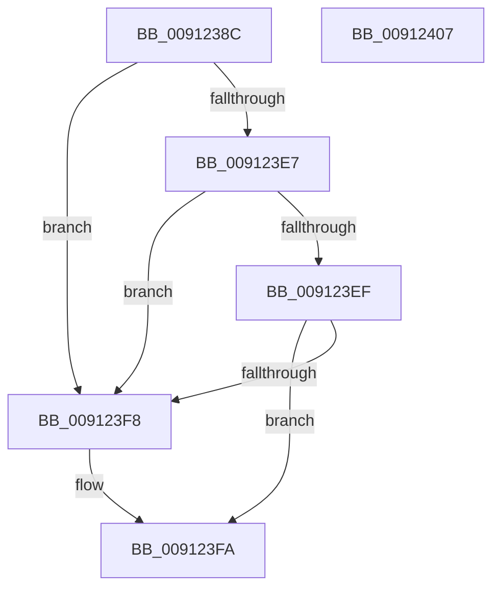

# PopIsLockConsoleTimeoutActive

- RVA: `0x0091238C`–`0x00912408` (길이 `124` bytes)
- VA: `0x000000014091238C`
- 실행 섹션: `PAGE`
- PDB 이름 있음: `예`; PDB Function 태그: `아니요`
- unwind 정보 RVA: `0x00071A74`
- 디코드: `31`개 명령, `124/124` bytes 표시
- 미해석 바이트: `0` (있으면 어셈블리에 `.byte`로 보존)

> 이 문서는 커널 이미지의 기계어와 PDB 기호를 분석해 생성했습니다. 4번과 5번은 함수 원형과 자료형을 바이너리 사용 방식에서 추정한 C 해석이며 원본 소스 복구 결과는 아닙니다.

## 1. Dependencies

- 직접 호출 지점: **2**; 고유 호출 대상: **2**
- 직접 호출자로 확인된 함수: **1**
- RIP 상대 이미지 참조: **6**

### Outgoing calls
- `0x009123C2` → [ExAcquireResourceExclusiveLite](../../text/21/ExAcquireResourceExclusiveLite_function_00214E20.md) (function, `0x00214E20`)
- `0x009123FA` → [PopReleaseAdaptiveLock](PopReleaseAdaptiveLock_function_009137DC.md) (function, `0x009137DC`)

### Direct callers
- [PopCaptureSleepStudyStatistics](../../text/43/PopCaptureSleepStudyStatistics_function_004399F4.md) at `0x00439AB5`

### Static image references
- `0x00912395` → RVA `0x00F08140` (`.data`; read)
- `0x009123D0` → RVA `0x00FD82A0` (`PAGEDATA`; write)
- `0x009123D9` → RVA `0x00F08221` (`.data`; read)
- `0x009123DF` → RVA `0x00F08220` (`.data`; write)
- `0x009123E7` → RVA `0x00F08222` (`.data`; read)
- `0x009123EF` → RVA `0x00F08238` (`.data`; read)

## 2. Other-region calls and transfers

- 다른 실행 섹션으로 향하는 call: **1**
  - `0x009123C2` → [ExAcquireResourceExclusiveLite](../../text/21/ExAcquireResourceExclusiveLite_function_00214E20.md) (`PAGE` → `.text`)
- 별도 외부 분기/꼬리 이동을 확인하지 못했습니다.

## 3. Assembly (complete function range)

```asm
0091238C  40 53                           push rbx
0091238E  48 83 EC 50                     sub rsp, 0x50
00912392  0F 57 C0                        xorps xmm0, xmm0
00912395  48 8D 0D A4 5D 5F 00            lea rcx, [rip + 0x5f5da4]
0091239C  0F 11 44 24 20                  movups xmmword ptr [rsp + 0x20], xmm0
009123A1  33 C0                           xor eax, eax
009123A3  B3 01                           mov bl, 1
009123A5  0F 11 44 24 30                  movups xmmword ptr [rsp + 0x30], xmm0
009123AA  48 89 44 24 40                  mov qword ptr [rsp + 0x40], rax
009123AF  8A D3                           mov dl, bl
009123B1  65 48 8B 04 25 88 01 00 00      mov rax, qword ptr gs:[0x188]
009123BA  66 FF 88 E4 01 00 00            dec word ptr [rax + 0x1e4]
009123C1  90                              nop
009123C2  E8 59 2A 90 FF                  call 0x140214e20
009123C7  65 48 8B 04 25 88 01 00 00      mov rax, qword ptr gs:[0x188]
009123D0  48 89 05 C9 5E 6C 00            mov qword ptr [rip + 0x6c5ec9], rax
009123D7  33 C0                           xor eax, eax
009123D9  38 05 42 5E 5F 00               cmp byte ptr [rip + 0x5f5e42], al
009123DF  88 05 3B 5E 5F 00               mov byte ptr [rip + 0x5f5e3b], al
009123E5  74 11                           je 0x1409123f8
009123E7  38 05 35 5E 5F 00               cmp byte ptr [rip + 0x5f5e35], al
009123ED  75 09                           jne 0x1409123f8
009123EF  83 3D 42 5E 5F 00 FF            cmp dword ptr [rip + 0x5f5e42], -1
009123F6  75 02                           jne 0x1409123fa
009123F8  8A D8                           mov bl, al
009123FA  E8 DD 13 00 00                  call 0x1409137dc
009123FF  8A C3                           mov al, bl
00912401  48 83 C4 50                     add rsp, 0x50
00912405  5B                              pop rbx
00912406  C3                              ret
00912407  CC                              int3
```

## 4. C-style interpretation (structured pseudocode)

```c
__int64 __fastcall PopIsLockConsoleTimeoutActive(void)
{
    __int64 result;
    __int64 v_rbx;
    __int64 v_rsp;
    unsigned __int64 v_stack_m18;
    unsigned __int64 v_stack_m28;
    unsigned __int64 v_stack_m38;

    v_rsp = (v_rsp) - (80);
    v_stack_m38 = v_xmm0;
    result = 0;
    v_stack_m28 = v_xmm0;
    v_stack_m18 = 0;
    result = ExAcquireResourceExclusiveLite(v_rip + 6249892, 1, a3, a4);
    *(unsigned __int64 *)(v_rip + 7102153) = *(unsigned __int64 *)(gs_base + (0 + 392));
    result = 0;
    *(unsigned __int8 *)(v_rip + 6250043) = 0;
    if ((*(unsigned __int8 *)(v_rip + 6250050)) == 0) goto loc_009123F8;
    if ((*(unsigned __int8 *)(v_rip + 6250037)) != 0) goto loc_009123F8;
    v_rbx = 1;
    if ((*(unsigned int *)(v_rip + 6250050)) == -1) {
        v_rbx = 0;
    }
    result = PopReleaseAdaptiveLock(v_rip + 6249892, 1, a3, a4);
    v_rsp = (v_rsp) + (80);
    return (unsigned __int8)(v_rbx);
}
```

## 5. (Beta) C Style

```c
void PopIsLockConsoleTimeoutActive(void)
{
    int64_t result;
    int64_t local_rbx;
    int64_t local_rsp;
    uint64_t v_stack_m18;
    uint64_t v_stack_m28;
    uint64_t v_stack_m38;

    local_rsp = (local_rsp) - (80);
    v_stack_m38 = v_xmm0;
    result = 0;
    v_stack_m28 = v_xmm0;
    v_stack_m18 = 0;
    result = ExAcquireResourceExclusiveLite(v_rip + 6249892, 1, a3, a4);
    *(uint64_t *)(v_rip + 0x6C5EC9) = *(uint64_t *)(gs_base + (0 + 0x188));
    result = 0;
    *(uint8_t *)(v_rip + 0x5F5E3B) = 0;
    if ((*(uint8_t *)(v_rip + 0x5F5E42)) == 0) goto loc_009123F8;
    if ((*(uint8_t *)(v_rip + 0x5F5E35)) != 0) goto loc_009123F8;
    local_rbx = 1;
    if ((*(uint32_t *)(v_rip + 0x5F5E42)) == -1) {
        local_rbx = 0;
    }
    result = PopReleaseAdaptiveLock(v_rip + 6249892, 1, a3, a4);
    local_rsp = (local_rsp) + (80);
    return (uint8_t)(local_rbx);
}
```

## 6. Execution-region graph

[열기: 2D/3D 그래프와 함수 탐색 컨트롤 패널](../../../control-panel.html?section=page&rva=0x0091238C&view=graph)

- 2D 그래프는 위에서 아래로 흐르고, 3D 그래프는 빈 공간을 드래그해 회전합니다. Shift+드래그는 이동, 휠은 확대·축소, 함수 노드 선택은 대상 보고서 이동입니다.

### Static fallback


