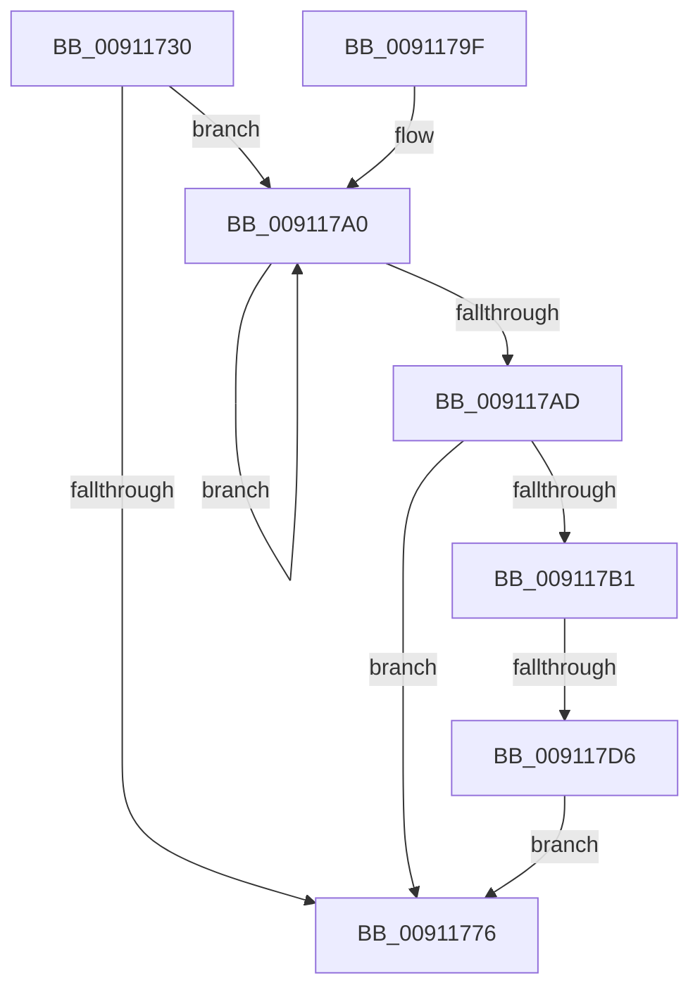

# PopLogDisabledSleepReason

- RVA: `0x00911730`–`0x009117DD` (길이 `173` bytes)
- VA: `0x0000000140911730`
- 실행 섹션: `PAGE`
- PDB 이름 있음: `예`; PDB Function 태그: `예`
- unwind 정보 RVA: `0x0008A1F4`
- 디코드: `47`개 명령, `173/173` bytes 표시
- 미해석 바이트: `0` (있으면 어셈블리에 `.byte`로 보존)

> 이 문서는 커널 이미지의 기계어와 PDB 기호를 분석해 생성했습니다. 4번과 5번은 함수 원형과 자료형을 바이너리 사용 방식에서 추정한 C 해석이며 원본 소스 복구 결과는 아닙니다.

## 1. Dependencies

- 직접 호출 지점: **4**; 고유 호출 대상: **4**
- 직접 호출자로 확인된 함수: **1**
- RIP 상대 이미지 참조: **2**

### Outgoing calls
- `0x00911756` → [ExAcquireFastMutex](../../text/20/ExAcquireFastMutex_function_0020E5A0.md) (function, `0x0020E5A0`)
- `0x0091175E` → [PopRemoveReasonRecordByReasonCode](PopRemoveReasonRecordByReasonCode_function_00911B30.md) (function, `0x00911B30`)
- `0x0091177D` → [ExReleaseFastMutex](../../text/25/ExReleaseFastMutex_function_002519C0.md) (function, `0x002519C0`)
- `0x009117C5` → [ExAllocatePool2](../../poolcode/B8/ExAllocatePool2_function_00B820F0.md) (function, `0x00B820F0`)

### Direct callers
- [PopFilterCapabilities](PopFilterCapabilities_function_0091141C.md) at `0x00911582`

### Static image references
- `0x0091174B` → RVA `0x00F0EA80` (`.data`; read)
- `0x00911763` → RVA `0x00F0EA70` (`.data`; read)

## 2. Other-region calls and transfers

- 다른 실행 섹션으로 향하는 call: **3**
  - `0x00911756` → [ExAcquireFastMutex](../../text/20/ExAcquireFastMutex_function_0020E5A0.md) (`PAGE` → `.text`)
  - `0x0091177D` → [ExReleaseFastMutex](../../text/25/ExReleaseFastMutex_function_002519C0.md) (`PAGE` → `.text`)
  - `0x009117C5` → [ExAllocatePool2](../../poolcode/B8/ExAllocatePool2_function_00B820F0.md) (`PAGE` → `POOLCODE`)
- call이 아닌 외부 분기/꼬리 이동: **1**
  - `0x009117D0` → [sub_00B216F0](../B2/Unknown_function_00B216F0.md) (`tail-transfer`)

## 3. Assembly (complete function range)

```asm
00911730  48 8B C4                        mov rax, rsp
00911733  48 89 58 08                     mov qword ptr [rax + 8], rbx
00911737  48 89 68 10                     mov qword ptr [rax + 0x10], rbp
0091173B  48 89 70 18                     mov qword ptr [rax + 0x18], rsi
0091173F  48 89 78 20                     mov qword ptr [rax + 0x20], rdi
00911743  41 56                           push r14
00911745  48 83 EC 20                     sub rsp, 0x20
00911749  33 DB                           xor ebx, ebx
0091174B  48 8D 0D 2E D3 5F 00            lea rcx, [rip + 0x5fd32e]
00911752  8B FB                           mov edi, ebx
00911754  8B F3                           mov esi, ebx
00911756  E8 45 CE 8F FF                  call 0x14020e5a0
0091175B  8D 4B 0D                        lea ecx, [rbx + 0xd]
0091175E  E8 CD 03 00 00                  call 0x140911b30
00911763  48 8B 05 06 D3 5F 00            mov rax, qword ptr [rip + 0x5fd306]
0091176A  4C 8D 35 FF D2 5F 00            lea r14, [rip + 0x5fd2ff]
00911771  49 3B C6                        cmp rax, r14
00911774  75 2A                           jne 0x1409117a0
00911776  48 8D 0D 03 D3 5F 00            lea rcx, [rip + 0x5fd303]
0091177D  E8 3E 02 94 FF                  call 0x1402519c0
00911782  48 8B 6C 24 38                  mov rbp, qword ptr [rsp + 0x38]
00911787  8B C3                           mov eax, ebx
00911789  48 8B 5C 24 30                  mov rbx, qword ptr [rsp + 0x30]
0091178E  48 8B 74 24 40                  mov rsi, qword ptr [rsp + 0x40]
00911793  48 8B 7C 24 48                  mov rdi, qword ptr [rsp + 0x48]
00911798  48 83 C4 20                     add rsp, 0x20
0091179C  41 5E                           pop r14
0091179E  C3                              ret
0091179F  CC                              int3
009117A0  0B 78 14                        or edi, dword ptr [rax + 0x14]
009117A3  FF C6                           inc esi
009117A5  48 8B 00                        mov rax, qword ptr [rax]
009117A8  49 3B C6                        cmp rax, r14
009117AB  75 F3                           jne 0x1409117a0
009117AD  85 FF                           test edi, edi
009117AF  74 C5                           je 0x140911776
009117B1  8B EE                           mov ebp, esi
009117B3  41 B8 63 62 75 66               mov r8d, 0x66756263
009117B9  48 C1 E5 03                     shl rbp, 3
009117BD  B9 00 01 00 00                  mov ecx, 0x100
009117C2  48 8B D5                        mov rdx, rbp
009117C5  E8 26 09 27 00                  call 0x140b820f0
009117CA  48 8B F0                        mov rsi, rax
009117CD  48 85 C0                        test rax, rax
009117D0  0F 85 1A FF 20 00               jne 0x140b216f0
009117D6  BB 9A 00 00 C0                  mov ebx, 0xc000009a
009117DB  EB 99                           jmp 0x140911776
```

## 4. C-style interpretation (structured pseudocode)

```c
__int64 __fastcall PopLogDisabledSleepReason(void)
{
    __int64 result;
    __int64 v_rbp;
    __int64 v_rbx;
    __int64 v_rdi;
    __int64 v_rsi;
    __int64 v_rsp;
    unsigned __int64 v_stack_p10;
    unsigned __int64 v_stack_p18;
    unsigned __int64 v_stack_p20;
    unsigned __int64 v_stack_p8;

    *(unsigned __int64 *)(v_rsp + 8) = v_rbx;
    *(unsigned __int64 *)(v_rsp + 16) = v_rbp;
    *(unsigned __int64 *)(v_rsp + 24) = v_rsi;
    *(unsigned __int64 *)(v_rsp + 32) = v_rdi;
    v_rsp = (v_rsp) - (32);
    v_rbx = 0;
    result = ExAcquireFastMutex(v_rip + 6279982, a2, a3, a4);
    result = PopRemoveReasonRecordByReasonCode(v_rbx + 13, a2, a3, a4);
    if ((*(unsigned __int64 *)(v_rip + 6279942)) != (v_rip + 6279935)) goto loc_009117A0;
loc_00911776:
    result = ExReleaseFastMutex(v_rip + 6279939, a2, a3, a4);
    v_rsp = (v_rsp) + (32);
    return 0;
loc_009117A0:
    v_rdi = (unsigned int)((v_stack_p20) | (*(unsigned int *)(0 + 20)));
    v_rsi = (unsigned int)((v_stack_p18) + 1);
    if ((*(unsigned __int64 *)(0)) != (v_rip + 6279935)) goto loc_009117A0;
    if ((unsigned int)(v_rdi) == 0) goto loc_00911776;
    v_rbp = ((unsigned int)((unsigned int)(v_rsi))) << (3);
    result = ExAllocatePool2(256, v_rbp, (unsigned int)(0x66756263ULL), a4);
    goto loc_00911776;
}
```

## 5. (Beta) C Style

```c
void PopLogDisabledSleepReason(void)
{
    int64_t result;
    int64_t local_rbp;
    int64_t local_rbx;
    int64_t local_rdi;
    int64_t local_rsi;
    int64_t local_rsp;
    uint64_t v_stack_p10;
    uint64_t v_stack_p18;
    uint64_t v_stack_p20;
    uint64_t v_stack_p8;

    *(uint64_t *)(local_rsp + 0x8) = local_rbx;
    *(uint64_t *)(local_rsp + 0x10) = local_rbp;
    *(uint64_t *)(local_rsp + 0x18) = local_rsi;
    *(uint64_t *)(local_rsp + 0x20) = local_rdi;
    local_rsp = (local_rsp) - (32);
    local_rbx = 0;
    result = ExAcquireFastMutex(v_rip + 6279982, a2, a3, a4);
    result = PopRemoveReasonRecordByReasonCode(local_rbx + 13, a2, a3, a4);
    if ((*(uint64_t *)(v_rip + 0x5FD306)) != (v_rip + 6279935)) goto loc_009117A0;
loc_00911776:
    result = ExReleaseFastMutex(v_rip + 6279939, a2, a3, a4);
    local_rsp = (local_rsp) + (32);
    return 0;
loc_009117A0:
    local_rdi = (uint32_t)((v_stack_p20) | (*(uint32_t *)(0 + 0x14)));
    local_rsi = (uint32_t)((v_stack_p18) + 1);
    if ((*(uint64_t *)(0)) != (v_rip + 6279935)) goto loc_009117A0;
    if ((uint32_t)(local_rdi) == 0) goto loc_00911776;
    local_rbp = ((uint32_t)((uint32_t)(local_rsi))) << (3);
    result = ExAllocatePool2(256, local_rbp, (uint32_t)(0x66756263ULL), a4);
    goto loc_00911776;
}
```

## 6. Execution-region graph

[열기: 2D/3D 그래프와 함수 탐색 컨트롤 패널](../../../control-panel.html?section=page&rva=0x00911730&view=graph)

- 2D 그래프는 위에서 아래로 흐르고, 3D 그래프는 빈 공간을 드래그해 회전합니다. Shift+드래그는 이동, 휠은 확대·축소, 함수 노드 선택은 대상 보고서 이동입니다.

### Static fallback


