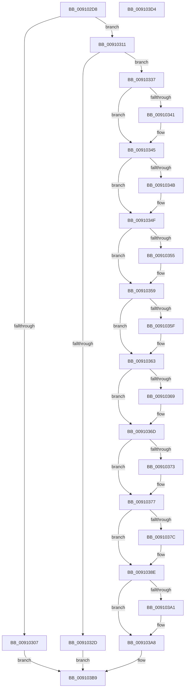

# PopLogSleepDisabled

- RVA: `0x009102D8`–`0x009103D5` (길이 `253` bytes)
- VA: `0x00000001409102D8`
- 실행 섹션: `PAGE`
- PDB 이름 있음: `예`; PDB Function 태그: `아니요`
- unwind 정보 RVA: `0x00060300`
- 디코드: `72`개 명령, `253/253` bytes 표시
- 미해석 바이트: `0` (있으면 어셈블리에 `.byte`로 보존)

> 이 문서는 커널 이미지의 기계어와 PDB 기호를 분석해 생성했습니다. 4번과 5번은 함수 원형과 자료형을 바이너리 사용 방식에서 추정한 C 해석이며 원본 소스 복구 결과는 아닙니다.

## 1. Dependencies

- 직접 호출 지점: **3**; 고유 호출 대상: **3**
- 직접 호출자로 확인된 함수: **7**
- RIP 상대 이미지 참조: **3**

### Outgoing calls
- `0x009102FB` → [PopGetReasonListByReasonCode](PopGetReasonListByReasonCode_function_00911B7C.md) (function, `0x00911B7C`)
- `0x00910320` → [ExAllocatePool2](../../poolcode/B8/ExAllocatePool2_function_00B820F0.md) (function, `0x00B820F0`)
- `0x00910389` → [memcpy](../../text/6C/memcpy_function_006C6840.md) (function, `0x006C6840`)

### Direct callers
- [PopUpdateUpgradeInProgress](../75/PopUpdateUpgradeInProgress_function_00754880.md) at `0x00754986`
- [PopEnableHiberFile](../90/PopEnableHiberFile_function_0090F850.md) at `0x0090FD1A`
- [NtPowerInformation](../95/NtPowerInformation_function_00955D80.md) at `0x009568E0`
- [sub_00B21662](../B2/Unknown_function_00B21662.md) at `0x00B2168E`
- [sub_00B216F0](../B2/Unknown_function_00B216F0.md) at `0x00B21722`
- [PopInitPlatformSettings](../../init/C3/PopInitPlatformSettings_function_00C3D40C.md) at `0x00C3D590`
- [PopInitPlatformSettings](../../init/C3/PopInitPlatformSettings_function_00C3D40C.md) at `0x00C3D5C9`
- [PoInitSystem](../../init/C7/PoInitSystem_function_00C72358.md) at `0x00C73005`
- [PoInitSystem](../../init/C7/PoInitSystem_function_00C72358.md) at `0x00C73020`
- [PoInitSystem](../../init/C7/PoInitSystem_function_00C72358.md) at `0x00C7306C`

### Static image references
- `0x0091038E` → RVA `0x00F0CBB8` (`.data`; read)
- `0x00910395` → RVA `0x00F0CBB0` (`.data`; read)
- `0x009103B2` → RVA `0x00F0CBB8` (`.data`; write)

## 2. Other-region calls and transfers

- 다른 실행 섹션으로 향하는 call: **2**
  - `0x00910320` → [ExAllocatePool2](../../poolcode/B8/ExAllocatePool2_function_00B820F0.md) (`PAGE` → `POOLCODE`)
  - `0x00910389` → [memcpy](../../text/6C/memcpy_function_006C6840.md) (`PAGE` → `.text`)
- 별도 외부 분기/꼬리 이동을 확인하지 못했습니다.

## 3. Assembly (complete function range)

```asm
009102D8  48 89 5C 24 08                  mov qword ptr [rsp + 8], rbx
009102DD  48 89 6C 24 10                  mov qword ptr [rsp + 0x10], rbp
009102E2  48 89 74 24 18                  mov qword ptr [rsp + 0x18], rsi
009102E7  57                              push rdi
009102E8  41 56                           push r14
009102EA  41 57                           push r15
009102EC  48 83 EC 20                     sub rsp, 0x20
009102F0  49 8B E9                        mov rbp, r9
009102F3  4D 8B F8                        mov r15, r8
009102F6  8B F2                           mov esi, edx
009102F8  44 8B F1                        mov r14d, ecx
009102FB  E8 7C 18 00 00                  call 0x140911b7c
00910300  33 FF                           xor edi, edi
00910302  48 85 C0                        test rax, rax
00910305  74 0A                           je 0x140910311
00910307  BF 35 00 00 C0                  mov edi, 0xc0000035
0091030C  E9 A8 00 00 00                  jmp 0x1409103b9
00910311  48 8D 55 20                     lea rdx, [rbp + 0x20]
00910315  B9 00 01 00 00                  mov ecx, 0x100
0091031A  41 B8 63 62 75 66               mov r8d, 0x66756263
00910320  E8 CB 1D 27 00                  call 0x140b820f0
00910325  48 8B D8                        mov rbx, rax
00910328  48 85 C0                        test rax, rax
0091032B  75 0A                           jne 0x140910337
0091032D  BF 9A 00 00 C0                  mov edi, 0xc000009a
00910332  E9 82 00 00 00                  jmp 0x1409103b9
00910337  44 89 70 18                     mov dword ptr [rax + 0x18], r14d
0091033B  40 F6 C6 01                     test sil, 1
0091033F  74 04                           je 0x140910345
00910341  C6 40 10 01                     mov byte ptr [rax + 0x10], 1
00910345  40 F6 C6 02                     test sil, 2
00910349  74 04                           je 0x14091034f
0091034B  C6 40 11 01                     mov byte ptr [rax + 0x11], 1
0091034F  40 F6 C6 04                     test sil, 4
00910353  74 04                           je 0x140910359
00910355  C6 40 12 01                     mov byte ptr [rax + 0x12], 1
00910359  40 F6 C6 08                     test sil, 8
0091035D  74 04                           je 0x140910363
0091035F  C6 40 13 01                     mov byte ptr [rax + 0x13], 1
00910363  40 F6 C6 10                     test sil, 0x10
00910367  74 04                           je 0x14091036d
00910369  C6 40 16 01                     mov byte ptr [rax + 0x16], 1
0091036D  40 F6 C6 20                     test sil, 0x20
00910371  74 04                           je 0x140910377
00910373  C6 40 14 01                     mov byte ptr [rax + 0x14], 1
00910377  48 85 ED                        test rbp, rbp
0091037A  74 12                           je 0x14091038e
0091037C  48 8D 48 20                     lea rcx, [rax + 0x20]
00910380  89 68 1C                        mov dword ptr [rax + 0x1c], ebp
00910383  4C 8B C5                        mov r8, rbp
00910386  49 8B D7                        mov rdx, r15
00910389  E8 B2 64 DB FF                  call 0x1406c6840
0091038E  48 8B 05 23 C8 5F 00            mov rax, qword ptr [rip + 0x5fc823]
00910395  48 8D 0D 14 C8 5F 00            lea rcx, [rip + 0x5fc814]
0091039C  48 39 08                        cmp qword ptr [rax], rcx
0091039F  74 07                           je 0x1409103a8
009103A1  B9 03 00 00 00                  mov ecx, 3
009103A6  CD 29                           int 0x29
009103A8  48 89 0B                        mov qword ptr [rbx], rcx
009103AB  48 89 43 08                     mov qword ptr [rbx + 8], rax
009103AF  48 89 18                        mov qword ptr [rax], rbx
009103B2  48 89 1D FF C7 5F 00            mov qword ptr [rip + 0x5fc7ff], rbx
009103B9  48 8B 5C 24 40                  mov rbx, qword ptr [rsp + 0x40]
009103BE  8B C7                           mov eax, edi
009103C0  48 8B 6C 24 48                  mov rbp, qword ptr [rsp + 0x48]
009103C5  48 8B 74 24 50                  mov rsi, qword ptr [rsp + 0x50]
009103CA  48 83 C4 20                     add rsp, 0x20
009103CE  41 5F                           pop r15
009103D0  41 5E                           pop r14
009103D2  5F                              pop rdi
009103D3  C3                              ret
009103D4  CC                              int3
```

## 4. C-style interpretation (structured pseudocode)

```c
__int64 __fastcall PopLogSleepDisabled(int a1, int a2, __int64 a3, __int64 a4)
{
    __int64 result;
    __int64 v_rdi;
    __int64 v_rsp;
    unsigned __int64 v_stack_p10;
    unsigned __int64 v_stack_p18;
    unsigned __int64 v_stack_p8;

    v_stack_p8 = v_rbx;
    v_stack_p10 = v_rbp;
    v_stack_p18 = v_rsi;
    v_rsp = (v_rsp) - (32);
    result = PopGetReasonListByReasonCode(a1, a2, a3, a4);
    v_rdi = 0;
    if (result == 0) goto loc_00910311;
    goto loc_009103B9;
loc_00910311:
    result = ExAllocatePool2(256, a4 + 32, (unsigned int)(0x66756263ULL), a4);
    if (result != 0) goto loc_00910337;
    goto loc_009103B9;
loc_00910337:
    *(unsigned int *)(result + 24) = (unsigned int)((unsigned int)(a1));
    if ((((unsigned __int8)((unsigned int)(a2))) & (1)) != 0) {
        *(unsigned __int8 *)(result + 16) = 1;
    }
    if ((((unsigned __int8)((unsigned int)(a2))) & (2)) != 0) {
        *(unsigned __int8 *)(result + 17) = 1;
    }
    if ((((unsigned __int8)((unsigned int)(a2))) & (4)) != 0) {
        *(unsigned __int8 *)(result + 18) = 1;
    }
    if ((((unsigned __int8)((unsigned int)(a2))) & (8)) != 0) {
        *(unsigned __int8 *)(result + 19) = 1;
    }
    if ((((unsigned __int8)((unsigned int)(a2))) & (16)) != 0) {
        *(unsigned __int8 *)(result + 22) = 1;
    }
    if ((((unsigned __int8)((unsigned int)(a2))) & (32)) != 0) {
        *(unsigned __int8 *)(result + 20) = 1;
    }
    if (a4 != 0) {
        a1 = result + 32;
        *(unsigned int *)(result + 28) = (unsigned int)(a4);
        a3 = a4;
        a2 = a3;
        result = memcpy(a1, a2, a3, a4);
    }
    if ((*(unsigned __int64 *)(*(unsigned __int64 *)(v_rip + 6277155))) != (v_rip + 6277140)) {
        a1 = 3;
    }
    *(unsigned __int64 *)(result) = a1;
    *(unsigned __int64 *)(result + 8) = *(unsigned __int64 *)(v_rip + 6277155);
    *(unsigned __int64 *)(*(unsigned __int64 *)(v_rip + 6277155)) = result;
    *(unsigned __int64 *)(v_rip + 6277119) = result;
loc_009103B9:
    v_rsp = (v_rsp) + (32);
    return (unsigned int)((unsigned int)((unsigned int)(0xC000009AULL)));
}
```

## 5. (Beta) C Style

```c
int64_t PopLogSleepDisabled(int32_t Arg1, int32_t Arg2, int64_t Arg3, void *Arg4)
{
    uint8_t *arg4 = (uint8_t *)Arg4;

    int64_t result;
    int64_t local_rdi;
    int64_t local_rsp;
    uint64_t v_stack_p10;
    uint64_t v_stack_p18;
    uint64_t v_stack_p8;

    v_stack_p8 = local_rbx;
    v_stack_p10 = local_rbp;
    v_stack_p18 = local_rsi;
    local_rsp = (local_rsp) - (32);
    result = PopGetReasonListByReasonCode(Arg1, Arg2, Arg3, Arg4);
    local_rdi = 0;
    if (result == 0) goto loc_00910311;
    goto loc_009103B9;
loc_00910311:
    result = ExAllocatePool2(256, Arg4 + 32, (uint32_t)(0x66756263ULL), Arg4);
    if (result != 0) goto loc_00910337;
    goto loc_009103B9;
loc_00910337:
    *(uint32_t *)(result + 0x18) = (uint32_t)((uint32_t)(Arg1));
    if ((((uint8_t)((uint32_t)(Arg2))) & (1)) != 0) {
        *(uint8_t *)(result + 0x10) = 1;
    }
    if ((((uint8_t)((uint32_t)(Arg2))) & (2)) != 0) {
        *(uint8_t *)(result + 0x11) = 1;
    }
    if ((((uint8_t)((uint32_t)(Arg2))) & (4)) != 0) {
        *(uint8_t *)(result + 0x12) = 1;
    }
    if ((((uint8_t)((uint32_t)(Arg2))) & (8)) != 0) {
        *(uint8_t *)(result + 0x13) = 1;
    }
    if ((((uint8_t)((uint32_t)(Arg2))) & (16)) != 0) {
        *(uint8_t *)(result + 0x16) = 1;
    }
    if ((((uint8_t)((uint32_t)(Arg2))) & (32)) != 0) {
        *(uint8_t *)(result + 0x14) = 1;
    }
    if (Arg4 != NULL) {
        Arg1 = result + 32;
        *(uint32_t *)(result + 0x1C) = (uint32_t)(Arg4);
        Arg3 = Arg4;
        Arg2 = Arg3;
        result = memcpy(Arg1, Arg2, Arg3, Arg4);
    }
    if ((*(uint64_t *)(*(uint64_t *)(v_rip + 0x5FC823))) != (v_rip + 6277140)) {
        Arg1 = 3;
    }
    *(uint64_t *)(result) = Arg1;
    *(uint64_t *)(result + 0x8) = *(uint64_t *)(v_rip + 0x5FC823);
    *(uint64_t *)(*(uint64_t *)(v_rip + 0x5FC823)) = result;
    *(uint64_t *)(v_rip + 0x5FC7FF) = result;
loc_009103B9:
    local_rsp = (local_rsp) + (32);
    return (uint32_t)((uint32_t)((uint32_t)(0xC000009AULL)));
}
```

### 관측된 메모리 오프셋

구조체 형식이 확인되지 않은 접근은 인자 기준의 오프셋으로만 기록했습니다.

| 기준 인자 | 오프셋 표현 | 폭 (bit) | 접근 |
|---|---:|---:|---|
| `Arg4` | `+ 0x20` | `64` | `R` |

## 6. Execution-region graph

[열기: 2D/3D 그래프와 함수 탐색 컨트롤 패널](../../../control-panel.html?section=page&rva=0x009102D8&view=graph)

- 2D 그래프는 위에서 아래로 흐르고, 3D 그래프는 빈 공간을 드래그해 회전합니다. Shift+드래그는 이동, 휠은 확대·축소, 함수 노드 선택은 대상 보고서 이동입니다.

### Static fallback


