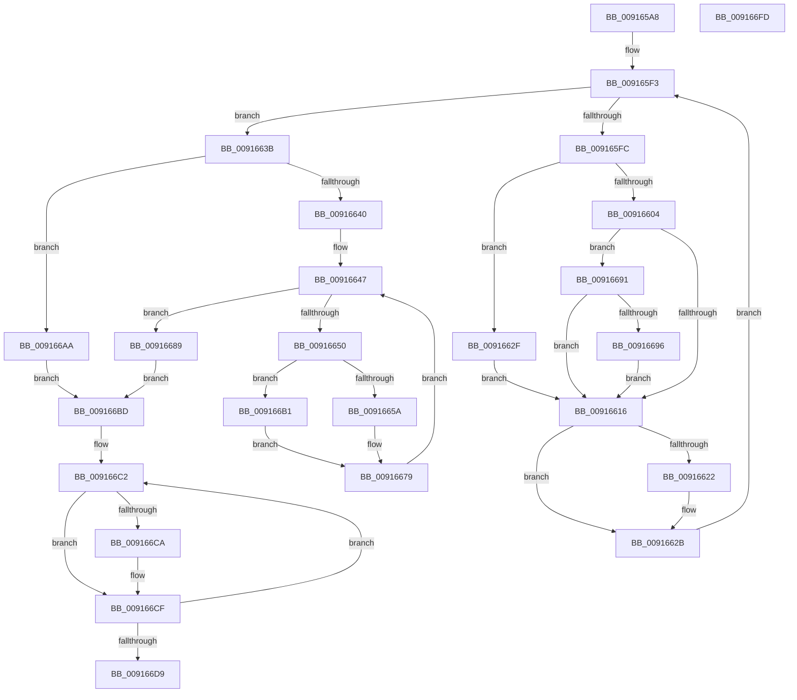

# PopMarshalSettingValues

- RVA: `0x009165A8`–`0x009166FE` (길이 `342` bytes)
- VA: `0x00000001409165A8`
- 실행 섹션: `PAGE`
- PDB 이름 있음: `예`; PDB Function 태그: `아니요`
- unwind 정보 RVA: `0x0008A7EC`
- 디코드: `105`개 명령, `342/342` bytes 표시
- 미해석 바이트: `0` (있으면 어셈블리에 `.byte`로 보존)

> 이 문서는 커널 이미지의 기계어와 PDB 기호를 분석해 생성했습니다. 4번과 5번은 함수 원형과 자료형을 바이너리 사용 방식에서 추정한 C 해석이며 원본 소스 복구 결과는 아닙니다.

## 1. Dependencies

- 직접 호출 지점: **3**; 고유 호출 대상: **3**
- 직접 호출자로 확인된 함수: **2**
- RIP 상대 이미지 참조: **2**

### Outgoing calls
- `0x00916674` → [memcpy](../../text/6C/memcpy_function_006C6840.md) (function, `0x006C6840`)
- `0x009166CA` → [PopUnreferencePowerSetting](PopUnreferencePowerSetting_function_009164A4.md) (function, `0x009164A4`)
- `0x009166E3` → [_security_check_cookie](../../text/6A/_security_check_cookie_function_006AC640.md) (function, `0x006AC640`)

### Direct callers
- [PopGetSettingValue](PopGetSettingValue_function_00913310.md) at `0x00913368`
- [PopDispatchNotificationsToList](../A3/PopDispatchNotificationsToList_function_00A3ADA8.md) at `0x00A3AE9E`

### Static image references
- `0x009165B9` → RVA `0x00E0A740` (`.data`; read)
- `0x009165E6` → RVA `0x00F0CE0C` (`.data`; read)

## 2. Other-region calls and transfers

- 다른 실행 섹션으로 향하는 call: **2**
  - `0x00916674` → [memcpy](../../text/6C/memcpy_function_006C6840.md) (`PAGE` → `.text`)
  - `0x009166E3` → [_security_check_cookie](../../text/6A/_security_check_cookie_function_006AC640.md) (`PAGE` → `.text`)
- 별도 외부 분기/꼬리 이동을 확인하지 못했습니다.

## 3. Assembly (complete function range)

```asm
009165A8  48 89 5C 24 08                  mov qword ptr [rsp + 8], rbx
009165AD  56                              push rsi
009165AE  57                              push rdi
009165AF  41 54                           push r12
009165B1  41 56                           push r14
009165B3  41 57                           push r15
009165B5  48 83 EC 50                     sub rsp, 0x50
009165B9  48 8B 05 80 41 4F 00            mov rax, qword ptr [rip + 0x4f4180]
009165C0  48 33 C4                        xor rax, rsp
009165C3  48 89 44 24 48                  mov qword ptr [rsp + 0x48], rax
009165C8  4D 8B E1                        mov r12, r9
009165CB  48 8B F2                        mov rsi, rdx
009165CE  4C 8B D1                        mov r10, rcx
009165D1  0F 57 C0                        xorps xmm0, xmm0
009165D4  33 C0                           xor eax, eax
009165D6  0F 11 44 24 30                  movups xmmword ptr [rsp + 0x30], xmm0
009165DB  48 89 44 24 40                  mov qword ptr [rsp + 0x40], rax
009165E0  33 FF                           xor edi, edi
009165E2  89 7C 24 24                     mov dword ptr [rsp + 0x24], edi
009165E6  4C 63 0D 1F 68 5F 00            movsxd r9, dword ptr [rip + 0x5f681f]
009165ED  33 D2                           xor edx, edx
009165EF  44 8D 70 03                     lea r14d, [rax + 3]
009165F3  89 54 24 20                     mov dword ptr [rsp + 0x20], edx
009165F7  41 3B D6                        cmp edx, r14d
009165FA  73 3F                           jae 0x14091663b
009165FC  41 8B 42 34                     mov eax, dword ptr [r10 + 0x34]
00916600  A8 08                           test al, 8
00916602  75 2B                           jne 0x14091662f
00916604  49 8B 44 D2 40                  mov rax, qword ptr [r10 + rdx*8 + 0x40]
00916609  48 8B C8                        mov rcx, rax
0091660C  48 89 44 D4 30                  mov qword ptr [rsp + rdx*8 + 0x30], rax
00916611  83 FA 02                        cmp edx, 2
00916614  74 7B                           je 0x140916691
00916616  83 C7 08                        add edi, 8
00916619  89 7C 24 24                     mov dword ptr [rsp + 0x24], edi
0091661D  48 85 C9                        test rcx, rcx
00916620  74 09                           je 0x14091662b
00916622  FF 01                           inc dword ptr [rcx]
00916624  03 79 04                        add edi, dword ptr [rcx + 4]
00916627  89 7C 24 24                     mov dword ptr [rsp + 0x24], edi
0091662B  FF C2                           inc edx
0091662D  EB C4                           jmp 0x1409165f3
0091662F  4B 8B 4C CA 40                  mov rcx, qword ptr [r10 + r9*8 + 0x40]
00916634  48 89 4C D4 30                  mov qword ptr [rsp + rdx*8 + 0x30], rcx
00916639  EB DB                           jmp 0x140916616
0091663B  44 3B C7                        cmp r8d, edi
0091663E  72 6A                           jb 0x1409166aa
00916640  48 89 74 24 28                  mov qword ptr [rsp + 0x28], rsi
00916645  33 DB                           xor ebx, ebx
00916647  89 5C 24 20                     mov dword ptr [rsp + 0x20], ebx
0091664B  41 3B DE                        cmp ebx, r14d
0091664E  73 39                           jae 0x140916689
00916650  48 8B 54 DC 30                  mov rdx, qword ptr [rsp + rbx*8 + 0x30]
00916655  48 85 D2                        test rdx, rdx
00916658  74 57                           je 0x1409166b1
0091665A  8B 42 08                        mov eax, dword ptr [rdx + 8]
0091665D  89 06                           mov dword ptr [rsi], eax
0091665F  8B 42 04                        mov eax, dword ptr [rdx + 4]
00916662  89 46 04                        mov dword ptr [rsi + 4], eax
00916665  44 8B 7A 04                     mov r15d, dword ptr [rdx + 4]
00916669  45 8B C7                        mov r8d, r15d
0091666C  48 83 C2 0C                     add rdx, 0xc
00916670  48 8D 4E 08                     lea rcx, [rsi + 8]
00916674  E8 C7 01 DB FF                  call 0x1406c6840
00916679  41 8D 4F 08                     lea ecx, [r15 + 8]
0091667D  48 03 F1                        add rsi, rcx
00916680  48 89 74 24 28                  mov qword ptr [rsp + 0x28], rsi
00916685  FF C3                           inc ebx
00916687  EB BE                           jmp 0x140916647
00916689  41 89 3C 24                     mov dword ptr [r12], edi
0091668D  33 FF                           xor edi, edi
0091668F  EB 2C                           jmp 0x1409166bd
00916691  48 85 C0                        test rax, rax
00916694  75 80                           jne 0x140916616
00916696  48 8B 44 24 38                  mov rax, qword ptr [rsp + 0x38]
0091669B  48 89 44 D4 30                  mov qword ptr [rsp + rdx*8 + 0x30], rax
009166A0  48 8B 4C 24 38                  mov rcx, qword ptr [rsp + 0x38]
009166A5  E9 6C FF FF FF                  jmp 0x140916616
009166AA  BF 23 00 00 C0                  mov edi, 0xc0000023
009166AF  EB 0C                           jmp 0x1409166bd
009166B1  83 26 00                        and dword ptr [rsi], 0
009166B4  83 66 04 00                     and dword ptr [rsi + 4], 0
009166B8  45 33 FF                        xor r15d, r15d
009166BB  EB BC                           jmp 0x140916679
009166BD  48 8D 5C 24 30                  lea rbx, [rsp + 0x30]
009166C2  48 8B 0B                        mov rcx, qword ptr [rbx]
009166C5  48 85 C9                        test rcx, rcx
009166C8  74 05                           je 0x1409166cf
009166CA  E8 D5 FD FF FF                  call 0x1409164a4
009166CF  48 83 C3 08                     add rbx, 8
009166D3  49 83 EE 01                     sub r14, 1
009166D7  75 E9                           jne 0x1409166c2
009166D9  8B C7                           mov eax, edi
009166DB  48 8B 4C 24 48                  mov rcx, qword ptr [rsp + 0x48]
009166E0  48 33 CC                        xor rcx, rsp
009166E3  E8 58 5F D9 FF                  call 0x1406ac640
009166E8  48 8B 9C 24 80 00 00 00         mov rbx, qword ptr [rsp + 0x80]
009166F0  48 83 C4 50                     add rsp, 0x50
009166F4  41 5F                           pop r15
009166F6  41 5E                           pop r14
009166F8  41 5C                           pop r12
009166FA  5F                              pop rdi
009166FB  5E                              pop rsi
009166FC  C3                              ret
009166FD  CC                              int3
```

## 4. C-style interpretation (structured pseudocode)

```c
__int64 __fastcall PopMarshalSettingValues(__int64 a1, __int64 a2, int a3, __int64 a4)
{
    __int64 result;
    __int64 v_r14;
    __int64 v_r15;
    __int64 v_rbx;
    __int64 v_rdi;
    __int64 v_rsi;
    __int64 v_rsp;
    unsigned __int64 v_stack_m30;
    unsigned __int64 v_stack_m38;
    unsigned __int64 v_stack_m40;
    unsigned __int64 v_stack_m48;
    unsigned __int64 v_stack_m50;
    unsigned int v_stack_m54;
    unsigned int v_stack_m58;
    unsigned __int64 v_stack_p8;

    v_stack_p8 = v_rbx;
    v_rsp = (v_rsp) - (80);
    result = (*(unsigned __int64 *)(v_rip + 5194112)) ^ (v_rsp);
    v_stack_m30 = result;
    result = 0;
    v_stack_m48 = v_xmm0;
    v_stack_m38 = 0;
    v_rdi = 0;
    v_stack_m54 = 0;
    a2 = 0;
loc_009165F3:
    v_stack_m58 = 0;
    if (0 >= ((unsigned int)(result + 3))) goto loc_0091663B;
    if ((((unsigned __int8)((unsigned int)(*(unsigned int *)(a1 + 52)))) & (8)) != 0) goto loc_0091662F;
    *(unsigned __int64 *)(v_rsp + a2 * 8 + 48) = *(unsigned __int64 *)(a1 + a2 * 8 + 64);
    if (0 == 2) goto loc_00916691;
loc_00916616:
    v_rdi = (unsigned int)((v_rdi) + (8));
    v_stack_m54 = (unsigned int)(v_rdi);
    if (*(unsigned __int64 *)(a1 + a2 * 8 + 64) != 0) {
        v_rdi = (unsigned int)((v_rdi) + (*(unsigned int *)(*(unsigned __int64 *)(a1 + a2 * 8 + 64) + 4)));
        v_stack_m54 = (unsigned int)(v_rdi);
    }
    a2 = (unsigned int)((a2) + 1);
    goto loc_009165F3;
loc_0091662F:
    *(unsigned __int64 *)(v_rsp + a2 * 8 + 48) = *(unsigned __int64 *)(a1 + (int)(*(unsigned int *)(v_rip + 6252575)) * 8 + 64);
    goto loc_00916616;
loc_0091663B:
    if (a3 < ((unsigned int)(v_rdi))) goto loc_009166AA;
    v_stack_m50 = a2;
    v_rbx = 0;
loc_00916647:
    v_stack_m58 = 0;
    if (0 >= ((unsigned int)(result + 3))) goto loc_00916689;
    if (*(unsigned __int64 *)(v_rsp + v_rbx * 8 + 48) == 0) goto loc_009166B1;
    *(unsigned int *)(a2) = (unsigned int)((unsigned int)(*(unsigned int *)(*(unsigned __int64 *)(v_rsp + v_rbx * 8 + 48) + 8)));
    *(unsigned int *)(a2 + 4) = (unsigned int)((unsigned int)(*(unsigned int *)(*(unsigned __int64 *)(v_rsp + v_rbx * 8 + 48) + 4)));
    a2 = (*(unsigned __int64 *)(v_rsp + v_rbx * 8 + 48)) + (12);
    result = memcpy(a2 + 8, a2, (unsigned int)((unsigned int)((unsigned int)(*(unsigned int *)(*(unsigned __int64 *)(v_rsp + v_rbx * 8 + 48) + 4)))), (int)(*(unsigned int *)(v_rip + 6252575)));
loc_00916679:
    v_rsi = (a2) + ((unsigned int)(*(unsigned int *)(*(unsigned __int64 *)(v_rsp + v_rbx * 8 + 48) + 4)) + 8);
    v_stack_m50 = v_rsi;
    v_rbx = (unsigned int)((v_rbx) + 1);
    goto loc_00916647;
loc_00916689:
    *(unsigned int *)(a4) = (unsigned int)(v_rdi);
    v_rdi = 0;
    goto loc_009166BD;
loc_00916691:
    if (result != 0) goto loc_00916616;
    *(unsigned __int64 *)(v_rsp + a2 * 8 + 48) = v_stack_m40;
    goto loc_00916616;
loc_009166AA:
    goto loc_009166BD;
loc_009166B1:
    v_r15 = 0;
    goto loc_00916679;
loc_009166BD:
loc_009166C2:
    result = v_stack_m40;
    if (*(unsigned __int64 *)(v_stack_m48) != 0) {
        result = PopUnreferencePowerSetting(*(unsigned __int64 *)(v_stack_m48), a2, (unsigned int)((unsigned int)((unsigned int)(*(unsigned int *)(*(unsigned __int64 *)(v_rsp + v_rbx * 8 + 48) + 4)))), (int)(*(unsigned int *)(v_rip + 6252575)));
    }
    v_rbx = (v_stack_m48) + (8);
    v_r14 = (result + 3) - (1);
    if (condition_is_not_equal) goto loc_009166C2;
    a1 = (v_stack_m30) ^ (v_rsp);
    result = _security_check_cookie(a1, a2, (unsigned int)((unsigned int)((unsigned int)(*(unsigned int *)(*(unsigned __int64 *)(v_rsp + v_rbx * 8 + 48) + 4)))), (int)(*(unsigned int *)(v_rip + 6252575)));
    v_rsp = (v_rsp) + (80);
    return result;
}
```

## 5. (Beta) C Style

```c
int64_t PopMarshalSettingValues(void *Arg1, void *Arg2, int32_t Arg3, void *Arg4)
{
    uint8_t *arg1 = (uint8_t *)Arg1;
    uint8_t *arg2 = (uint8_t *)Arg2;
    uint8_t *arg4 = (uint8_t *)Arg4;

    int64_t result;
    int64_t local_r14;
    int64_t local_r15;
    int64_t local_rbx;
    int64_t local_rdi;
    int64_t local_rsi;
    int64_t local_rsp;
    uint64_t v_stack_m30;
    uint64_t v_stack_m38;
    uint64_t v_stack_m40;
    uint64_t v_stack_m48;
    uint64_t v_stack_m50;
    uint32_t v_stack_m54;
    uint32_t v_stack_m58;
    uint64_t v_stack_p8;

    v_stack_p8 = local_rbx;
    local_rsp = (local_rsp) - (80);
    result = (*(uint64_t *)(v_rip + 0x4F4180)) ^ (local_rsp);
    v_stack_m30 = result;
    result = 0;
    v_stack_m48 = v_xmm0;
    v_stack_m38 = 0;
    local_rdi = 0;
    v_stack_m54 = 0;
    Arg2 = 0;
loc_009165F3:
    v_stack_m58 = 0;
    if (0 >= ((uint32_t)(result + 3))) goto loc_0091663B;
    if ((((uint8_t)((uint32_t)(*(uint32_t *)(arg1 + 0x34)))) & (8)) != 0) goto loc_0091662F;
    *(uint64_t *)(local_rsp + arg2 * 8 + 0x30) = *(uint64_t *)(arg1 + arg2 * 8 + 0x40);
    if (0 == 2) goto loc_00916691;
loc_00916616:
    local_rdi = (uint32_t)((local_rdi) + (8));
    v_stack_m54 = (uint32_t)(local_rdi);
    if (*(uint64_t *)(arg1 + arg2 * 8 + 0x40) != 0) {
        local_rdi = (uint32_t)((local_rdi) + (*(uint32_t *)(*(uint64_t *)(arg1 + arg2 * 8 + 0x40) + 0x4)));
        v_stack_m54 = (uint32_t)(local_rdi);
    }
    Arg2 = (uint32_t)((Arg2) + 1);
    goto loc_009165F3;
loc_0091662F:
    *(uint64_t *)(local_rsp + arg2 * 8 + 0x30) = *(uint64_t *)(arg1 + (int32_t)(*(uint32_t *)(v_rip + 0x5F681F)) * 8 + 0x40);
    goto loc_00916616;
loc_0091663B:
    if (Arg3 < ((uint32_t)(local_rdi))) goto loc_009166AA;
    v_stack_m50 = Arg2;
    local_rbx = 0;
loc_00916647:
    v_stack_m58 = 0;
    if (0 >= ((uint32_t)(result + 3))) goto loc_00916689;
    if (*(uint64_t *)(local_rsp + local_rbx * 8 + 0x30) == 0) goto loc_009166B1;
    *(uint32_t *)(arg2) = (uint32_t)((uint32_t)(*(uint32_t *)(*(uint64_t *)(local_rsp + local_rbx * 8 + 0x30) + 0x8)));
    *(uint32_t *)(arg2 + 0x4) = (uint32_t)((uint32_t)(*(uint32_t *)(*(uint64_t *)(local_rsp + local_rbx * 8 + 0x30) + 0x4)));
    Arg2 = (*(uint64_t *)(local_rsp + local_rbx * 8 + 0x30)) + (12);
    result = memcpy(Arg2 + 8, Arg2, (uint32_t)((uint32_t)((uint32_t)(*(uint32_t *)(*(uint64_t *)(local_rsp + local_rbx * 8 + 0x30) + 0x4)))), (int32_t)(*(uint32_t *)(v_rip + 0x5F681F)));
loc_00916679:
    local_rsi = (Arg2) + ((uint32_t)(*(uint32_t *)(*(uint64_t *)(local_rsp + local_rbx * 8 + 0x30) + 0x4)) + 8);
    v_stack_m50 = local_rsi;
    local_rbx = (uint32_t)((local_rbx) + 1);
    goto loc_00916647;
loc_00916689:
    *(uint32_t *)(arg4) = (uint32_t)(local_rdi);
    local_rdi = 0;
    goto loc_009166BD;
loc_00916691:
    if (result != 0) goto loc_00916616;
    *(uint64_t *)(local_rsp + arg2 * 8 + 0x30) = v_stack_m40;
    goto loc_00916616;
loc_009166AA:
    goto loc_009166BD;
loc_009166B1:
    local_r15 = 0;
    goto loc_00916679;
loc_009166BD:
loc_009166C2:
    result = v_stack_m40;
    if (*(uint64_t *)(v_stack_m48) != 0) {
        result = PopUnreferencePowerSetting(*(uint64_t *)(v_stack_m48), Arg2, (uint32_t)((uint32_t)((uint32_t)(*(uint32_t *)(*(uint64_t *)(local_rsp + local_rbx * 8 + 0x30) + 0x4)))), (int32_t)(*(uint32_t *)(v_rip + 0x5F681F)));
    }
    local_rbx = (v_stack_m48) + (8);
    local_r14 = (result + 3) - (1);
    if (condition_is_not_equal) goto loc_009166C2;
    Arg1 = (v_stack_m30) ^ (local_rsp);
    result = _security_check_cookie(Arg1, Arg2, (uint32_t)((uint32_t)((uint32_t)(*(uint32_t *)(*(uint64_t *)(local_rsp + local_rbx * 8 + 0x30) + 0x4)))), (int32_t)(*(uint32_t *)(v_rip + 0x5F681F)));
    local_rsp = (local_rsp) + (80);
    return result;
}
```

### 관측된 메모리 오프셋

구조체 형식이 확인되지 않은 접근은 인자 기준의 오프셋으로만 기록했습니다.

| 기준 인자 | 오프셋 표현 | 폭 (bit) | 접근 |
|---|---:|---:|---|
| `Arg1` | `+ 0x34` | `32` | `R` |
| `Arg1` | `+ 0x40 + r9*8` | `64` | `R` |
| `Arg1` | `+ 0x40 + rdx*8` | `64` | `R` |
| `Arg2` | `+ 0x0` | `32` | `R/W` |
| `Arg2` | `+ 0x0` | `32` | `W` |
| `Arg2` | `+ 0x4` | `32` | `R/W` |
| `Arg2` | `+ 0x4` | `32` | `W` |
| `Arg2` | `+ 0x8` | `64` | `R` |
| `Arg4` | `+ 0x0` | `32` | `W` |

## 6. Execution-region graph

[열기: 2D/3D 그래프와 함수 탐색 컨트롤 패널](../../../control-panel.html?section=page&rva=0x009165A8&view=graph)

- 2D 그래프는 위에서 아래로 흐르고, 3D 그래프는 빈 공간을 드래그해 회전합니다. Shift+드래그는 이동, 휠은 확대·축소, 함수 노드 선택은 대상 보고서 이동입니다.

### Static fallback


