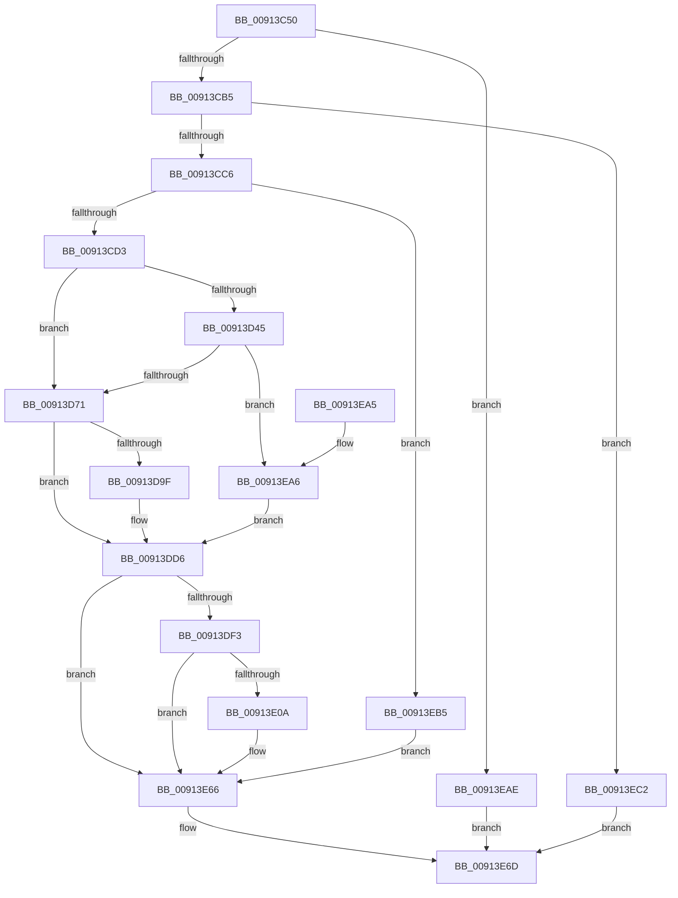

# PopNotifyConsoleUserPresent

- RVA: `0x00913C50`–`0x00913EC7` (길이 `631` bytes)
- VA: `0x0000000140913C50`
- 실행 섹션: `PAGE`
- PDB 이름 있음: `예`; PDB Function 태그: `아니요`
- unwind 정보 RVA: `0x0008A530`
- 디코드: `157`개 명령, `631/631` bytes 표시
- 미해석 바이트: `0` (있으면 어셈블리에 `.byte`로 보존)

> 이 문서는 커널 이미지의 기계어와 PDB 기호를 분석해 생성했습니다. 4번과 5번은 함수 원형과 자료형을 바이너리 사용 방식에서 추정한 C 해석이며 원본 소스 복구 결과는 아닙니다.

## 1. Dependencies

- 직접 호출 지점: **14**; 고유 호출 대상: **12**
- 직접 호출자로 확인된 함수: **3**
- RIP 상대 이미지 참조: **5**

### Outgoing calls
- `0x00913CB5` → [RtlGetActiveConsoleId](../../text/43/RtlGetActiveConsoleId_function_00436230.md) (function, `0x00436230`)
- `0x00913CC6` → [TtmIsEnabled](TtmIsEnabled_function_009143D8.md) (function, `0x009143D8`)
- `0x00913D0D` → [memset](../../text/6C/memset_function_006C6C40.md) (function, `0x006C6C40`)
- `0x00913D1D` → [PopIsStateTransitionBlockingThread](../../pagelk/B7/PopIsStateTransitionBlockingThread_function_00B79380.md) (function, `0x00B79380`)
- `0x00913D3C` → [PopDiagTraceWin32kCalloutStart](PopDiagTraceWin32kCalloutStart_function_0091564C.md) (function, `0x0091564C`)
- `0x00913D64` → [ZwPowerInformation](../../text/6A/ZwPowerInformation_function_006ADCB0.md) (function, `0x006ADCB0`)
- `0x00913D8D` → [PopInvokeWin32CalloutWithWatchdog](PopInvokeWin32CalloutWithWatchdog_function_00913920.md) (function, `0x00913920`)
- `0x00913DA9` → [memset](../../text/6C/memset_function_006C6C40.md) (function, `0x006C6C40`)
- `0x00913DD1` → [ZwPowerInformation](../../text/6A/ZwPowerInformation_function_006ADCB0.md) (function, `0x006ADCB0`)
- `0x00913E01` → [EtwEventEnabled](../../text/39/EtwEventEnabled_function_00392450.md) (function, `0x00392450`)
- `0x00913E61` → [EtwWrite](../../text/41/EtwWrite_function_0041C720.md) (function, `0x0041C720`)
- `0x00913E78` → [PopDiagTraceNotifyConsoleUserPresent](PopDiagTraceNotifyConsoleUserPresent_function_00913ED0.md) (function, `0x00913ED0`)
- `0x00913E84` → [_security_check_cookie](../../text/6A/_security_check_cookie_function_006AC640.md) (function, `0x006AC640`)
- `0x00913EBB` → [TtmNotifyConsoleUserPresent](TtmNotifyConsoleUserPresent_function_0091327C.md) (function, `0x0091327C`)

### Direct callers
- [PopUserPresentSetWorker](../../text/49/PopUserPresentSetWorker_function_0049D4F0.md) at `0x0049D57E`
- [PopSetSystemAwayMode](../75/PopSetSystemAwayMode_function_0075EF00.md) at `0x0075EFEE`
- [NtSetThreadExecutionState](../AC/NtSetThreadExecutionState_function_00AC0A40.md) at `0x00AC0D1F`

### Static image references
- `0x00913C6E` → RVA `0x00E0A740` (`.data`; read)
- `0x00913C81` → RVA `0x00F06628` (`.data`; read)
- `0x00913DD6` → RVA `0x00E67858` (`.data`; read)
- `0x00913DF3` → RVA `0x00F0B408` (`.data`; read)
- `0x00913DFA` → RVA `0x000119C8` (`.rdata`; read)

## 2. Other-region calls and transfers

- 다른 실행 섹션으로 향하는 call: **9**
  - `0x00913CB5` → [RtlGetActiveConsoleId](../../text/43/RtlGetActiveConsoleId_function_00436230.md) (`PAGE` → `.text`)
  - `0x00913D0D` → [memset](../../text/6C/memset_function_006C6C40.md) (`PAGE` → `.text`)
  - `0x00913D1D` → [PopIsStateTransitionBlockingThread](../../pagelk/B7/PopIsStateTransitionBlockingThread_function_00B79380.md) (`PAGE` → `PAGELK`)
  - `0x00913D64` → [ZwPowerInformation](../../text/6A/ZwPowerInformation_function_006ADCB0.md) (`PAGE` → `.text`)
  - `0x00913DA9` → [memset](../../text/6C/memset_function_006C6C40.md) (`PAGE` → `.text`)
  - `0x00913DD1` → [ZwPowerInformation](../../text/6A/ZwPowerInformation_function_006ADCB0.md) (`PAGE` → `.text`)
  - `0x00913E01` → [EtwEventEnabled](../../text/39/EtwEventEnabled_function_00392450.md) (`PAGE` → `.text`)
  - `0x00913E61` → [EtwWrite](../../text/41/EtwWrite_function_0041C720.md) (`PAGE` → `.text`)
  - `0x00913E84` → [_security_check_cookie](../../text/6A/_security_check_cookie_function_006AC640.md) (`PAGE` → `.text`)
- 별도 외부 분기/꼬리 이동을 확인하지 못했습니다.

## 3. Assembly (complete function range)

```asm
00913C50  48 89 5C 24 18                  mov qword ptr [rsp + 0x18], rbx
00913C55  48 89 74 24 20                  mov qword ptr [rsp + 0x20], rsi
00913C5A  55                              push rbp
00913C5B  57                              push rdi
00913C5C  41 54                           push r12
00913C5E  41 56                           push r14
00913C60  41 57                           push r15
00913C62  48 8D 6C 24 C0                  lea rbp, [rsp - 0x40]
00913C67  48 81 EC 40 01 00 00            sub rsp, 0x140
00913C6E  48 8B 05 CB 6A 4F 00            mov rax, qword ptr [rip + 0x4f6acb]
00913C75  48 33 C4                        xor rax, rsp
00913C78  48 89 45 30                     mov qword ptr [rbp + 0x30], rax
00913C7C  33 C0                           xor eax, eax
00913C7E  83 CB FF                        or ebx, 0xffffffff
00913C81  80 3D A0 29 5F 00 00            cmp byte ptr [rip + 0x5f29a0], 0
00913C88  0F 57 C0                        xorps xmm0, xmm0
00913C8B  89 44 24 39                     mov dword ptr [rsp + 0x39], eax
00913C8F  8B F2                           mov esi, edx
00913C91  89 44 24 38                     mov dword ptr [rsp + 0x38], eax
00913C95  44 8A E1                        mov r12b, cl
00913C98  89 45 90                        mov dword ptr [rbp - 0x70], eax
00913C9B  8B C3                           mov eax, ebx
00913C9D  0F 11 44 24 60                  movups xmmword ptr [rsp + 0x60], xmm0
00913CA2  89 5C 24 30                     mov dword ptr [rsp + 0x30], ebx
00913CA6  0F 11 44 24 70                  movups xmmword ptr [rsp + 0x70], xmm0
00913CAB  0F 11 45 80                     movups xmmword ptr [rbp - 0x80], xmm0
00913CAF  0F 84 F9 01 00 00               je 0x140913eae
00913CB5  E8 76 25 B2 FF                  call 0x140436230
00913CBA  89 44 24 30                     mov dword ptr [rsp + 0x30], eax
00913CBE  3B C3                           cmp eax, ebx
00913CC0  0F 84 FC 01 00 00               je 0x140913ec2
00913CC6  E8 0D 07 00 00                  call 0x1409143d8
00913CCB  84 C0                           test al, al
00913CCD  0F 85 E2 01 00 00               jne 0x140913eb5
00913CD3  83 65 88 00                     and dword ptr [rbp - 0x78], 0
00913CD7  48 8D 4D A0                     lea rcx, [rbp - 0x60]
00913CDB  48 83 65 90 00                  and qword ptr [rbp - 0x70], 0
00913CE0  BF 01 00 00 00                  mov edi, 1
00913CE5  88 44 24 74                     mov byte ptr [rsp + 0x74], al
00913CE9  33 D2                           xor edx, edx
00913CEB  48 8D 44 24 38                  lea rax, [rsp + 0x38]
00913CF0  44 88 64 24 38                  mov byte ptr [rsp + 0x38], r12b
00913CF5  89 74 24 3C                     mov dword ptr [rsp + 0x3c], esi
00913CF9  44 8D 47 5F                     lea r8d, [rdi + 0x5f]
00913CFD  89 7C 24 70                     mov dword ptr [rsp + 0x70], edi
00913D01  C7 44 24 78 08 00 00 00         mov dword ptr [rsp + 0x78], 8
00913D09  48 89 45 80                     mov qword ptr [rbp - 0x80], rax
00913D0D  E8 2E 2F DB FF                  call 0x1406c6c40
00913D12  45 33 FF                        xor r15d, r15d
00913D15  45 33 F6                        xor r14d, r14d
00913D18  4C 21 7C 24 50                  and qword ptr [rsp + 0x50], r15
00913D1D  E8 5E 56 26 00                  call 0x140b79380
00913D22  8A D8                           mov bl, al
00913D24  48 8D 54 24 60                  lea rdx, [rsp + 0x60]
00913D29  48 8D 44 24 30                  lea rax, [rsp + 0x30]
00913D2E  44 8A CF                        mov r9b, dil
00913D31  44 8B C7                        mov r8d, edi
00913D34  48 89 44 24 20                  mov qword ptr [rsp + 0x20], rax
00913D39  8D 4F 04                        lea ecx, [rdi + 4]
00913D3C  E8 0B 19 00 00                  call 0x14091564c
00913D41  84 DB                           test bl, bl
00913D43  75 2C                           jne 0x140913d71
00913D45  4C 8D 4C 24 50                  lea r9, [rsp + 0x50]
00913D4A  C7 45 A0 15 00 00 00            mov dword ptr [rbp - 0x60], 0x15
00913D51  44 8D 47 5F                     lea r8d, [rdi + 0x5f]
00913D55  C7 44 24 20 08 00 00 00         mov dword ptr [rsp + 0x20], 8
00913D5D  48 8D 55 A0                     lea rdx, [rbp - 0x60]
00913D61  8D 4F 56                        lea ecx, [rdi + 0x56]
00913D64  E8 47 9F D9 FF                  call 0x1406adcb0
00913D69  85 C0                           test eax, eax
00913D6B  0F 88 35 01 00 00               js 0x140913ea6
00913D71  48 8B 44 24 50                  mov rax, qword ptr [rsp + 0x50]
00913D76  4C 8D 4C 24 30                  lea r9, [rsp + 0x30]
00913D7B  44 8B C7                        mov r8d, edi
00913D7E  48 89 44 24 20                  mov qword ptr [rsp + 0x20], rax
00913D83  48 8D 54 24 60                  lea rdx, [rsp + 0x60]
00913D88  B9 05 00 00 00                  mov ecx, 5
00913D8D  E8 8E FB FF FF                  call 0x140913920
00913D92  48 8B 5C 24 50                  mov rbx, qword ptr [rsp + 0x50]
00913D97  44 8B F8                        mov r15d, eax
00913D9A  48 85 DB                        test rbx, rbx
00913D9D  74 37                           je 0x140913dd6
00913D9F  33 D2                           xor edx, edx
00913DA1  48 8D 4D A0                     lea rcx, [rbp - 0x60]
00913DA5  44 8D 42 60                     lea r8d, [rdx + 0x60]
00913DA9  E8 92 2E DB FF                  call 0x1406c6c40
00913DAE  44 21 74 24 20                  and dword ptr [rsp + 0x20], r14d
00913DB3  48 8D 55 A0                     lea rdx, [rbp - 0x60]
00913DB7  45 33 C9                        xor r9d, r9d
00913DBA  C7 45 A0 15 00 00 00            mov dword ptr [rbp - 0x60], 0x15
00913DC1  48 89 5D A8                     mov qword ptr [rbp - 0x58], rbx
00913DC5  40 88 7D F8                     mov byte ptr [rbp - 8], dil
00913DC9  45 8D 41 60                     lea r8d, [r9 + 0x60]
00913DCD  41 8D 49 57                     lea ecx, [r9 + 0x57]
00913DD1  E8 DA 9E D9 FF                  call 0x1406adcb0
00913DD6  80 3D 7B 3A 55 00 00            cmp byte ptr [rip + 0x553a7b], 0
00913DDD  48 8D 44 24 60                  lea rax, [rsp + 0x60]
00913DE2  48 89 44 24 58                  mov qword ptr [rsp + 0x58], rax
00913DE7  44 89 74 24 48                  mov dword ptr [rsp + 0x48], r14d
00913DEC  44 89 7C 24 40                  mov dword ptr [rsp + 0x40], r15d
00913DF1  74 73                           je 0x140913e66
00913DF3  48 8B 0D 0E 76 5F 00            mov rcx, qword ptr [rip + 0x5f760e]
00913DFA  48 8D 15 C7 DB 6F FF            lea rdx, [rip - 0x902439]
00913E01  E8 4A E6 A7 FF                  call 0x140392450
00913E06  84 C0                           test al, al
00913E08  74 5C                           je 0x140913e66
00913E0A  83 65 0C 00                     and dword ptr [rbp + 0xc], 0
00913E0E  48 8D 44 24 58                  lea rax, [rsp + 0x58]
00913E13  83 65 1C 00                     and dword ptr [rbp + 0x1c], 0
00913E17  48 8D 15 AA DB 6F FF            lea rdx, [rip - 0x902456]
00913E1E  83 65 2C 00                     and dword ptr [rbp + 0x2c], 0
00913E22  B9 04 00 00 00                  mov ecx, 4
00913E27  48 89 45 00                     mov qword ptr [rbp], rax
00913E2B  45 33 C0                        xor r8d, r8d
00913E2E  48 8D 44 24 40                  lea rax, [rsp + 0x40]
00913E33  89 4D 18                        mov dword ptr [rbp + 0x18], ecx
00913E36  48 89 45 10                     mov qword ptr [rbp + 0x10], rax
00913E3A  48 8D 44 24 48                  lea rax, [rsp + 0x48]
00913E3F  48 89 45 20                     mov qword ptr [rbp + 0x20], rax
00913E43  44 8D 49 FF                     lea r9d, [rcx - 1]
00913E47  48 8D 45 00                     lea rax, [rbp]
00913E4B  89 4D 28                        mov dword ptr [rbp + 0x28], ecx
00913E4E  48 8B 0D B3 75 5F 00            mov rcx, qword ptr [rip + 0x5f75b3]
00913E55  48 89 44 24 20                  mov qword ptr [rsp + 0x20], rax
00913E5A  C7 45 08 08 00 00 00            mov dword ptr [rbp + 8], 8
00913E61  E8 BA 88 B0 FF                  call 0x14041c720
00913E66  8B 44 24 30                     mov eax, dword ptr [rsp + 0x30]
00913E6A  40 32 FF                        xor dil, dil
00913E6D  44 8B CE                        mov r9d, esi
00913E70  45 8A C4                        mov r8b, r12b
00913E73  8B D0                           mov edx, eax
00913E75  40 8A CF                        mov cl, dil
00913E78  E8 53 00 00 00                  call 0x140913ed0
00913E7D  48 8B 4D 30                     mov rcx, qword ptr [rbp + 0x30]
00913E81  48 33 CC                        xor rcx, rsp
00913E84  E8 B7 87 D9 FF                  call 0x1406ac640
00913E89  4C 8D 9C 24 40 01 00 00         lea r11, [rsp + 0x140]
00913E91  49 8B 5B 40                     mov rbx, qword ptr [r11 + 0x40]
00913E95  49 8B 73 48                     mov rsi, qword ptr [r11 + 0x48]
00913E99  49 8B E3                        mov rsp, r11
00913E9C  41 5F                           pop r15
00913E9E  41 5E                           pop r14
00913EA0  41 5C                           pop r12
00913EA2  5F                              pop rdi
00913EA3  5D                              pop rbp
00913EA4  C3                              ret
00913EA5  CC                              int3
00913EA6  44 8B F7                        mov r14d, edi
00913EA9  E9 28 FF FF FF                  jmp 0x140913dd6
00913EAE  BF 01 00 00 00                  mov edi, 1
00913EB3  EB B8                           jmp 0x140913e6d
00913EB5  8B 4C 24 30                     mov ecx, dword ptr [rsp + 0x30]
00913EB9  8B D6                           mov edx, esi
00913EBB  E8 BC F3 FF FF                  call 0x14091327c
00913EC0  EB A4                           jmp 0x140913e66
00913EC2  40 B7 02                        mov dil, 2
00913EC5  EB A6                           jmp 0x140913e6d
```

## 4. C-style interpretation (structured pseudocode)

```c
__int64 __fastcall PopNotifyConsoleUserPresent(unsigned __int8 a1, int a2)
{
    __int64 result;
    __int64 v_r14;
    __int64 v_r15;
    __int64 v_rbx;
    __int64 v_rdi;
    __int64 v_rsp;
    unsigned __int64 v_stack_m108;
    unsigned __int64 v_stack_m110;
    unsigned __int64 v_stack_m118;
    unsigned int v_stack_m120;
    unsigned int v_stack_m128;
    unsigned int v_stack_m12C;
    unsigned int v_stack_m12F;
    unsigned int v_stack_m130;
    unsigned int v_stack_m138;
    unsigned __int64 v_stack_m148;
    unsigned __int64 v_stack_m28;
    unsigned __int64 v_stack_m38;
    unsigned int v_stack_m3C;
    unsigned int v_stack_m40;
    unsigned __int64 v_stack_m48;
    unsigned int v_stack_m4C;
    unsigned int v_stack_m50;
    unsigned __int64 v_stack_m58;
    unsigned int v_stack_m5C;
    unsigned int v_stack_m60;
    unsigned __int64 v_stack_m68;
    unsigned __int8 v_stack_m70;
    unsigned __int64 v_stack_mC0;
    unsigned __int64 v_stack_mC8;
    unsigned int v_stack_mD8;
    unsigned int v_stack_mE0;
    unsigned __int64 v_stack_mE8;
    unsigned int v_stack_mF0;
    unsigned __int8 v_stack_mF4;
    unsigned __int64 v_stack_mF8;
    unsigned __int64 v_stack_p18;
    unsigned __int64 v_stack_p20;

    v_stack_p18 = v_rbx;
    v_stack_p20 = v_rsi;
    v_rsp = (v_rsp) - (320);
    result = (*(unsigned __int64 *)(v_rip + 5204683)) ^ (v_rsp);
    v_stack_m38 = result;
    result = 0;
    v_rbx = (unsigned int)((v_rbx) | (0xFFFFFFFFULL));
    v_stack_m12F = 0;
    v_stack_m130 = 0;
    v_stack_mD8 = 0;
    v_stack_m108 = v_xmm0;
    v_stack_m138 = (unsigned int)(v_rbx);
    v_stack_mF8 = v_xmm0;
    v_stack_mE8 = v_xmm0;
    if ((*(unsigned __int8 *)(v_rip + 6236576)) == 0) goto loc_00913EAE;
    result = RtlGetActiveConsoleId(a1, a2, a3, a4);
    v_stack_m138 = (unsigned int)(result);
    if (((unsigned int)(result)) == ((unsigned int)(v_rbx))) goto loc_00913EC2;
    result = TtmIsEnabled(a1, a2, a3, a4);
    if ((unsigned __int8)(result) != 0) goto loc_00913EB5;
    v_stack_mF4 = (unsigned __int8)(result);
    a2 = 0;
    v_stack_m130 = a1;
    v_stack_m12C = (unsigned int)((unsigned int)(a2));
    v_stack_mF8 = 1;
    v_stack_mF0 = 8;
    v_stack_mE8 = v_stack_m130;
    result = memset(v_stack_mC8, a2, 1 + 95, a4);
    v_r15 = 0;
    v_r14 = 0;
    result = PopIsStateTransitionBlockingThread(v_stack_mC8, a2, 1 + 95, a4);
    v_stack_m148 = v_stack_m138;
    result = PopDiagTraceWin32kCalloutStart(1 + 4, v_stack_m108, 1, 1);
    if ((unsigned __int8)((unsigned __int8)(result)) != 0) goto loc_00913D71;
    v_stack_mC8 = 21;
    v_stack_m148 = 8;
    result = ZwPowerInformation(1 + 86, v_stack_mC8, 1 + 95, v_stack_m118);
    if (sign_flag) goto loc_00913EA6;
loc_00913D71:
    v_stack_m148 = v_stack_m118;
    result = PopInvokeWin32CalloutWithWatchdog(5, v_stack_m108, 1, v_stack_m138);
    if (v_stack_m118 != 0) {
        a2 = 0;
        a1 = v_stack_mC8;
        a3 = a2 + 96;
        result = memset(a1, a2, a3, v_stack_m138);
        a2 = v_stack_mC8;
        a4 = 0;
        v_stack_mC8 = 21;
        v_stack_mC0 = v_stack_m118;
        v_stack_m70 = 1;
        a3 = a4 + 96;
        a1 = a4 + 87;
        result = ZwPowerInformation(a1, a2, a3, a4);
    }
    v_stack_m110 = v_stack_m108;
    v_stack_m120 = 0;
    v_stack_m128 = (unsigned int)((unsigned int)((unsigned int)(result)));
    if ((*(unsigned __int8 *)(v_rip + 5585531)) == 0) goto loc_00913E66;
    result = EtwEventEnabled(*(unsigned __int64 *)(v_rip + 6256142), v_rip - 9446457, a3, a4);
    if ((unsigned __int8)(result) != 0) {
        result = v_stack_m110;
        a2 = v_rip - 9446486;
        a1 = 4;
        v_stack_m68 = result;
        a3 = 0;
        result = v_stack_m128;
        v_stack_m50 = a1;
        v_stack_m58 = result;
        result = v_stack_m120;
        v_stack_m48 = result;
        a4 = a1 - 1;
        result = v_stack_m68;
        v_stack_m40 = a1;
        a1 = *(unsigned __int64 *)(v_rip + 6256051);
        v_stack_m148 = result;
        v_stack_m60 = 8;
        result = EtwWrite(a1, a2, a3, a4);
    }
    v_rdi = 0;
loc_00913E6D:
    result = PopDiagTraceNotifyConsoleUserPresent(0, (unsigned int)((unsigned int)((unsigned int)(v_stack_m138))), a1, (unsigned int)((unsigned int)((unsigned int)(a2))));
    a1 = (v_stack_m38) ^ (v_rsp);
    result = _security_check_cookie(a1, (unsigned int)((unsigned int)((unsigned int)(v_stack_m138))), a1, (unsigned int)((unsigned int)((unsigned int)(a2))));
    return result;
loc_00913EA6:
    goto loc_00913DD6;
loc_00913EAE:
    goto loc_00913E6D;
loc_00913EB5:
    result = TtmNotifyConsoleUserPresent((unsigned int)(v_stack_m110), (unsigned int)((unsigned int)(*(unsigned __int64 *)(v_stack_m28 + 72))), a1, (unsigned int)((unsigned int)((unsigned int)(a2))));
    goto loc_00913E66;
loc_00913EC2:
    goto loc_00913E6D;
}
```

## 5. (Beta) C Style

```c
int64_t PopNotifyConsoleUserPresent(uint8_t Arg1, int32_t Arg2)
{
    int64_t result;
    int64_t local_r14;
    int64_t local_r15;
    int64_t local_rbx;
    int64_t local_rdi;
    int64_t local_rsp;
    uint64_t v_stack_m108;
    uint64_t v_stack_m110;
    uint64_t v_stack_m118;
    uint32_t v_stack_m120;
    uint32_t v_stack_m128;
    uint32_t v_stack_m12C;
    uint32_t v_stack_m12F;
    uint32_t v_stack_m130;
    uint32_t v_stack_m138;
    uint64_t v_stack_m148;
    uint64_t v_stack_m28;
    uint64_t v_stack_m38;
    uint32_t v_stack_m3C;
    uint32_t v_stack_m40;
    uint64_t v_stack_m48;
    uint32_t v_stack_m4C;
    uint32_t v_stack_m50;
    uint64_t v_stack_m58;
    uint32_t v_stack_m5C;
    uint32_t v_stack_m60;
    uint64_t v_stack_m68;
    uint8_t v_stack_m70;
    uint64_t v_stack_mC0;
    uint64_t v_stack_mC8;
    uint32_t v_stack_mD8;
    uint32_t v_stack_mE0;
    uint64_t v_stack_mE8;
    uint32_t v_stack_mF0;
    uint8_t v_stack_mF4;
    uint64_t v_stack_mF8;
    uint64_t v_stack_p18;
    uint64_t v_stack_p20;

    v_stack_p18 = local_rbx;
    v_stack_p20 = local_rsi;
    local_rsp = (local_rsp) - (320);
    result = (*(uint64_t *)(v_rip + 0x4F6ACB)) ^ (local_rsp);
    v_stack_m38 = result;
    result = 0;
    local_rbx = (uint32_t)((local_rbx) | (0xFFFFFFFFULL));
    v_stack_m12F = 0;
    v_stack_m130 = 0;
    v_stack_mD8 = 0;
    v_stack_m108 = v_xmm0;
    v_stack_m138 = (uint32_t)(local_rbx);
    v_stack_mF8 = v_xmm0;
    v_stack_mE8 = v_xmm0;
    if ((*(uint8_t *)(v_rip + 0x5F29A0)) == 0) goto loc_00913EAE;
    result = RtlGetActiveConsoleId(Arg1, Arg2, a3, a4);
    v_stack_m138 = (uint32_t)(result);
    if (((uint32_t)(result)) == ((uint32_t)(local_rbx))) goto loc_00913EC2;
    result = TtmIsEnabled(Arg1, Arg2, a3, a4);
    if ((uint8_t)(result) != 0) goto loc_00913EB5;
    v_stack_mF4 = (uint8_t)(result);
    Arg2 = 0;
    v_stack_m130 = Arg1;
    v_stack_m12C = (uint32_t)((uint32_t)(Arg2));
    v_stack_mF8 = 1;
    v_stack_mF0 = 8;
    v_stack_mE8 = v_stack_m130;
    result = memset(v_stack_mC8, Arg2, 1 + 95, a4);
    local_r15 = 0;
    local_r14 = 0;
    result = PopIsStateTransitionBlockingThread(v_stack_mC8, Arg2, 1 + 95, a4);
    v_stack_m148 = v_stack_m138;
    result = PopDiagTraceWin32kCalloutStart(1 + 4, v_stack_m108, 1, 1);
    if ((uint8_t)((uint8_t)(result)) != 0) goto loc_00913D71;
    v_stack_mC8 = 21;
    v_stack_m148 = 8;
    result = ZwPowerInformation(1 + 86, v_stack_mC8, 1 + 95, v_stack_m118);
    if (sign_flag) goto loc_00913EA6;
loc_00913D71:
    v_stack_m148 = v_stack_m118;
    result = PopInvokeWin32CalloutWithWatchdog(5, v_stack_m108, 1, v_stack_m138);
    if (v_stack_m118 != 0) {
        Arg2 = 0;
        Arg1 = v_stack_mC8;
        a3 = Arg2 + 96;
        result = memset(Arg1, Arg2, a3, v_stack_m138);
        Arg2 = v_stack_mC8;
        a4 = 0;
        v_stack_mC8 = 21;
        v_stack_mC0 = v_stack_m118;
        v_stack_m70 = 1;
        a3 = a4 + 96;
        Arg1 = a4 + 87;
        result = ZwPowerInformation(Arg1, Arg2, a3, a4);
    }
    v_stack_m110 = v_stack_m108;
    v_stack_m120 = 0;
    v_stack_m128 = (uint32_t)((uint32_t)((uint32_t)(result)));
    if ((*(uint8_t *)(v_rip + 0x553A7B)) == 0) goto loc_00913E66;
    result = EtwEventEnabled(*(uint64_t *)(v_rip + 0x5F760E), v_rip - 9446457, a3, a4);
    if ((uint8_t)(result) != 0) {
        result = v_stack_m110;
        Arg2 = v_rip - 9446486;
        Arg1 = 4;
        v_stack_m68 = result;
        a3 = 0;
        result = v_stack_m128;
        v_stack_m50 = Arg1;
        v_stack_m58 = result;
        result = v_stack_m120;
        v_stack_m48 = result;
        a4 = Arg1 - 1;
        result = v_stack_m68;
        v_stack_m40 = Arg1;
        Arg1 = *(uint64_t *)(v_rip + 0x5F75B3);
        v_stack_m148 = result;
        v_stack_m60 = 8;
        result = EtwWrite(Arg1, Arg2, a3, a4);
    }
    local_rdi = 0;
loc_00913E6D:
    result = PopDiagTraceNotifyConsoleUserPresent(0, (uint32_t)((uint32_t)((uint32_t)(v_stack_m138))), Arg1, (uint32_t)((uint32_t)((uint32_t)(Arg2))));
    Arg1 = (v_stack_m38) ^ (local_rsp);
    result = _security_check_cookie(Arg1, (uint32_t)((uint32_t)((uint32_t)(v_stack_m138))), Arg1, (uint32_t)((uint32_t)((uint32_t)(Arg2))));
    return result;
loc_00913EA6:
    goto loc_00913DD6;
loc_00913EAE:
    goto loc_00913E6D;
loc_00913EB5:
    result = TtmNotifyConsoleUserPresent((uint32_t)(v_stack_m110), (uint32_t)((uint32_t)(*(uint64_t *)(v_stack_m28 + 0x48))), Arg1, (uint32_t)((uint32_t)((uint32_t)(Arg2))));
    goto loc_00913E66;
loc_00913EC2:
    goto loc_00913E6D;
}
```

## 6. Execution-region graph

[열기: 2D/3D 그래프와 함수 탐색 컨트롤 패널](../../../control-panel.html?section=page&rva=0x00913C50&view=graph)

- 2D 그래프는 위에서 아래로 흐르고, 3D 그래프는 빈 공간을 드래그해 회전합니다. Shift+드래그는 이동, 휠은 확대·축소, 함수 노드 선택은 대상 보고서 이동입니다.

### Static fallback


