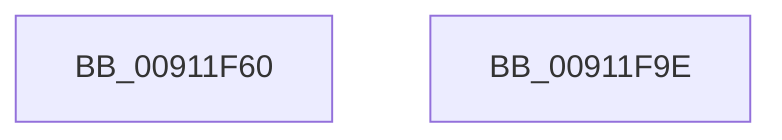

# PopNotifyCsStateExited

- RVA: `0x00911F60`–`0x00911F9F` (길이 `63` bytes)
- VA: `0x0000000140911F60`
- 실행 섹션: `PAGE`
- PDB 이름 있음: `예`; PDB Function 태그: `아니요`
- unwind 정보 RVA: `0x0005C788`
- 디코드: `14`개 명령, `63/63` bytes 표시
- 미해석 바이트: `0` (있으면 어셈블리에 `.byte`로 보존)

> 이 문서는 커널 이미지의 기계어와 PDB 기호를 분석해 생성했습니다. 4번과 5번은 함수 원형과 자료형을 바이너리 사용 방식에서 추정한 C 해석이며 원본 소스 복구 결과는 아닙니다.

## 1. Dependencies

- 직접 호출 지점: **4**; 고유 호출 대상: **4**
- 직접 호출자로 확인된 함수: **0**
- RIP 상대 이미지 참조: **3**

### Outgoing calls
- `0x00911F6B` → [PopAcquireRwLockExclusive](../../text/43/PopAcquireRwLockExclusive_function_00430B44.md) (function, `0x00430B44`)
- `0x00911F77` → [PopPowerAggregatorScheduleWorker](PopPowerAggregatorScheduleWorker_function_00912B9C.md) (function, `0x00912B9C`)
- `0x00911F88` → [PopPowerAggregatorDiagTraceEvent](PopPowerAggregatorDiagTraceEvent_function_00912184.md) (function, `0x00912184`)
- `0x00911F94` → [PopReleaseRwLock](../../text/2D/PopReleaseRwLock_function_002DFBBC.md) (function, `0x002DFBBC`)

### Direct callers
- 이 함수 시작 RVA로 연결되는 직접 call은 확인되지 않았습니다. 간접 호출은 완전히 역산할 수 없습니다.

### Static image references
- `0x00911F64` → RVA `0x00F09710` (`.data`; read)
- `0x00911F70` → RVA `0x00F09740` (`.data`; read)
- `0x00911F7F` → RVA `0x00011968` (`.rdata`; read)

## 2. Other-region calls and transfers

- 다른 실행 섹션으로 향하는 call: **2**
  - `0x00911F6B` → [PopAcquireRwLockExclusive](../../text/43/PopAcquireRwLockExclusive_function_00430B44.md) (`PAGE` → `.text`)
  - `0x00911F94` → [PopReleaseRwLock](../../text/2D/PopReleaseRwLock_function_002DFBBC.md) (`PAGE` → `.text`)
- 별도 외부 분기/꼬리 이동을 확인하지 못했습니다.

## 3. Assembly (complete function range)

```asm
00911F60  48 83 EC 28                     sub rsp, 0x28
00911F64  48 8D 0D A5 77 5F 00            lea rcx, [rip + 0x5f77a5]
00911F6B  E8 D4 EB B1 FF                  call 0x140430b44
00911F70  48 8D 0D C9 77 5F 00            lea rcx, [rip + 0x5f77c9]
00911F77  E8 20 0C 00 00                  call 0x140912b9c
00911F7C  45 33 C0                        xor r8d, r8d
00911F7F  48 8D 0D E2 F9 6F FF            lea rcx, [rip - 0x90061e]
00911F86  33 D2                           xor edx, edx
00911F88  E8 F7 01 00 00                  call 0x140912184
00911F8D  48 8D 0D 7C 77 5F 00            lea rcx, [rip + 0x5f777c]
00911F94  E8 23 DC 9C FF                  call 0x1402dfbbc
00911F99  48 83 C4 28                     add rsp, 0x28
00911F9D  C3                              ret
00911F9E  CC                              int3
```

## 4. C-style interpretation (structured pseudocode)

```c
__int64 __fastcall PopNotifyCsStateExited(__int64 a1, int a2, int a3)
{
    __int64 result;
    __int64 v_rsp;

    v_rsp = (v_rsp) - (40);
    result = PopAcquireRwLockExclusive(v_rip + 6256549, a2, a3, a4);
    result = PopPowerAggregatorScheduleWorker(v_rip + 6256585, a2, a3, a4);
    a3 = 0;
    a2 = 0;
    result = PopPowerAggregatorDiagTraceEvent(v_rip - 9438750, a2, a3, a4);
    result = PopReleaseRwLock(v_rip + 6256508, a2, a3, a4);
    v_rsp = (v_rsp) + (40);
    return result;
}
```

## 5. (Beta) C Style

```c
int64_t PopNotifyCsStateExited(int64_t Arg1, int32_t Arg2, int32_t Arg3)
{
    int64_t result;
    int64_t local_rsp;

    local_rsp = (local_rsp) - (40);
    result = PopAcquireRwLockExclusive(v_rip + 6256549, Arg2, Arg3, a4);
    result = PopPowerAggregatorScheduleWorker(v_rip + 6256585, Arg2, Arg3, a4);
    Arg3 = 0;
    Arg2 = 0;
    result = PopPowerAggregatorDiagTraceEvent(v_rip - 9438750, Arg2, Arg3, a4);
    result = PopReleaseRwLock(v_rip + 6256508, Arg2, Arg3, a4);
    local_rsp = (local_rsp) + (40);
    return result;
}
```

## 6. Execution-region graph

[열기: 2D/3D 그래프와 함수 탐색 컨트롤 패널](../../../control-panel.html?section=page&rva=0x00911F60&view=graph)

- 2D 그래프는 위에서 아래로 흐르고, 3D 그래프는 빈 공간을 드래그해 회전합니다. Shift+드래그는 이동, 휠은 확대·축소, 함수 노드 선택은 대상 보고서 이동입니다.

### Static fallback


