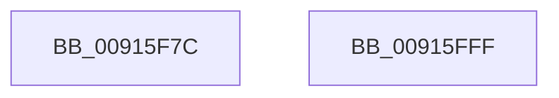

# PopPowerAggregatorAllocateLogEntry

- RVA: `0x00915F7C`–`0x00916000` (길이 `132` bytes)
- VA: `0x0000000140915F7C`
- 실행 섹션: `PAGE`
- PDB 이름 있음: `예`; PDB Function 태그: `아니요`
- unwind 정보 RVA: `0x0005FD94`
- 디코드: `30`개 명령, `132/132` bytes 표시
- 미해석 바이트: `0` (있으면 어셈블리에 `.byte`로 보존)

> 이 문서는 커널 이미지의 기계어와 PDB 기호를 분석해 생성했습니다. 4번과 5번은 함수 원형과 자료형을 바이너리 사용 방식에서 추정한 C 해석이며 원본 소스 복구 결과는 아닙니다.

## 1. Dependencies

- 직접 호출 지점: **2**; 고유 호출 대상: **2**
- 직접 호출자로 확인된 함수: **3**
- RIP 상대 이미지 참조: **0**

### Outgoing calls
- `0x00915FC2` → [memset](../../text/6C/memset_function_006C6C40.md) (function, `0x006C6C40`)
- `0x00915FD2` → [KeQueryInterruptTimePrecise](../../text/20/KeQueryInterruptTimePrecise_function_00209530.md) (function, `0x00209530`)

### Direct callers
- [PopPowerAggregatorInvokeStateMachine](PopPowerAggregatorInvokeStateMachine_function_00912038.md) at `0x0091204A`
- [PopPowerAggregatorInvokeStateMachine](PopPowerAggregatorInvokeStateMachine_function_00912038.md) at `0x009120D6`
- [PopPowerAggregatorRecordIntent](PopPowerAggregatorRecordIntent_function_00914850.md) at `0x00914948`
- [PopPowerAggregatorSetCurrentState](../98/PopPowerAggregatorSetCurrentState_function_0098A3B0.md) at `0x0098A3E7`

### Static image references
- 디코드된 RIP-relative 메모리 참조가 없습니다.

## 2. Other-region calls and transfers

- 다른 실행 섹션으로 향하는 call: **2**
  - `0x00915FC2` → [memset](../../text/6C/memset_function_006C6C40.md) (`PAGE` → `.text`)
  - `0x00915FD2` → [KeQueryInterruptTimePrecise](../../text/20/KeQueryInterruptTimePrecise_function_00209530.md) (`PAGE` → `.text`)
- 별도 외부 분기/꼬리 이동을 확인하지 못했습니다.

## 3. Assembly (complete function range)

```asm
00915F7C  48 89 5C 24 10                  mov qword ptr [rsp + 0x10], rbx
00915F81  48 89 74 24 18                  mov qword ptr [rsp + 0x18], rsi
00915F86  57                              push rdi
00915F87  48 83 EC 20                     sub rsp, 0x20
00915F8B  44 8B 81 C8 02 00 00            mov r8d, dword ptr [rcx + 0x2c8]
00915F92  48 8B F1                        mov rsi, rcx
00915F95  4D 69 C8 98 00 00 00            imul r9, r8, 0x98
00915F9C  41 FF C0                        inc r8d
00915F9F  8B FA                           mov edi, edx
00915FA1  41 83 E0 1F                     and r8d, 0x1f
00915FA5  33 D2                           xor edx, edx
00915FA7  44 89 81 C8 02 00 00            mov dword ptr [rcx + 0x2c8], r8d
00915FAE  41 B8 94 00 00 00               mov r8d, 0x94
00915FB4  49 8D 1C 09                     lea rbx, [r9 + rcx]
00915FB8  48 81 C1 D4 02 00 00            add rcx, 0x2d4
00915FBF  49 03 C9                        add rcx, r9
00915FC2  E8 79 0C DB FF                  call 0x1406c6c40
00915FC7  48 8D 4C 24 30                  lea rcx, [rsp + 0x30]
00915FCC  89 BB D0 02 00 00               mov dword ptr [rbx + 0x2d0], edi
00915FD2  E8 59 35 8F FF                  call 0x140209530
00915FD7  48 89 83 D8 02 00 00            mov qword ptr [rbx + 0x2d8], rax
00915FDE  48 8D 83 D0 02 00 00            lea rax, [rbx + 0x2d0]
00915FE5  48 8B 0E                        mov rcx, qword ptr [rsi]
00915FE8  48 8B 74 24 40                  mov rsi, qword ptr [rsp + 0x40]
00915FED  48 89 8B E0 02 00 00            mov qword ptr [rbx + 0x2e0], rcx
00915FF4  48 8B 5C 24 38                  mov rbx, qword ptr [rsp + 0x38]
00915FF9  48 83 C4 20                     add rsp, 0x20
00915FFD  5F                              pop rdi
00915FFE  C3                              ret
00915FFF  CC                              int3
```

## 4. C-style interpretation (structured pseudocode)

```c
__int64 __fastcall PopPowerAggregatorAllocateLogEntry(__int64 a1, int a2)
{
    __int64 result;
    __int64 v_rsp;
    unsigned __int64 v_stack_p10;
    unsigned __int64 v_stack_p18;
    unsigned __int64 v_stack_p8;

    v_stack_p10 = v_rbx;
    v_stack_p18 = v_rsi;
    v_rsp = (v_rsp) - (32);
    a4 = (a4) * ((unsigned int)(*(unsigned int *)(a1 + 712)));
    a3 = (unsigned int)(((unsigned int)(*(unsigned int *)(a1 + 712))) + 1);
    a3 = (unsigned int)((a3) & (31));
    a2 = 0;
    *(unsigned int *)(a1 + 712) = (unsigned int)(a3);
    a1 = (a1) + (724);
    a1 = (a1) + (a4);
    result = memset(a1, a2, 148, a4);
    *(unsigned int *)(a4 + a1 * 1 + 720) = (unsigned int)((unsigned int)(a2));
    result = KeQueryInterruptTimePrecise(v_stack_p8, a2, 148, a4);
    *(unsigned __int64 *)(a4 + a1 * 1 + 728) = result;
    *(unsigned __int64 *)(a4 + a1 * 1 + 736) = *(unsigned __int64 *)(a1);
    v_rsp = (v_rsp) + (32);
    return a4 + a1 * 1 + 720;
}
```

## 5. (Beta) C Style

```c
int64_t PopPowerAggregatorAllocateLogEntry(void *Arg1, int32_t Arg2)
{
    uint8_t *arg1 = (uint8_t *)Arg1;

    int64_t result;
    int64_t local_rsp;
    uint64_t v_stack_p10;
    uint64_t v_stack_p18;
    uint64_t v_stack_p8;

    v_stack_p10 = local_rbx;
    v_stack_p18 = local_rsi;
    local_rsp = (local_rsp) - (32);
    a4 = (a4) * ((uint32_t)(*(uint32_t *)(arg1 + 0x2C8)));
    a3 = (uint32_t)(((uint32_t)(*(uint32_t *)(arg1 + 0x2C8))) + 1);
    a3 = (uint32_t)((a3) & (31));
    Arg2 = 0;
    *(uint32_t *)(arg1 + 0x2C8) = (uint32_t)(a3);
    Arg1 = (Arg1) + (724);
    Arg1 = (Arg1) + (a4);
    result = memset(Arg1, Arg2, 148, a4);
    *(uint32_t *)(a4 + arg1 * 1 + 0x2D0) = (uint32_t)((uint32_t)(Arg2));
    result = KeQueryInterruptTimePrecise(v_stack_p8, Arg2, 148, a4);
    *(uint64_t *)(a4 + arg1 * 1 + 0x2D8) = result;
    *(uint64_t *)(a4 + arg1 * 1 + 0x2E0) = *(uint64_t *)(arg1);
    local_rsp = (local_rsp) + (32);
    return a4 + Arg1 * 1 + 720;
}
```

### 관측된 메모리 오프셋

구조체 형식이 확인되지 않은 접근은 인자 기준의 오프셋으로만 기록했습니다.

| 기준 인자 | 오프셋 표현 | 폭 (bit) | 접근 |
|---|---:|---:|---|
| `Arg1` | `+ 0x0` | `64` | `R` |
| `Arg1` | `+ 0x2C8` | `32` | `R` |
| `Arg1` | `+ 0x2C8` | `32` | `W` |

## 6. Execution-region graph

[열기: 2D/3D 그래프와 함수 탐색 컨트롤 패널](../../../control-panel.html?section=page&rva=0x00915F7C&view=graph)

- 2D 그래프는 위에서 아래로 흐르고, 3D 그래프는 빈 공간을 드래그해 회전합니다. Shift+드래그는 이동, 휠은 확대·축소, 함수 노드 선택은 대상 보고서 이동입니다.

### Static fallback


