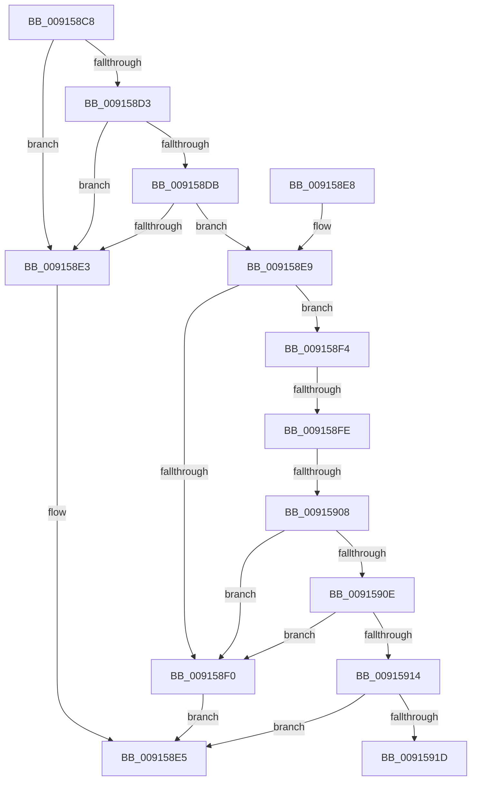

# PopPowerAggregatorAreTargetStatesEqual

- RVA: `0x009158C8`–`0x00915929` (길이 `97` bytes)
- VA: `0x00000001409158C8`
- 실행 섹션: `PAGE`
- PDB 이름 있음: `예`; PDB Function 태그: `예`
- unwind 정보 RVA: `0x000DB714`
- 디코드: `33`개 명령, `97/97` bytes 표시
- 미해석 바이트: `0` (있으면 어셈블리에 `.byte`로 보존)

> 이 문서는 커널 이미지의 기계어와 PDB 기호를 분석해 생성했습니다. 4번과 5번은 함수 원형과 자료형을 바이너리 사용 방식에서 추정한 C 해석이며 원본 소스 복구 결과는 아닙니다.

## 1. Dependencies

- 직접 호출 지점: **0**; 고유 호출 대상: **0**
- 직접 호출자로 확인된 함수: **1**
- RIP 상대 이미지 참조: **0**

### Outgoing calls
- 직접 디코드된 call 명령이 없습니다.

### Direct callers
- [PopPowerAggregatorRecordIntent](PopPowerAggregatorRecordIntent_function_00914850.md) at `0x009148EE`
- [PopPowerAggregatorRecordIntent](PopPowerAggregatorRecordIntent_function_00914850.md) at `0x009148FE`

### Static image references
- 디코드된 RIP-relative 메모리 참조가 없습니다.

## 2. Other-region calls and transfers

- 다른 실행 섹션으로 향하는 call: **0**
- call이 아닌 외부 분기/꼬리 이동: **3**
  - `0x009158F8` → `0x00B2199A` (`tail-transfer`)
  - `0x00915902` → `0x00B21984` (`tail-transfer`)
  - `0x00915924` → `0x00B219BB` (`tail-transfer`)

## 3. Assembly (complete function range)

```asm
009158C8  44 8B 01                        mov r8d, dword ptr [rcx]
009158CB  4C 8B C9                        mov r9, rcx
009158CE  44 3B 02                        cmp r8d, dword ptr [rdx]
009158D1  75 10                           jne 0x1409158e3
009158D3  8B 42 04                        mov eax, dword ptr [rdx + 4]
009158D6  39 41 04                        cmp dword ptr [rcx + 4], eax
009158D9  75 08                           jne 0x1409158e3
009158DB  8B 42 08                        mov eax, dword ptr [rdx + 8]
009158DE  39 41 08                        cmp dword ptr [rcx + 8], eax
009158E1  74 06                           je 0x1409158e9
009158E3  33 C9                           xor ecx, ecx
009158E5  8A C1                           mov al, cl
009158E7  C3                              ret
009158E8  CC                              int3
009158E9  33 C9                           xor ecx, ecx
009158EB  45 85 C0                        test r8d, r8d
009158EE  75 04                           jne 0x1409158f4
009158F0  B1 01                           mov cl, 1
009158F2  EB F1                           jmp 0x1409158e5
009158F4  41 83 E8 01                     sub r8d, 1
009158F8  0F 84 9C C0 20 00               je 0x140b2199a
009158FE  41 83 E8 01                     sub r8d, 1
00915902  0F 84 7C C0 20 00               je 0x140b21984
00915908  41 83 E8 01                     sub r8d, 1
0091590C  74 E2                           je 0x1409158f0
0091590E  41 83 F8 01                     cmp r8d, 1
00915912  75 DC                           jne 0x1409158f0
00915914  8A 42 18                        mov al, byte ptr [rdx + 0x18]
00915917  41 38 41 18                     cmp byte ptr [r9 + 0x18], al
0091591B  75 C8                           jne 0x1409158e5
0091591D  8B 42 1C                        mov eax, dword ptr [rdx + 0x1c]
00915920  41 39 41 1C                     cmp dword ptr [r9 + 0x1c], eax
00915924  E9 92 C0 20 00                  jmp 0x140b219bb
```

## 4. C-style interpretation (structured pseudocode)

```c
__int64 __fastcall PopPowerAggregatorAreTargetStatesEqual(__int64 a1, __int64 a2)
{
    if (((unsigned int)((unsigned int)(*(unsigned int *)(a1)))) != (*(unsigned int *)(a2))) goto loc_009158E3;
    if ((*(unsigned int *)(a1 + 4)) != ((unsigned int)((unsigned int)(*(unsigned int *)(a2 + 4))))) goto loc_009158E3;
    if ((*(unsigned int *)(a1 + 8)) == ((unsigned int)((unsigned int)(*(unsigned int *)(a2 + 8))))) goto loc_009158E9;
loc_009158E3:
    a1 = 0;
loc_009158E5:
    return 0;
loc_009158E9:
    a1 = 0;
    if ((unsigned int)((unsigned int)(*(unsigned int *)(a1))) != 0) goto loc_009158F4;
loc_009158F0:
    goto loc_009158E5;
loc_009158F4:
    a3 = (unsigned int)(((unsigned int)(*(unsigned int *)(a1))) - (1));
    a3 = (unsigned int)((a3) - (1));
    a3 = (unsigned int)((a3) - (1));
    if (condition_is_equal) goto loc_009158F0;
    if (((unsigned int)(a3)) != 1) goto loc_009158F0;
    if ((*(unsigned __int8 *)(a1 + 24)) != ((unsigned __int8)(*(unsigned __int8 *)(a2 + 24)))) goto loc_009158E5;
}
```

## 5. (Beta) C Style

```c
int64_t PopPowerAggregatorAreTargetStatesEqual(void *Arg1, void *Arg2)
{
    uint8_t *arg1 = (uint8_t *)Arg1;
    uint8_t *arg2 = (uint8_t *)Arg2;

    if (((uint32_t)((uint32_t)(*(uint32_t *)(arg1)))) != (*(uint32_t *)(arg2))) goto loc_009158E3;
    if ((*(uint32_t *)(arg1 + 0x4)) != ((uint32_t)((uint32_t)(*(uint32_t *)(arg2 + 0x4))))) goto loc_009158E3;
    if ((*(uint32_t *)(arg1 + 0x8)) == ((uint32_t)((uint32_t)(*(uint32_t *)(arg2 + 0x8))))) goto loc_009158E9;
loc_009158E3:
    Arg1 = 0;
loc_009158E5:
    return 0;
loc_009158E9:
    Arg1 = 0;
    if ((uint32_t)((uint32_t)(*(uint32_t *)(arg1))) != 0) goto loc_009158F4;
loc_009158F0:
    goto loc_009158E5;
loc_009158F4:
    a3 = (uint32_t)(((uint32_t)(*(uint32_t *)(arg1))) - (1));
    a3 = (uint32_t)((a3) - (1));
    a3 = (uint32_t)((a3) - (1));
    if (condition_is_equal) goto loc_009158F0;
    if (((uint32_t)(a3)) != 1) goto loc_009158F0;
    if ((*(uint8_t *)(arg1 + 0x18)) != ((uint8_t)(*(uint8_t *)(arg2 + 0x18)))) goto loc_009158E5;
}
```

### 관측된 메모리 오프셋

구조체 형식이 확인되지 않은 접근은 인자 기준의 오프셋으로만 기록했습니다.

| 기준 인자 | 오프셋 표현 | 폭 (bit) | 접근 |
|---|---:|---:|---|
| `Arg1` | `+ 0x0` | `32` | `R` |
| `Arg1` | `+ 0x4` | `32` | `R` |
| `Arg1` | `+ 0x8` | `32` | `R` |
| `Arg1` | `+ 0x18` | `8` | `R` |
| `Arg1` | `+ 0x1C` | `32` | `R` |
| `Arg2` | `+ 0x0` | `32` | `R` |
| `Arg2` | `+ 0x4` | `32` | `R` |
| `Arg2` | `+ 0x8` | `32` | `R` |
| `Arg2` | `+ 0x18` | `8` | `R` |
| `Arg2` | `+ 0x1C` | `32` | `R` |

## 6. Execution-region graph

[열기: 2D/3D 그래프와 함수 탐색 컨트롤 패널](../../../control-panel.html?section=page&rva=0x009158C8&view=graph)

- 2D 그래프는 위에서 아래로 흐르고, 3D 그래프는 빈 공간을 드래그해 회전합니다. Shift+드래그는 이동, 휠은 확대·축소, 함수 노드 선택은 대상 보고서 이동입니다.

### Static fallback


