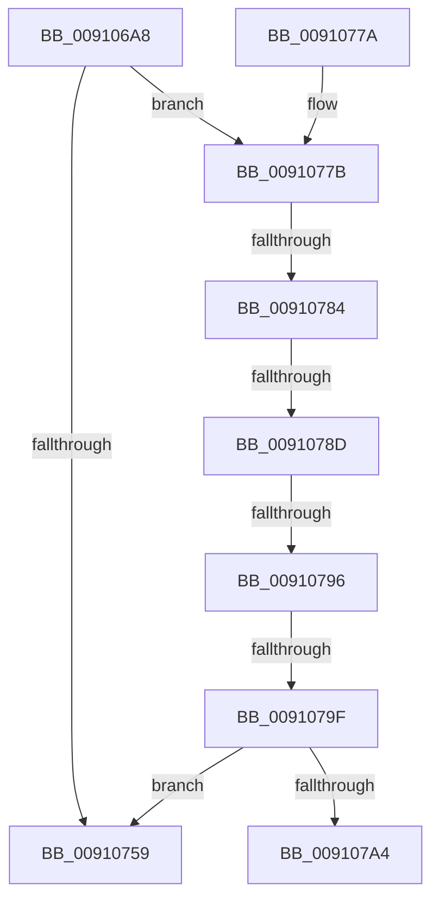

# PopPowerAggregatorDetermineTargetSystemPowerState

- RVA: `0x009106A8`–`0x009107A9` (길이 `257` bytes)
- VA: `0x00000001409106A8`
- 실행 섹션: `PAGE`
- PDB 이름 있음: `예`; PDB Function 태그: `예`
- unwind 정보 RVA: `0x0008A108`
- 디코드: `70`개 명령, `257/257` bytes 표시
- 미해석 바이트: `0` (있으면 어셈블리에 `.byte`로 보존)

> 이 문서는 커널 이미지의 기계어와 PDB 기호를 분석해 생성했습니다. 4번과 5번은 함수 원형과 자료형을 바이너리 사용 방식에서 추정한 C 해석이며 원본 소스 복구 결과는 아닙니다.

## 1. Dependencies

- 직접 호출 지점: **2**; 고유 호출 대상: **2**
- 직접 호출자로 확인된 함수: **2**
- RIP 상대 이미지 참조: **3**

### Outgoing calls
- `0x009106D1` → [memset](../../text/6C/memset_function_006C6C40.md) (function, `0x006C6C40`)
- `0x009106E2` → [PopFilterCapabilities](PopFilterCapabilities_function_0091141C.md) (function, `0x0091141C`)

### Direct callers
- [PopPowerAggregatorHandleResumeIntent](../../text/5D/PopPowerAggregatorHandleResumeIntent_function_005D91A0.md) at `0x005D91EF`
- [PopPowerAggregatorHandleSystemTransitionIntent](PopPowerAggregatorHandleSystemTransitionIntent_function_00910630.md) at `0x00910666`

### Static image references
- `0x009106DB` → RVA `0x00F0CEC0` (`.data`; read)
- `0x009106E7` → RVA `0x00F0CE68` (`.data`; read)
- `0x00910744` → RVA `0x00FC6D44` (`ALMOSTRO`; read)

## 2. Other-region calls and transfers

- 다른 실행 섹션으로 향하는 call: **1**
  - `0x009106D1` → [memset](../../text/6C/memset_function_006C6C40.md) (`PAGE` → `.text`)
- call이 아닌 외부 분기/꼬리 이동: **5**
  - `0x0091077E` → [sub_00B21422 + 0x1C](../B2/Unknown_function_00B21422.md) (`tail-transfer`)
  - `0x00910787` → [sub_00B21422 + 0x1C](../B2/Unknown_function_00B21422.md) (`tail-transfer`)
  - `0x00910790` → [sub_00B21422 + 0x1C](../B2/Unknown_function_00B21422.md) (`tail-transfer`)
  - `0x00910799` → [sub_00B21422](../B2/Unknown_function_00B21422.md) (`tail-transfer`)
  - `0x009107A4` → [sub_00B21422 + 0x31](../B2/Unknown_function_00B21422.md) (`tail-transfer`)

## 3. Assembly (complete function range)

```asm
009106A8  48 8B C4                        mov rax, rsp
009106AB  48 89 58 08                     mov qword ptr [rax + 8], rbx
009106AF  48 89 70 10                     mov qword ptr [rax + 0x10], rsi
009106B3  48 89 78 18                     mov qword ptr [rax + 0x18], rdi
009106B7  41 56                           push r14
009106B9  48 83 EC 70                     sub rsp, 0x70
009106BD  8A DA                           mov bl, dl
009106BF  4D 8B F0                        mov r14, r8
009106C2  33 D2                           xor edx, edx
009106C4  8B F1                           mov esi, ecx
009106C6  48 8D 48 A8                     lea rcx, [rax - 0x58]
009106CA  49 8B F9                        mov rdi, r9
009106CD  44 8D 42 4C                     lea r8d, [rdx + 0x4c]
009106D1  E8 6A 65 DB FF                  call 0x1406c6c40
009106D6  48 8D 54 24 20                  lea rdx, [rsp + 0x20]
009106DB  48 8D 0D DE C7 5F 00            lea rcx, [rip + 0x5fc7de]
009106E2  E8 35 0D 00 00                  call 0x14091141c
009106E7  4C 8B 15 7A C7 5F 00            mov r10, qword ptr [rip + 0x5fc77a]
009106EE  45 33 C9                        xor r9d, r9d
009106F1  44 38 4C 24 23                  cmp byte ptr [rsp + 0x23], r9b
009106F6  44 8B C6                        mov r8d, esi
009106F9  40 88 77 04                     mov byte ptr [rdi + 4], sil
009106FD  41 8B 42 3C                     mov eax, dword ptr [r10 + 0x3c]
00910701  89 47 08                        mov dword ptr [rdi + 8], eax
00910704  41 8B 42 58                     mov eax, dword ptr [r10 + 0x58]
00910708  89 47 0C                        mov dword ptr [rdi + 0xc], eax
0091070B  0F 95 C0                        setne al
0091070E  44 38 4C 24 24                  cmp byte ptr [rsp + 0x24], r9b
00910713  88 47 10                        mov byte ptr [rdi + 0x10], al
00910716  0F 95 C0                        setne al
00910719  44 38 4C 24 25                  cmp byte ptr [rsp + 0x25], r9b
0091071E  88 47 11                        mov byte ptr [rdi + 0x11], al
00910721  0F 95 C0                        setne al
00910724  44 38 4C 24 26                  cmp byte ptr [rsp + 0x26], r9b
00910729  88 47 12                        mov byte ptr [rdi + 0x12], al
0091072C  0F 95 C0                        setne al
0091072F  44 38 4C 24 28                  cmp byte ptr [rsp + 0x28], r9b
00910734  88 47 13                        mov byte ptr [rdi + 0x13], al
00910737  0F 95 C0                        setne al
0091073A  88 47 14                        mov byte ptr [rdi + 0x14], al
0091073D  8A 44 24 36                     mov al, byte ptr [rsp + 0x36]
00910741  88 47 15                        mov byte ptr [rdi + 0x15], al
00910744  44 39 0D F9 65 6B 00            cmp dword ptr [rip + 0x6b65f9], r9d
0091074B  0F 95 C0                        setne al
0091074E  88 47 16                        mov byte ptr [rdi + 0x16], al
00910751  41 8B C8                        mov ecx, r8d
00910754  83 E9 01                        sub ecx, 1
00910757  75 22                           jne 0x14091077b
00910759  45 89 06                        mov dword ptr [r14], r8d
0091075C  44 88 47 05                     mov byte ptr [rdi + 5], r8b
00910760  4C 8D 5C 24 70                  lea r11, [rsp + 0x70]
00910765  41 8B C1                        mov eax, r9d
00910768  49 8B 5B 10                     mov rbx, qword ptr [r11 + 0x10]
0091076C  49 8B 73 18                     mov rsi, qword ptr [r11 + 0x18]
00910770  49 8B 7B 20                     mov rdi, qword ptr [r11 + 0x20]
00910774  49 8B E3                        mov rsp, r11
00910777  41 5E                           pop r14
00910779  C3                              ret
0091077A  CC                              int3
0091077B  83 E9 01                        sub ecx, 1
0091077E  0F 84 BA 0C 21 00               je 0x140b2143e
00910784  83 E9 01                        sub ecx, 1
00910787  0F 84 B1 0C 21 00               je 0x140b2143e
0091078D  83 E9 01                        sub ecx, 1
00910790  0F 84 A8 0C 21 00               je 0x140b2143e
00910796  83 E9 01                        sub ecx, 1
00910799  0F 84 83 0C 21 00               je 0x140b21422
0091079F  83 F9 01                        cmp ecx, 1
009107A2  74 B5                           je 0x140910759
009107A4  E9 AA 0C 21 00                  jmp 0x140b21453
```

## 4. C-style interpretation (structured pseudocode)

```c
__int64 __fastcall PopPowerAggregatorDetermineTargetSystemPowerState(int a1, int a2, __int64 a3, __int64 a4)
{
    __int64 result;
    __int64 v_rsp;
    unsigned __int8 v_stack_m42;
    unsigned __int8 v_stack_m50;
    unsigned __int8 v_stack_m52;
    unsigned __int8 v_stack_m53;
    unsigned __int8 v_stack_m54;
    unsigned __int8 v_stack_m55;
    unsigned __int64 v_stack_m58;
    unsigned __int64 v_stack_m8;

    *(unsigned __int64 *)(v_rsp + 8) = v_rbx;
    *(unsigned __int64 *)(v_rsp + 16) = v_rsi;
    *(unsigned __int64 *)(v_rsp + 24) = v_rdi;
    v_rsp = (v_rsp) - (112);
    a2 = 0;
    result = memset(v_rsp - 88, a2, a2 + 76, a4);
    result = PopFilterCapabilities(v_rip + 6277086, v_stack_m58, a2 + 76, a4);
    a4 = 0;
    *(unsigned __int8 *)(a4 + 4) = (unsigned __int8)((unsigned int)(a1));
    *(unsigned int *)(a4 + 8) = (unsigned int)((unsigned int)(*(unsigned int *)(*(unsigned __int64 *)(v_rip + 6276986) + 60)));
    *(unsigned int *)(a4 + 12) = (unsigned int)((unsigned int)(*(unsigned int *)(*(unsigned __int64 *)(v_rip + 6276986) + 88)));
    result = (v_stack_m55 != 0) ? 1 : 0;
    *(unsigned __int8 *)(a4 + 16) = (unsigned __int8)(result);
    result = (v_stack_m54 != 0) ? 1 : 0;
    *(unsigned __int8 *)(a4 + 17) = (unsigned __int8)(result);
    result = (v_stack_m53 != 0) ? 1 : 0;
    *(unsigned __int8 *)(a4 + 18) = (unsigned __int8)(result);
    result = (v_stack_m52 != 0) ? 1 : 0;
    *(unsigned __int8 *)(a4 + 19) = (unsigned __int8)(result);
    result = (v_stack_m50 != 0) ? 1 : 0;
    *(unsigned __int8 *)(a4 + 20) = (unsigned __int8)(result);
    *(unsigned __int8 *)(a4 + 21) = (unsigned __int8)(v_stack_m42);
    result = ((*(unsigned int *)(v_rip + 7038457)) != 0) ? 1 : 0;
    *(unsigned __int8 *)(a4 + 22) = (unsigned __int8)(result);
    a1 = (unsigned int)(((unsigned int)((unsigned int)((unsigned int)((unsigned int)((unsigned int)(a1)))))) - (1));
    if (condition_is_not_equal) goto loc_0091077B;
loc_00910759:
    *(unsigned int *)(a3) = (unsigned int)((unsigned int)((unsigned int)((unsigned int)(a1))));
    *(unsigned __int8 *)(a4 + 5) = (unsigned __int8)((unsigned int)((unsigned int)((unsigned int)(a1))));
    return 0;
loc_0091077B:
    a1 = (unsigned int)((a1) - (1));
    a1 = (unsigned int)((a1) - (1));
    a1 = (unsigned int)((a1) - (1));
    a1 = (unsigned int)((a1) - (1));
    if (a1 == 1) goto loc_00910759;
}
```

## 5. (Beta) C Style

```c
int64_t PopPowerAggregatorDetermineTargetSystemPowerState(int32_t Arg1, int32_t Arg2, void *Arg3, void *Arg4)
{
    uint8_t *arg3 = (uint8_t *)Arg3;
    uint8_t *arg4 = (uint8_t *)Arg4;

    int64_t result;
    int64_t local_rsp;
    uint8_t v_stack_m42;
    uint8_t v_stack_m50;
    uint8_t v_stack_m52;
    uint8_t v_stack_m53;
    uint8_t v_stack_m54;
    uint8_t v_stack_m55;
    uint64_t v_stack_m58;
    uint64_t v_stack_m8;

    *(uint64_t *)(local_rsp + 0x8) = local_rbx;
    *(uint64_t *)(local_rsp + 0x10) = local_rsi;
    *(uint64_t *)(local_rsp + 0x18) = local_rdi;
    local_rsp = (local_rsp) - (112);
    Arg2 = 0;
    result = memset(local_rsp - 88, Arg2, Arg2 + 76, Arg4);
    result = PopFilterCapabilities(v_rip + 6277086, v_stack_m58, Arg2 + 76, Arg4);
    Arg4 = 0;
    *(uint8_t *)(arg4 + 0x4) = (uint8_t)((uint32_t)(Arg1));
    *(uint32_t *)(arg4 + 0x8) = (uint32_t)((uint32_t)(*(uint32_t *)(*(uint64_t *)(v_rip + 0x5FC77A) + 0x3C)));
    *(uint32_t *)(arg4 + 0xC) = (uint32_t)((uint32_t)(*(uint32_t *)(*(uint64_t *)(v_rip + 0x5FC77A) + 0x58)));
    result = (v_stack_m55 != 0) ? 1 : 0;
    *(uint8_t *)(arg4 + 0x10) = (uint8_t)(result);
    result = (v_stack_m54 != 0) ? 1 : 0;
    *(uint8_t *)(arg4 + 0x11) = (uint8_t)(result);
    result = (v_stack_m53 != 0) ? 1 : 0;
    *(uint8_t *)(arg4 + 0x12) = (uint8_t)(result);
    result = (v_stack_m52 != 0) ? 1 : 0;
    *(uint8_t *)(arg4 + 0x13) = (uint8_t)(result);
    result = (v_stack_m50 != 0) ? 1 : 0;
    *(uint8_t *)(arg4 + 0x14) = (uint8_t)(result);
    *(uint8_t *)(arg4 + 0x15) = (uint8_t)(v_stack_m42);
    result = ((*(uint32_t *)(v_rip + 0x6B65F9)) != 0) ? 1 : 0;
    *(uint8_t *)(arg4 + 0x16) = (uint8_t)(result);
    Arg1 = (uint32_t)(((uint32_t)((uint32_t)((uint32_t)((uint32_t)((uint32_t)(Arg1)))))) - (1));
    if (condition_is_not_equal) goto loc_0091077B;
loc_00910759:
    *(uint32_t *)(arg3) = (uint32_t)((uint32_t)((uint32_t)((uint32_t)(Arg1))));
    *(uint8_t *)(arg4 + 0x5) = (uint8_t)((uint32_t)((uint32_t)((uint32_t)(Arg1))));
    return 0;
loc_0091077B:
    Arg1 = (uint32_t)((Arg1) - (1));
    Arg1 = (uint32_t)((Arg1) - (1));
    Arg1 = (uint32_t)((Arg1) - (1));
    Arg1 = (uint32_t)((Arg1) - (1));
    if (Arg1 == 1) goto loc_00910759;
}
```

### 관측된 메모리 오프셋

구조체 형식이 확인되지 않은 접근은 인자 기준의 오프셋으로만 기록했습니다.

| 기준 인자 | 오프셋 표현 | 폭 (bit) | 접근 |
|---|---:|---:|---|
| `Arg3` | `+ 0x0` | `32` | `W` |
| `Arg4` | `+ 0x4` | `8` | `W` |
| `Arg4` | `+ 0x5` | `8` | `W` |
| `Arg4` | `+ 0x8` | `32` | `W` |
| `Arg4` | `+ 0xC` | `32` | `W` |
| `Arg4` | `+ 0x10` | `8` | `W` |
| `Arg4` | `+ 0x11` | `8` | `W` |
| `Arg4` | `+ 0x12` | `8` | `W` |
| `Arg4` | `+ 0x13` | `8` | `W` |
| `Arg4` | `+ 0x14` | `8` | `W` |
| `Arg4` | `+ 0x15` | `8` | `W` |
| `Arg4` | `+ 0x16` | `8` | `W` |

## 6. Execution-region graph

[열기: 2D/3D 그래프와 함수 탐색 컨트롤 패널](../../../control-panel.html?section=page&rva=0x009106A8&view=graph)

- 2D 그래프는 위에서 아래로 흐르고, 3D 그래프는 빈 공간을 드래그해 회전합니다. Shift+드래그는 이동, 휠은 확대·축소, 함수 노드 선택은 대상 보고서 이동입니다.

### Static fallback


